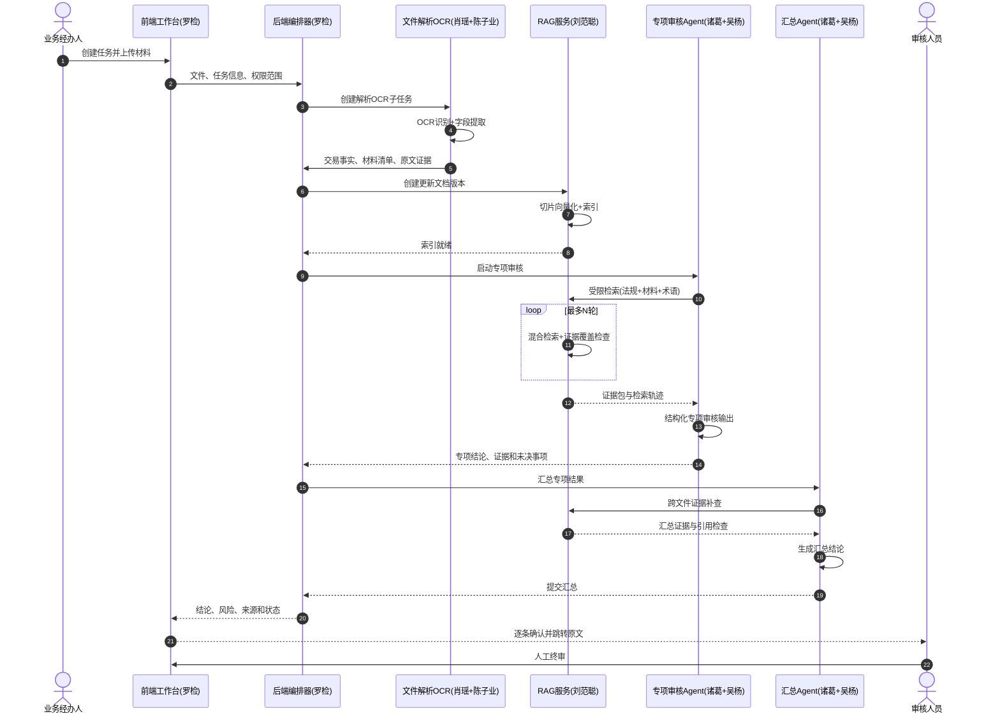

# Team 8 项目 Master

> 最后更新：2026-10-20

---

## 1. 团队分工

| 序号 | 成员 | 模块 | 联系方式 |
|:----:|------|------|----------|
| 1 | **罗检** | 前端工作台 + 后端任务编排 | 26263050030@m.fudan.edu.cn |
| 2 | **刘范聪** | RAG 服务 + AI 助手（慧眼），辅助审核 Agent | 26263050026@m.fudan.edu.cn |
| 3 | **诸葛 + 吴杨** | 专项审核 Agent，**诸葛负责答辩** | 26263050084@m.fudan.edu.cn / yangwu26@m.fudan.edu.cn |
| 4 | **陈子业 + 肖瑶** | 文件解析 + OCR，**负责部署** | ziyechen26@m.fudan.edu.cn / 26263050060@m.fudan.edu.cn |

### 分工时序图



---

## 2. 当前状态

| 序号 | 模块 | 负责人 | 进度 |
|:----:|------|--------|------|
| 1 | 前端工作台 + 后端编排 | 罗检 | 🚧 持续迭代 |
| 2 | 规则引擎（20 条） | 罗检 | 🚧 持续迭代 |
| 3 | AI 助手（慧眼） | 刘范聪 | 🚧 持续迭代 |
| 4 | RAG 本地引擎 | 刘范聪 | 🚧 持续迭代 |
| 5 | 文件解析 Agent | 陈子业 + 肖瑶 | 🚧 Mock → 真实实现 |
| 6 | OCR 服务 | 陈子业 + 肖瑶 | 🚧 待部署 |
| 7 | 专项审核 Agent | 诸葛 + 吴杨 | 🚧 Mock → 真实实现 |
| 8 | RAGFlow 底座 | 刘范聪 | ⏳ 待部署 |
| 9 | 部署上线 | 陈子业 + 肖瑶 | ⏳ 待开始 |
| 10 | 答辩准备 | 诸葛 | 🚧 梳理业务与技术选型 |

---

## 3. 系统结构

### 整体架构

```
境外贷款单据智能审核平台
│
├─ 前端层（端口 5173）— 罗检
│  ├─ Vue 3 + TypeScript + Element Plus
│  ├─ 登录 & 权限守卫
│  ├─ 任务创建 & 上传
│  ├─ 规则核对 & AI 审核
│  ├─ PDF 原文定位（bbox 高亮）
│  └─ AI 助手「慧眼」对话界面
│
├─ 后端层（端口 8000）— 罗检
│  ├─ FastAPI + SQLAlchemy
│  ├─ JWT 鉴权 & 角色权限
│  ├─ 任务编排 & 状态流转
│  ├─ parse_agent.py — 文件解析（Mock）— 陈子业 + 肖瑶
│  ├─ review_agent.py — 专项审核（Mock）— 诸葛 + 吴杨
│  ├─ assistant_service.py — AI 助手（SSE 流式）— 刘范聪
│  └─ rule_engine/ — 20 条硬性规则 — 罗检
│
├─ RAG 服务（端口 8010）— 刘范聪
│  ├─ 独立 Python 服务
│  ├─ 百炼 Embedding + SQLite 本地引擎
│  ├─ /api/v1/query — 业务规则 & 项目设计查询
│  ├─ /api/v1/documents — 文档上传 & 解析
│  └─ （待部署）RAGFlow 正式底座
│
├─ OCR 服务（待部署）— 陈子业 + 肖瑶
│  ├─ 文本层 PDF 直接提取
│  ├─ 扫描 PDF / 图片进入 OCR
│  └─ 保留页码 & bbox 坐标
│
└─ 数据层
   ├─ PostgreSQL — 任务、单据、结果
   └─ 文件存储 — sample_pdfs、uploads
```

### 代码目录

| 序号 | 目录 | 负责人 | 说明 |
|:----:|------|--------|------|
| 1 | `code/backend/` | 罗检 | FastAPI 后端，源码全在 `app/` |
| 2 | `code/frontend/` | 罗检 | Vue 3 前端，源码全在 `src/` |
| 3 | `code/rag-service/` | 刘范聪 | 独立 RAG 服务，不合并到 backend |
| 4 | `code/ocr_demo/` | 陈子业 + 肖瑶 | OCR 服务，待部署 |
| 5 | `docs/` | 全员 | 技术文档、架构图、交接说明 |
| 6 | `mockup/` | 全员 | 各成员 HTML 设计稿 |

---

## 4. 基础设施

### 4.1 ECS 服务器
```
IP: [请通过汇丰授权的资源渠道获取]
用户: [请通过汇丰授权的资源渠道获取]
密码: [请通过安全渠道获取，不在文档保存]
SSH: 使用已授权的密钥与主机指纹配置连接
```

### 4.2 PostgreSQL
```
地址: [请通过汇丰授权的资源渠道获取]
库名: team08
用户: [请通过汇丰授权的资源渠道获取]
密码: [请通过安全渠道获取，不在文档保存]
```

### 4.3 百炼 API
```
Base URL: https://llm-tlndh47wd9ustbss.cn-beijing.maas.aliyuncs.com/compatible-mode/v1
API Key: [请通过团队密钥管理渠道获取，不在文档保存]
LLM: qwen3.8-flash
Embedding: qwen3.7-text-embedding-flash
```

---

## 5. 重要链接

1. **GitHub**：https://github.com/HBCN-AI-Campaign/HBCN-AI-Campaign-Team8
2. **百度网盘**：https://pan.baidu.com/s/4pUSzh0
3. **技术文档**：[docs/README.md](docs/README.md)
