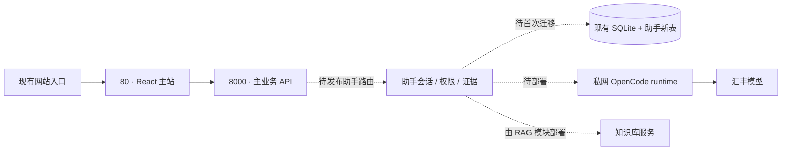
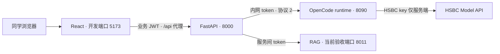

# 助手发布交付

本目录只交付 OpenCode runtime，主站与 RAG 沿用各自发布流程。[总设计与接口](../../../docs/ai-assistant/README.md) · [当前验收](../../../docs/ai-assistant/持续优化实施规划.md)。模板未在比赛 ECS 安装，不表示已上线。

对外接入统一走[助手 V1](../../../docs/ai-assistant/对外接口V1.md)，不直接开放本 runtime。主后端 release 须包含同仓库 `code/assistant-sdk`；在 backend 安装 `requirements-assistant.txt` 会安装该包，旧 `app.assistant_client` 转为兼容导入。其他调用模块可单独安装 SDK，不需要部署主后端源码。

## 0. 现有比赛云环境（2026-10-22 只读核对）

| 已核对事实 | 助手发布需要做什么 |
|---|---|
| Ubuntu 24.04 / x86_64，网站现已运行 | 继续使用现有云主站；Linux 验收对应这个目标，不另建网站入口 |
| `/home/frontend` 的 Vite `dev --host 0.0.0.0 --port 80` 直接监听 80；源目录无助手路由/API 调用，也没有 `@ant-design/x` 依赖或 `dist/` | 当前是 React 开发服务器，不是静态生产构建；主站发布必须纳入助手路由及 Ant Design X，然后转为版本化静态构建。不能只增后端 |
| `/home/backend` 的 FastAPI 监听 8000，OpenAPI 无助手路由 | 主站负责人合入助手路由/配置，在新 release 验证后切换；不原地覆盖正在运行的目录 |
| 80/8000 进程由 root 登录 shell 启动，处于 transient session scope，未绑定可用 systemd unit | 未来发布须由站点负责人明确交接进程所有权/回滚方式，再分别做版本化服务托管；不直接 kill 或覆盖 PID |
| 现有 SQLite 只有主业务表，无助手表 | 备份现有库后执行助手迁移；本版首次迁移会创建全部助手表，不依赖启动时 create_all |
| backend 没有 `.env`；进程没有任何 DB/JWT/assistant 配置变量，SQLite 仅有 users/tasks/documents/check_results；当前 Python 环境未安装 Alembic 与 HTTPX | 现有运行未体现部署所需配置。不能让新 release 默默指向空默认数据库或直接沿用示例 JWT Secret；主站 owner 必须通过批准渠道交接 DB 位置、JWT 配置及 requirements 安装策略。现有后端配置由主站模块所有，助手部署不改它 |
| 未发现 8090/8010/8011 监听服务 | runtime 和 RAG 在该机的部署尚需完成；RAG 由其模块负责，不把本机服务状态写成云端就绪 |

本次仅 SSH 读取系统/监听/目录/业务表结构、进程环境变量名（不读值）与 OpenAPI，连接沿用团队资源与已固定的主机指纹；没有发布文件、运行迁移、重启进程或查询业务记录内容。登录资料仍由团队安全渠道提供，此文不保存密码、IP 或 HSBC key。监听状态会变化，正式切换前需重新核对。

切换主站 release 时特别核对：`DATABASE_URL` 必须继续指向原业务库的绝对位置，不能因工作目录改变而创建空库；现有 uploads/sample_pdfs 的挂载或受控链接也要保留。当前源码的这些目录随 backend 根目录解析，由主站发布者安排持久化映射。助手发布不执行 seed、不复制真实单据进 release、不改变业务账号/JWT 配置。备份与恢复按主站流程完成后，再对同一个库执行助手迁移。



## 1. 固定版本，独立发布

在独立 release 目录安装锁文件并验证，保留上一版本；避免覆盖主站运行目录。

```bash
cd /opt/hbcn/releases/<commit>/code/assistant-runtime
bun install --frozen-lockfile --ignore-scripts
bun run typecheck
bun test
bun run build
```

运行目录必须同时包含 dist/ 和 .opencode/skills/。正式运行无需源码或 node_modules，但 Bun 版本与构建版本应一致。当前验证版本 1.4.3；目标 Linux CPU/系统仍须验证，Windows 构建成功不代替 Linux 验收。

Linux 可执行 `bash scripts/linux-acceptance.sh`：临时安装官方 npm 包内的固定 Bun，复制源码/锁文件/技能进行安装、类型检查、源码及独立发布包测试、构建；不复制 .env，不修改现有服务。需要 npm 和 Linux x86_64/aarch64；首次要下载依赖。

## 2. 安全渠道交付配置

参考 ../.env.example，把 AI_BASE_URL、AI_API_KEY、AI_MODEL、ASSISTANT_RUNTIME_TOKEN、AI_REQUEST_TIMEOUT_MS 放入 /etc/hbcn/runtime.env。与主后端的 runtime token 对齐，凭证不进仓库和前端。环境文件属主/权限限制为运行账号所需范围。runtime 的 `/readyz` 返回 `assistant_protocol: 2`，本版主后端要求此精确协议值；同时切换 runtime 与主后端版本，旧 runtime 不会显示就绪，也不接收新问答请求。

使用专用 hbcn 账号；部署者确认该账号和目录已准备好。Bun 放在 /usr/local/bin/bun 或修改 unit 为实际绝对路径；ProtectHome 会阻止从个人 home 执行 Bun。不要为通过启动而直接关闭所有保护，先检查具体写入需求。

## 3. 复核 systemd unit 后启动

[服务模板](hbcn-assistant-runtime.service)使用 Linux/systemd 现有能力管理进程和私有临时目录。先核对服务名、路径、端口与归属；已有同名服务时先检查，不覆盖。确认 release 后再切换 /opt/hbcn/current，按部署流程安装 unit。

```bash
systemd-analyze verify hbcn-assistant-runtime.service
sudo systemctl daemon-reload
sudo systemctl start hbcn-assistant-runtime
sudo systemctl status hbcn-assistant-runtime
sudo journalctl -u hbcn-assistant-runtime --since '-5 minutes'
```

默认只监听回环 8090；浏览器经主站业务 JWT 调用助手，不开放 runtime 公网入口。分机部署时限定私网地址与防火墙来源。同学用网站 URL 与业务账号登录，无需 runtime token 或 HSBC key。容器环境可选 ../docker-compose.yml，与 systemd 二选一；容器方案仍须真实 Docker 验收。

## 4. 开发机启动与端口对齐

首次分别在 runtime 和 backend 目录复制 `.env.example` 为 `.env`，用安全方式填入团队授权配置，勿覆盖已有文件。两个文件的 `ASSISTANT_RUNTIME_TOKEN` 相同；HSBC key 仅 runtime 需要。后端先安装 `requirements-assistant.txt`，业务数据库按主站流程初始化/升级，再执行助手迁移。激活后端虚拟环境后，在三个终端分别运行：

| 目录 | 命令 | 默认位置 |
|---|---|---|
| code/assistant-runtime | `bun install --frozen-lockfile`，`bun run start` | 127.0.0.1:8090，仅后端调用 |
| code/backend | `python -m alembic -c assistant-alembic.ini upgrade head`，`python -m app.assistant_preflight`，`python -m uvicorn app.main:app --host 127.0.0.1 --port 8000 --workers 1` | 主业务 API 8000 |
| code/frontend | `npm ci`，`npm run dev` | 浏览器 5173/assistant（需登录） |

Windows 在 `code/backend` 下用 `.venv\Scripts\Activate.ps1`，Linux 用 `source .venv/bin/activate` 激活环境。端口不同则对应调整 backend 的 `ASSISTANT_RUNTIME_URL` 及 frontend 的 `.env.local` 中 `HBCN_API_TARGET`；它们都是服务地址，不是 API key。当前 RAG 验收地址为 8011；旧 8010 实例不代表本轮 RAG 版本，RAG 本身仍由其模块流程部署，不能当作主业务 API。



`preflight --require-rag` 还要求 RAG 授权就绪接口通过。网页和每次 AI 调用都会核对 runtime 的版本；显示“协议版本不一致”时应部署同一 release 并重启 runtime。正确 token 和协议也不等于 HSBC 请求一定成功，仍须实际合成任务问答及引用验收。生产网站无需 Vite，沿用主站静态站点与 API 代理。

### 当前本机实例（2026-10-22）

本轮保留其他会话的旧进程，另启当前助手 API；不把本机配置写成团队固定地址。

| 入口 | 当前状态 |
|---|---|
| `http://127.0.0.1:5173/assistant` | 正式 React/Vite 助手页，代理到 8003 |
| `http://127.0.0.1:8003/api/assistant/v1` | 当前源码 API，单 worker，沿用既有本机库和登录账号 |
| `http://127.0.0.1:8092` | 已存在且协议/鉴权通过的 OpenCode runtime，汇丰 qwen3.8-flash |
| 8000 / 8002 / 8010 | 旧服务原样保留，OpenAPI 未提供助手 V1 或本轮 RAG ready |
| 8011 | 未监听，`rag_available=false`；未启动/更改 RAG 同学服务 |

启动采用**进程环境覆盖**，没有重写共享 `.env`。若上述进程退出，在核对端口空闲、runtime 8092 仍已授权就绪后，可分别在两个 PowerShell 终端恢复（先激活后端虚拟环境；前端需可用的 Node/npm）：

```powershell
# code/backend
$env:ASSISTANT_RUNTIME_URL='http://127.0.0.1:8092'
$env:DEBUG='false'
python -m uvicorn app.main:app --host 127.0.0.1 --port 8003 --workers 1
```

```powershell
# code/frontend
$env:HBCN_API_TARGET='http://127.0.0.1:8003'
npm run dev -- --host 127.0.0.1 --port 5173 --strictPort
```

本机本轮 npm 不在 PATH，实际直接用已安装 Node 运行 `node_modules/vite/bin/vite.js`，参数同上；未更改 package.json 或 lockfile。停止时只停止自己启动的这两个实例，不依据端口批量杀其他会话进程。

经 **5173 真实 HTTP 代理 → 8003 → OpenCode → 汇丰** 的能力说明问答约 **14.2 秒**通过，包含正常主站登录、V1 契约、同键同 run、保存游标结果恢复；临时验收会话已删除。真实 RAG 尚未联通，不是云端/负载或双浏览器联合验收。普通本机预检通过；生产 JWT 弱默认值仍须由云站负责人正确配置，不能以本机演示代替生产预检。

## 5. 只读预检 → 实际问答 → 回滚演练

主后端使用 requirements-assistant.txt；先按业务模块流程升级旧业务表，再运行助手独立迁移。以下在 code/backend 下执行，使用该部署的环境配置：

```bash
python -m alembic -c assistant-alembic.ini upgrade head
python -m app.assistant_preflight --require-rag --production
```

预检退出码 0 表示数据库结构/迁移/运行唯一约束、runtime 鉴权与协议、RAG 既有授权就绪接口，以及生产 JWT/DEBUG 配置通过；不写库、不发模型请求、不打印连接串或凭证。目标云端验收使用 `--require-rag --production`；本机开发可省略 `--production`，报告仍会显示生产配置是否安全。不要将预检通过称为模型质量或外部 API 授权验收。

随后用团队两个审核账号，从现有网站入口完成邀请、历史、具名讨论、AI 问答、引用、停止/刷新恢复和撤权测试。主后端当前只支持单实例单 worker；同学拉取后必须通过团队渠道取得授权配置。

可先安装独立 SDK，使用其[双账号 HTTP 验收命令](../../assistant-sdk/README.md)检查发布后的站点：`python -m hbcn_assistant.verify --site <网站根地址> --task <获准演示任务> --expert-id <第二审核账号ID> --live --require-rag`。两个 JWT 从环境变量注入，不放命令行；仅新增并清理一个助手会话，不改业务任务。接口失败/清理失败返回非零；RAG ready 不证明真实检索质量，仍须检索引用与浏览器验收。现有站点未发布 V1 时该命令应失败，不能改为跳过契约检查。

独立 PostgreSQL 机制验收：通过安全环境变量 `HBCN_ASSISTANT_TEST_POSTGRES_URL` 提供获准的测试库连接（`postgresql+psycopg2`），在 backend 执行 `python -m tests.postgres_assistant_acceptance --live-database`。测试账号须有创建/删除 schema 权限；仅在随机 `assistant_acceptance_...` schema 建合成业务表并迁移，使用 4 连接并发、非 UTC 会话、双 JWT API，结束删除本次 schema；不隐式读取主站 DATABASE_URL，不修改 public/RAG schema，不调用真实模型。报告失败阶段/清理状态，失败退出非零；若 cleanup_complete=false，管理员按报告 cleanup_schema 核对处理。不要为此给生产应用账号永久授予建 schema 权限。

本机 PostgreSQL 18.3/Asia-Shanghai 已通过上述验证；模型为 mock、API 为 ASGI，不表示汇丰数据库、浏览器、TLS、吞吐或真实模型联合验收。助手写入的时间统一为 UTC，物理列保持原类型；早期 PG 数据若曾由旧代码写入，按原部署会话时区审计，工具不批量改写历史。

失败时恢复上一版本的链接和配置并重启本项服务，保留助手新增表/历史，禁止用删库回滚。涉及主站重启由其部署负责人执行，不猜测或停止 80/8000 上的既有服务。
