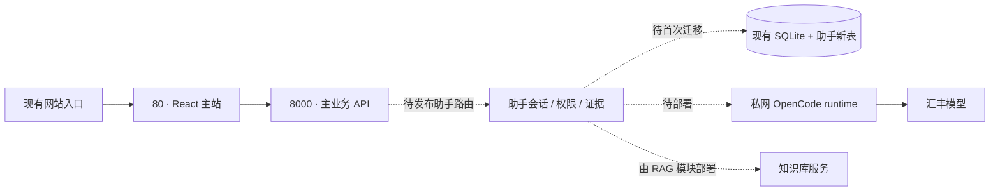
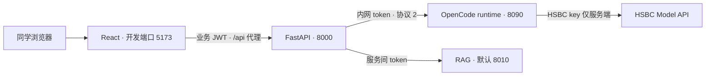

# 助手发布交付

本目录只交付 OpenCode runtime，主站与 RAG 沿用各自发布流程。[总设计与接口](../../../docs/ai-assistant/README.md) · [当前验收](../../../docs/ai-assistant/持续优化实施规划.md)。模板未在比赛 ECS 安装，不表示已上线。

## 0. 现有比赛云环境（2026-10-22 只读核对）

| 已核对事实 | 助手发布需要做什么 |
|---|---|
| Ubuntu 24.04 / x86_64，网站现已运行 | 继续使用现有云主站；Linux 验收对应这个目标，不另建网站入口 |
| `/home/frontend` 的 React/Ant Design 前端监听 80 | 前端负责人发布包含 Ant Design X 与 /assistant 路由的固定版本构建 |
| `/home/backend` 的 FastAPI 监听 8000，OpenAPI 无助手路由 | 主站负责人合入助手路由/配置，在新 release 验证后切换；不原地覆盖正在运行的目录 |
| 现有 SQLite 只有主业务表，无助手表 | 备份现有库后执行助手迁移；本版首次迁移会创建全部助手表，不依赖启动时 create_all |
| 未发现 8090/8010/8011 监听服务 | runtime 和 RAG 在该机的部署尚需完成；RAG 由其模块负责，不把本机服务状态写成云端就绪 |

本次仅 SSH 读取系统/监听/目录/业务表结构与 OpenAPI，连接沿用团队资源与已固定的主机指纹；没有发布文件、运行迁移、重启进程或查询业务单据内容。登录资料仍由团队安全渠道提供，此文不保存密码、IP 或 HSBC key。监听状态会变化，正式切换前需重新核对。

切换主站 release 时特别核对：`DATABASE_URL` 必须继续指向原业务库的绝对位置，不能因工作目录改变而创建空库；现有 uploads/sample_pdfs 的挂载或受控链接也要保留。当前源码的这些目录随 backend 根目录解析，由主站发布者安排持久化映射。助手发布不执行 seed、不复制真实单据进 release、不改变业务账号/JWT 配置。备份与恢复按主站流程完成后，再对同一个库执行助手迁移。



## 1. 固定版本，独立发布

在独立 release 目录安装锁文件并验证，保留上一版本；避免覆盖主站运行目录。

```bash
cd /opt/hbcn/releases/<commit>/code/assistant-runtime
bun install --frozen-lockfile --ignore-scripts
bun run typecheck
bun test
bun run build
```

运行目录必须同时包含 dist/ 和 .opencode/skills/。正式运行无需源码或 node_modules，但 Bun 版本与构建版本应一致。当前验证版本 1.4.3；目标 Linux CPU/系统仍须验证，Windows 构建成功不代替 Linux 验收。

Linux 可执行 `bash scripts/linux-acceptance.sh`：临时安装官方 npm 包内的固定 Bun，复制源码/锁文件/技能进行安装、类型检查、源码及独立发布包测试、构建；不复制 .env，不修改现有服务。需要 npm 和 Linux x86_64/aarch64；首次要下载依赖。

## 2. 安全渠道交付配置

参考 ../.env.example，把 AI_BASE_URL、AI_API_KEY、AI_MODEL、ASSISTANT_RUNTIME_TOKEN、AI_REQUEST_TIMEOUT_MS 放入 /etc/hbcn/runtime.env。与主后端的 runtime token 对齐，凭证不进仓库和前端。环境文件属主/权限限制为运行账号所需范围。runtime 的 `/readyz` 返回 `assistant_protocol: 2`，本版主后端要求此精确协议值；同时切换 runtime 与主后端版本，旧 runtime 不会显示就绪，也不接收新问答请求。

使用专用 hbcn 账号；部署者确认该账号和目录已准备好。Bun 放在 /usr/local/bin/bun 或修改 unit 为实际绝对路径；ProtectHome 会阻止从个人 home 执行 Bun。不要为通过启动而直接关闭所有保护，先检查具体写入需求。

## 3. 复核 systemd unit 后启动

[服务模板](hbcn-assistant-runtime.service)使用 Linux/systemd 现有能力管理进程和私有临时目录。先核对服务名、路径、端口与归属；已有同名服务时先检查，不覆盖。确认 release 后再切换 /opt/hbcn/current，按部署流程安装 unit。

```bash
systemd-analyze verify hbcn-assistant-runtime.service
sudo systemctl daemon-reload
sudo systemctl start hbcn-assistant-runtime
sudo systemctl status hbcn-assistant-runtime
sudo journalctl -u hbcn-assistant-runtime --since '-5 minutes'
```

默认只监听回环 8090；浏览器经主站业务 JWT 调用助手，不开放 runtime 公网入口。分机部署时限定私网地址与防火墙来源。同学用网站 URL 与业务账号登录，无需 runtime token 或 HSBC key。容器环境可选 ../docker-compose.yml，与 systemd 二选一；容器方案仍须真实 Docker 验收。

## 4. 开发机启动与端口对齐

首次分别在 runtime 和 backend 目录复制 `.env.example` 为 `.env`，用安全方式填入团队授权配置，勿覆盖已有文件。两个文件的 `ASSISTANT_RUNTIME_TOKEN` 相同；HSBC key 仅 runtime 需要。后端先安装 `requirements-assistant.txt`，业务数据库按主站流程初始化/升级，再执行助手迁移。激活后端虚拟环境后，在三个终端分别运行：

| 目录 | 命令 | 默认位置 |
|---|---|---|
| code/assistant-runtime | `bun install --frozen-lockfile`，`bun run start` | 127.0.0.1:8090，仅后端调用 |
| code/backend | `python -m alembic -c assistant-alembic.ini upgrade head`，`python -m app.assistant_preflight`，`python -m uvicorn app.main:app --host 127.0.0.1 --port 8000 --workers 1` | 主业务 API 8000 |
| code/frontend | `npm ci`，`npm run dev` | 浏览器 5173/assistant（需登录） |

Windows 在 `code/backend` 下用 `.venv\Scripts\Activate.ps1`，Linux 用 `source .venv/bin/activate` 激活环境。端口不同则对应调整 backend 的 `ASSISTANT_RUNTIME_URL` 及 frontend 的 `.env.local` 中 `HBCN_API_TARGET`；它们都是服务地址，不是 API key。RAG 使用其模块的部署流程与默认 8010，不能当作主业务 API。



`preflight --require-rag` 还要求 RAG 授权就绪接口通过。网页和每次 AI 调用都会核对 runtime 的版本；显示“协议版本不一致”时应部署同一 release 并重启 runtime。正确 token 和协议也不等于 HSBC 请求一定成功，仍须实际合成任务问答及引用验收。生产网站无需 Vite，沿用主站静态站点与 API 代理。

## 5. 只读预检 → 实际问答 → 回滚演练

主后端使用 requirements-assistant.txt；先按业务模块流程升级旧业务表，再运行助手独立迁移。以下在 code/backend 下执行，使用该部署的环境配置：

```bash
python -m alembic -c assistant-alembic.ini upgrade head
python -m app.assistant_preflight --require-rag
```

预检退出码 0 表示数据库结构/迁移/运行唯一约束、runtime 鉴权与本地配置、RAG 既有授权就绪接口通过；不写库、不发模型请求、不打印连接串或凭证。省略 --require-rag 可检查普通问答依赖，但结果会明确标注 RAG 未检查。不要将预检通过称为模型质量或外部 API 授权验收。

随后用团队两个审核账号，从现有网站入口完成邀请、历史、具名讨论、AI 问答、引用、停止/刷新恢复和撤权测试。主后端当前只支持单实例单 worker；同学拉取后必须通过团队渠道取得授权配置。

失败时恢复上一版本的链接和配置并重启本项服务，保留助手新增表/历史，禁止用删库回滚。涉及主站重启由其部署负责人执行，不猜测或停止 80/8000 上的既有服务。
