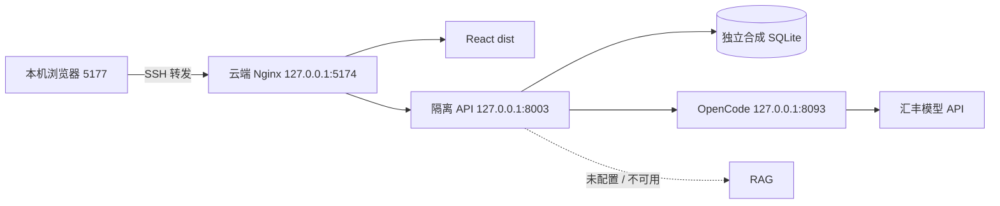
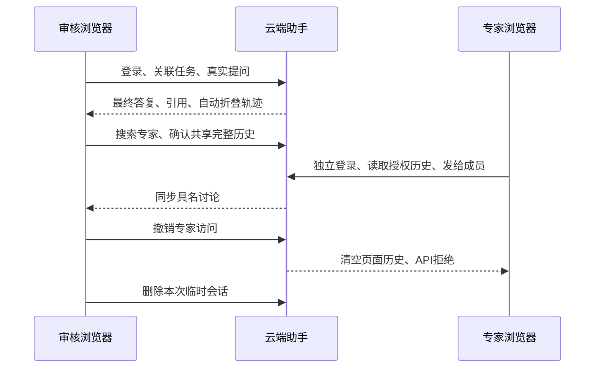

# 云端隔离预览 · 2026-10-22

已在现有 Ubuntu 24.04 云电脑启动 **57563ed** 候选包：React 静态构建、FastAPI、OpenCode、汇丰真实模型。此预览用于验收；正式主站仍按仓库版本统一部署。



| 交接项 | 实际位置 / 边界 |
|---|---|
| 预览目录 | `/opt/hbcn-assistant-preview/current`，源码包清单/哈希保留于 release |
| 运行数据 | `/var/lib/hbcn-assistant-preview`；只有 2 个合成审核账号和 1 个合成任务；不复制主站业务库 |
| 服务配置 | `/etc/hbcn-assistant-preview`；JWT、内部 token、汇丰 key 和账号口令不进仓库 |
| 运行账号 | `hbcn-assistant-preview`；API 单 worker，三个服务仅回环监听 |
| 服务单元 | `hbcn-assistant-preview-{web,api,runtime}.service`；已启动，未启用开机自启 |
| Nginx / Bun | Ubuntu Nginx 1.24.0-2ubuntu7.18 仅解包至 preview/tooling；Bun 1.4.3，不替换系统安装 |
| 预览访问 | 当前开发机 SSH 隧道 `http://127.0.0.1:5177/assistant`；隧道退出即不可访问，其他电脑需自己的获准 SSH 转发 |
| 原主站 | 80/8000 原进程、数据及认证配置未改；正式发布由团队统一切换 |

预览账号由安全渠道交付，不使用公开测试口令。候选包中的真实业务 PDF、凭证、业务 DB、RAG 实现/数据、依赖目录均排除。Nginx 仅承载本预览，不作为全站网关选型变更。

## 已验收

- 干净 Linux / Python 3.12 安装：后端 **90** 项、SDK **8** 项、依赖一致性、启动/docs/V1 鉴权通过；临时验证目录已清理。
- 云端独立业务表 → 助手增量迁移、强 JWT / DEBUG=false 的只读预检通过；构建静态资源返回正确类型，未登录助手 API 返回 401。
- 云端 **Nginx → API → OpenCode → 汇丰** 双账号真实问答 **7.29 秒**：邀请、具名讨论、相同历史、任务引用、同键同运行、游标恢复、撤权拒绝通过；临时会话已删除。
- `--require-rag --production` **未通过**：RAG 未配置，`rag_available=false`。不能把预览描述成真实知识库或正式主站全链路验收。
- 排错发现 systemd 只读保护阻止 OpenCode 初始化 `.local`。运行前显式设置私有 HOME 并限域放行写入，保留安全保护；恢复原始 runtime 构建后验收通过，诊断文件已移除。正式模板同步此修正。

## 正式部署只需重复的检查

用户验收固定版本后，同学无需重跑全部开发测试；合入其他模块、修改代码/依赖时仍跑相关回归。目标配置或数据库不同，部署后必须验证这些差异。

1. 备份正式业务库，按主站流程升级业务字段，再执行助手增量迁移。
2. 执行 `python -m app.assistant_preflight --require-rag --production`；真实 RAG 不可用不得宣称完整验收。
3. 用两个获准审核账号执行 [SDK HTTP 验收](../../../assistant-sdk/README.md)，并在浏览器核对发送、引用、邀请、历史和撤权。
4. 记录 commit、配置归属与上版回滚入口；正式流量切换由统一发布流程执行。

## 可复用的双浏览器页面验收

[browser-acceptance.mjs](browser-acceptance.mjs) 复用 Playwright（Apache-2.0），以两个隔离浏览器上下文从登录页开始操作，调用真实模型。仅用于获准的**合成任务与两个合成审核账号**；会创建并删除一段会话，不修改任务/账号/专家资料。失败或清理未完成均返回非零。不保存 JWT、口令、浏览器状态或 trace。
2026-10-22 已在本预览以 Edge 和两个独立登录上下文实际运行通过：真实问答/引用/轨迹折叠、搜索与邀请、共享历史、具名讨论同步、撤权清空及 API 404；零未捕获页面错误，会话清理通过。真实知识库链路不在此次结果内。

在本目录安装独立测试依赖，不改变主前端依赖：

```bash
npm ci --ignore-scripts
npx playwright install chromium
```

账号文件由安全渠道提供，限制读取权限，放在仓库外；JSON 结构如下，示例值不是可登录口令：

```json
{
  "owner": { "username": "<合成审核账号>", "password": "<随机口令>" },
  "expert": { "username": "<合成专家账号>", "password": "<随机口令>" },
  "task_code": "<获准的合成任务编号>"
}
```

```powershell
$env:HBCN_PREVIEW_URL = 'http://127.0.0.1:5177'
$env:HBCN_PREVIEW_ACCESS_FILE = 'C:\secure\preview-accounts.json'
npm run test:live
```

Linux 用 `export` 设置同名变量。也可设置 `HBCN_BROWSER_CHANNEL=msedge` 使用已安装的 Edge，不必下载 Chromium；本轮使用此方式。默认从当前依赖目录加载 Playwright，使用受控预装库时可设 `HBCN_PLAYWRIGHT_MODULE` 为其绝对模块路径。执行需 Node 20+，真实模型可能产生费用；脚本只在显式 `--live` 下运行。



只停止本预览：`sudo systemctl stop hbcn-assistant-preview-web hbcn-assistant-preview-api hbcn-assistant-preview-runtime`。这不停止主站；保留数据库/配置以便恢复，勿用删库回滚。
