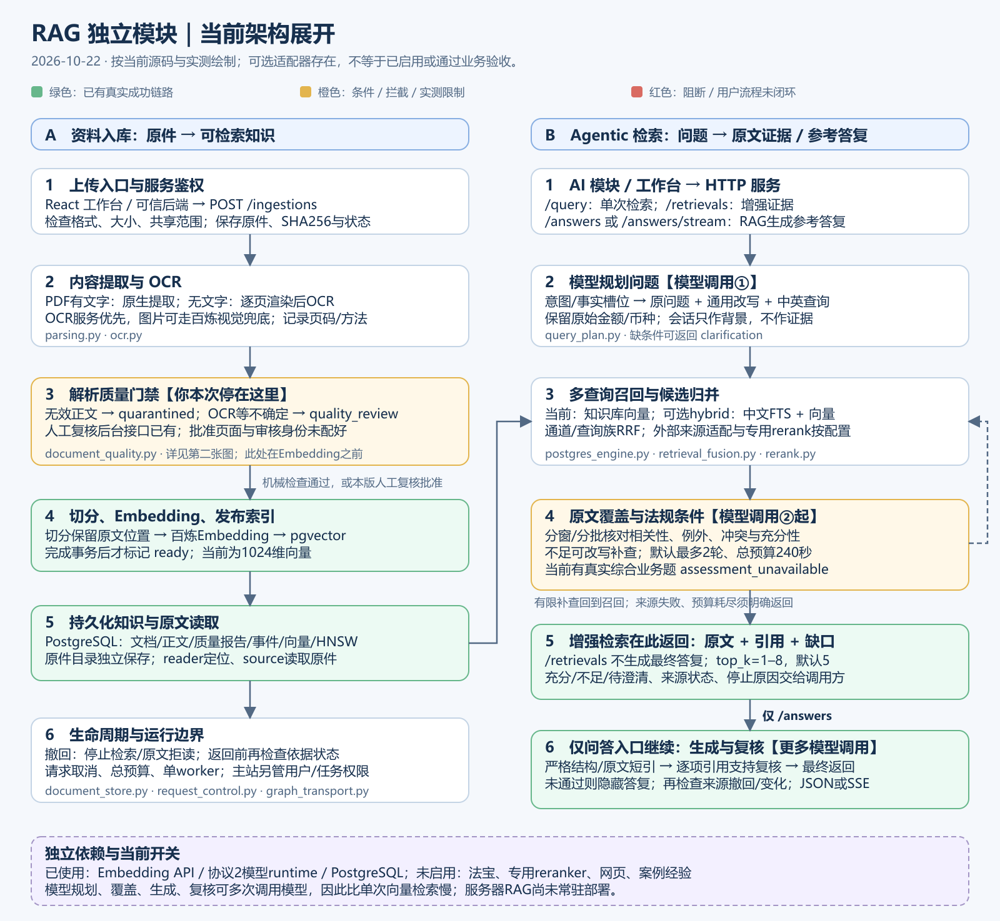
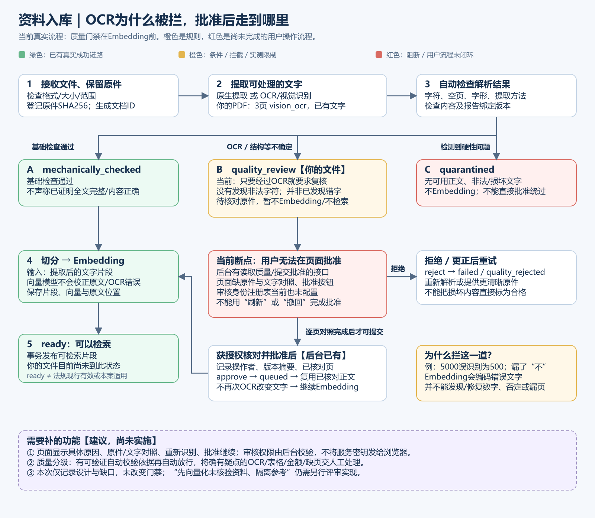

# RAG 专属架构图：当前流程、断点与实测

2026-10-22，按当前 `lfc` 源码与本机实测整理。图中区分已有能力、条件拦截、未闭环操作；建议改造不代表已实现。本次只补图和说明，未批准资料或修改运行策略。

## 1. 模块全景

[打开可放大、可编辑的 SVG](docs/diagrams/rag-module-current.svg)。AI 模块只接 HTTP；主站负责用户/任务权限，RAG 负责共享知识和证据。模型规划、覆盖核对、答复生成、引用复核可能多次调用模型，因此不能用单次向量检索的耗时理解整个问答。

## 2. 本次卡住的位置：OCR → 质量门禁 → Embedding

[打开可放大、可编辑的 SVG](docs/diagrams/rag-ingestion-quality.svg)。你上传的政策问答共3页，实际解析方法全部是 `vision_ocr`，触发原因是 `ocr_requires_source_comparison`；报告没有发现非法控制字符或替换字符。**OCR已经识别了文字；当前人为策略要求OCR逐单元复核，所以停在Embedding之前。**

拦截是为了避免把漏识别的“不”、错误金额/日期、遗漏表格等变成可检索依据。Embedding只把输入表示为向量，不负责检查或纠正输入文字。该拦截不是Embedding的技术要求，也不是本项目已经确认的法规强制程序。

保留质量检查有意义，但“所有OCR一律人工复核”偏保守，且没有配好批准入口。**当前不能仅凭“经过OCR”就断言文字错误，也不能凭“没乱码”证明识别准确。** 不是每份资料都必然需要人工审核：原生文字通过基础检查可直接继续；OCR自动放行应另有可验证的质量依据，当前尚未实现这种分级。

## 3. 测过什么，漏了什么

| 项目 | 证据与边界 |
| --- | --- |
| 自动质量判定 | 本次重跑 `test_document_quality.py`，6项通过；覆盖OCR标记、乱码、表格/页眉遗漏信号、截断拒收等合成场景，不证明真实OCR准确率 |
| 批准后的后台机制 | `test_quality_review.py` 有5项隔离PG/合成HTTP测试；默认回归跳过，本次未重跑，更没有用你的真实审核身份批准本文件 |
| 真实基础入库/问答 | 前一轮16项HTTP检查通过；本机4份业务资料ready，见[测试记录](ACCEPTANCE-2026-10-22.md) |
| 你这份扫描PDF | 已真实OCR到3页并进入quality_review；尚未完成本文件Embedding/检索验收 |
| 页面上批准继续 | **缺功能**：没有原件/解析对照和批准按钮；审核主体注册表也未配置，真实用户路径没有闭环 |
| 综合业务增强检索 | 已有真实失败题 `assessment_unavailable`，不能把基础链路成功当成所有功能通过 |

之前的机制测试证明了程序按规则拦截，**没有证明这条规则和交互对用户合适**。真实上传暴露了这个差距；以操作验收补足图和测试，不能用测试数量代替可用性。

## 4. 优先补齐的功能与验收动作

| 优先项（尚未实施） | 用真实操作验收 |
| --- | --- |
| 显示具体触发页和原因；原件与提取文字对照 | 在这份3页PDF中看见实际OCR文字、页码、原图和待检查项 |
| 页面批准/拒绝/重新识别，后台校验审核权限并留审计 | 授权用户对照后批准 → 自动继续Embedding → ready → 按文件名/具体条款检索 → 引用能回原页；未授权用户不能批准 |
| 分级质量处理，减少无差别人工拦截 | 清晰原生文字自动继续；OCR有独立校验依据才可自动放行；确有疑点保留待复核；错数字、漏否定词、漏页的样例不能被误放行 |
| 模型失败与知识缺口分别表达 | 上游核对失败显示“模型核对未完成”，不能把它概括成“没有相关法规”；复验已记录的复杂业务题 |

“待核验资料先Embedding、存入隔离参考索引”属于另一项可选设计，需明确检索过滤和证据标记后再决定；本图没有将其画成当前已实现功能。人工解析复核也不等于法规现行效力、辖区/日期适用性或贷款审批。

## 5. 模块与源码对应

| 职责 | 源码 |
| --- | --- |
| 服务鉴权、共享范围与HTTP入口 | `app/main.py`、`app/backend_api.py` |
| 文件提取、OCR服务/视觉识别 | `app/parsing.py`、`app/ocr.py` |
| 质量判定、批准声明、审核主体权限 | `app/document_quality.py`、`app/document_store.py`、`app/reference_security.py` |
| 入库编排、向量/词法、持久状态 | `app/postgres_engine.py`、`app/lexical_index.py`、`app/database.py` |
| 意图、问题改写、多语言、金额币种约束 | `app/query_plan.py` |
| Agentic编排、RRF、多源、重排 | `app/answer_graph.py`、`app/retrieval_fusion.py`、`app/pkulaw.py`、`app/web_context.py`、`app/rerank.py` |
| 原文窗口、覆盖、法规条件、答复/引用核对 | `app/evidence_context.py`、`app/evidence_assessment.py`、`app/legal_applicability.py`、`app/answer_draft.py`、`app/answer_verification.py` |
| 独立模型HTTP协议、取消、React工作台 | `app/runtime_client.py`、`app/request_control.py`、`app/graph_transport.py`、`ui/src/` |

接入方式见[接口指南](INTEGRATION.md)；当前服务器部署与验收限制见[部署交接](deploy/README.md)。
