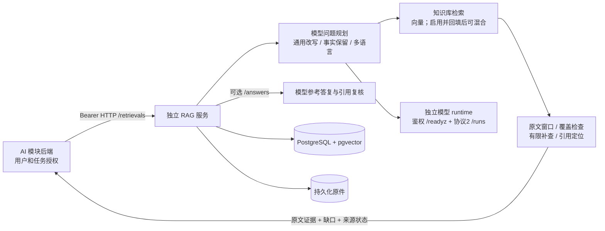

# RAG 接入指南（给 AI 模块与部署同事）

交付范围：独立知识库服务 `0.5.1`，HTTP 契约 `1.3.1`。代码在 `lfc` 分支；部署前固定经过评审的提交。只需要通过 HTTP 调用，不需要复制 RAG 内部代码或连接其数据库。

模块流程见 [RAG模块架构](RAG模块架构.md)，实施与验收见 [RAG模块优化规划](RAG模块优化规划.md)。OCR待复核发生在Embedding之前；本机复核页面需要显式配置服务端操作员，不能用服务Token冒充复核权限。

## 1. 向部署方取得两个配置

在调用方**服务端**注入 `RAG_BASE_URL` 和 `RAG_SERVICE_TOKEN`。服务端的 `SERVICE_TOKEN` 与调用方 `RAG_SERVICE_TOKEN` 值相同；不要把它们放进前端、Git 或聊天记录。请求头：`Authorization: Bearer <token>`。

2026-10-22 本机验收入口是 `http://127.0.0.1:8012`；这是本机地址，同事远程不能直接使用。汇丰服务器常驻 RAG 尚未部署，部署方需提供可达的私网/HTTPS 地址。`/health` 只检查存活，带鉴权的 `/api/v1/ready` 必须返回 HTTP 200 且 `status=ready`，之后还应实际提问。

## 2. AI 模块优先调用增强检索

以下代码仅依赖 `httpx`，在调用方运行：

```python
import os
import httpx

with httpx.Client(
    base_url=os.environ["RAG_BASE_URL"].rstrip("/"),
    headers={"Authorization": "Bearer " + os.environ["RAG_SERVICE_TOKEN"]},
    timeout=httpx.Timeout(300, connect=10),
) as client:
    client.get("/api/v1/ready").raise_for_status()
    response = client.post("/api/v1/retrievals", json={
        "query": "支付指令的5000美元金额有误，应怎样核查？",
        "scope": "business_rules",
        "top_k": 5,
        "sources": ["knowledge_base"],
    })
    response.raise_for_status()
    result = response.json()
    # 将原文及其限制一起交给 AI，保留 citation 与原文定位信息。
    evidence = result["sources"]
    limitations = {key: result.get(key) for key in (
        "evidence_status", "missing", "clarification_question", "stop_reason",
        "source_status", "rerank_status", "warnings", "legal_applicability",
    )}
```

可直接运行同等 HTTP 示例：`python examples/retrieve.py --query '支付指令金额有误如何核查？' --scope business_rules`。它从调用方环境读取以上两个变量，不读取本服务内部配置。

| 选择 | 含义 |
| --- | --- |
| `business_rules` | 业务规范、文件核对规则 |
| `law` | 法规参考资料；可检索不等于已确认当前效力或本案适用 |
| `project_design` | 项目设计/明确标识的测试资料 |
| `all` | 上述共享范围联合检索 |

`task_documents` 不属于本服务增强入口，返回 422；主站需自行核验用户、任务权限及处理本案单据。可选 `conversation` 只用于消歧和问题规划，不能当作已证实的证据。

HTTP 200 后仍需判断 `evidence_status`：`sufficient` 才表示检索器认为当前资料足够；`insufficient` 保留缺口并补充资料，`clarification` 向用户澄清。上述状态都不是贷款审批结论。`sources[].content` 是选中的原文窗口，连同 `citation/document_id/chunk_id/reader_url/source_url/metadata` 一起保存；不要把相似度当置信概率。

增强检索/问答的 `top_k` 范围是 **1–8**，默认5（兼容 `/query` 为1–20）。综合问题可能需要超过5条依据而返回 `stop_reason=evidence_budget`；可提高到8或拆分问题，不能删除提示后把截断结果当完整依据。若8仍不够，应拆分或另行评审模块预算/契约扩展，不绕过完整性检查。

## 3. 其他常用接口

| 接口 | 用法 |
| --- | --- |
| `POST /api/v1/query` | 兼容单次检索，返回 `evidence[]`，无模型规划 |
| `POST /api/v1/answers` | RAG 自己生成结构化、带引用的参考答复；与增强检索共用基础请求字段 |
| `POST /api/v1/answers/stream` | POST SSE，消费 `step`、最终 `result` 或 `error`；仅连接结束不能算成功 |
| `POST /api/v1/ingestions` | multipart `file`、`scope`；202 后轮询文档状态，`ready` 才算可检索 |
| `GET /api/v1/documents/{id}/content?chunk_id=…` | 引用原文及焦点定位 |
| `GET /api/v1/documents/{id}/source` | 读取原件；主站重新鉴权后代理给浏览器 |
| `GET /api/v1/capabilities` | 查询实际启用的引擎与可选能力 |

完整字段、错误码、网页/法宝、质量复核与撤回见 [API_CONTRACT.md](API_CONTRACT.md) 和 [OpenAPI](contracts/openapi-v1.json)。运行中的 `/docs` 提供接口页面。管理/原文接口是可信服务级接口，不能直接暴露给任意最终用户。

默认增强请求总预算 240 秒，调用方和代理超时至少 300 秒；还需由部署方对齐模型 runtime 的单次预算与 RAG 单次90秒预算。有费用的超时请求不自动重放。401 检查鉴权，422 检查参数，429 检查并发，502/503 检查依赖和就绪状态。保留非 2xx 和 SSE error，不能将失败展示成“未找到法规”。本轮综合业务题在8条证据模式下出现 `assessment_unavailable`，尚未验收通过，见测试记录；不能仅凭基础链路成功声明复杂业务已经可用。

## 4. 模块内部与调用方边界



专用 reranker、法宝、网页快照、历史经验均按独立配置/授权启用；本轮实际验收使用知识库来源、向量模式，不把可选适配器存在当成已经上线。调用方还可以独立调用法宝 MCP，是否使用 RAG 内多源适配由业务路由确定。

## 5. 汇丰服务器部署与验收

部署清单见 [deploy/README.md](deploy/README.md)：独立 Python 3.12 环境、Node/UI 构建、PostgreSQL/pgvector、Embedding API、协议 2 模型 runtime、受控 Secret 与持久盘。生产部署使用获授权的模型和直接可达的服务地址；本机测试使用的 SSH 隧道不是生产依赖。不以现有机器资源降低模型或质量标准。

已有库缺当前质量报告时不能直接继续使用；先备份，再在独立 schema/原件目录重检，OCR 或结构疑点进入人工复核。本轮旧库保留，新验收库与原件目录隔离，不能只复制向量或将旧 ready 批量标成合格。

部署后按顺序验证：`/health` → 鉴权/`/ready` → 真实入库 → 单次/增强检索 → 原文 → 带引用答复 → 撤回。可用以下脚本复现 HTTP 验收（会产生真实模型费用，并创建、撤回一份明确的合成测试资料）：

```bash
python scripts/verify-module.py --base-url http://127.0.0.1:8011 --write-fixture --report data/module-acceptance.json
```

Token 由服务端环境或本模块 `.env` 读取，不通过命令行传递。报告不含密钥和业务正文。该链路验收不替代真实审核题集、扫描件 OCR、主站权限/UI、Linux 镜像及服务器负载验收。详见 [本轮测试记录](ACCEPTANCE-2026-10-22.md)。
