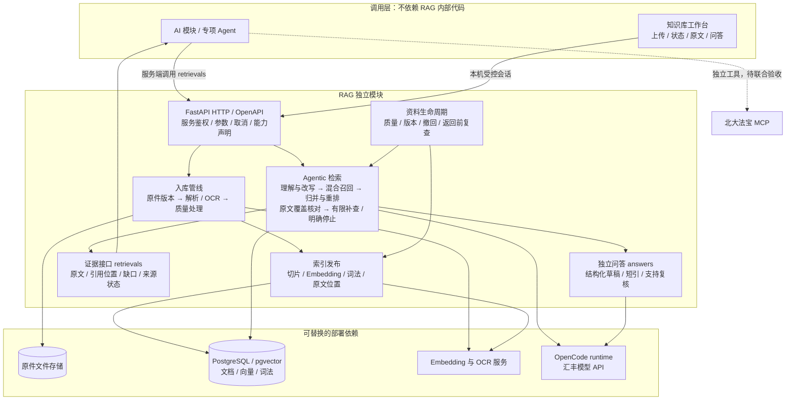
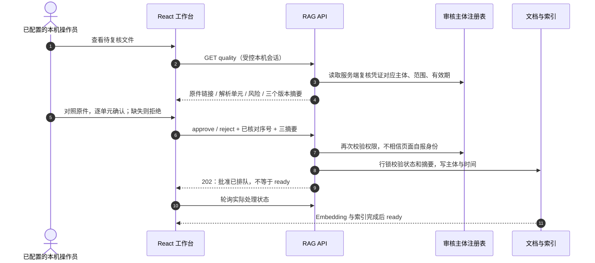

# RAG 模块优化规划｜实现、场景测试与验收

> 2026-10-22 · 本轮实施基线。架构入口：[RAG模块架构](RAG模块架构.md)。本轮目标是把使用流程做完整并取证；每一轮以验收报告中的失败项为下一轮输入，禁止靠增加测试轮数宣称成熟。历史 R01–R21 是机制记录，不代表业务验收全部通过。

## 1. 目标图与本轮范围

上述总图与架构文档第1节保持一致，细化的分支/时序见下文。**本轮交付**：统一文档；修复 OCR 待复核无操作入口；准确解释模型失败；建立用户路径测试与报告。**后续发布条件**：真实业务金标、外部来源联合重排、主站权限联调、服务器部署与恢复演练分别取证，不能用本轮本机测试替代。

## 2. 执行和审核规则

每次只对新改动或尚未解决的失败复测；同一失败没有新假设、新输入或新配置时停止重复调用，转为记录所需资源/协作。最多一次基线与一次修复后全套验收；确需进一步修复时逐项说明原因。共享 Git 协调结束后，仅在 lfc 按明确文件清单提交和推送；不写 main，不覆盖 AI/业务同事修改。资料、凭证和真实案件不提交 Git。

## 3. 文档入库与复核：先补用户走不通的地方

### 3.1 状态与用户动作

| 状态 | 系统在做什么 | 用户应该能做什么 | 验收 |
|---|---|---|---|
| queued / processing | 接收、解析、切片、Embedding、写索引 | 看中文阶段、刷新；页面关闭不取消后台任务 | S01/S02 |
| quality_review | 保存待核对解析，未 Embedding | 看具体页/单元与原因、打开原件、逐项核对、批准或拒绝 | S03–S06 |
| quarantined | 乱码/无有效文本等阻断，不能直接批准 | 看原因，更正原件或授权重新识别 | S07 |
| failed | 解析、模型、索引失败或被拒绝 | 看安全错误；授权重检，不自动重放审批 | S06/S08 |
| ready | 当前版本片段可检索 | 按文件内容问答、查看引用、打开原页、撤回 | S01/S09 |
| withdrawn | 当前版本不可再使用 | 看撤回状态；旧引用、在途答复不得继续使用 | S09 |

### 3.2 复核授权与页面

原有服务端双凭证接口保持兼容。本机工作台可由部署者**显式**配置服务端 `RAG_UI_DOCUMENT_REVIEW_KEY`，只在有效本机 Cookie、回环连接与同源条件下使用；沿用注册表 reviewer、精确 scope、有效期和实时撤销检查。前端不拿到凭证，不因持有服务 Token 自动获得复核权。不配置时页面明确说明由部署者配置授权，不让用户盯着状态等。它代表本机受控操作员，不冒充主站登录用户；云端必须通过真实身份适配，不把代理回环连接当成用户权限。

批准按钮必须满足：当前 quality_review、报告与页数一致、原件可打开、逐单元主动确认全部完成、显式提交。没有“全部默认勾选”。拒绝需选择不完整/错误/不可辨认。quarantined 不能通过审批绕过。409 后刷新并重新对照；网络错误后查状态，禁止自动重放决策。重检需说明会隐藏旧片段、重解析且可能重新调用付费模型。

### 3.3 OCR 与自动放行的后续优化

| 项目 | 实现/选择 | 放行条件 |
|---|---|---|
| 现有原生解析 | 保留 PDF 原生提取、DOCX 顺序、工作表定位；未覆盖图像/公式等标明风险 | 无当前规则风险可机械通过，不等于完整性已证明 |
| 现有 OCR | OCR 服务优先，已配置视觉模型兜底；拒绝截断响应 | 当前仍需原文对照，先把人工路径做通 |
| 风险分级自动放行 | 待比较成熟版面/OCR方案、独立文本对照、跨页表格覆盖，不靠单模型自评分 | 在固定样本上验证关键金额/币种/否定词/日期、漏页漏表格；业务认可阈值后再启用 |
| 隔离参考索引 | 可选实验；不能与已核验依据混用 | 先定义用途、检索过滤与引用标记，再决定是否值得增加维护复杂度 |

本轮不以放宽质量规则来制造“全部 ready”；先闭合可解释、可处理的流程，再用准确率证据减少不必要人工工作。

## 4. 查询、来源与回答的实施要求

| 能力 | 当前机制 / 需要继续完成 | 验收要点 |
|---|---|---|
| 意图与改写 | 保留原问与具体事实，同时生成通用业务表达；未知则澄清 | “支付指令5000不对”可查金额不符处理；不能把5000改成500或自行确定 USD |
| 多语言术语 | 中文金额/数额/支付指令与英文 amount/payment instruction 互补查询 | 中英问题返回同一授权依据；多值金额/币种保留歧义 |
| 词法+向量 | 现有 vector/hybrid 配置，中文词法索引显式回填 | 固定语料比较 Recall@20、nDCG@10；配置启用不等于质量提升 |
| 多路归并 | 查询族 RRF、同源去重、保留版本/页码；不同来源分数不能直接混比 | 同一正文多个查询命中不能刷排名；冲突不能直接覆盖 |
| 重排 | 已有专用模型适配接口，待配置和真实质量对照 | 比较纯向量、hybrid+RRF、加入rerank；保留反例和有效期差异 |
| Agentic RAG | 有界理解→召回→覆盖→补查；不是无限调用 | 有明确缺口才重写；重复/无新证据/超时/错误分别停止 |
| 长文与法规 | 原文窗口、字节预算、分批与联合覆盖；一般参考和本案结论分开 | 原文页码正确；缺附录或例外不能说全文充分；适用性需辖区、日期、主体、业务 |
| 模型异常 | 当前核对失败会误显示“知识库没有足够证据”，本轮修正 | 模型失败、预算不足与真实无资料分别说明；不生成未经核对的结论 |
| 外层 AI 与法宝 | 推荐外层 AI 独立调用 RAG/法宝；RAG 内适配保持可选 | 明确本轮哪个模块负责检索，避免重复；MCP失效不能假装已查法规 |
| 网页上下文 | 获准调用方提供采集时间、实际文本、完整性声明 | 网页是未核实快照；URL本身不是内容；过期/来源撤销要失效 |
| 历史案件与记忆 | 法规库、脱敏案例库、经验记忆分开治理 | 真实任务ACL、复核版本、政策失效、撤销/删除传播；个人偏好不能成为业务规则 |

不得把图谱 RAG、全库长上下文或多 Agent 当作必选升级。仅在真实失败题证明需要时评估成熟方案，记录资源、授权、成本和收益；资源申请与技术选型分开，不以现有服务器算力压低质量目标。

## 5. 固定场景测试集

| ID | 用户怎样操作 / 输入 | 预期与证据级别 |
|---|---|---|
| S01 | 上传有清晰文字的 TXT/PDF、DOCX、XLSX，等状态后查唯一条款 | 真实 PG/Embedding：ready、片段>0、命中本文件、原文可定位 |
| S02 | 上传后关面板再打开 / 刷新 | 状态来自服务，不因关闭面板丢任务；阶段不伪造 |
| S03 | 扫描/图片走 OCR 后进入待复核 | 具体原因与解析单元可见，原件与解析可对照；不能提前检索 |
| S04 | 只核对部分页即尝试批准 | UI禁用；绕过前端提交也被后台拒绝；摘要变化409 |
| S05 | 授权操作员完整对照**合成样本**后批准 | 202→实际Embedding→ready→检索；记录主体/时间，复用已核对解析不再次OCR |
| S06 | 缺页、错数字或漏否定词，选择拒绝 | 不发布索引；拒绝原因保留；真实文件不自动批准 |
| S07 | 输入乱码、空文档、公式无缓存等风险样本 | 按原因 failed/quarantined/quality_review；不能误称已完成Embedding |
| S08 | 授权重检；过期、撤销、错范围、跨站或远程请求 | 重检明确确认；未授权不能看待核对正文或批准；服务Token独用不提升权限 |
| S09 | ready后撤回，再用旧片段或处理中请求 | 文档不再检索/读原件；在途依据失效，不展示旧结论 |
| S10 | 金额/币种/中英文同义问题，多值歧义 | 机制测试 + 真实题逐项核对；保留原始事实，无凭空改写 |
| S11 | 法规参考、本案判断、缺辖区/日期、网页/法宝部分失败 | 明确用途/缺条件/来源状态；不能把不全的材料说成已完成法规核验 |
| S12 | 模型返回空、格式错、核对未完成、超预算；用户取消 | 浏览器与图测试：显示真实故障类型、不冒充无资料、释放后续调用与名额 |
| S13 | 复杂流贷/固贷用途题，真实业务语料 | 冻结问题/文档版本；保存来源、覆盖、耗时、失败归因；不凭基础烟测盖通过章 |
| S14 | AI调用契约、服务器ready、原件访问、重启/备份恢复 | 跨模块/服务器联合验收，未做必须标待验收 |

合成样本测试机制，不能叫“真实业务金标准”。第8/9/10套故意造错资料及流贷、固贷、车贷资料需业务方确认授权、标准答案和证据页；按案件族划分 dev/holdout，避免同一原件错误变体泄漏。知识库公开法规和共享业务规范可以单独导入；整套真实贷款单据不能直接塞进共享法规库。全部批量 Embedding 前先清单分类、去重、版本/现行性和来源授权确认。

## 6. 验收报告模板与当前差距

每份报告至少写：代码/配置版本（不含密钥）、测试环境与索引/文档版本、场景ID、数据是合成/脱敏/真实、操作、预期、实际、通过/失败/跳过、时延和上游调用、失败原因、修复与复测结果。单元/HTTP/浏览器/真实依赖分栏计数，跳过不得记通过。真实正文与运行日志保留在忽略目录，公共报告只写必要摘要。

| 完成门槛 | 本轮要求 |
|---|---|
| 文档 | 架构与规划均为 Mermaid；入口统一；当前/目标/条件启用清楚，无过时图片依赖 |
| 功能 | 合成待复核样本能通过完整授权页面路径；未授权/部分确认/版本变化被阻止；不自动批准用户真实PDF |
| 测试 | 相关后端、UI测试与构建；浏览器真实HTTP操作；隔离PG审批发布机制；至少一条实际Embedding检索验收 |
| 复审 | 对照架构逐项核验；首轮失败要有修复或明确待办，不能隐藏复杂业务题失败 |
| 交接 | HTTP/OpenAPI、部署所需配置和限制同步；当前服务器尚未部署的部分明确列出 |

报告入口：[本轮流程验收报告](RAG模块流程验收报告.md)。原始真实链路结果见 [2026-10-22记录](ACCEPTANCE-2026-10-22.md)。云端生产验收仍需持久任务/重启恢复设计、多用户权限接线、授权真实金标和部署同事签认；不能仅凭本机通过提前宣布整体目标完成。

## 7. 2026-10-23 复审后的执行顺序

本轮两页合成扫描PDF已通过真实OCR→复核批准→Embedding→向量与Agentic检索→撤回；这只关闭S03—S05的一条受控样本路径，不关闭真实业务/云端验收。简单增强检索约121秒、复杂业务题覆盖失败和首次OCR诊断不足均为后续输入。

| 次序 | 下一步与修改依据 | 验收证据 |
|---|---|---|
| 1 | 量测规划、各查询召回、原文窗口、覆盖批次与上游终止原因；优先复用LangGraph/runtime既有事件和成熟观测，不采集密钥或完整业务正文 | 同一固定问题的分阶段时延与调用数；据此区分网络/数据库/上下文/模型，不能先猜根因 |
| 2 | 依据瓶颈比较合理并行、覆盖批次设计、runtime预算及所需资源；不减少必要覆盖或降模型制造提速 | 固定简单题与复杂失败题同时保留事实、引用、完整性检查；报告质量/耗时/费用取舍 |
| 3 | 在授权独立索引做hybrid与专用rerank对照，清点公开法规/业务规范；真实案件先做权限和金标治理 | 冻结语料、查询、模型和索引版本；排名指标与失败例，不只看能返回内容 |
| 4 | 接服务器与外层AI/法宝，验证真实身份、任务边界、持久化和恢复 | 目标环境证据和部署同事签认；本机通过不能替代 |

本轮没有增加自研通用Agent或评测框架。新增能力实施前继续按项目要求先查官方资料与成熟方案，把选型/许可/资源决策写入本规划；只实现本项目需要的适配。

### 7.1 查询召回并行：先测量再修改

固定复杂题诊断：规划18.66秒；四个召回串行约50.55秒，加归并前失效复查约3.16秒；原文核对模型约51.09秒后未返回答案。初始化52.22秒另计，图内127.50秒。召回中的Embedding/SQL耗时相互包含，不能叠加成总时长；这不是吞吐基准，也尚未证明模型空答的根因。

比较[LangGraph原生分支/Send](https://docs.langchain.com/oss/python/langgraph/use-graph-api)、[LangChain Runnable.batch](https://reference.langchain.com/python/langchain-core/runnables/base/Runnable/batch)和自建线程调度。选择已有langchain-core的RunnableLambda.batch：官方支持I/O并发及max_concurrency，保持当前图节点和HTTP契约，只并行独立查询，不另建Agent框架。LangGraph Send留作以后确有独立节点持久化/重试需要时评估；本次没有该需求。沿用现有依赖及MIT许可，不新增SaaS或自动上传正文。

实现约束：默认至多3路（RAG_RETRIEVAL_CONCURRENCY，1—6）；先按原顺序去重、预留查询预算，再按输入顺序归并结果。工作线程必须继承请求取消上下文，开始调用前检查取消与总预算；退出时等待在途调用清理，不能提前释放请求名额。每路及最终返回前保留原有生命周期检查；不删查询、窗口或核对调用。测试并发上限、计划顺序、预算、取消上下文、等待清理和失败；用同一真实题复测召回阶段，模型问题独立记录。

观测依据：[LangGraph事件流](https://docs.langchain.com/oss/python/langgraph/streaming)、[SQLAlchemy性能诊断](https://docs.sqlalchemy.org/en/21/faq/performance.html)。当前先本机记录固定操作名、时长、计数；[LangSmith tracing](https://docs.langchain.com/oss/python/langgraph/observability)需另评数据和服务授权，本轮未启用。默认不记录SQL参数、凭证或整段业务原文。

复审结果：同题单次对照召回节点53.719→35.188秒，图内127.500→103.250秒；仍为assessment_unavailable，不算业务通过。两次改写和候选未冻结，不作稳定性能/召回质量结论。详见[报告第6节](RAG模块流程验收报告.md#6-10月23日追加复审召回并行模型失败保留)。下一步优先取证runtime终止状态：只记录白名单错误类别/耗时/版本，不输出正文或密钥；区分超时、执行失败、最终文本提取为空，再决定RAG适配、预算协商或交给runtime维护方。不得无证据反复加超时或重跑整套流程。
