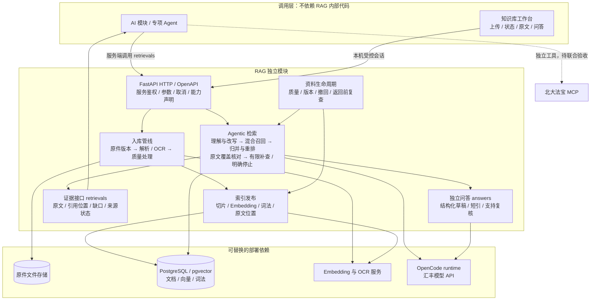
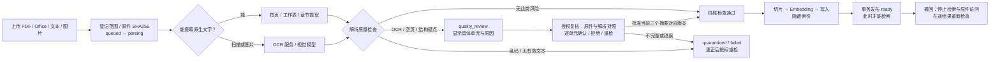
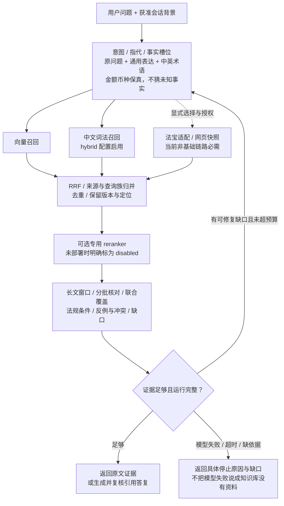
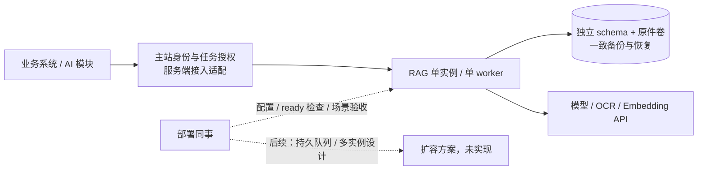

# RAG 模块架构｜现状、目标与修改入口

> 2026-10-22 · 模块边界与 AI 模块一致：独立服务、HTTP 契约、内部独立更新。本文看图理解；实现、场景与验收看 [RAG模块优化规划](RAG模块优化规划.md)。实线表示已有机制；虚线表示待联调或待实现，不能把目标图当作上线证明。

## 1. 总图：知识怎样进去，AI 怎样调用

**RAG 内部会使用模型判断是否需要补查，这就是这里的 Agentic RAG。** 外层 AI 决定何时调用知识库、法宝或其他工具；它与 RAG 的有限检索循环是两个层次。法宝可由 AI 独立调用，已有 RAG 内部法宝适配保留为显式可选项，不是必需依赖，避免双方重复检索。网页是调用方授权提供的文本快照，不能只凭 URL 假装读过网页。

## 2. 入库图：为什么 OCR 后还可能停住

这道检查拦的是**可能识别错的文字**，不是检查向量是否生成成功。OCR 已存在；Embedding 不会纠正漏字、金额或否定词。当前策略把 OCR 一律列为待对照，这是保守的工程策略，并非 Embedding 技术要求，也没有据此认定监管强制逐页人工审核。后续自动放行必须用独立 OCR 质量样本验证，不能用“没有乱码”代替识别正确。

## 3. 查询图：改写、混合检索、多源与有限补查

默认上限为两轮、六次内部检索；跨语言分支和来源有各自预算。模型核对、生成、复核会增加时延，应分别量测。相关性重排只排列候选；覆盖核对决定是否还缺依据，二者不能互相替代。

## 4. 当前状态与部署边界

| 部分 | 当前事实 / 验收边界 |
|---|---|
| 解析、向量入库、检索、引用、撤回 | 本机已有真实 HTTP / PG / Embedding / 模型链路记录；不等于任意文件都已通过 |
| OCR 复核 | 页面原文对照、逐单元确认与版本绑定审批已补齐；两页合成扫描件经真实OCR/Embedding/Agentic检索通过，首次OCR失败与时延仍保留在[流程报告](RAG模块流程验收报告.md) |
| 混合召回、多源适配、专用重排接口 | 代码机制存在；当前实例为 vector，法宝与专用重排未启用，不宣称收益已验收 |
| 复杂业务题 | 已记录模型覆盖核对未完成的失败，不能以基础烟测替代 |
| 历史案例 / 经验记忆 | 独立治理机制存在；真实案例授权、用户权限和外层 AI 接线待做，不混进公共法规索引 |
| 汇丰服务器 / 主站联合 UI | 待同事部署和联合实测；本机运行不代表服务器已上线 |

## 5. 修改入口

| 模块 | 源码与职责 |
|---|---|
| HTTP 与权限 | `app/main.py`、`app/backend_api.py`、`app/reference_security.py`：服务调用、受控工作台、复核范围授权 |
| 解析与质量 | `app/parsing.py`、`app/ocr.py`、`app/document_quality.py`：提取、OCR、风险报告 |
| 文档与索引 | `app/document_store.py`、`app/postgres_engine.py`、`app/lexical_index.py`：状态、批准、Embedding、索引发布与撤回 |
| 查询与归并 | `app/query_plan.py`、`app/retrieval_fusion.py`、`app/rerank.py`：保真改写、RRF、重排 |
| Agentic 与证据 | `app/answer_graph.py`、`app/evidence_context.py`、`app/evidence_assessment.py`：有界循环、长文覆盖、停止原因 |
| 法规与引用 | `app/legal_applicability.py`、`app/answer_draft.py`、`app/answer_verification.py`：用途门禁、结构化答复与短引复核 |
| 外部来源与 UI | `app/pkulaw.py`、`app/web_context.py`、`ui/src/`：可选来源、上传/对照/问答页面 |

接口字段只维护在 [API_CONTRACT](API_CONTRACT.md) 与 OpenAPI；部署只维护在 [deploy/README](deploy/README.md)，避免复制多份相互矛盾的规格。
