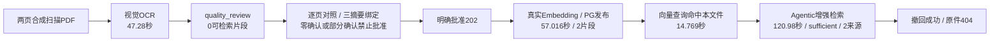

# RAG 模块流程验收报告

> 2026-10-22—23 · 对照[架构](RAG模块架构.md)与[优化规划](RAG模块优化规划.md)。服务0.5.1、HTTP契约1.3.1。整体goal进行中；本轮通过不等于完整业务验收或服务器上线。

## 1. 基线失败与修改

| 场景 | 发现的问题 | 修改 / 复测结论 |
|---|---|---|
| S03/S05 用户政策PDF | 3页已vision_ocr，但旧页面无复核入口、审核主体未配置 | 补原件对照、逐单元确认、批准/拒绝/重检；配置本机7天操作员，未自动批准真实政策文件 |
| S12 模型异常 | assessment_unavailable误说成知识库无证据 | 区分模型失败、异常格式、超时、输出预算不足；机制测试通过 |
| 文档一致性 | 图片总览缺质量分支，多份旧基线并存 | 统一两份Mermaid主文档；删旧ARCHITECTURE入口与两组PNG/SVG共4张重复图；旧规划标历史，保留历史证据 |
| S13 复杂业务题 | 流贷/固贷用途题116.28秒，20候选窗口、0可展示来源，覆盖核对未完成 | **仍未通过**；简单合成问题通过不能替代，先定位再固定原题复验 |
| OCR首次尝试 | 两页合成扫描件首次failed，仅有泛化错误 | 根因未取证，不能归咎网络；补页号、超时/连接/HTTP/截断安全诊断；一次授权重检41.78秒识别完成，不宣称根因已修复 |
| 浏览器等待 | 首次批准202后测试过早读取processing，审计断言失败；样本随后撤回 | 改显式HTTP轮询，核验ready/片段数/主体；新样本复测通过。取消烟测同步改严格核验并通过 |

## 2. 分层结果

| 验证 | 实际结果 | 证明范围 / 局限 |
|---|---|---|
| 后端默认完整回归 | 204项：191通过、13跳过；11.659秒 | 机制与契约；跳过不算通过 |
| 后续OCR诊断相关回归 | test_document_quality 6项通过，0.169秒 | 完整回归后新增诊断，针对截断/HTTP错误不泄露响应等复验 |
| 真实PG审批/发布 | opt-in test_quality_review 5项通过，420.424秒 | 随机隔离schema；真实PG，合成解析/Embedding；覆盖三摘要、范围、发布屏障、撤回 |
| React交互 | 2文件21项通过，99.44秒 | 完整确认、部分禁用、冲突失效、未配置授权、请求契约；初次超时后定位改组件测试，完整页面另做浏览器验证 |
| 生产构建 | TypeScript与Vite通过 | 主bundle约696KB有体积提示；无首屏/无障碍/负载结论 |
| 浏览器+FastAPI | 通过 | 真实Cookie/SSE/页面/路由，合成模型/DB/OCR；覆盖引用、错误/取消、上传/撤回、对照/批准/拒绝/重检、移动布局 |
| 真实OCR/Embedding/增强检索 | 两页合成扫描PDF流程通过 | 真实视觉模型、Embedding、PG与SDK；不是业务金标，未做此样本最终回答生成 |
| 接口/依赖 | OpenAPI快照检查、pip check通过 | 新增可选字段；不是完整安全审计 |
| 主站 / 汇丰服务器 / 专用重排 / 法宝 | 本轮未验收 | 不计通过；当前本机vector，法宝与专用重排未启用 |

各层不能相加成“业务全部通过”。原有16项基础HTTP结果见[前次实测](ACCEPTANCE-2026-10-22.md)，不替代本报告。

## 3. 真实依赖样本与耗时

自制两页纯图片PDF含唯一标识、USD 5000、金额不符停止处理、不得改币种等已知文字，无客户数据或真实政策。程序逐页比较OCR与生成原稿（仅归一空白），核对原件SHA，在真实浏览器逐页确认；这是合成原稿对照测试，不冒充人工批准真实银行文件。

原流程13个检查通过；重启后的补查也确认该样本不再被检索到，/docs可访问，共15个检查。[机器摘要](docs/acceptance/2026-10-23-live-ocr.json)。原稿/完整日志在忽略目录data/flow-acceptance。样本已撤回，不可再以该ID测试成功检索；需按S03—S05创建新样本。

这只覆盖两页清晰英文，未证明中文扫描、手写、复杂跨页表格或长页OCR质量；首次OCR失败保留。简单增强检索约121秒是明确时延缺口，不能只因sufficient就称体验优秀。

## 4. 复现与交接

1. 模块根目录运行 `python -m unittest discover -s tests -v`；隔离PG需测试账号和显式HBCN_TEST_POSTGRES=1，不用正式业务库作测试集。
2. ui目录运行 `npm test && npm run build`；按[工作台说明](ui/README.md)配置Playwright/Edge后运行 `node scripts/smoke-ui.cjs`，只启停自己的合成服务。
3. 按[部署说明](deploy/README.md)配置真实依赖与本机复核profile，key不进浏览器。上传带唯一标识的两页合成扫描件，等quality_review，对照原件；先验未确认/部分确认不能批准，再完整确认批准。
4. 202后轮询实际ready、chunk_count>0并核验主体/版本；用唯一标识问/query和/retrievals，核对原文页码/事实/充分性；最后撤回，验原件不可读、后续检索不含该文档。

本机8012依赖临时进程和SSH，不是服务器常驻部署。执行环境切换后确认8012无监听、补查被拒绝连接；重新启动后，本次/health确认0.5.1、/docs返回200、带会话/ready返回200且sdk_runtime=ready，撤回文档不再命中。历史通过不代替当前存活，也不能据此承诺永久在线。

## 5. 剩余项与审核顺序

- 先量测规划/召回/覆盖批次耗时、模型终止原因与资源；runtime单次45秒和RAG单次90秒/总240秒差异仅是待核对配置，尚未证明为复杂题根因。先诊断再改预算/并发，不删质量核对或静默换弱模型。
- 固定复杂业务失败题；第8/9/10套需业务方确认授权、答案、证据页、案件族holdout，故意造错资料本身不是金标。
- OCR分级自动放行未实现；hybrid真实对照、专用rerank、外部来源冲突/现行性需单独验收。
- AI真实身份/任务ACL、法宝联合调用、Linux/Docker部署、持久队列/恢复备份、并发负载待取证；不改队友业务逻辑，不合入main。

本轮交付范围仅为RAG模块、相关契约与报告；发布固定lfc的实际Git提交，不将工作区修改当成已部署。整体goal保持active，未宣告全面完成。
