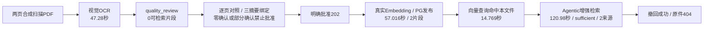

# RAG 模块流程验收报告

> 2026-10-22—23 · 对照[架构](RAG模块架构.md)与[优化规划](RAG模块优化规划.md)。服务0.5.1、HTTP契约1.3.1。整体goal进行中；本轮通过不等于完整业务验收或服务器上线。

## 1. 基线失败与修改

| 场景 | 发现的问题 | 修改 / 复测结论 |
|---|---|---|
| S03/S05 用户政策PDF | 3页已vision_ocr，但旧页面无复核入口、审核主体未配置 | 补原件对照、逐单元确认、批准/拒绝/重检；配置本机7天操作员，未自动批准真实政策文件 |
| S12 模型异常 | assessment_unavailable误说成知识库无证据 | 区分模型失败、异常格式、超时、输出预算不足；机制测试通过 |
| 文档一致性 | 图片总览缺质量分支，多份旧基线并存 | 统一两份Mermaid主文档；删旧ARCHITECTURE入口与两组PNG/SVG共4张重复图；旧规划标历史，保留历史证据 |
| S13 复杂业务题 | 流贷/固贷用途题116.28秒，20候选窗口、0可展示来源，覆盖核对未完成 | **仍未通过**；简单合成问题通过不能替代，先定位再固定原题复验 |
| OCR首次尝试 | 两页合成扫描件首次failed，仅有泛化错误 | 根因未取证，不能归咎网络；补页号、超时/连接/HTTP/截断安全诊断；一次授权重检41.78秒识别完成，不宣称根因已修复 |
| 浏览器等待 | 首次批准202后测试过早读取processing，审计断言失败；样本随后撤回 | 改显式HTTP轮询，核验ready/片段数/主体；新样本复测通过。取消烟测同步改严格核验并通过 |

## 2. 分层结果

| 验证 | 实际结果 | 证明范围 / 局限 |
|---|---|---|
| 后端默认完整回归 | 204项：191通过、13跳过；11.659秒 | 机制与契约；跳过不算通过 |
| 后续OCR诊断相关回归 | test_document_quality 6项通过，0.169秒 | 完整回归后新增诊断，针对截断/HTTP错误不泄露响应等复验 |
| 真实PG审批/发布 | opt-in test_quality_review 5项通过，420.424秒 | 随机隔离schema；真实PG，合成解析/Embedding；覆盖三摘要、范围、发布屏障、撤回 |
| React交互 | 2文件21项通过，99.44秒 | 完整确认、部分禁用、冲突失效、未配置授权、请求契约；初次超时后定位改组件测试，完整页面另做浏览器验证 |
| 生产构建 | TypeScript与Vite通过 | 主bundle约696KB有体积提示；无首屏/无障碍/负载结论 |
| 浏览器+FastAPI | 通过 | 真实Cookie/SSE/页面/路由，合成模型/DB/OCR；覆盖引用、错误/取消、上传/撤回、对照/批准/拒绝/重检、移动布局 |
| 真实OCR/Embedding/增强检索 | 两页合成扫描PDF流程通过 | 真实视觉模型、Embedding、PG与SDK；不是业务金标，未做此样本最终回答生成 |
| 接口/依赖 | OpenAPI快照检查、pip check通过 | 新增可选字段；不是完整安全审计 |
| 主站 / 汇丰服务器 / 专用重排 / 法宝 | 本轮未验收 | 不计通过；当前本机vector，法宝与专用重排未启用 |

各层不能相加成“业务全部通过”。原有16项基础HTTP结果见[前次实测](ACCEPTANCE-2026-10-22.md)，不替代本报告。

## 3. 真实依赖样本与耗时

自制两页纯图片PDF含唯一标识、USD 5000、金额不符停止处理、不得改币种等已知文字，无客户数据或真实政策。程序逐页比较OCR与生成原稿（仅归一空白），核对原件SHA，在真实浏览器逐页确认；这是合成原稿对照测试，不冒充人工批准真实银行文件。

原流程13个检查通过；重启后的补查也确认该样本不再被检索到，/docs可访问，共15个检查。[机器摘要](docs/acceptance/2026-10-23-live-ocr.json)。原稿/完整日志在忽略目录data/flow-acceptance。样本已撤回，不可再以该ID测试成功检索；需按S03—S05创建新样本。

这只覆盖两页清晰英文，未证明中文扫描、手写、复杂跨页表格或长页OCR质量；首次OCR失败保留。简单增强检索约121秒是明确时延缺口，不能只因sufficient就称体验优秀。

## 4. 复现与交接

1. 模块根目录运行 `python -m unittest discover -s tests -v`；隔离PG需测试账号和显式HBCN_TEST_POSTGRES=1，不用正式业务库作测试集。
2. ui目录运行 `npm test && npm run build`；按[工作台说明](ui/README.md)配置Playwright/Edge后运行 `node scripts/smoke-ui.cjs`，只启停自己的合成服务。
3. 按[部署说明](deploy/README.md)配置真实依赖与本机复核profile，key不进浏览器。上传带唯一标识的两页合成扫描件，等quality_review，对照原件；先验未确认/部分确认不能批准，再完整确认批准。
4. 202后轮询实际ready、chunk_count>0并核验主体/版本；用唯一标识问/query和/retrievals，核对原文页码/事实/充分性；最后撤回，验原件不可读、后续检索不含该文档。

本机8012依赖临时进程和SSH，不是服务器常驻部署。执行环境切换后确认8012无监听、补查被拒绝连接；重新启动后，本次/health确认0.5.1、/docs返回200、带会话/ready返回200且sdk_runtime=ready，撤回文档不再命中。历史通过不代替当前存活，也不能据此承诺永久在线。

## 5. 剩余项与审核顺序

- 先量测规划/召回/覆盖批次耗时、模型终止原因与资源；runtime单次45秒和RAG单次90秒/总240秒差异仅是待核对配置，尚未证明为复杂题根因。先诊断再改预算/并发，不删质量核对或静默换弱模型。
- 固定复杂业务失败题；第8/9/10套需业务方确认授权、答案、证据页、案件族holdout，故意造错资料本身不是金标。
- OCR分级自动放行未实现；hybrid真实对照、专用rerank、外部来源冲突/现行性需单独验收。
- AI真实身份/任务ACL、法宝联合调用、Linux/Docker部署、持久队列/恢复备份、并发负载待取证；不改队友业务逻辑，不合入main。

本轮交付范围仅为RAG模块、相关契约与报告；发布固定lfc的实际Git提交，不将工作区修改当成已部署。整体goal保持active，未宣告全面完成。

## 6. 10月23日追加复审：召回并行，模型失败保留

改动以f43be99为基线，仅限RAG内部召回及配置、图与说明；通过已有LangChain Runnable.batch并行独立查询，默认3路。HTTP契约保持1.3.1，部署时仍须固定新的lfc提交；本机已有常驻进程不会因源码提交自动更新。

| 同一道复杂业务题，真实依赖 | 串行基线 | 并发3路 |
|---|---:|---:|
| 初始化（图外，单列） | 52.218秒 | 58.640秒 |
| 问题理解与改写SDK | 18.656秒 | 15.735秒 |
| 召回节点跨度（含归并后生命周期检查） | 53.719秒 | 35.188秒 |
| 核对前生命周期检查 | 3.859秒 | 3.203秒 |
| 原文核对SDK，均未返回答案 | 51.094秒 | 48.797秒 |
| 图内总耗时 | 127.500秒 | 103.250秒 |
| 查询数 / 候选窗口数 | 4 / 20 | 4 / 20 |
| 停止原因 / 最终可展示来源 | assessment_unavailable / 0 | assessment_unavailable / 0 |

这是固定问题“流动资金贷款和固定资产贷款的用途限制分别是什么？”的一次前后观察，不是稳定性能基准。相同scope、top_k、模型/图预算；两次模型重新改写，未冻结具体查询与候选身份，因此候选数量相同不证明相关性相同。Embedding与SQL为嵌套计时，不能与节点总耗时相加。并发时部分单路耗时反而增加，需要后续评估数据库池/网络/限流，不据此承诺多用户吞吐。[无正文机器摘要](docs/acceptance/2026-10-23-retrieval-latency.json)。

机制回归：完整默认套件207项（194通过、13跳过），40.322秒；最后补齐排队截止测试后，当前并发专题4项全部通过，0.358秒。专题覆盖逆序完成仍与串行结果一致、全局查询预算、跨线程取消与等待清理、首错后停止排队I/O、总预算耗尽后不启动排队查询或模型核对。最后修改未重复完整套件，不能写成208项完整通过。无UI代码变更，未重复UI构建；此前构建结果仅对应上一轮UI。

本轮隔离HTTP烟测通过：实际服务启动、health/docs/OpenAPI、来源/重排契约和鉴权；该烟测不调用共享数据库或真实模型，不能替代上表的真实依赖失败结果。

**复杂业务题仍未通过。** 当前presented_windows/batch_count只累计成功核对的批次，0不表示从未向模型提交原文；本次确有核对调用，但未取得可校验输出。源码可见runtime的空answer可能来自超时、执行失败或成功后无最终文本；RAG目前仅报通用空答。必须取得上游安全终止状态后再修改预算或接口，不能仅凭约49秒推断根因。本轮未改共享assistant-runtime或放松覆盖、引用、撤回检查。

## 7. 10月23日隔离分支复验：ceafa40

本次在 `lfc-rag` 独立 worktree、基线 `ceafa40` 复验；工作区起始干净。Python 3.13 虚拟环境按 `requirements-dev.txt` 安装依赖后执行 `python -m unittest discover -s tests -v`：**208项，195通过、13跳过、0失败**。跳过项需要 opt-in 的隔离 PostgreSQL schema 或显式外部语料路径；因此 PostgreSQL FTS/并发撤回真实数据库测试仍未执行。此套测试主要是合成数据、Mock/故障注入，不代表业务金标准、真实模型或法宝调用。

RAG UI 在本隔离 worktree 安装锁定依赖后，`pnpm exec vitest run --maxWorkers=1` 通过：2个文件、21项、0失败，耗时130秒。`pnpm build` 通过（TypeScript 与 Vite）；产物主 JS 约696 KB，Vite 提示超过500 KB拆包建议，记为非阻断优化项。默认并行 worker 首轮超过40秒无输出后中断；单 worker 完整复验通过，保留时延供后续诊断。

长期 Goal 工具仍返回既有目标为 `blocked`，并拒绝新建重复目标；当前工具没有把 `blocked` 重新设为 `active` 的操作。本轮按交接要求继续复验，但不伪报 Goal 已激活。此前相关执行记录有远端 compact stream 在完成前断开的失败；当前隔离工作树已正常加载，`lfc-rag` HEAD 为 `ceafa40`，并非代码树未加载或有隐含新提交。

目标服务器状态由只读交接核查提供：`/opt/hbcn-rag` 与 `/etc/hbcn-rag/rag.env` 不存在，8011 连接拒绝。故 Linux/云端启动、health/ready、主站→RAG 请求、持久化和恢复演练全部 **pending**；不执行部署或服务器修改。当前专用 reranker 也没有可用配置/服务证据；接口机制测试通过不代表 rerank 已启用或质量优于 RRF。

## 8. 10月23日补充复验：启动恢复与索引失败

### 跳过项及本机环境

完整 Python 回归为 **211项：198通过、13跳过、0失败**。13项逐项跳过原因如下；启用测试标记仍必须同时提供专用、可丢弃的隔离库或语料，标记本身不是安全证明。

| 测试 | 跳过原因 |
|---|---|
| `test_hybrid_retrieval.HybridPostgresTests.test_live_lexical_hybrid_and_lifecycle` | 未设 `HBCN_TEST_POSTGRES=1`；需隔离 PostgreSQL 验证真实 FTS、索引回填与 scope 过滤 |
| `test_document_lifecycle.DocumentLifecyclePostgresTests.test_withdrawal_atomically_blocks_both_channels_readers_and_stale_vector_results` | 同上；需真实 PG 验证事务撤回、向量/词法读屏障 |
| `test_document_lifecycle.DocumentLifecyclePostgresTests.test_withdrawal_during_indexing_fences_final_publication` | 同上；需真实 PG 验证撤回与索引发布竞态 |
| `test_document_lifecycle.DocumentLifecyclePostgresTests.test_ordinary_ingestion_can_publish_then_withdraw_without_erasing_original` | 同上；需真实 PG 验证发布/撤回生命周期 |
| `test_document_lifecycle.DocumentLifecyclePostgresTests.test_graph_withdrawal_during_generation_suppresses_answer_and_original_evidence` | 同上；需真实 PG 验证生成期间撤回后不发布答案/证据 |
| `test_document_lifecycle.DocumentLifecyclePostgresTests.test_evidence_only_graph_rechecks_after_assessment_and_cannot_claim_sufficiency` | 同上；需真实 PG 验证证据复核期间撤回 |
| `test_quality_review.QualityReviewPostgresTests.test_pending_content_not_embedded_until_exact_review_and_uses_reviewed_text_without_reocr` | 未设 `HBCN_TEST_POSTGRES=1`；需真实 PG 验证逐单元批准、复用核验文本再入库 |
| `test_quality_review.QualityReviewPostgresTests.test_invalid_text_and_changed_original_are_never_embedded_and_withdrawn_review_is_blocked` | 同上；需真实 PG 验证原件变更/撤回对复核和入库的阻断 |
| `test_quality_review.QualityReviewPostgresTests.test_http_review_requires_separate_live_scope_bound_key_and_rejects_forged_identity` | 同上；需真实 PG 验证 HTTP 复核授权及 scope 绑定 |
| `test_quality_review.QualityReviewPostgresTests.test_changed_parsed_units_invalidate_approval_and_rejection_never_enqueues` | 同上；需真实 PG 验证解析版本变化和拒绝后的队列状态 |
| `test_quality_review.QualityReviewPostgresTests.test_legacy_ready_sources_are_hidden_until_explicit_recheck_and_withdrawal_cannot_be_rechecked` | 同上；需真实 PG 验证旧 ready 隔离、显式重检和撤回单调性 |
| `test_reference_governance.ReferencePostgresTests.test_real_fts_transactions_publication_race_and_source_revocation` | 未设 `HBCN_TEST_POSTGRES=1`；需真实 PG 验证参考治理 FTS 事务、发布竞态和撤销 |
| `test_ragflow.RAGFlowClientTests.test_external_manifest_corpus_when_explicitly_configured` | 未设 `HBCN_TEST_SOURCE_ROOT`；需调用方显式提供含11份批准测试文件的外部语料根目录 |

隔离 worktree 没有 Docker/Podman、PostgreSQL 服务/客户端或本地 5432 监听；RAG 数据库 URL、数据库资源文件、SSH 隧道资源文件也均未配置。因此本机没有可安全使用的临时 PostgreSQL/容器，本次没有运行上述真实 PG 用例，也没有连接汇丰服务器或其他共享库。第13项外部语料路径未提供，未读取或处理真实业务原件。

### 离线故障注入与结果

发现一个就绪门禁问题：启动恢复 hook 抛错时，lifespan 会保存 `startup_error`，但 `/api/v1/ready` 之前没有检查它；若数据库和 runtime 后续探针成功，可能错误返回 ready。现已让 ready 在该状态下 fail closed，并添加测试验证启动会调用恢复 hook、恢复失败后 ready 返回503且不继续调用资源探针。

另新增一个 SQLite 事务测试夹具，对 `PostgresEngine.process` 注入“首批向量已部分写入后Embedding失败”。验证失败文档仍不可检索，下一次处理尝试先删除残留片段，再发布唯一且完整的一代片段；该夹具只测试应用编排和状态门禁，不模拟 PostgreSQL、pgvector、向量供应商事务或真实崩溃恢复。目标数据库中的 `recover_interrupted()` SQL更新、进程被杀后的磁盘/向量一致性仍须隔离 PostgreSQL 故障演练。

本次验证：`python -m unittest discover -s tests -v` 211项（198通过、13跳过）；`python scripts/smoke-isolated-api.py` 通过（临时本机HTTP服务、无共享数据库/模型调用）；`python scripts/export-openapi.py --check` 通过；`python -m pip check` 通过。UI 源码未变，沿用前节21项 UI 测试与构建结果。本次未运行 Docker/Linux，也未调用真实模型、Embedding、reranker、MCP、外部语料或目标服务器。

部署文档静态版本核对：当前 `app/version.py` 与部署 README / Docker tag 均为服务0.5.1、API 1.3.1，版本号一致，没有版本过期。README 已补入目标机当前未部署证据、systemd 权限待核验项、占位 token 说明、本地可复现命令和13项 skip 的前置条件。服务端部署、身份权限、备份恢复与主站真实联调继续 **pending**。

## 9. 10月23日接口边界与并发隔离复验

发布候选版本更新为服务 `0.5.2`、HTTP 契约 `1.3.2`。`/answers`、`/answers/stream`、`/retrievals` 现在拒绝请求体中的未知字段并返回422，防止调用方误以为 `session_id`/`request_id` 会建立RAG会话或赋予身份。RAG仍无服务端会话存储，调用方每次显式传 `conversation`；迁移要求及assistant兼容核对已写入[优化规划](RAG模块优化规划.md)和[API契约](API_CONTRACT.md)。

已检查 `lfc-assistant` 调用适配和测试：当前调用只发送正式字段，契约门禁接受 `1.x >= 1.2.0`，因此无需改 assistant 分支。面向其他旧调用方，收到422时按 detail 移除未定义请求字段；需要请求关联 ID 的由调用方本身记录。接口变更摘要已发至 AI助手会话，供联调引用。

并发合成测试让两个 GraphRun 使用不同 query/conversation，同时取消其中一个；通过验证取消请求不发布结果、另一个请求只返回自己的状态且容量正确释放。测试没有使用真实数据库或模型。

本轮回归：`python -m unittest discover -s tests` 213项（200通过、13跳过、0失败）；OpenAPI `--check` 通过。13项跳过条件仍见第8节，真实 PostgreSQL、外部批准语料、汇丰服务器联调及真实业务金标仍为 **pending**。本轮只更新独立 `lfc-rag` 工作区，尚未提交或合并。

## 10. 10月23日 422 校验响应脱敏复验

审查发现 FastAPI 默认 `RequestValidationError` 响应可能包含 `input`，因此 `/answers` 等接口的额外字段或格式错误可能回显请求原文。现增加统一安全处理器，422 只返回每项的 `loc` 与 `category`，不含 `msg`、`input` 或 `ctx`；未知字段的任意键名统一替换为 `<unknown_field>`。三个问答/检索端点的 OpenAPI 422 schema 也显式引用同一 `RequestValidationResponse`，schema 仅定义 `loc/category`，并有测试对照 schema 与运行时字段。API 契约为服务 `0.5.3`、HTTP `1.3.3`，文档要求调用方按 OpenAPI 清理未定义字段。

新增敏感哨兵回归：提交超长 query、伪造会话值和恶意未知字段名，断言三者均不出现在响应体，且校验项只含 `loc/category`；同时断言 answers、answers/stream、retrievals 的 OpenAPI 422 响应引用脱敏模型。最终验证：`py_compile` 通过；定向契约测试4项通过；`python -m unittest discover -s tests` 214项（201通过、13跳过、0失败）；OpenAPI 快照重导出后 `--check` 通过；`pip check` 与 `git diff --check` 通过。13项跳过仍需隔离 PostgreSQL/外部语料。修复只在 `lfc-rag`，不会直接合并。

## 11. 10月23日隔离 PostgreSQL、语料与检索基线审计

资源盘点：工作区无 Docker/Podman/PostgreSQL 可执行文件或服务，`127.0.0.1:5432` 未监听；RAG_DATABASE_URL、数据库资源文件和 SSH tunnel 文件均未配置。RAG 目录只含 `knowledge-base/catalog.json` 和说明，没有 SAFE_MANIFEST 的11个批准资料文件；`BUSINESS_SOURCE_ROOT` 与 `HBCN_TEST_SOURCE_ROOT` 均不可用。因此本轮没有启用 skip 标记，也没有连接共享/生产数据库；12项 PostgreSQL、1项批准语料测试仍未实测。

新增 `.github/workflows/rag-ci.yml`：用一次性 PostgreSQL 16 容器运行完整后端套件并显式启用 12 项 PostgreSQL 集成。新增 `scripts/postgres_test_prereqs.py` 和 `scripts/run-postgres-tests.ps1`，本机入口拒绝远端、非 loopback、数据库名不等于 `hbcn_rag_test`、缺 CREATE 权限或非 PostgreSQL 16 的目标。前置脚本只检查并连接，不创建/删除数据库；测试只创建带随机名的 schema 并在 teardown 删除。已补 URL 白名单单元测试。该 CI workflow 尚未由 GitHub 实际执行；本机没有 PostgreSQL，不能据静态/合成测试称这12项已通过。

批准语料最小复现仍需授权方准备根目录：设置 `HBCN_TEST_SOURCE_ROOT` 后运行 `python -m unittest discover -s tests -p test_ragflow.py`；这仅验证 11 个 manifest 文件存在和范围，不做业务检索评测。当前检索质量程序要求逐题审核的固定 exact/general/translated 查询与证据分级；holdout 至少六类各20题是代表性下限检查，不等于统计功效。已核对 reranker 实验共用同一最多20候选集合，所以 Recall@20 不会因重排而改善，排序变化看 nDCG@10。真实候选召回、指标门槛、置信区间分析计划和业务基线均缺批准金标/冻结结果，不能宣称过线；需要业务/法律审核人先定义 relevance 等级、通过/非劣阈值、案件族隔离与 holdout 使用规则。评测 schema 的审核人字段是声明，不具备身份签名；受控数据环境的签名、访问审计仍待完成。

契约审查：1.3.3 是 API-only，无数据库迁移；回退到 1.3.2/0.5.2 会恢复默认 422 input 回显，因此旧代码不可直接重新对外服务。已在 API 契约与部署文档加入口限制、补等效脱敏/网关后才恢复的回退步骤。本轮检索基线审查未使用真实业务数据，也没有更改任何排序/召回参数。

本次续验使用项目 `.venv`（Python 3.13）：全量套件 **218项，205通过、13跳过、0失败**；新增数据库前置/模块契约定向测试8项通过。OpenAPI 快照按当前脱敏422契约重生成后 `--check` 通过，`pip check`、Python 编译、GitHub Actions YAML 解析、PowerShell 脚本语法和 `git diff --check` 均通过。13项仍因本机没有 PostgreSQL/DSN及外部批准语料而跳过；GitHub workflow 已配置但尚未实际运行，不能据此关闭这些验收缺口。
