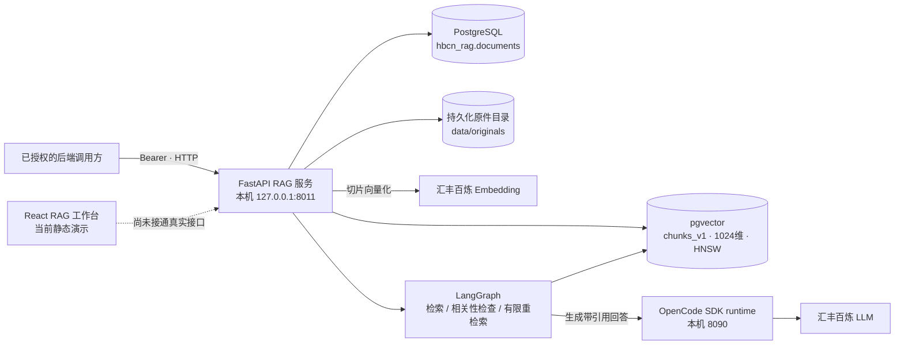
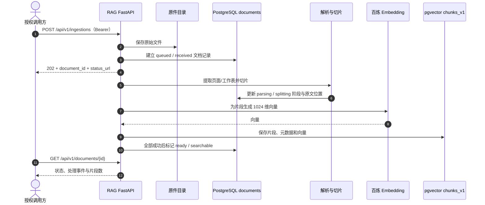
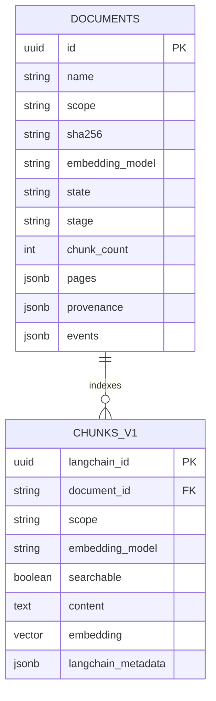

# RAG 模块总览与运行说明

独立的境外贷款知识查询模块。2026-10-21 已真实跑通 PostgreSQL/pgvector 入库、业务检索与 OpenCode SDK 引用问答。**当前主机验收不代表已经部署到团队 ECS，也不代表 RAG 工作台或主站助手已完成端到端联调。** 后端验收明细见 [`docs/RAG后端验收与运行.md`](../../docs/RAG后端验收与运行.md)，ECS 迁移步骤见 [`docs/部署到汇丰ECS实施方案.md`](../../docs/部署到汇丰ECS实施方案.md)。

## 一页现状

| 项目 | 当前事实 |
| --- | --- |
| 代码位置 | `code/rag-service/`，独立 FastAPI 服务；不并入主站后端进程 |
| 已验收服务 | 本机 `127.0.0.1:8011`；旧 `8010` 是另一实例，不代表本次版本 |
| 检索存储 | 汇丰 PostgreSQL 的 `hbcn_rag` schema，pgvector 1024 维向量表 `chunks_v1`，HNSW 索引 |
| 已接能力 | 百炼 Embedding、OpenCode SDK、文件解析/切片、相关性核对与有限重检索、带引用回答、原文定位 |
| 验收证据 | 自动回归 47 项通过；具体资料范围和测试边界见验收报告 |
| 尚未完成 | ECS 常驻部署、真实 RAG UI 接线、主站助手到 8011 的部署联调、任务级资料权限、完整法规服务 |
| 原件位置 | 当前验收环境为本机 `data/originals/`；迁移时必须与数据库记录一起搬迁并备份 |

## 当前 RAG 架构

此图说明已验收的独立后端。主站适配层代码已存在，但 ECS 上的服务地址、Token 和端到端调用仍须按部署方案验证。



## 入库时序



## 当前数据关系



`DOCUMENTS.events/pages/provenance` 是文档记录中的 JSONB 字段，不是单独的事件表；原始文件存于文件系统，不是 PostgreSQL 大对象。`document_id` 是片段回到文档的逻辑关联。RAG 原件目录和数据库都要备份，不能只备份 pgvector。

## 技术选择

- 向量存储复用官方 [langchain-postgres](https://github.com/langchain-ai/langchain-postgres) `PGEngine` / `PGVectorStore`，连接汇丰 PostgreSQL/pgvector，创建独立 schema 与 HNSW 索引。
- 切分复用 [LangChain Text Splitters](https://github.com/langchain-ai/langchain/tree/master/libs/text-splitters)；解析使用 pypdf、pypdfium2、python-docx、openpyxl，不自建向量相似度算法或切片器。
- 编排复用 [LangGraph](https://github.com/langchain-ai/langgraph)：问题理解 → 检索 → SDK 核对相关性 → 必要时改写重检索（最多两轮）→ SDK 回答 → 引用编号校验。不展示模型内部思维链。
- 智能调用已有 `code/assistant-runtime` OpenCode SDK `/runs`；当前 SDK 模型为汇丰百炼 `qwen3.8-flash`，Embedding 为 `qwen3.7-text-embedding-flash`、1024维。
- 使用轻量成熟库而非复制完整平台：当前未部署 Docker/RAGFlow，不把旧 SQLite 冒充 PostgreSQL。旧 local/ragflow 引擎保留兼容；新增接口仅用于显式 `RAG_ENGINE=postgres`，不静默回退。

## 安装与运行

在本目录执行，Windows / Python 3.12 实测：

```powershell
python -m venv .venv
.venv\Scripts\python -m pip install -r requirements.txt
Copy-Item .env.example .env
# 配置完成后启动；已有 .env 时跳过复制，不要覆盖
.\scripts\start-backend.ps1 -Port 8011
```

本机现有 `.env` 已配置。后台隐藏运行，仅监听 `127.0.0.1:8011`；检测冲突，不杀已有进程。日志/PID 在忽略目录 `data/`。停止：`scripts/stop-backend.ps1 -Port 8011`。

| 配置 | 含义 |
| --- | --- |
| `SERVICE_TOKEN` | 服务鉴权，不提交、不发浏览器 |
| `BAILIAN_BASE_URL` / `BAILIAN_API_KEY` | 已下发百炼地址/授权 |
| `RAG_DATABASE_URL` | 直接连接串，与资源文件方式二选一 |
| `RAG_DATABASE_RESOURCE_FILE` | PostgreSQL 资源文件路径，读取 PGHOST/PGPORT/PGDATABASE/PGUSER/PGPASSWORD |
| `RAG_SSH_RESOURCE_FILE` / `RAG_SSH_HOST_KEY_SHA256` | 本机经 ECS 访问私网 RDS；固定主机指纹，不接受任意密钥 |
| `RAG_POSTGRES_SSLMODE` | 默认 require；本次 RDS 不支持 TLS，经 SSH 隧道显式 disable，不能自行开放数据库公网 |
| `ASSISTANT_RUNTIME_URL` | 已有 SDK 运行时，默认本机8090 |
| `ASSISTANT_RUNTIME_TOKEN` / `ASSISTANT_RUNTIME_RESOURCE_FILE` | 服务 token，或仅读取已有 runtime `.env` 中的 token |
| `RAG_DATABASE_SCHEMA` / `RAG_VECTOR_TABLE` | 默认 hbcn_rag / chunks_v1，不改主项目业务表 |
| `RAG_DATA_DIR` | 原件目录，默认 data/，须与数据库一起备份 |

**必须单实例、单 worker**：启动会将上次中断任务标为失败，不能运行两个实例共享此 schema 同时恢复任务。更换向量维度须配置新表并重新导入，不能覆盖旧表。不要使用 reload 作为长期部署方式。

本次应用在本地电脑，数据库在汇丰私网；电脑休眠、SDK 退出、SSH 中断都会影响服务。不是 ECS 常驻生产部署，也未开放公网入口。

## HTTP 契约

`/health` 仅判断进程存活。以下 API 全部要求 `Authorization: Bearer <SERVICE_TOKEN>` 或本机 `/ui/` 签发的同源 HttpOnly 会话。主系统仍负责用户与任务权限，本服务不开放 task_documents。

| 方法与路径 | 用途 |
| --- | --- |
| `GET /api/v1/ready` | 实查数据库、pgvector、列维度和 SDK 健康状态；不产生模型费用，不冒充真实模型验收 |
| `GET /api/v1/capabilities` | 配置能力、范围、格式及上传上限；不是就绪检测 |
| `POST /api/v1/ingestions` | 推荐异步上传：multipart file、scope；可选 source_url、jurisdiction；返回202、document、status_url |
| `GET /api/v1/documents` | 列表及 queued/processing/ready/failed 状态 |
| `GET /api/v1/documents/{id}` | 状态、持久化处理事件 |
| `POST /api/v1/documents/{id}/retry` | 仅重试失败文档；损坏原件仍会失败 |
| `GET /api/v1/documents/{id}/content?chunk_id=...` | 全文 pages/sections、命中 focus 的真实页码/工作表/字符起点；拒绝跨文档片段 |
| `GET /api/v1/documents/{id}/source` | 受鉴权原件；PDF inline，其他 attachment；HTML 不作为可信网页执行 |
| `POST /api/v1/query` | 原有纯证据检索协议，不生成答案 |
| `POST /api/v1/answers` | 真问答：answer、sources、warnings、grounding、retrieval_rounds |
| `POST /api/v1/answers/stream` | 同一问答图，SSE step/result/error；不使用计时器模拟动态 |
| `POST /api/v1/documents` | 旧同步入口，新接入改用 ingestions 与轮询 |

问答请求：

```json
{"query":"固定资产投资类贷款的用途应如何填写？","scope":"business_rules","top_k":5,"conversation":[]}
```

scope 为 business_rules/project_design/law/all。conversation 最多12条 role(user/assistant) + content，仅用于补全指代，不作为事实依据。sources 返回引用编号、原文、document_id、chunk_id、物理 PDF 页码（Office/文本为 null）、原件/全文相对 URL。

无足够相关证据时 grounding=insufficient，不能用相似度冒充置信概率或审批结论。引用编号校验不等同于法律真实性证明；法规始终附带效力/适用性复核提示，北大法宝商业 API/MCP 尚未接入。

## 上传与原件

真实阶段：received → parsing → splitting → embedding → indexing → ready；异常 failed，重启中断 interrupted。原件在 `data/originals/{UUID}/original`，元数据、解析全文、事件和向量在独立 PostgreSQL schema。处理中的向量不可检索，完成时事务性开放。按 scope/SHA256/embedding模型去重；失败重试用 retry。

支持 PDF、DOCX、XLSX、TXT/MD/CSV/JSON/HTML、常见图片；旧版 DOC/XLS/PPT/PPTX 先转换。PDF保留真实页码，DOCX/Excel不伪造页码。扫描页/图片复用 OCR 客户端，失败时走百炼视觉；不保证所有扫描质量。默认50MiB/文件、500页PDF、200万字符、2个解析线程、8个处理/排队名额。问答并发4，每次SDK调用默认超时90秒，完整问答可包含多次调用，调用方须设更长请求超时。

## 白名单导入与验收

```powershell
.venv\Scripts\python -m pip install -r requirements-dev.txt
.venv\Scripts\python scripts/ingest-corpus.py --source-root '实际共享资料根目录'
.venv\Scripts\python scripts/ingest-corpus.py --source-root '实际共享资料根目录' --execute
.venv\Scripts\python scripts/verify-backend.py
.venv\Scripts\python scripts/verify-backend.py --persistence-only
$env:HBCN_TEST_SOURCE_ROOT = '实际共享资料根目录'
.venv\Scripts\python -m unittest discover -s tests -v
```

导入默认预览，仅4份明确业务资料、2份已检查文本的境外贷款通知，不扫描资源凭证目录。真实验收会产生少量模型费用并创建明确标记的验收资料；报告在 data/，不含凭证与业务原文。新电脑需准备知识文件，见 `knowledge-base/README.md`；catalog 不能替代原文正确性检查。

## 接入边界

**后端跑通不等于 UI 已接通。** 当前 `ui/` React 页面仍含静态演示和模拟动态，本次未修改，不作为后端验收证据。下一步 UI 按新接口连接真实上传、阶段、问答及阅读器。

主系统调用方需将 RAG_BASE_URL 指向实际8011服务，服务 token 仅留后端；本次没有修改队友配置/代码，未停止原有8010实例。旧 `scripts/deploy-ragflow.ps1` / `app.cli` 是 RAGFlow 工作流，不用于本次 PostgreSQL 验收。
