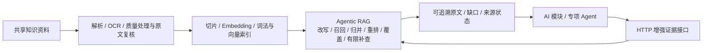

# RAG 模块｜架构、优化规划与运行

> 当前代码协作基线：lfc。模块独立部署，其他 AI / 业务模块通过 HTTP 调用，内部更新不要求调用方修改索引实现。



## 阅读入口

| 看什么 | 唯一维护入口 |
|---|---|
| 先看图理解模块 | [RAG模块架构](RAG模块架构.md)：总图、入库、Agentic、部署边界与源码入口 |
| 怎么改、怎么测、如何验收 | [RAG模块优化规划](RAG模块优化规划.md)：实现方案、场景S01–S14、循环与完成标准 |
| 本轮实际结果 | [RAG模块流程验收报告](RAG模块流程验收报告.md)；前次真实链路见[2026-10-22记录](ACCEPTANCE-2026-10-22.md) |
| 其他同事调用 | [接入指南](INTEGRATION.md)、[HTTP契约](API_CONTRACT.md)、[OpenAPI](contracts/openapi-v1.json) |
| 部署与维护 | [部署交接](deploy/README.md)、[工作台构建](ui/README.md) |

## 当前边界

本机8012已有真实PG/Embedding/模型的基础链路记录，**尚不等于汇丰服务器已部署或主站已完成联合验收**。当前实例使用vector模式；hybrid、可选法宝、多源与专用重排的机制和启用/质量验收分别记录。复杂流贷/固贷题已有模型覆盖核对失败，仍需复验。

你上传的政策问答已真实OCR到3页，停在quality_review，尚未Embedding。本轮补受控操作员原文对照与批准/拒绝/重检页面；是否可用以本轮报告和实际部署配置为准，不自动批准真实文件。历史R01–R21材料是机制和决策证据，入口为[历史规划](../../docs/Agentic-RAG优化规划.md)与[历史台账](../../docs/RAG持续优化执行台账.md)，不作为新的独立实施基线。

## 技术选择

- 向量存储复用官方 [langchain-postgres](https://github.com/langchain-ai/langchain-postgres) `PGEngine` / `PGVectorStore`，连接汇丰 PostgreSQL/pgvector，创建独立 schema 与 HNSW 索引。
- 切分复用 [LangChain Text Splitters](https://github.com/langchain-ai/langchain/tree/master/libs/text-splitters)；解析使用 pypdf、pypdfium2、python-docx、openpyxl，不自建向量相似度算法或切片器。
- 编排复用 [LangGraph](https://github.com/langchain-ai/langgraph)：问题理解 → 检索 → SDK 核对相关性 → 必要时改写重检索（最多两轮）→ SDK 回答 → 引用编号校验。不展示模型内部思维链。
- 智能调用已有 `code/assistant-runtime` OpenCode SDK `/runs`；当前 SDK 模型为汇丰百炼 `qwen3.8-flash`，Embedding 为 `qwen3.7-text-embedding-flash`、1024维。
- 使用轻量成熟库而非复制完整平台：当前未部署 Docker/RAGFlow，不把旧 SQLite 冒充 PostgreSQL。旧 local/ragflow 引擎保留兼容；新增接口仅用于显式 `RAG_ENGINE=postgres`，不静默回退。

## 安装与运行

在本目录执行，Windows / Python 3.12 实测：

```powershell
python -m venv .venv
.venv\Scripts\python -m pip install -r requirements.txt
Copy-Item .env.example .env
# 配置完成后启动；已有 .env 时跳过复制，不要覆盖
.\scripts\start-backend.ps1 -Port 8011
```

以上是通用启动方式，需先配置实际可达的数据库、Embedding、协议 2 runtime 与 Token；模板中的本机 8090 不保证有运行时。启动脚本后台隐藏运行，检测端口冲突，不杀已有进程；日志/PID 在忽略目录 `data/`。停止用 `scripts/stop-backend.ps1 -Port <实际端口>`。本轮8012使用本机临时隧道、隔离验收schema与原件目录；当前状态看[流程报告](RAG模块流程验收报告.md)，不要同时再启动一个共享该schema的worker。

| 配置 | 含义 |
| --- | --- |
| `SERVICE_TOKEN` | 服务鉴权，不提交、不发浏览器 |
| `BAILIAN_BASE_URL` / `BAILIAN_API_KEY` | 已下发百炼地址/授权 |
| `RAG_DATABASE_URL` | 直接连接串，与资源文件方式二选一 |
| `RAG_DATABASE_RESOURCE_FILE` | PostgreSQL 资源文件路径，读取 PGHOST/PGPORT/PGDATABASE/PGUSER/PGPASSWORD |
| `RAG_SSH_RESOURCE_FILE` / `RAG_SSH_HOST_KEY_SHA256` | 本机经 ECS 访问私网 RDS；固定主机指纹，不接受任意密钥 |
| `RAG_POSTGRES_SSLMODE` | 默认 require；本次 RDS 不支持 TLS，经 SSH 隧道显式 disable，不能自行开放数据库公网 |
| `ASSISTANT_RUNTIME_URL` | 实际可达的协议 2 SDK 运行时；不要把模板 8090 当已部署地址 |
| `ASSISTANT_RUNTIME_TOKEN` / `ASSISTANT_RUNTIME_RESOURCE_FILE` | 服务 token，或仅读取已有 runtime `.env` 中的 token |
| `RAG_DATABASE_SCHEMA` / `RAG_VECTOR_TABLE` | 默认 hbcn_rag / chunks_v1，不改主项目业务表 |
| `RAG_DATA_DIR` | 原件目录，默认 data/，须与数据库一起备份 |

**必须单实例、单 worker**：启动会将上次中断任务标为失败，不能运行两个实例共享此 schema 同时恢复任务。更换向量维度须配置新表并重新导入，不能覆盖旧表。不要使用 reload 作为长期部署方式。

本次应用在本地电脑，数据库在汇丰私网；电脑休眠、SDK 退出、SSH 中断都会影响服务。不是 ECS 常驻生产部署，也未开放公网入口。

## HTTP 契约

`/health` 仅判断进程存活。以下 API 全部要求 `Authorization: Bearer <SERVICE_TOKEN>` 或本机 `/ui/` 签发的同源 HttpOnly 会话。主系统仍负责用户与任务权限，本服务不开放 task_documents。

| 方法与路径 | 用途 |
| --- | --- |
| `GET /api/v1/ready` | 实查数据库、pgvector、列维度和 SDK 健康状态；不产生模型费用，不冒充真实模型验收 |
| `GET /api/v1/capabilities` | 配置能力、范围、格式及上传上限；不是就绪检测 |
| `POST /api/v1/ingestions` | 推荐异步上传：multipart file、scope；可选 source_url、jurisdiction；返回202、document、status_url |
| `GET /api/v1/documents` | 列表及 queued/processing/ready/failed 状态 |
| `GET /api/v1/documents/{id}` | 状态、持久化处理事件 |
| `POST /api/v1/documents/{id}/retry` | 仅重试失败文档；损坏原件仍会失败 |
| `GET /api/v1/documents/{id}/content?chunk_id=...` | 全文 pages/sections、命中 focus 的真实页码/工作表/字符起点；拒绝跨文档片段 |
| `GET /api/v1/documents/{id}/source` | 受鉴权原件；PDF inline，其他 attachment；HTML 不作为可信网页执行 |
| `POST /api/v1/query` | 原有纯证据检索协议，不生成答案 |
| `POST /api/v1/retrievals` | 增强证据检索：问题规划、归并、覆盖检查与有限补查，跳过最终答复生成 |
| `POST /api/v1/answers` | 真问答：answer、sources、warnings、grounding、retrieval_rounds |
| `POST /api/v1/answers/stream` | 同一问答图，SSE step/result/error；不使用计时器模拟动态 |
| `POST /api/v1/documents` | 旧同步入口，新接入改用 ingestions 与轮询 |

问答请求：

```json
{"query":"固定资产投资类贷款的用途应如何填写？","scope":"business_rules","top_k":5,"conversation":[]}
```

scope 为 business_rules/project_design/law/all。conversation 最多12条 role(user/assistant) + content，仅用于补全指代，不作为事实依据。sources 返回引用编号、原文、document_id、chunk_id、物理 PDF 页码（Office/文本为 null）、原件/全文相对 URL。

`/retrievals` 使用相同请求字段；返回 sources、evidence_status（sufficient/insufficient/clarification）、missing、stop_reason、retrieval_rounds、warnings、可选 clarification_question 和 `query_context`，不返回 answer 或 grounding。`query_context` 保留带原文位置的用户陈述摘录、未知槽位和多值歧义；来源匹配通过不等于陈述真实或提取完整。部分相关原文可以与 insufficient 状态同时存在，调用方必须处理缺口，不能因 sources 非空就宣告依据充分。该接口用于后续主站接线，现有 `/query` 语义不变。

源码默认每次至多 4 个初始表达（原问题＋优先保留通用/翻译分支），全程至多 6 次引擎检索、2 轮，问答总预算 240 秒、单次 SDK 90 秒。独立查询通过现有 LangChain batch 默认并发3路，`RAG_RETRIEVAL_CONCURRENCY` 可设1—6；结果按计划顺序归并。配置见 `.env.example` 的 RAG_MAX_QUERY_VARIANTS / RAG_MAX_RETRIEVAL_QUERIES / RAG_MAX_RETRIEVAL_ROUNDS / RAG_TOTAL_TIMEOUT_SECONDS；总预算在阶段边界及排队查询启动前检查并传给 SDK，不是对数据库驱动的强制取消，在途调用清理完成前保留请求名额。词法混合的实现与迁移见下节；跨源 rerank 与完整撤销治理仍在后续阶段。

多查询融合复用已锁定的 langchain-postgres RRF，只增加本项目的查询族去偏、来源/版本标识与评分类型适配；不把融合分标成相似度或审批概率。当前相关性/充分性选择仍依赖 SDK，未替代独立金融质量评测。

无足够相关证据时 grounding=insufficient，不能用相似度冒充置信概率或审批结论。第五轮增加逐段模型支持判断与精确原文短引/完整映射校验，未通过会隐藏业务答复；状态 supported_by_model 仍不等同于法律真实性证明；法规始终附带效力/适用性复核提示，法宝只读 MCP 适配已完成源码与部分真实烟测，商业缓存边界及完整法规验收仍待完成。

## 答复原文支持核对

生成答复后追加一次 SDK 核对，每个展示段落和每个引用必须映射到原文精确短引；保存答复/段落 hash、短引位置以及长文父片段锚点。response.answer_verification 区分 supported_by_model、unsupported、invalid_verification、verification_unavailable 等状态。核对不通过时保留来源、隐藏未核实业务答复，grounding=insufficient。纯证据入口不生成、不追加此调用。

短引存在是确定性校验，语义支持仍是模型判断，不能证明法律适用性、模型无遗漏或审批正确。第五轮真实正反对照分别通过和拒绝，但自由生成两次因额外主张被拒；第六轮改为严格结构化业务结论＋精确原文短引，服务端渲染引用、局限单列，同一合成问题的真实完整链路通过（2 段、59.84 秒）。只证明该样例修复，不代表整体答复质量达标。预算包含在既有总时限中，不无限修复重试。结构化修复与实测见 [第六轮记录](../../docs/RAG优化第六轮验证记录.md)，失败沿革见 [第五轮记录](../../docs/RAG优化第五轮验证记录.md)。

## 长文窗口与上下文覆盖

第四轮修复 SDK 静默截断：长片段拆成原文窗口，metadata.excerpt 保存父片段 ID/hash、起止字符、原文长度和窗口计数。原片段链接保留；偏移按 Unicode codepoint，不是 JS UTF-16 下标。每段发给 SDK 的内容与返回引用窗口一致，不让整段未读正文冒充已核对依据。

默认 `RAG_MAX_CONTEXT_WINDOWS=80`、`RAG_MAX_CONTEXT_BATCHES=6`，每批最多 20 段并核对 UTF-8 JSON 字节预算。多批初筛后对保留原文做联合覆盖核对；例外、反例及冲突须保留。超窗口/批次/总时限或联合依据仍过大时返回部分证据和缺口。context_coverage 的 input_complete 仅说明入围窗口完整提交，不代表全库/整法已读或结论准确。SDK 客户端超限直接报告，避免继续切掉正文或会话。详见 [第四轮验证](../../docs/RAG优化第四轮验证记录.md)。

## 多源与独立重排配置

法宝默认关闭。将 `PKULAW_MCP_TOKEN` 通过服务端环境注入，设置 `PKULAW_MCP_ENABLED=true`；不把桌面 Codex 配置做成运行依赖。请求示例（已有服务鉴权之外的 JSON 请求体）：

```json
{"query":"境外贷款应核查哪些风险管理要求？","scope":"law","sources":["knowledge_base","pkulaw"],"top_k":5}
```

sources 默认只含 knowledge_base。每轮法宝一个查询，默认全程最多两个，单次最多 3 条结果、最多 2 次有已知条号的补取；总时限与每次 30 秒预算共同约束。来源正文不全返回 source_status=partial、missing 及部分证据，不声称充分。只提供条文片段，不保证整部法规、附件或业务适用性。运行环境须确认实时使用、展示与存储授权；当前不持久化法宝正文缓存。

专用重排配置为 `RAG_RERANK_PROVIDER=cohere_compatible`、RAG_RERANK_URL/MODEL/TOKEN/REVISION；这表示接口协议，不限定模型厂商。默认 disabled，尚无已确认模型服务。非本机端点需要显式允许 `RAG_RERANK_ALLOW_EXTERNAL` 并落实资料数据流授权；不得为省部署工作把敏感资料发到未批准服务。配置服务失败时响应 rerank_status=unavailable，不冒充成功；模型版本和 token 截断未知会保留未核验标记。真实重排质量须另测，capabilities 仅表示配置，不表示可用性或达标。

## 混合检索升级与回滚

现有实例默认 `RAG_SEARCH_MODE=vector`，不自动迁移共享语料。先备份并在隔离环境验证，再在 RAG 虚拟环境执行：

```powershell
python -m app.lexical_index --apply
```

这会增加 `<向量表>_lexical` 派生表与 GIN，分批回填固定分词器版本，不重新向量化。之后设置 `RAG_SEARCH_MODE=hybrid`，重启对应实例并检查 `/api/v1/ready` 的 search_mode/lexical_tokenizer。未回填、版本不一致或 GIN 缺失时拒绝混合检索，不能把错误当作空召回。新文档在开放检索的事务中写入词法派生数据；删除原片段时级联删除词法记录。

回滚将模式设回 vector 并重启，不删除向量或原件；回滚期间新增资料需再次回填后才能重新启用 hybrid。中文 jieba 搜索分词（MIT）与 PostgreSQL FTS/GIN 提供词法候选，向量阈值仅用于向量通道，归并分保留在 metadata.channel_fusion，非余弦相似度。独立重排已接标准接口，实际模型资源与质量验收仍待完成。迁移/真实测试边界及候选方案比较见 [第二轮验证记录](../../docs/RAG优化第二轮验证记录.md)。

## 上传与原件

真实阶段：received → parsing → splitting → embedding → indexing → ready；异常 failed，重启中断 interrupted。原件在 `data/originals/{UUID}/original`，元数据、解析全文、事件和向量在独立 PostgreSQL schema。处理中的向量不可检索，完成时事务性开放。按 scope/SHA256/embedding模型去重；失败重试用 retry。

支持 PDF、DOCX、XLSX、TXT/MD/CSV/JSON/HTML、常见图片；旧版 DOC/XLS/PPT/PPTX 先转换。PDF保留真实页码，DOCX/Excel不伪造页码。扫描页/图片复用 OCR 客户端，失败时走百炼视觉；不保证所有扫描质量。默认50MiB/文件、500页PDF、200万字符、2个解析线程、8个处理/排队名额。问答并发4，每次SDK调用默认超时90秒，完整问答可包含多次调用，调用方须设更长请求超时。

## 白名单导入与验收

```powershell
.venv\Scripts\python -m pip install -r requirements-dev.txt
.venv\Scripts\python scripts/ingest-corpus.py --source-root '实际共享资料根目录'
.venv\Scripts\python scripts/ingest-corpus.py --source-root '实际共享资料根目录' --execute
.venv\Scripts\python scripts/verify-backend.py
.venv\Scripts\python scripts/verify-backend.py --persistence-only
$env:HBCN_TEST_SOURCE_ROOT = '实际共享资料根目录'
.venv\Scripts\python -m unittest discover -s tests -v
```

导入默认预览，仅4份明确业务资料、2份境外贷款通知，不扫描资源凭证目录。法规有可提取文本不等于图像/OCR 层完整，仍须按本版质量报告处理待复核状态。真实验收会产生模型费用并创建明确标记的验收资料；报告在 data/，不含凭证与业务原文。新电脑需准备知识文件，见 `knowledge-base/README.md`；catalog 不能替代原文正确性检查。

## 接入边界

**后端跑通不等于完整 UI 业务验收。** 2026-10-21 首轮后端验收时，React 页面仍为静态演示；第八轮已移除演示并接真实接口，合成依赖浏览器契约已验证。真实模型/索引/MCP/UI 联合质量、任务权限及共享部署仍须按台账验收，不能由历史后端结果替代。

主系统调用方将 RAG_BASE_URL 指向部署方提供的实际服务，本轮本机使用8012，服务 token 仅留后端；本次只提交 RAG 自身修复与文档。旧 `scripts/deploy-ragflow.ps1` / `app.cli` 是 RAGFlow 工作流，不用于本次 PostgreSQL 验收。
