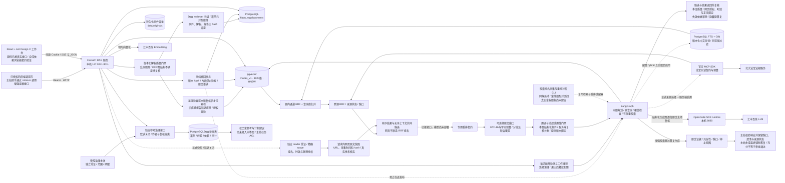
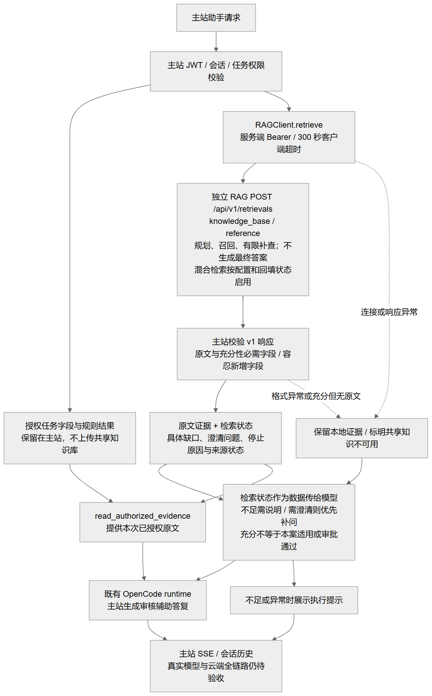
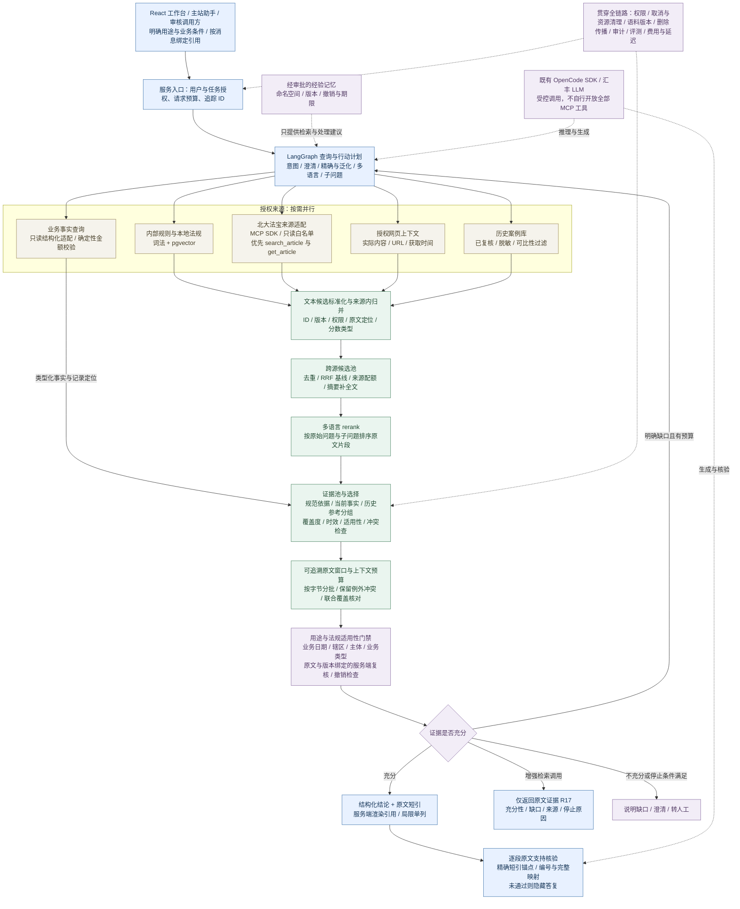
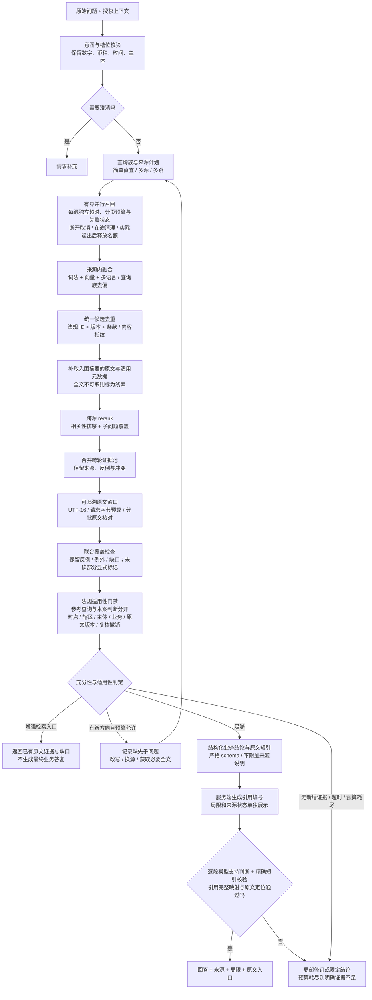
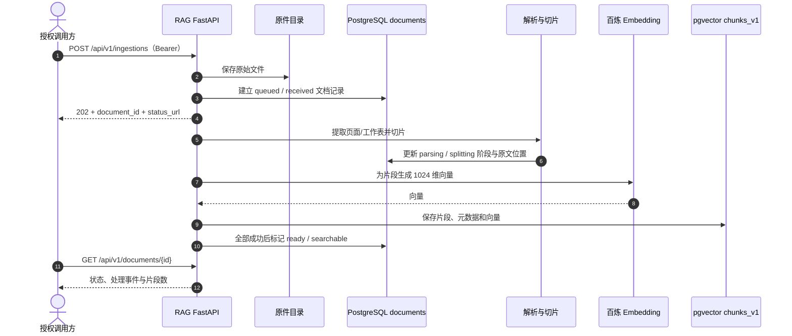
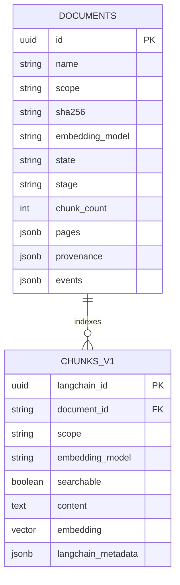

# RAG 模块总览与运行说明

协作交付入口：服务 `0.5.0` / HTTP 契约 `1.3.0`。其他模块只调用 [接口契约](API_CONTRACT.md) 与 [OpenAPI](contracts/openapi-v1.json)，无需依赖 RAG 内部类、表或模型；云端部署同事使用 [部署交接](deploy/README.md)。现有 `/query` 保持兼容，新增消费者优先对接 `/retrievals` 原文证据接口；内部优化独立发布，云端可提供模型/API/存储资源，不因现有 ECS 配置降低质量目标。

模块边界：RAG 管理检索、证据与独立问答；主站助手和专项 Agent 负责各自最终输出。调用方按接口消费原文证据和缺口，主站负责最终用户/任务授权。模块可独立部署与更新，真实云端接线及完整业务验收仍须分别取证。

独立的境外贷款知识查询模块。2026-10-21 已真实跑通 PostgreSQL/pgvector 入库、业务检索与 OpenCode SDK 引用问答。**当前主机验收不代表已经部署到团队 ECS，也不代表 RAG 工作台或主站助手已完成端到端联调。** 后端验收明细见 [`docs/RAG后端验收与运行.md`](../../docs/RAG后端验收与运行.md)，ECS 迁移步骤见 [`docs/部署到汇丰ECS实施方案.md`](../../docs/部署到汇丰ECS实施方案.md)。

## 一页现状

持续优化入口：[优化规划 v3](../../docs/Agentic-RAG优化规划.md) 与 [执行台账](../../docs/RAG持续优化执行台账.md)。用户已授权按需求持续实现、测试、审查与迭代；R01–R17 各项以台账的实际证据为准。北大法宝只读适配源码已完成真实烟测，服务端默认未启用；专用重排契约已接入但模型未部署。下文区分历史已验收后端、本轮源码增量和仍待实现的完整目标。

| 项目 | 当前事实 |
| --- | --- |
| 代码位置 | `code/rag-service/`，独立 FastAPI 服务；不并入主站后端进程 |
| 已验收服务 | 本机 `127.0.0.1:8011`；旧 `8010` 是另一实例，不代表本次版本 |
| 检索存储 | 汇丰 PostgreSQL 的 `hbcn_rag` schema，pgvector 1024 维向量表 `chunks_v1`，HNSW 索引 |
| 已接能力 | 百炼 Embedding、OpenCode SDK、文件解析/切片、相关性核对与有限重检索、带引用回答、原文定位 |
| 验收证据 | 自动回归 47 项通过；具体资料范围和测试边界见验收报告 |
| 尚未完成 | ECS 常驻部署、真实模型/索引/MCP/UI 完整验收、主站助手部署联调、任务级资料权限、完整法规服务 |
| 原件位置 | 当前验收环境为本机 `data/originals/`；迁移时必须与数据库记录一起搬迁并备份 |

本轮源码增量：首次结构化问题规划、原始事实查询保留、中英互补表达、查询族归一 RRF、空召回恢复、跨轮候选保留、查询/轮次/时间预算与停止原因；新增 `/api/v1/retrievals` 仅返回原文证据。测试和 2 个真实模型规划冒烟见执行台账，第二轮新增可切换的中文词法/向量混合及显式回填，实际 PostgreSQL 隔离合成测试通过，见 [第二轮验证](../../docs/RAG优化第二轮验证记录.md)。第三轮新增法宝与知识库多源归并、显式来源选择和专用重排契约，见 [第三轮验证](../../docs/RAG优化第三轮验证记录.md)；尚未宣告正式语料检索质量、真实重排模型、完整法规服务、UI 或共享部署验收完成。第四轮增加可追溯长文窗口、按字节分批与联合覆盖核对，真实 SDK 已取回长文末尾限制；具体局限见第四轮记录。第十七轮主站适配接入 `/retrievals` 原文证据和检索充分性状态，保留旧 `/query` 兼容；实际主站/云端联合验收仍待完成。

第十三轮补齐普通知识文档逻辑撤回：HTTP/React 确认、hash 绑定、事务关闭向量/词法可见性、原文拒读、在途入库发布屏障，以及跨轮候选和答复返回前复核。原件保留，未实现物理删除、跨系统缓存通知或案例依赖统一传播；详见[第十三轮验证](../../docs/RAG优化第十三轮验证记录.md)。

第十四轮增加解析质量报告、隔离/待复核、独立凭证逐单元原文审核与旧库授权重检；**旧 ready 缺本版报告默认排除**，升级需迁移窗口。见[质量契约](../../docs/RAG文档质量门禁契约.md)和[第十四轮验证](../../docs/RAG优化第十四轮验证记录.md)。这不是 OCR 准确率或法规业务质量验收。

第十五轮增加默认关闭的网页上下文适配：独立授权的调用方提交实际文本快照，与知识库/法宝候选共同重排和核对；不代抓任意 URL，不把网页自动升格为法规依据。见[接入契约](../../docs/RAG网页上下文接入契约.md)及[第十五轮验证](../../docs/RAG优化第十五轮验证记录.md)，真实浏览器采集和主站授权接线尚未完成。

## 当前 RAG 架构

第八轮 React 工作台已接同源真实问答 SSE、增强检索、原文与文档入库状态，使用 Ant Design X 成熟组件；移除固定答复/来源/假页数。浏览器→实际 FastAPI 传输验收采用合成依赖，不等于模型/数据库/MCP 完整业务验收。契约兼容标记、构建/鉴权与复现见 [UI 说明](ui/README.md)。未重启共享后端，旧进程不具备本轮接口时 UI 会提示版本不匹配。

第九轮补充请求取消：HTTP 断开可通知图工作线程，阻止后续调用并取消在途模型、Embedding、rerank 和 MCP 异步操作；并发名额在实际线程退出后释放。浏览器与合成依赖清理已验证，阻塞数据库不会强制杀线程，真实 SDK 会话和外部服务实际停止尚待验收；见[第九轮记录](../../docs/RAG优化第九轮验证记录.md)。

第十轮增加离线排名质量评测 CLI 与严格数据契约，支持案件组隔离、六组 holdout 数量校验、Recall@20/nDCG@10 和配对置信区间。目录中没有真实审核题或金标；评测契约不等于质量门槛通过。详情见[评测契约](../../docs/RAG评测集与排名评估契约.md)和[第十轮记录](../../docs/RAG优化第十轮验证记录.md)。

第十一轮增加现有 PostgreSQL/RRF/专用重排的排名采集 CLI，固定审核查询表达并共用一次候选池，报告按案件组重采样；真实金标、不可变索引与实际模型收益仍待验收，见[第十一轮记录](../../docs/RAG优化第十一轮验证记录.md)。

第十二轮增加默认关闭的独立案例/经验治理：不可变版本、分离复核、精确范围/政策过滤、PostgreSQL 词法检索、来源撤销传播、到期清理及读取审计。实际隔离 PG/并发/HTTP 路由机制已验；真实案例、主站用户/任务 ACL、Agent 接线和相关性质量仍未完成，见[治理契约](../../docs/RAG案例与经验治理契约.md)及[第十二轮记录](../../docs/RAG优化第十二轮验证记录.md)。本轮同步冻结独立模块接口并提供 Linux/systemd/Dockerfile；无 Docker/云端实测，部署不视为完成。

第七轮新增用途与法规条件门禁：一般参考不等于本案核验；显式本案判断需要业务日期、辖区、主体、业务类型与原文/版本绑定的服务端复核记录。缺口阻断结论生成但保留参考片段。配置、返回状态与未完成边界见 [法规复核契约](../../docs/RAG法规复核台账契约.md)；默认未配置真实复核文件，尚未完成法规业务验收。

此图说明独立后端结构；问答图节点标签已按本轮源码增量更新，新增行为的验证边界见台账。主站适配层代码已存在，但 ECS 上的服务地址、Token 和端到端调用仍须按部署方案验证。



### 主站增强证据接线（源码已实现）

第十七/十八轮接线只检索共享知识库，任务资料仍在主站授权上下文；新增 v1 响应校验、具体缺口/澄清状态传递和可见执行提示。下图说明实际代码路径，不证明模型遵循率、原文链接可用率或云端已验收。可编辑[图源](../../docs/diagrams/rag-assistant-evidence.mmd)与[可缩放图](../../docs/diagrams/rendered/rag-assistant-evidence.svg)。



## 优化后的目标架构（执行中，逐项验收）

本节是按 [优化规划 v3](../../docs/Agentic-RAG优化规划.md) 维护的完整目标，不替换上文当前实现。目标中的多源、独立重排、历史案例等仍未完成；按执行台账逐项实现和验收。图源：[总体架构](../../docs/diagrams/rag-target-architecture.mmd)、[检索闭环](../../docs/diagrams/rag-target-retrieval.mmd)。

[北大法宝接入交接说明](../../docs/PKULaw-MCP接入说明.md) 已记录 9 个地址的 initialize 和其中法规语义服务的查询验证；规划优先复用已发现的 `search_article` / `get_article`，其余工具逐项核对后开放。交接历史保留；第三轮已实现官方 SDK 客户端并实际调用 search_article 和联合证据链路，get_article 的补正文机制有契约回归但尚未真实调用；不代表其余八个服务已接入。

### 总体架构：多源检索、联合重排、案例与记忆

图像预览：[PNG](../../docs/diagrams/rendered/rag-target-architecture.png) / [SVG 放大版](../../docs/diagrams/rendered/rag-target-architecture.svg)。



### 多路归并与 Agentic RAG 流程

图像预览：[PNG](../../docs/diagrams/rendered/rag-target-retrieval.png) / [SVG 放大版](../../docs/diagrams/rendered/rag-target-retrieval.svg)。



关键设计：先按来源做混合召回与去偏归并，再按可比原文做跨源 rerank；摘要没有取得全文时仅作线索。证据池分清现行规范、本案事实和历史参考，检查时点、辖区与冲突后，Agent 决定补查、回答或说明不足。精确业务数据走只读结构化工具与确定性金额校验。

历史文件采用“复核案例库＋经审批的经验记忆”：案例供相似问题参考，记忆供流程/查询建议；旧案放行不能变成现行规则。详见规划的历史案例治理图。北大法宝由服务端 MCP 客户端发现真实工具并固定只读白名单，按 schema 做搜索/原文/效力能力映射；详情见规划的接入时序图与 M1–M8。

| 规划范围 | 对应需求 | 实施出口 |
| --- | --- | --- |
| 查询与检索底座 | R01–R04、R06 | 事实保真、多语言混合召回与重排质量对照 |
| 多源与受控闭环 | R05、R07–R08、R13、R15 | MCP 契约、证据覆盖/适用性、只读事实与预算控制 |
| 案例、文档与记忆 | R09、R11–R12 | 真实 UI、权限、版本/时效、复核及撤销传播 |
| 验收与条件实验 | R10、R14、R16 | 独立题集、T01–T16、资源成本、灰度回滚；高级方法按收益启用 |

图中阶段都不能以“代码有接口”认定验收完成；按优化规划持续提供单元/契约/端到端测试及真实质量报告，缺少条件的部分如实记录。

## 入库时序



## 当前数据关系



`DOCUMENTS.events/pages/provenance` 是文档记录中的 JSONB 字段，不是单独的事件表；原始文件存于文件系统，不是 PostgreSQL 大对象。`document_id` 是片段回到文档的逻辑关联。RAG 原件目录和数据库都要备份，不能只备份 pgvector。

## 技术选择

- 向量存储复用官方 [langchain-postgres](https://github.com/langchain-ai/langchain-postgres) `PGEngine` / `PGVectorStore`，连接汇丰 PostgreSQL/pgvector，创建独立 schema 与 HNSW 索引。
- 切分复用 [LangChain Text Splitters](https://github.com/langchain-ai/langchain/tree/master/libs/text-splitters)；解析使用 pypdf、pypdfium2、python-docx、openpyxl，不自建向量相似度算法或切片器。
- 编排复用 [LangGraph](https://github.com/langchain-ai/langgraph)：问题理解 → 检索 → SDK 核对相关性 → 必要时改写重检索（最多两轮）→ SDK 回答 → 引用编号校验。不展示模型内部思维链。
- 智能调用已有 `code/assistant-runtime` OpenCode SDK `/runs`；当前 SDK 模型为汇丰百炼 `qwen3.8-flash`，Embedding 为 `qwen3.7-text-embedding-flash`、1024维。
- 使用轻量成熟库而非复制完整平台：当前未部署 Docker/RAGFlow，不把旧 SQLite 冒充 PostgreSQL。旧 local/ragflow 引擎保留兼容；新增接口仅用于显式 `RAG_ENGINE=postgres`，不静默回退。

## 安装与运行

在本目录执行，Windows / Python 3.12 实测：

```powershell
python -m venv .venv
.venv\Scripts\python -m pip install -r requirements.txt
Copy-Item .env.example .env
# 配置完成后启动；已有 .env 时跳过复制，不要覆盖
.\scripts\start-backend.ps1 -Port 8011
```

本机现有 `.env` 已配置。后台隐藏运行，仅监听 `127.0.0.1:8011`；检测冲突，不杀已有进程。日志/PID 在忽略目录 `data/`。停止：`scripts/stop-backend.ps1 -Port 8011`。

| 配置 | 含义 |
| --- | --- |
| `SERVICE_TOKEN` | 服务鉴权，不提交、不发浏览器 |
| `BAILIAN_BASE_URL` / `BAILIAN_API_KEY` | 已下发百炼地址/授权 |
| `RAG_DATABASE_URL` | 直接连接串，与资源文件方式二选一 |
| `RAG_DATABASE_RESOURCE_FILE` | PostgreSQL 资源文件路径，读取 PGHOST/PGPORT/PGDATABASE/PGUSER/PGPASSWORD |
| `RAG_SSH_RESOURCE_FILE` / `RAG_SSH_HOST_KEY_SHA256` | 本机经 ECS 访问私网 RDS；固定主机指纹，不接受任意密钥 |
| `RAG_POSTGRES_SSLMODE` | 默认 require；本次 RDS 不支持 TLS，经 SSH 隧道显式 disable，不能自行开放数据库公网 |
| `ASSISTANT_RUNTIME_URL` | 已有 SDK 运行时，默认本机8090 |
| `ASSISTANT_RUNTIME_TOKEN` / `ASSISTANT_RUNTIME_RESOURCE_FILE` | 服务 token，或仅读取已有 runtime `.env` 中的 token |
| `RAG_DATABASE_SCHEMA` / `RAG_VECTOR_TABLE` | 默认 hbcn_rag / chunks_v1，不改主项目业务表 |
| `RAG_DATA_DIR` | 原件目录，默认 data/，须与数据库一起备份 |

**必须单实例、单 worker**：启动会将上次中断任务标为失败，不能运行两个实例共享此 schema 同时恢复任务。更换向量维度须配置新表并重新导入，不能覆盖旧表。不要使用 reload 作为长期部署方式。

本次应用在本地电脑，数据库在汇丰私网；电脑休眠、SDK 退出、SSH 中断都会影响服务。不是 ECS 常驻生产部署，也未开放公网入口。

## HTTP 契约

`/health` 仅判断进程存活。以下 API 全部要求 `Authorization: Bearer <SERVICE_TOKEN>` 或本机 `/ui/` 签发的同源 HttpOnly 会话。主系统仍负责用户与任务权限，本服务不开放 task_documents。

| 方法与路径 | 用途 |
| --- | --- |
| `GET /api/v1/ready` | 实查数据库、pgvector、列维度和 SDK 健康状态；不产生模型费用，不冒充真实模型验收 |
| `GET /api/v1/capabilities` | 配置能力、范围、格式及上传上限；不是就绪检测 |
| `POST /api/v1/ingestions` | 推荐异步上传：multipart file、scope；可选 source_url、jurisdiction；返回202、document、status_url |
| `GET /api/v1/documents` | 列表及 queued/processing/ready/failed 状态 |
| `GET /api/v1/documents/{id}` | 状态、持久化处理事件 |
| `POST /api/v1/documents/{id}/retry` | 仅重试失败文档；损坏原件仍会失败 |
| `GET /api/v1/documents/{id}/content?chunk_id=...` | 全文 pages/sections、命中 focus 的真实页码/工作表/字符起点；拒绝跨文档片段 |
| `GET /api/v1/documents/{id}/source` | 受鉴权原件；PDF inline，其他 attachment；HTML 不作为可信网页执行 |
| `POST /api/v1/query` | 原有纯证据检索协议，不生成答案 |
| `POST /api/v1/retrievals` | 增强证据检索：问题规划、归并、覆盖检查与有限补查，跳过最终答复生成 |
| `POST /api/v1/answers` | 真问答：answer、sources、warnings、grounding、retrieval_rounds |
| `POST /api/v1/answers/stream` | 同一问答图，SSE step/result/error；不使用计时器模拟动态 |
| `POST /api/v1/documents` | 旧同步入口，新接入改用 ingestions 与轮询 |

问答请求：

```json
{"query":"固定资产投资类贷款的用途应如何填写？","scope":"business_rules","top_k":5,"conversation":[]}
```

scope 为 business_rules/project_design/law/all。conversation 最多12条 role(user/assistant) + content，仅用于补全指代，不作为事实依据。sources 返回引用编号、原文、document_id、chunk_id、物理 PDF 页码（Office/文本为 null）、原件/全文相对 URL。

`/retrievals` 使用相同请求字段；返回 sources、evidence_status（sufficient/insufficient/clarification）、missing、stop_reason、retrieval_rounds、warnings 和可选 clarification_question，不返回 answer 或 grounding。部分相关原文可以与 insufficient 状态同时存在，调用方必须处理缺口，不能因 sources 非空就宣告依据充分。该接口用于后续主站接线，现有 `/query` 语义不变。

源码默认每次至多 4 个初始表达（原问题＋优先保留通用/翻译分支），全程至多 6 次引擎检索、2 轮，问答总预算 240 秒、单次 SDK 90 秒。配置见 `.env.example` 的 RAG_MAX_QUERY_VARIANTS / RAG_MAX_RETRIEVAL_QUERIES / RAG_MAX_RETRIEVAL_ROUNDS / RAG_TOTAL_TIMEOUT_SECONDS；总预算在阶段边界检查并传给 SDK，不是对数据库驱动的强制取消。词法混合的实现与迁移见下节；跨源 rerank 与完整撤销治理仍在后续阶段。

多查询融合复用已锁定的 langchain-postgres RRF，只增加本项目的查询族去偏、来源/版本标识与评分类型适配；不把融合分标成相似度或审批概率。当前相关性/充分性选择仍依赖 SDK，未替代独立金融质量评测。

无足够相关证据时 grounding=insufficient，不能用相似度冒充置信概率或审批结论。第五轮增加逐段模型支持判断与精确原文短引/完整映射校验，未通过会隐藏业务答复；状态 supported_by_model 仍不等同于法律真实性证明；法规始终附带效力/适用性复核提示，法宝只读 MCP 适配已完成源码与部分真实烟测，商业缓存边界及完整法规验收仍待完成。

## 答复原文支持核对

生成答复后追加一次 SDK 核对，每个展示段落和每个引用必须映射到原文精确短引；保存答复/段落 hash、短引位置以及长文父片段锚点。response.answer_verification 区分 supported_by_model、unsupported、invalid_verification、verification_unavailable 等状态。核对不通过时保留来源、隐藏未核实业务答复，grounding=insufficient。纯证据入口不生成、不追加此调用。

短引存在是确定性校验，语义支持仍是模型判断，不能证明法律适用性、模型无遗漏或审批正确。第五轮真实正反对照分别通过和拒绝，但自由生成两次因额外主张被拒；第六轮改为严格结构化业务结论＋精确原文短引，服务端渲染引用、局限单列，同一合成问题的真实完整链路通过（2 段、59.84 秒）。只证明该样例修复，不代表整体答复质量达标。预算包含在既有总时限中，不无限修复重试。结构化修复与实测见 [第六轮记录](../../docs/RAG优化第六轮验证记录.md)，失败沿革见 [第五轮记录](../../docs/RAG优化第五轮验证记录.md)。

## 长文窗口与上下文覆盖

第四轮修复 SDK 静默截断：长片段拆成原文窗口，metadata.excerpt 保存父片段 ID/hash、起止字符、原文长度和窗口计数。原片段链接保留；偏移按 Unicode codepoint，不是 JS UTF-16 下标。每段发给 SDK 的内容与返回引用窗口一致，不让整段未读正文冒充已核对依据。

默认 `RAG_MAX_CONTEXT_WINDOWS=80`、`RAG_MAX_CONTEXT_BATCHES=6`，每批最多 20 段并核对 UTF-8 JSON 字节预算。多批初筛后对保留原文做联合覆盖核对；例外、反例及冲突须保留。超窗口/批次/总时限或联合依据仍过大时返回部分证据和缺口。context_coverage 的 input_complete 仅说明入围窗口完整提交，不代表全库/整法已读或结论准确。SDK 客户端超限直接报告，避免继续切掉正文或会话。详见 [第四轮验证](../../docs/RAG优化第四轮验证记录.md)。

## 多源与独立重排配置

法宝默认关闭。将 `PKULAW_MCP_TOKEN` 通过服务端环境注入，设置 `PKULAW_MCP_ENABLED=true`；不把桌面 Codex 配置做成运行依赖。请求示例（已有服务鉴权之外的 JSON 请求体）：

```json
{"query":"境外贷款应核查哪些风险管理要求？","scope":"law","sources":["knowledge_base","pkulaw"],"top_k":5}
```

sources 默认只含 knowledge_base。每轮法宝一个查询，默认全程最多两个，单次最多 3 条结果、最多 2 次有已知条号的补取；总时限与每次 30 秒预算共同约束。来源正文不全返回 source_status=partial、missing 及部分证据，不声称充分。只提供条文片段，不保证整部法规、附件或业务适用性。运行环境须确认实时使用、展示与存储授权；当前不持久化法宝正文缓存。

专用重排配置为 `RAG_RERANK_PROVIDER=cohere_compatible`、RAG_RERANK_URL/MODEL/TOKEN/REVISION；这表示接口协议，不限定模型厂商。默认 disabled，尚无已确认模型服务。非本机端点需要显式允许 `RAG_RERANK_ALLOW_EXTERNAL` 并落实资料数据流授权；不得为省部署工作把敏感资料发到未批准服务。配置服务失败时响应 rerank_status=unavailable，不冒充成功；模型版本和 token 截断未知会保留未核验标记。真实重排质量须另测，capabilities 仅表示配置，不表示可用性或达标。

## 混合检索升级与回滚

现有实例默认 `RAG_SEARCH_MODE=vector`，不自动迁移共享语料。先备份并在隔离环境验证，再在 RAG 虚拟环境执行：

```powershell
python -m app.lexical_index --apply
```

这会增加 `<向量表>_lexical` 派生表与 GIN，分批回填固定分词器版本，不重新向量化。之后设置 `RAG_SEARCH_MODE=hybrid`，重启对应实例并检查 `/api/v1/ready` 的 search_mode/lexical_tokenizer。未回填、版本不一致或 GIN 缺失时拒绝混合检索，不能把错误当作空召回。新文档在开放检索的事务中写入词法派生数据；删除原片段时级联删除词法记录。

回滚将模式设回 vector 并重启，不删除向量或原件；回滚期间新增资料需再次回填后才能重新启用 hybrid。中文 jieba 搜索分词（MIT）与 PostgreSQL FTS/GIN 提供词法候选，向量阈值仅用于向量通道，归并分保留在 metadata.channel_fusion，非余弦相似度。独立重排已接标准接口，实际模型资源与质量验收仍待完成。迁移/真实测试边界及候选方案比较见 [第二轮验证记录](../../docs/RAG优化第二轮验证记录.md)。

## 上传与原件

真实阶段：received → parsing → splitting → embedding → indexing → ready；异常 failed，重启中断 interrupted。原件在 `data/originals/{UUID}/original`，元数据、解析全文、事件和向量在独立 PostgreSQL schema。处理中的向量不可检索，完成时事务性开放。按 scope/SHA256/embedding模型去重；失败重试用 retry。

支持 PDF、DOCX、XLSX、TXT/MD/CSV/JSON/HTML、常见图片；旧版 DOC/XLS/PPT/PPTX 先转换。PDF保留真实页码，DOCX/Excel不伪造页码。扫描页/图片复用 OCR 客户端，失败时走百炼视觉；不保证所有扫描质量。默认50MiB/文件、500页PDF、200万字符、2个解析线程、8个处理/排队名额。问答并发4，每次SDK调用默认超时90秒，完整问答可包含多次调用，调用方须设更长请求超时。

## 白名单导入与验收

```powershell
.venv\Scripts\python -m pip install -r requirements-dev.txt
.venv\Scripts\python scripts/ingest-corpus.py --source-root '实际共享资料根目录'
.venv\Scripts\python scripts/ingest-corpus.py --source-root '实际共享资料根目录' --execute
.venv\Scripts\python scripts/verify-backend.py
.venv\Scripts\python scripts/verify-backend.py --persistence-only
$env:HBCN_TEST_SOURCE_ROOT = '实际共享资料根目录'
.venv\Scripts\python -m unittest discover -s tests -v
```

导入默认预览，仅4份明确业务资料、2份已检查文本的境外贷款通知，不扫描资源凭证目录。真实验收会产生少量模型费用并创建明确标记的验收资料；报告在 data/，不含凭证与业务原文。新电脑需准备知识文件，见 `knowledge-base/README.md`；catalog 不能替代原文正确性检查。

## 接入边界

**后端跑通不等于完整 UI 业务验收。** 2026-10-21 首轮后端验收时，React 页面仍为静态演示；第八轮已移除演示并接真实接口，合成依赖浏览器契约已验证。真实模型/索引/MCP/UI 联合质量、任务权限及共享部署仍须按台账验收，不能由历史后端结果替代。

主系统调用方需将 RAG_BASE_URL 指向实际8011服务，服务 token 仅留后端；本次没有修改队友配置/代码，未停止原有8010实例。旧 `scripts/deploy-ragflow.ps1` / `app.cli` 是 RAGFlow 工作流，不用于本次 PostgreSQL 验收。
