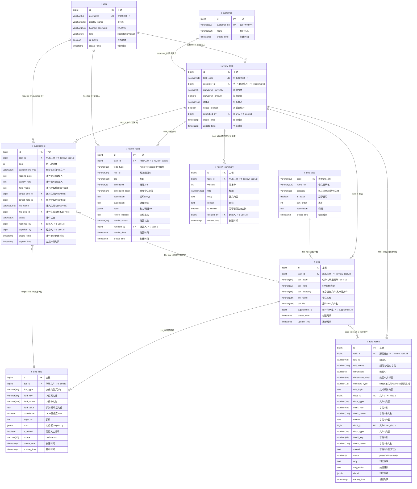

# 数据库 ER 图（改进版 v2）

> 境外贷款单据智能审核平台 —— 数据库实体关系图
> 与 `schema_postgres.sql`（改进版 v2）一致。
> 生成日期：2026-10-24

## 实体关系图

## 关系说明

| 关系 | 基数 | 外键 | 含义 |
|---|---|---|---|
| `t_user` → `t_review_task` | 一对多 | `submitted_by` | 一个用户可提交多个审核任务 |
| `t_customer` → `t_review_task` | 一对多 | `customer_id` | 一个客户可有多个审核任务（借款人即客户，名称取自 `t_customer.name`） |
| `t_doc_type` → `t_doc` | 一对多 | `t_doc.doc_type` | 文件类型字典约束取值（可扩展：新增类型 INSERT 一行） |
| `t_review_task` → `t_doc` | 一对多 | `t_doc.task_id` | 一个任务包含多份单据 |
| `t_doc` → `t_doc_field` | 一对多 | `t_doc_field.doc_id` | 一份单据识别出多个字段（级联删除） |
| `t_review_task` → `t_supplement` | 一对多 | `t_supplement.task_id` | **需求1**：一个任务可多次补件 |
| `t_review_task` → `t_rule_result` | 一对多 | `t_rule_result.task_id` | **需求6**：一个任务逐条规则比对明细（级联删除） |
| `t_doc` → `t_rule_result` | 多对多(可空) | `doc1_id` / `doc2_id` | 每条比对指向 1~2 份文件（单文件自校验时 doc2 为空） |
| `t_review_task` → `t_review_todo` | 一对多 | `t_review_todo.task_id` | **需求4**：智能审核生成多个待办项（级联删除） |
| `t_review_task` → `t_review_summary` | 一对多 | `t_review_summary.task_id` | **需求5**：一个任务可多版本审核总结（级联删除） |
| `t_supplement` → `t_doc`/`t_doc_field` | 可空引用 | `file_doc_id` / `target_doc_id` / `target_field_id` | 补件关联到生成的文件或针对的字段 |

## 枚举/取值说明

| 字段 | 取值 |
|---|---|
| `t_user.role` | `operator`（经办人）、`reviewer`（审核人） |
| `t_review_task.status` | `pending`、`ai_reviewing`、`to_recheck`、`need_supplement`、`completed` |
| `t_doc.doc_type` | 由字典表 `t_doc_type.code` 维护：`FACILITY_LETTER`、`DRAWDOWN_INSTRUCTION`、`PAYMENT_INSTRUCTION`、`COMMERCIAL_CONTRACT`、`COMMERCIAL_ORDER`、`WAYBILL`、`CUSTOMS_DECLARATION`、`PROFORMA_INVOICE`（**可扩展**，新增类型 INSERT 一行即可） |
| `t_doc.doc_category` | `核心业务文件`、`支持性文件` |
| `t_doc_field.source` | `ocr`（机器识别）、`manual`（人工填写） |
| `t_supplement.supplement_type` | `field`（字段值补件）、`file`（文件补件） |
| `t_supplement.status` | `requested`、`supplied`、`accepted`、`rejected` |
| `t_review_todo.todo_type` | `hint`（提示）、`special`（专项审核） |
| `t_rule_result.compare_type` | `single`（单文件自校验，doc2/field2/value2 为空）、`pairwise`（两两比对） |
| `t_rule_result.status` | `pass`（通过）、`fail`（不打）、`warn`（提示）、`skip`（专项移交） |
| `t_review_todo.handle_status` | `pending`、`acknowledged`（已知悉记录在案）、`kept`（保留异常并继续）、`resolved` |

## 需求对照

| 需求 | 落地 |
|---|---|
| 1. 一个 task 多次补件（独立表，类型/说明/要求/value/file） | `t_supplement`（`seq` 支持多次，`supplement_type`+`field_value`+`file_doc_id`，`require_note`/`supply_note`） |
| 2. 每份文件标明所属任务（文件主表） | `t_doc.task_id`，`doc_type` 区分 8 类 |
| 3. 每个识别字段一行（字段名/值/置信度/定位框） | `t_doc_field`（`field_key`/`field_value`/`confidence`/`bbox`/`page_no`） |
| 4. 智能审核生成待办项 | `t_review_todo`（`todo_type`/`title`/`dimension`/`description`/`suggestion`/`review_opinion`/`handle_status`） |
| 5. 多版本审核总结（标题/正文/版本/备注） | `t_review_summary`（`version`/`title`/`body`/`remark`/`is_current`） |
| 6. 每个任务对应规则审核结果（比对字段、文件1字段1值1、文件2字段2值2、规则内容，值2可空） | `t_rule_result`（`compare_type` 区分单/双；`doc1_*`/`field1_*`/`value1` + `doc2_*`/`field2_*`/`value2`；`rule_logic`/`status`） |

> `reference_by_zg.sql` 为同事参考用的 `t_loan_file` 方案，与本设计并存备查。
