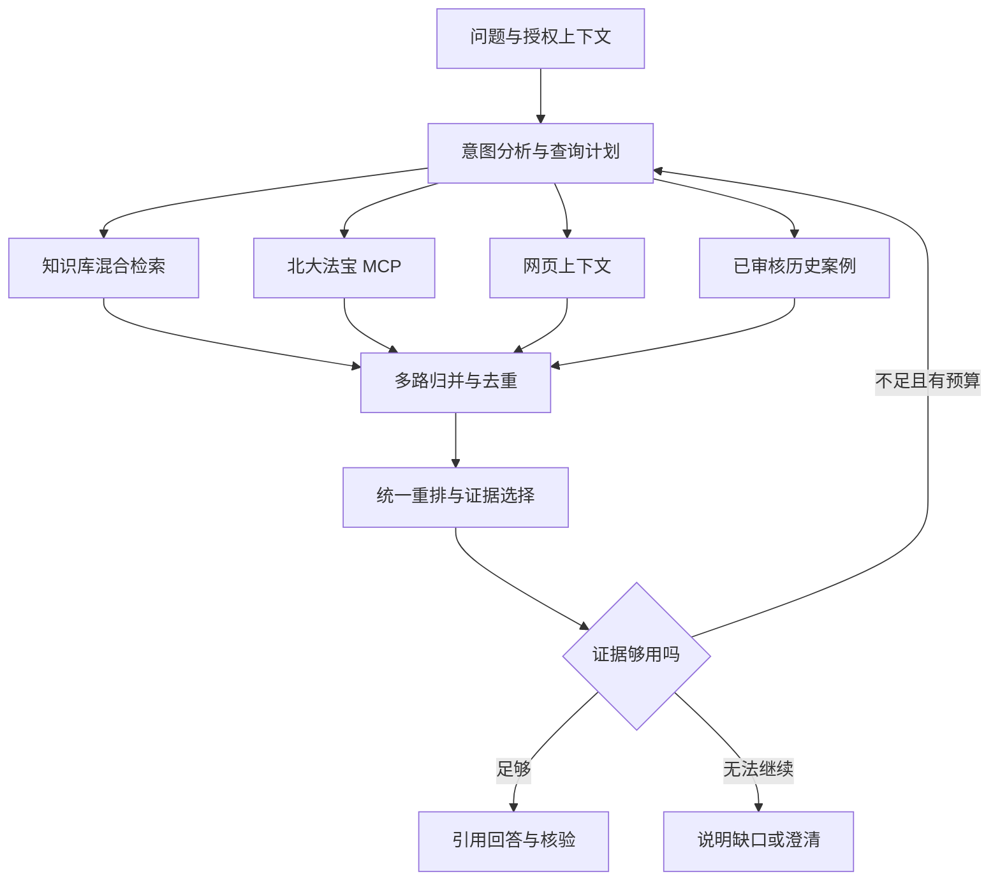

# Agentic RAG 优化规划 v1：本轮需求基线

> 2026-10-21；供对照调研前后的变化，不作为实施基线。正式评审入口为 [优化规划](Agentic-RAG优化规划.md)。本版本合并上一轮十项清单与用户本轮补充，尚未实施。

## 新增需求与初步方案

| 编号 | 需求 | v1 初步方案 | 尚需调研/决策 |
| --- | --- | --- | --- |
| R01 | 北大法宝 MCP 已由用户取得 | 在独立 RAG 服务内增加服务端 MCP 客户端和来源适配，不重新寻找 MCP 产品 | 实际配置尚未提供；协议、工具、授权和返回内容如何映射 |
| R02 | 知识库＋外部数据库联合重排 | 多源召回→归并去重→统一 rerank→证据充分性检查 | 外部检索分数、摘要与全文不一致时如何公平比较 |
| R03 | 多路归并 | 多查询/语言/通道形成来源内列表，来源间融合 | 查询数偏置、分页、失败、去重、各源候选配额 |
| R04 | 历史审核文件是否进入 RAG | 独立历史案例库，保留审核结论、上下文与原始证据关系 | RAG 与记忆系统边界、案例迁移条件、误例传播、时效 |
| R05 | 现有规划仍有哪些缺口 | 继续使用十项主清单，补充数据生命周期、工具边界与质量评测 | 对照成熟官方实现和研究，避免堆砌功能 |
| R06 | 以图评审目标方案 | 更新模块总览，提供总体架构、检索流程和历史经验治理图 | 当前/目标必须分开，图与规划需求编号一致 |
| R07 | 最后照规划实施验收 | 建立需求→模块→测试→验收证据映射 | 固定基线、阈值、评测集与发布/回滚条件 |

## 延续的十项基础需求

1. 意图识别、原始事实保留、通用与精确问题双分支。
2. 多查询、同义词和金融术语对齐。
3. 多语言生成与检索。
4. 关键词与向量混合召回。
5. 多来源适配与统一证据契约。
6. 片段重排与上下文组织。
7. 有预算的 Agentic 闭环。
8. 引用、法规时效和适用性核验。
9. 文档质量、任务权限及真实 UI。
10. 金标评测、可观测性、成本和资源决策。

## 初步流程

v1 的主要待验证假设：多源内容是否能直接统一重排；历史案例是否只做独立库就足够；是否需把结构化数据库查询与文本召回分开。这些问题的调研结果、修订理由及验收标准写入 v2 主规划。
