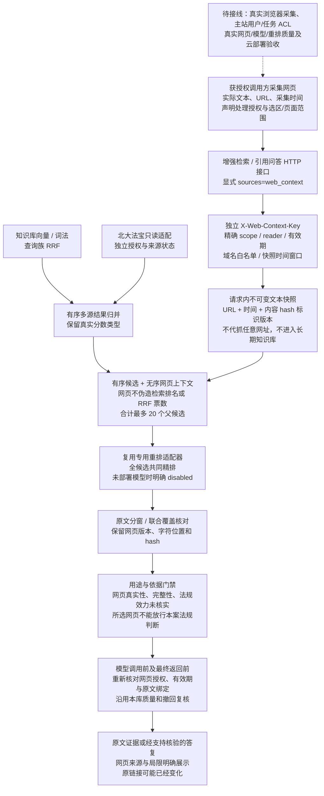
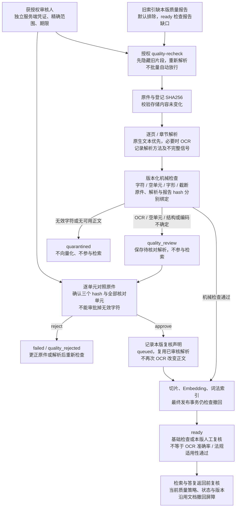
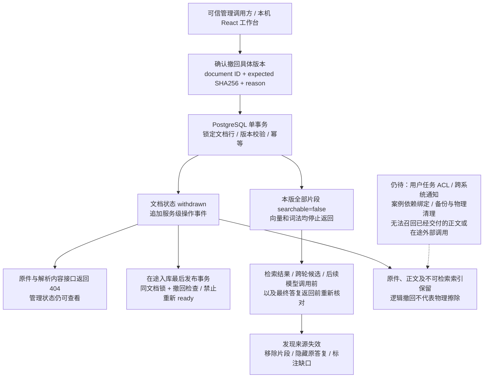
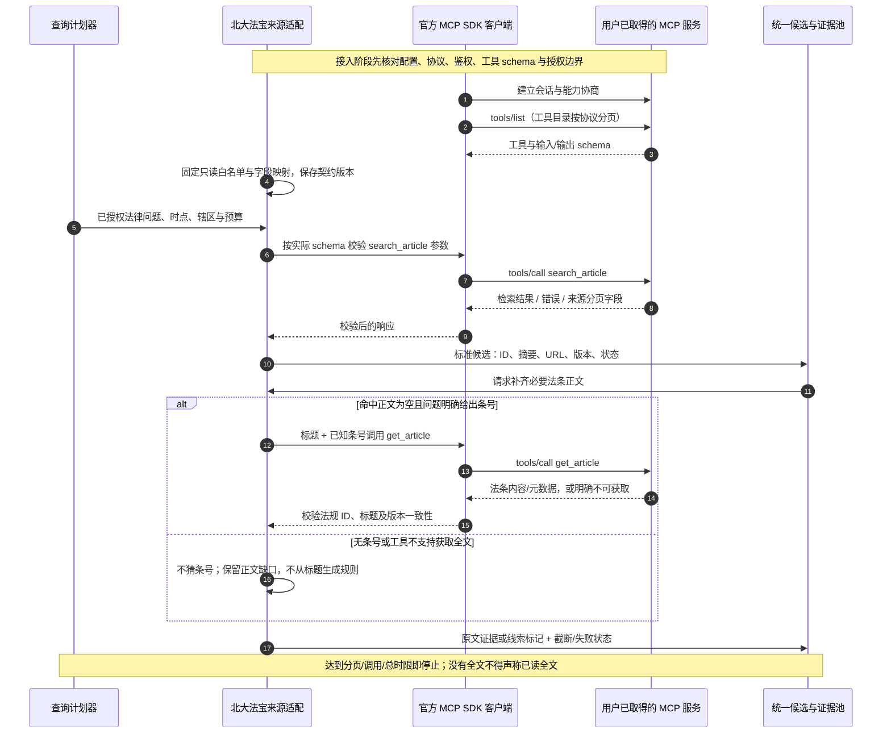
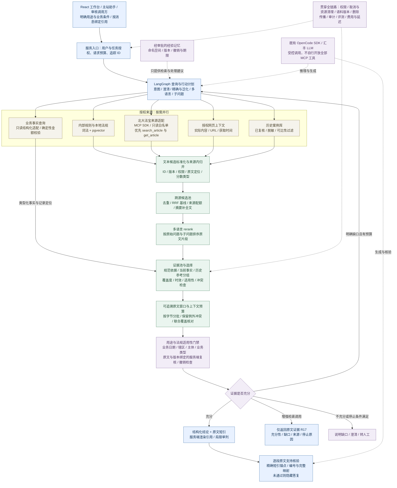
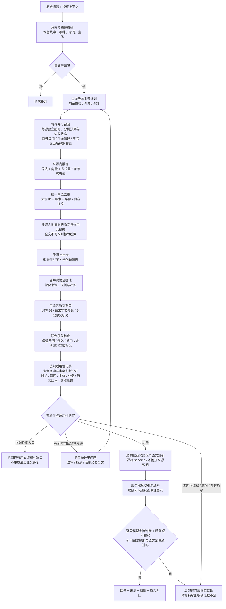
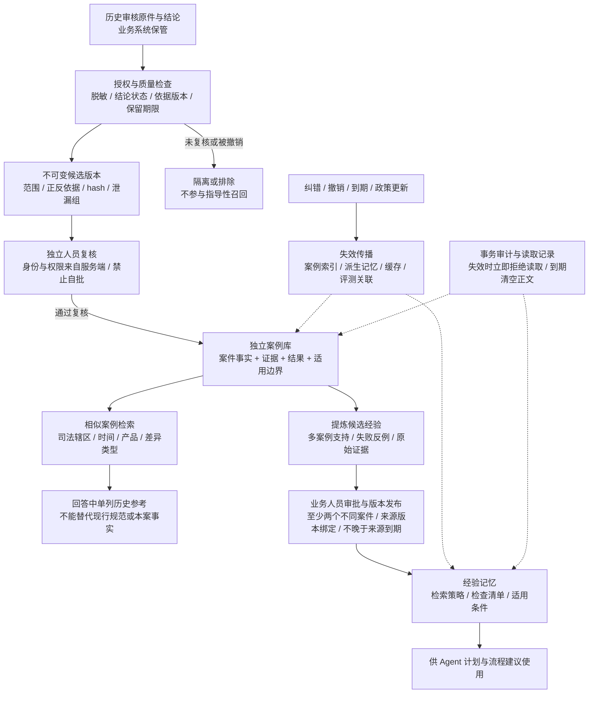

# Agentic RAG 优化规划

> 更新日期：2026-10-22。版本：v3 持续优化执行基线。用户已授权按规划持续实现、质检、验收与复审；各项完成状态以 [执行台账](RAG持续优化执行台账.md) 的证据为准。依据当前仓库代码核对，不把历史验收当作本次运行结果。
> 北大法宝 MCP 已由用户取得，仓库新增 [接入交接说明](PKULaw-MCP接入说明.md) 记录了地址与部分工具验证；已据此设计接入方案，第一轮为规划，第三轮已完成只读适配与部分真实查询；服务默认关闭，凭证只在验收进程内注入，不持久化。本文是持续执行与逐项验收基线；[v1 讨论稿](Agentic-RAG优化规划-v1讨论稿.md) 保存本轮调研前的需求基线，早期 [RAGFlow 实施规划](RAG实施规划.md) 仅保留作历史。

## 本轮决策摘要

持续目标现已启动。执行闭环为：维护需求与图→核对成熟方案→冻结本轮范围及测试→实现→回归与质量评测→审查修复→记录证据→下一轮。本文保留的“待评审”图表示目标设计，尚未完成的部分不得据此宣告已上线；本次授权取代此前“仅规划”的执行限制。

“最新特性”按收益纳入：关注官方成熟实现并做消融评测，只有质量/时延/成本与合规边界可验证的特性才进入默认链路。达到本规划硬门禁、质量门槛、端到端部署与回滚验收后交付一个冻结版本，不以无限追逐新功能代替版本完成。

目标采用“受控 Agentic 编排＋多源联邦检索＋两级归并＋原文重排＋分角色证据池”。先加强可验证的检索底座，再让 Agent 决定何时补检索；并非每次问题都走复杂多轮。

历史审核文件建议进入独立、受权限控制的案例库，用 RAG 检索相似案例；经复核的可复用经验才进入有版本的长期记忆。原始单据、本案事实、现行规则、历史处理意见四者保留边界，不能把历史“通过”结论自动提升为现行政策。

总览的 [目标架构](../code/rag-service/README.md#优化后的目标架构执行中逐项验收) 与本文图源一致；当前实现另行保留。持续按本轮冻结范围实现并提交测试、审查和验收证据，未完成范围继续推进。

## 当前代码与缺口

| 能力 | 仓库现状 | 下一步 |
| --- | --- | --- |
| 入库与原文 | PostgreSQL/pgvector、解析切片、页码/工作表定位、来源接口；第十三轮增加事务撤回、原文拒读和在途发布/答复复核 | 撤回已做机制验证；第十四轮增质量隔离/复核与旧库重检；复杂版面/真实解析质量、完整版本、物理删除和派生依赖仍待验收 |
| 首次问题改写 | 第一轮源码新增每次结构化规划、原始问题保留、通用/精确/翻译查询和澄清 | 真实模型 2 个合成问题已冒烟；继续扩大保真与召回评测 |
| 实际检索 | 第二轮新增中文词法 FTS/GIN 与向量通道 RRF，可显式回填并切换 hybrid；查询族归并继续保留 | 实际 PostgreSQL 隔离合成验证通过；正式语料尚未回填、未评测质量；继续独立重排与跨源归并 |
| 旧检索适配 | `app/ragflow.py` 有关键词/向量混合请求配置 | 旧适配存在不等于当前 PostgreSQL 主链路具有混合检索 |
| 重排 | 第三轮已接专用 rerank 协议及失败机制；默认 disabled，未部署实际模型；RRF 仍仅为归并 | 确认并部署获准模型，测试中英文/长文排序收益及截断；法规适用性另核验 |
| Agentic 闭环 | 第一轮新增有限查询/轮次/时间预算、充分性判断、重复/无新增停止；默认两轮 | 增加多源行动计划、事实核验与完整覆盖质量评测 |
| 空召回恢复 | 第一轮空召回可生成受控新查询，或澄清/说明不足 | 扩大不同失败类型的契约与真实样例测试 |
| 多轮证据 | 第一轮保留跨轮候选；增强接口可返回部分相关原文并明确缺口 | 持续评测多跳完整性，完善跨源去重与版本冲突 |
| 法规外部源 | 第三轮实现官方 SDK、固定只读契约、显式来源选择、正文隔离和预算；实际 search_article 与知识库联合烟测通过 | 服务端默认关闭；get_article 仅契约回归，商业边界/法规适用性和其余服务待完成 |
| React 工作台 | 第八轮移除固定演示，复用 Ant Design X；接同源 Cookie、问答 SSE、增强检索、按消息绑定原文、条件/缺口及入库状态 | 合成依赖浏览器契约已验证；真实模型/索引/MCP 完整 UI 联调、任务权限、真实 SDK 会话取消和业务质量仍待验收；见[UI 说明](../code/rag-service/ui/README.md) |
| 请求取消 | 第九轮新增 HTTP 断开检测、图工作线程取消上下文、模型/Embedding/rerank 异步连接及 MCP 会话清理；名额保留至线程真正退出 | 合成 HTTP/ASGI/浏览器已验证；阻塞数据库只在返回后停止后续步骤，真实 SDK 会话/商业 MCP/代理链取消仍待验收；见[第九轮记录](RAG优化第九轮验证记录.md) |
| 排序评测基础 | 第十轮新增严格题集/排名数据契约、holdout 分组规模校验、开发集隔离及配对置信区间报告 | 合成算例验证指标与防污染；无真实 holdout 或审核金标，质量门槛仍未运行；见[评测契约](RAG评测集与排名评估契约.md) |
| 排名采集与配对复审 | 第十一轮增加 PostgreSQL/RRF/专用重排的离线采集入口，固定查询表达、完整候选、按案件组 bootstrap、调用预检 | 19 项合成依赖专项通过；未运行真实金标/模型，未证明不可变快照、生成改写/多轮/答复质量；见[第十一轮](RAG优化第十一轮验证记录.md) |
| 案例/经验治理 | 第十二轮新增独立版本/依赖/审计表、分离复核、治理主体范围与期限、FTS/GIN、撤销替换和到期传播 | 10 项专项含实际 PG/并发/HTTP 通过；真实案例、主站用户任务 ACL、Agent 接线及相关性质量仍未完成；见[契约](RAG案例与经验治理契约.md) |
| 独立模块交付 | 服务 0.5.0 / HTTP 契约 1.3.0，旧 query 兼容、新 retrievals、OpenAPI、消费示例和 Linux/systemd/Dockerfile | 模块回归和 UI 构建通过；Docker/云部署及性能未实测，由部署同事按目标配置模型/API/资源，不降低质量；见[部署交接](../code/rag-service/deploy/README.md) |
| 主站增强证据消费 | 第十七轮切换 `/retrievals`，第十八轮严格校验消费字段并传递具体缺口、澄清、来源及停止状态 | 后端 30 项、前端 12 项及构建通过；真实模型遵循、原文代理、主站取消传播及真实云端联调待验收；见[第十八轮记录](RAG优化第十八轮验证记录.md) |
| 多轮会话背景接线 | 第十九轮把最近 user/assistant 会话以受限 conversation 传入 `/retrievals`，参与问题规划但不作为证据或权限凭据；按 12 条/单条 4,000 UTF-16 限制 | 主站/RAG 适配专项回归待本轮完成；真实多轮召回质量、会话撤销/删除传播、模型遵循与云端联调仍待验收 |
| 长文上下文 | 第四轮新增可追溯原文窗口、UTF-16/字节预算、分批和联合覆盖，真实 SDK 已取回合成长文末尾限制 | input_complete 只表示入围窗口提交完整，不证明整法/全库覆盖；继续法规适用性及逐结论支持核验 |
| 引用质量 | 第五轮增加逐段模型支持判断、精确短引及引用完整映射；失败隐藏业务答复 | 第六轮结构化草稿＋服务端引用渲染已修复同一失败样例的真实完整链路；仍需独立误拒/幻觉评测及法规适用性门禁 |
| 法规适用性 | 第七轮新增显式用途、结构化业务条件、原文及来源版本绑定的服务端复核台账、日期/范围/撤销门禁 | 部分完成；没有真实批准台账；默认参考不代表本案通过。完整时态检索、用途路由、专家复核及 UI/独立题集待验收；见[契约](RAG法规复核台账契约.md) |

以上为源码及前十五轮的分层验证范围；真实模型已覆盖规划、长文窗口、支持核验及结构化答复的有限烟测，不能推断整体业务质量或共享部署验收。第二轮实际 PostgreSQL 机制验证使用隔离合成资料；第三轮联合烟测用真实知识库、法宝和 SDK，但仅一次问题且重排关闭。第七轮法规约束使用合成复核记录；第八轮浏览器使用真实 FastAPI 传输与合成依赖，尚无真实法规业务及完整模型/索引/MCP/UI 验收。第十/十一轮仅建立评测与采集机制，无真实金标质量结论；第十二轮仅完成案例治理基础和模块接口交付，不等于生产权限或云部署已验收。详细测试记录见 [执行台账](RAG持续优化执行台账.md)，历史部署验收见 [模块总览](../code/rag-service/README.md) 与 [后端验收记录](RAG后端验收与运行.md)。

## 基础十项优化清单（R01–R10）

下文第 N 项对应 RNN；追加项 R11–R16 及 R17 见后文。用户已授权持续实施，优先级表示依赖顺序，完成状态以逐项验收证据为准。

### 1. 意图识别与业务问题泛化（P0）

识别用户是在查规则、解释差异、定位单据、核实法规，还是要求处理建议。提取单据类型、字段、差异类型、金额/币种、主体、时间和司法管辖区；缺失项标为未知，不由模型猜测。

例：原问题“支付指令这 5000 块钱不对，怎么办？”

- 原问题与事实槽位保留：支付指令；金额 5000；用户认为不对；币种、比较对象、错误原因未知。
- 通用规则查询：“支付指令金额有误或与支持性单据金额不一致时，应如何核查和处理？”其中“与支持性单据不一致”只是待检索的可能情形，不能当成已确认事实。
- 精确分支保留“5000”，用于存在金额门槛、特定条款或任务单据定位时的检索；不能机械删除数字。
- 若只有“这个 5000 为什么不对”，且无授权单据或会话上下文，先询问涉及哪份单据、哪项金额；不能擅自认定为支付指令。

验收：泛化不改变金额、币种、正反含义、法规适用范围；原始金额仍能用于门槛判断，回答不把假设当成事实。

### 2. 多关键词、术语同义词与多查询生成（P0）

从同一意图生成少量互补查询：通用规则、精确字段、处理流程；术语词表与模型生成结合。区分“金额/数额/款项金额”和“数量/笔数”，不能无条件视为同义。

示例词组：支付指令、付款指令、付款金额、金额不符、金额差异、更正、重新提交。保留原始查询为一路，生成结果结构化校验、去重、限制总数；扩展不能自动引入未经确认的错误原因。

验收：同义表达能召回同一目标条款，扩展不会使无关“数量不符”资料挤占正确结果。

### 3. 多语言检索与专业术语对齐（P0）

先覆盖实际语料中的中文和英文；按文档语言及业务需要增加其他语言。生成中文规则表达与英文专业表达，如 payment instruction、payment amount discrepancy、amendment procedure，并保留原文缩写与实体名称。

跨语言向量能力与显式翻译查询分别评估；翻译、关键词和向量通道互补。不要假定当前 Embedding 在所有语言与金融术语上均已通过验证；币种、法条号、法律名称、数值不得在翻译中变化。

验收：中文问英文资料、英文问中文资料、中英混问均有独立题组，记录翻译漂移与跨语言召回率。

### 4. 关键词＋向量混合召回与结果融合（P0）

为每个查询执行授权范围内的词法召回与向量召回。词法层比较 PostgreSQL 全文检索及中文分词扩展，与 Elasticsearch/OpenSearch 等成熟搜索服务；以中英金融语料召回质量、运维、授权和成本决定，不因现有机器资源直接排除更优方案。

PostgreSQL 全文检索的排名不可直接标为 BM25；采用哪种算法应按实际组件说明。中文分词、英文词形、精确金额/条文号、标点与 OCR 噪声均需实测。

多查询、多语言、多通道结果先以 RRF 等成熟方法融合、去重，再交给 reranker。不同来源原始相似分不能直接相加；多个近义改写命中同一条资料也不能冒充独立证据。记录查询族和通道，控制重复查询造成的票数偏置。

验收：对比单向量基线、词法、多查询、混合召回，报告 Recall@K、零召回率、延迟和成本。权限过滤在每个召回通道执行。

### 5. 多数据源接入与统一证据契约（P1）

第十五轮：实现默认关闭的网页文本快照适配，调用方显式提供实际原文、URL、采集时间、范围与处理授权；独立主体/域名/有效期门禁，进入现有联合候选、重排和分窗核对。网页是无序上下文，不制造 RRF 票数；所选网页不能放行本案法规判断。真实浏览器采集、主站用户/任务 ACL、真实网页多源质量仍未完成。见[接入契约](RAG网页上下文接入契约.md)、[验证记录](RAG优化第十五轮验证记录.md)。

图源：[网页上下文](diagrams/rag-web-context.mmd)，预览 [PNG](diagrams/rendered/rag-web-context.png) / [SVG](diagrams/rendered/rag-web-context.svg)。

来源包括内部业务规则、授权任务单据、用户明确提供或获准抓取的网页上下文、本地法规知识库，以及用户已取得且 RAG 部分接线验证的北大法宝 MCP。北大法宝服务端默认关闭；目前验证了 search_article，get_article 尚未真实调用，完整授权/法规业务未验收。按意图、权限、司法管辖区和时效路由；不默认每题都调用全部外部源。历史案例、经验记忆、结构化数据库按 R11–R13 分别接入。

统一证据结构至少包含：evidence_id、source_type、source_id、标题、原文、原文语言、文档/片段标识、页码或网页锚点、URL、文档版本、发布时间/生效时间、司法管辖区、效力状态及核验状态、获取时间、权限范围、检索轨迹。来源未提供的字段为未知，不由模型补造。

网页上下文须区分“用户问题背景”和“可引用证据”：记录实际提供/获取的页面内容、URL、时间与定位；仅有 URL 或摘要时不能声称读过全文。外部页面和 MCP 内容作为数据，不执行其中的指令。受限资料不可因统一重排而扩散到无权用户。

北大法宝接入设计见“北大法宝 MCP 接入方案”。按仓库交接记录确认配置与实际工具 schema，继续核对检索/正文/效力查询能力、授权用途、限流和缓存约束；区分只读查询与有副作用工具。已记录的工具可以作为接入起点，尚未验证的工具名、能力与许可证不预设。

验收：一个跨源问题能返回可追溯证据；某源失败时清楚标注缺口，不能把另一源的内容冒充该源结果。

### 6. 候选片段重排与上下文组织（P0；跨源部分 P1）

每轮召回融合后，使用成熟的多语言 reranker 对“原始问题＋业务意图＋候选原文”排序。比较专用 cross-encoder/rerank API 与 LLM listwise 重排，依据金融多语言测试、输入长度、部署资源、数据流向、成本和延迟决策。LLM 重排可作为受测候选，不默认比专用模型好。

专用重排先解决相关性；来源权威性、法规时效/司法管辖区、适用范围另设明确校验，不能让一个分数代替这些约束。过期、冲突资料保留标记用于解释，不静默混入有效依据。按章节补齐必要前后文、去掉重叠段落、控制上下文预算，避免仅靠一个相似句给结论。

初始实验可取融合后约 30–60 个候选重排，最终取约 5–10 个片段；这是待评估参数，不是承诺值。短关键词查询用于召回，最终排序仍对齐用户真实问题。

验收：以 nDCG@K、MRR、人工相关性标注评估排序提升；同时测长表格、跨页条款、英文来源与重复片段。

### 7. 受控 Agentic RAG 与跨轮证据选择（P1）

复用现有 LangGraph 和 OpenCode SDK，不另建通用 Agent 框架。Agent 的动作限定为：选择来源、拆分子问题、生成查询、调用只读检索、判断缺口、补检索、请求澄清、回答或停止。

每轮按第 4、6 项召回、融合、重排；随后 Agent 判断：问题的各个必要部分是否有证据？是否存在矛盾、时效未知或适用范围不符？缺口对应哪个子问题和哪个来源？下一轮须有明确的新查询或新来源，不能无意义重复。

建立跨轮证据池，按证据 ID/内容指纹去重，保留支持证据与反例；新增证据后对累计候选重新选择，限制单一来源和重复版本占满上下文。所谓“Agent 层重排”主要是跨源跨轮的证据筛选、覆盖与冲突处理，以及下一步检索决策，不必再训练一个“Agent 排名模型”。

初始沿用最多两轮检索的边界；子问题数、每轮查询数、外部调用数、总时限和 token/费用预算分别配置。实验确需增加轮数时，通过评测决定。达到预算、无新增证据、证据充足或问题无法消歧时停止。空召回也可以改写或换源；不得因没命中而无限循环。

验收：覆盖“首轮空召回后成功”“补到缺失的处理流程”“法规和内部政策冲突”“重复命中停止”“工具超时”“预算耗尽”“需用户澄清”。检索判断输出结构化缺口与动作摘要，不暴露内部思维链。

### 8. 回答依据、金额校验与法规适用性（P1）

把“引用编号存在”升级为“实质性结论得到对应原文支持”；分别输出规则依据、单据事实、尚未核实项和处理建议。金额不一致的具体原因只有在已授权单据与对比数据可用时才能确认；计算与金额/币种一致性检查交给确定性代码或现有规则引擎。

法规回答检查司法管辖区、有效时间、版本、适用主体与业务类型。内部操作政策与法律依据分开呈现，不简单用权威性分数互相覆盖。无法核验当前效力或证据存在冲突时明确限定结论，必要时转人工。

验收：有引用但不支持结论、引错页、过期规则、币种混淆、金额门槛边界和内部/外部依据冲突均能被发现或明确标注。

### 9. 文档质量、权限与真实 UI 联调（P0 基础；P1 完整）

按章节、条款和表格语义切分，保存原文定位、标题层级、版本、语言、适用范围；评估 OCR 错字、跨页表格与父子块。相同法规不同版本保留关联，不用覆盖文件方式掩盖修订。

任务单据接入前完成用户/角色/task_code 权限链路；检索、重排、缓存、原文接口均按同一权限边界执行。服务 Token 不等于任务级授权。

React 工作台按真实 API/SSE 接线：问题、查询进度、来源、缺口/失败和可打开的原文。仅展示业务所需的简要执行记录；调试详情置于受控诊断视图。前端显示的“已连接”、证据数与完成状态必须来自真实接口，不用计时器或固定来源代替。后续按模块协作实施，不覆盖其他会话的适配层。

验收：从 UI 上传到索引、真实提问、引用原文定位闭环；越权用户不能从候选、回答、日志或缓存读到其他任务内容。

第八轮复审细化 T09/T16：分别记录组件/接口机制回归、浏览器与真实 HTTP/SSE 的合成依赖契约、真实模型/索引/MCP 的业务闭环、共享部署与任务 ACL 四层证据。前一层通过不能替代后一层。工作台须校验后端契约版本，原文响应的文档 ID 必须与所点击的来源一致；无原件不得承诺可打开，分数不得显示为可信概率。停止浏览器接收和服务端取消传播分别验收；已完成前者不表示后者完成。此处明确已有要求的证据范围，未降低原始验收标准。

第九轮复审补充 T07/T15：断开检测、阻断后续调用、关闭在途连接、远端实际停止、资源与费用停止分别取证；不能因本地连接关闭便声称远端模型已停计费。阻塞工作未退出前不得提前释放并发名额，也不得靠无限排队绕过并发预算。服务关闭/进程重启及代理断开继续单列验收。

### 10. 评测、可观测性与资源决策（P0 起建，持续）

建立脱敏金标题集：金额与数额同义、数字门槛、首次口语问题、会话指代、中英文跨语言、规则/流程分开召回、网页＋知识库＋法规、零命中、冲突与越权。记录期望来源/条款、必要证据、不可推断事实和期望澄清项。

做增量对照：当前单向量 → 问题改写 → 多查询/多语言 → 混合召回 → rerank → 受控 Agentic。分别报告 Recall@K、nDCG@K、回答证据支持率、问题覆盖度、引用定位准确率、拒答/澄清质量、P50/P95 延迟、每题调用数与费用。模型评分辅助评测，关键金融/法规样例由人工复核。

轨迹保留请求 ID、查询版本、来源/通道、候选与选中 ID、模型/索引版本、重排耗时、轮次和停止原因；日志脱敏，不记录凭证或不必要业务原文。缓存键包含权限、语料版本、语言和模型版本；法规效力结果按授权与时效策略失效。

验收门槛在金标集建立后锁定，未达标不能用单条演示宣布质量提升。中文检索组件、多语言模型、reranker 与北大法宝若需要新增云资源/本地 GPU/商业授权，形成资源申请与部署比较，不因暂缺资源静默退化。

## 调研发现：v1 还缺什么

没有一个项目可以直接作为本系统“最优秀”的通用答案。以下以官方工程方案和原始研究作为组件与机制参考，最终选择以本项目金融/法规金标题的质量、资源与合规结果为准。调研于 2026-10-21 完成；未评测这些项目在本仓库的实际收益。

| 参考 | 对本项目的启发 | v2 的修订与限制 |
| --- | --- | --- |
| [Anthropic Contextual Retrieval](https://www.anthropic.com/engineering/contextual-retrieval) | 原文片段缺少文档背景会影响检索；词法、向量与重排可组合 | 补章节/表格上下文，试验上下文增强索引；生成的背景单列，不冒充原文；不照搬其性能数字 |
| [Elastic RRF](https://www.elastic.co/docs/reference/elasticsearch/rest-apis/reciprocal-rank-fusion) 与 [reranking](https://www.elastic.co/docs/solutions/search/ranking/semantic-reranking) | 候选融合与语义精排分别承担不同职责 | 明确来源内/跨源两级归并；采用成熟实现，避免直接相加外部分数 |
| [LangGraph Agentic RAG](https://docs.langchain.com/oss/python/langgraph/agentic-rag) | 用条件路由控制相关性判断与重检索 | 增加空召回恢复、证据覆盖、跨轮保留和停止原因 |
| [LangChain Memory overview](https://docs.langchain.com/oss/python/concepts/memory) | 会话状态与跨会话长期记忆不同；经验可以独立建模 | 案例库与经验记忆拆分，新增审批、适用边界与撤销链路；不自动把聊天写成政策 |
| [MCP Python SDK transports](https://py.sdk.modelcontextprotocol.io/client/transports/) 与 [MCP 工具协议](https://modelcontextprotocol.io/specification/2025-06-18/server/tools) | 连接、工具发现、schema、调用和错误均有协议层能力 | 复用官方 SDK；实际 SDK/协议版本以 MCP 服务兼容测试为准，不复制手写 JSON-RPC 或假造工具名 |
| [MCP 分页规范](https://modelcontextprotocol.io/specification/2025-06-18/server/utilities/pagination) | 工具目录分页有标准协议 | 区分 tools/list 分页和法律搜索结果分页，后者由实际工具 schema 决定 |
| [LangSmith RAG evaluation](https://docs.langchain.com/langsmith/evaluate-rag-tutorial) | 正确性、相关性、依据支持与检索质量分别评测 | 补过程测试、证据覆盖、外部服务契约、回放与失败注入，避免只看最终回答 |
| [Microsoft GraphRAG 原始研究](https://www.microsoft.com/en-us/research/publication/from-local-to-global-a-graph-rag-approach-to-query-focused-summarization/) | 图与社区摘要适合跨语料全局问题 | 图检索列为条件实验；当前具体条款/单据问题先用混合检索与多跳证据，不默认建设全量知识图谱 |

v1 的关键不足：把摘要与全文都送统一重排；尚未明确历史案例的参考地位；缺少结构化事实工具、双时点法规适用、权限撤销传播、评测污染防控及可复现发布。v2 通过下面六项和接入/验收方案补齐。

## 追加六项优化（R11–R16）

### 11. 历史审核案例库与经验记忆（R11，P1）

建议纳入，但不能直接把所有历史审核材料整批放入公共知识库。历史文件的职责分四层：

| 内容 | 存放与检索方式 | 使用限制 |
| --- | --- | --- |
| 原始任务单据与字段 | 业务原件库/任务库，经授权按任务读取或建立隔离索引 | 原件含客户信息；跨任务参考优先用经批准的脱敏案例，不默认开放原件 |
| 已复核历史案例 | 独立 case_reference 范围或等效元数据隔离；结构化条件＋文本检索 | 参考怎样处理过相似问题；不证明本案事实，也不保证旧结论符合新政策 |
| 经审批经验 | 独立记忆存储/命名空间；可复用既有数据库，无需为“记忆”强加新数据库 | 记录检查清单与查询策略；必须有证据来源、审批者、版本、期限和撤销状态 |
| 当前会话临时状态 | LangGraph 状态与有期限的检查点 | 仅用于本次任务的槽位、未完成子问题与证据池，不自动转成长期知识 |

案例最小字段：案例 ID、产品/业务类型、司法辖区、业务发生时间、审核时间、适用政策版本、脱敏事实摘要、差异类型、支持与反对证据、处理措施、结论状态（确认/争议/撤销）、复核者、授权范围、保留期限。抽取不到的字段标未知；仅有“通过/不通过”的标签不足以作为指导案例。

第十二轮已实现独立参考表和默认关闭的治理 API：不可变版本、hash/revision 绑定、分离复核、治理主体的精确范围/期限、条件过滤后词法检索、来源撤销/版本替换传播、到期清理及读取审计，见[治理契约](RAG案例与经验治理契约.md)。这些是机制基础；尚无真实案例、主站 JWT/任务权限、Agent 调用及相似性/差异分析质量验收，不能将治理主体权限声称为生产跨用户记忆隔离。

相似案例先按产品、辖区、时间/政策版本和问题类型过滤，再做相关性与事实差异比较。答案单列“历史参考及与本案差异”，不把相似分数解释为通过概率。拒绝“上一笔放行，所以这一笔也放行”的推理。

记忆写入链路：候选经验→人工复核→版本发布→按范围使用→纠错/撤销。模型可提炼候选，不能自行更新硬规则、审批标准或系统指令。负面案例、撤销结论、异常审批应保留审计关系，但不作为正向指导。

验收：相似但政策不同、已撤销、权限不符的案例不会作为有效指导；跨用户记忆隔离；撤销原案例后派生经验与缓存同步失效。历史案件作为测试金标时，测试答案和审核结论不得泄漏到用于同题检索的索引。

### 12. 文档与知识生命周期、上下文增强（R12，P0/P1）

第十四轮按审核修订：已实现版本化机械检查、OCR/不确定解析待复核、三摘要与全部单元绑定的独立授权审核；旧 ready 缺本版报告默认排除、就绪检查降级，必须安排授权重检及必要复核。**不是低 OCR 质量已可自动量化或全部漏页可检出**；真实扫描金额/跨页表格/缺页金标、复杂解析方案比较仍是 T12 必验项。见[质量契约](RAG文档质量门禁契约.md)、[验证记录](RAG优化第十四轮验证记录.md)。

图源：[质量门禁](diagrams/rag-document-quality.mmd)，预览 [PNG](diagrams/rendered/rag-document-quality.png) / [SVG](diagrams/rendered/rag-document-quality.svg)。

入库增加质量门禁：缺页、乱码、低 OCR 质量、表格结构丢失、语言识别异常、来源不明、重复文件与未授权材料；失败/待复核内容不进入可引用的规范依据集合。保存原文不可变版本和内容 hash，可重建索引。

切片先使用标题路径、条款层级、表头、币种/单位和必要相邻内容；复杂文档评估成熟版面解析/表格组件。可试验给检索文本添加短背景描述，但 retrieval_text、generated_context 与 verbatim_text 分开；回答引用只能指向真实原文，模型补充背景不能成为证据。长条款按需获取父块和邻块，限制扩展总量。

法规至少区分“当前查询时点”“业务发生/判断时点”“系统获取时点”；保存公布、生效、失效/修订信息及核验来源。回答用户问“当时是否合规”时不能仅套用今天的规定。效力元数据缺失不等于有效，不能仅凭最近抓取时间判定版本最新。

变更事件包括修订、纠错、授权变化、删除、撤销与保留期届满；传播到词法/向量索引、原文权限、摘要、记忆和缓存。索引版本切换需有完整性检查、可回退版本和派生物清单；已删除资料不应通过旧缓存继续可见。

第十三轮已落实本库逻辑撤回与 hash 绑定、向量/词法同事务停止可见、原文拒读、在途入库发布屏障、跨轮与输出前复核及 React 确认入口，见[验证记录](RAG优化第十三轮验证记录.md)。原件仍保留；主站最终操作者 ACL/审计、案例外键绑定、备份/物理清理、撤回通知与完整版本恢复尚未完成。旧版本回滚必须保留撤回屏障，不能恢复资料可见性。

### 13. 结构化事实查询与可计算校验（R13，P1）

“外部数据库”先区分两类：北大法宝这样的文献检索源，结果按原文重排；业务交易/审核数据库，金额、币种、日期、客户或任务状态通过类型化只读查询获取。结构化事实不宜先转成散碎文本再用相似度判断正确与否。

一期优先参数化领域工具与只读视图，不给模型任意 SQL 执行能力。字段/表白名单、行级用户任务权限、行数限制、查询超时和输出脱敏在服务端执行；计算使用 Decimal 等确定性实现，引用记录 ID、字段与数据快照时间。缺少字段时请求补充，不由检索猜金额。

统一证据包保留 typed_fact 类型与数据来源；它可进入事实证据分组，文本 reranker 不能将精确记录的值改写成另一个值。流程规则检索与金额一致性检查相互配合，最终审核结论仍由既有规则引擎/人工负责。

### 14. 自适应检索策略与高级方法实验（R14，P2，按证据启用）

将问题路由为：精确字段/条款直查、单库混合检索、多源法规/政策对照、跨文件多跳、全库趋势/共性分析。路由使用可校验的意图与事实需求；策略错误可降级到范围更明确的查询或澄清。

跨文件多跳优先用“子问题→必要证据→缺口”的矩阵，不凭空生成中间事实。法规引用链/修订链可建立轻量显式关系；只有全局统计或跨案例关系题形成稳定需求且金标证明收益，才评估 GraphRAG/层次摘要。精确统计优先结构化聚合，摘要中的趋势不能替代计数。

HyDE、自动查询扩展、LLM 重排、上下文压缩、图检索均列为实验开关；比较保真、漏检、延迟与成本后决定，不全部叠加。尤其是假设性答案只作检索提示，不能进入证据池冒充事实。简单问题可一轮完成，复杂问题需更多轮时调整预算必须有评测依据。

### 15. 工具与数据边界、可控运行（R15，P0/P1）

MCP、网页、历史案例均视为外部数据；模型不接受其中要求修改权限、执行命令或泄露文件的指令。源工具描述与 annotations 只作发现信息，读写性质需要适配层确认；工具 schema 变化重新做契约校验，不能自动放开新增工具。

只把检索必要的、授权的关键词发给北大法宝；不要把完整客户单据/账号作为默认上下文外送。网页获取限定允许的 URL、重定向和内容类型，防止抓取内网与凭证地址；页面脚本不作为可信程序执行。外部 rerank/Embedding 的数据处理范围纳入资源/合规决策。

每源设置并发与超时、可重试错误、退避、限流和短路状态；仅对确认只读且可重试的调用重试。支持取消请求、释放 MCP 会话/子进程与任务恢复；恢复前重新核对权限和外部时效，不盲目复用过时检查点。外部源失败明确返回 unavailable/timeout/unauthorized/truncated，不能伪装为 zero_results。

### 16. 评测集治理与可复现发布（R16，P0 起建）

将开发集、独立保留测试集、历史案件参考索引分开，按案件/文档版本分组切分，防止同案不同副本或结论泄漏。评测包含无答案题、错误前提、跨语言、金额阈值与法规变更；可自动生成候选题，但业务专家确认答案与有效来源。

工具契约使用脱敏录制/回放；真实服务测试单独标注时间、资料版本与调用费用。记录模型、提示词、分词器、索引、重排器、工具 schema 与参数版本，支持比较和定位退化。LLM judge 对候选顺序/来源标签的偏置需抽检，关键安全和法规测试使用确定性断言与人工复核。

第十一轮复审补充实验设计：检索策略对照允许候选集变化，在同一冻结语料和题集上比较 Recall@20；重排对照固定同一完整候选池，使用 nDCG@10。当前采集器最多保留 20 条，重排不会改变 Recall@20，不得将该指标不变或合成算例视为召回收益。按案件泄漏组配对重采样并报告独立组数；样本量、标注覆盖与置信区间可靠性另行复核，不以“可计算区间”代替验收。当前冻结查询采集尚不覆盖模型改写、Agentic 多轮、拒答、权限及法律适用，这些必须分别补测；未降低原质量门槛。

发布设置功能开关与受控灰度；旧新检索在同一权限语料快照上对照，必要时仅后台影子运行。索引/模型迁移不覆盖唯一旧版本；失败可回到旧检索，能力状态与失败提示须准确，不默默回到假答案或旧演示数据。

## 北大法宝 MCP 接入方案（已有 MCP，已有部分验证记录）

### 已有交接记录与一期接入范围

仓库的 [北大法宝 MCP 接入说明](PKULaw-MCP接入说明.md) 记录了最初交接：9 个 HTTPS 地址完成 initialize，`pkulaw-law-search` 已发现 `search_article` 与 `get_article`；其他 8 个服务未逐一发现工具/执行业务查询。在此基础上，第三轮 RAG 已实现固定只读适配，并完成实际 search_article 和知识库/SDK 联合烟测；get_article 仍仅契约回归，默认服务配置关闭，完整法规业务及商业边界未验收。第八轮没有重新调用法宝，不能将交接或第三轮结果称为本轮实测。

| 接入层级 | 已知入口/能力 | 规划处理 |
| --- | --- | --- |
| 一期优先 | `https://apim-gateway.pkulaw.com/mcp-law-search-service`；已发现 search_article、get_article | 按实际 inputSchema 用 search_article 搜索，必要时 get_article 按法规标题/条号补正文；get_article 的真实调用与返回仍须在集成时验收 |
| 二期逐项开放 | 法规/法条关键词、司法案例关键词/语义、法规/案号识别、引文校验、文档链接服务 | 地址见交接说明；先取 schema、确认只读/数据外送与用途，再按需求映射。不能因 initialize 成功就认定已具备业务能力 |
| 已见边界 | search_article 样例有法规元数据，但部分 article 正文为空 | 加入固定回放夹具：命中→按契约补正文→仍无正文只作线索；不根据标题编写条文内容 |

交接说明中“时效性/效力位阶/制定机关/日期/URL”等字段优先原样保留并做类型化映射；服务返回“现行有效”是带获取时间的来源声明，不能代替针对本业务时点与适用范围的核验。司法案例服务返回的是司法案例，不等同于内部历史审核案例库。

建议配置名可复用交接说明中的 `PKULAW_MCP_TOKEN`、`PKULAW_MCP_LAW_SEARCH_URL`；密钥由部署环境注入，RAG 不自动读取桌面 Codex 的 config.toml。无需重新申请已经可用的服务或把凭证复制到文档；仍需确认团队授权的存储/缓存/展示与并发配额边界。

### 接入位置与职责

推荐由独立 `rag-service` 持有服务端 MCP 客户端与北大法宝来源适配。LangGraph 决定检索目的和来源，适配层校验参数并调用固定只读工具；OpenCode SDK 继续承担既有模型调用。这样主站和其他 Agent 均复用同一证据契约、预算与审计，不各自建立一套法律检索逻辑。

若实际环境要求由已有 SDK runtime 托管 MCP，则通过一个后端代理/网关适配同一接口，保持只有一个连接与策略责任方；不同时在两层重复连接、重复取数或各自计费。具体托管位置在拿到配置后确认，优先采用上述服务内方案。

拟新增业务适配位置（名称是建议，不代表已有代码）：`app/sources/pkulaw.py`、`app/sources/contracts.py`、`app/retrieval/fusion.py`、`app/retrieval/rerank.py`；复用官方 MCP SDK 的协议与传输实现，不手写通用 MCP 框架。

### 分步接入与验收

| 步骤 | 准备修改/核对 | 必须产生的证据 |
| --- | --- | --- |
| M1 配置核对 | 复用交接说明的地址/配置名，凭证只放服务端；确认部署位置、传输、授权用途；不重申请已有资源 | 去凭证配置说明；哪些数据允许发送/存储；部署环境可达性 |
| M2 协议连接 | 复用官方 SDK；远程按实际服务使用 Streamable HTTP，stdio 仅在可信服务包与启动参数确认后使用；旧 SSE 若必要单独记录兼容性 | 握手/关闭、连接超时、断线恢复、凭证过期测试；锁定 SDK/协议版本 |
| M3 工具发现与契约 | tools/list，目录有 nextCursor 时按协商协议遍历；记录真实工具 schema 和返回样例，显式只读白名单 | 脱敏工具清单/契约夹具；未知工具拒绝；schema 变更检测 |
| M4 领域映射 | 优先将 search_article/get_article 映射到 search/fetch；全文、效力/修订查询若无独立工具不得虚构；无能力标 unavailable | 字段映射表；法条 ID、版本、辖区、时点、来源/定位如何取得 |
| M5 运行检索 | 传必要法律问题和可用过滤条件；外部搜索分页使用工具自身字段，不套用 MCP 目录分页 | 零命中、正常命中、分页截断、权限失败、限流与超时可区分 |
| M6 原文与联合重排 | 按候选预算补取原文，统一格式、去重并联合内部法规/业务规则重排 | 搜索摘要和原文分开；全文不可用只作为线索；重复法规版本不混淆 |
| M7 效力与适用性 | 依据真实服务能力核对效力/修订和业务时点；服务不提供时明确未核验 | 现行/历史/未知与冲突测试，不把“命中”当“适用” |
| M8 受控上线 | 只读联调→固定题集→失败注入→完整跨源问答；通过后才更新 capabilities | 可追溯工具调用和引用定位、费用/延迟、数据外送范围及退出方式 |

不把假设的 `search_law` 等工具名写死为事实；先复用已发现的 search_article/get_article 并补齐契约。获取法条内容不等于取得整部法规、全部附件或完整修订链。无此能力时，输出需要原文/人工核验的缺口，而不是臆造补全。

### 接入时序图

图像预览：[北大法宝接入时序 PNG](diagrams/rendered/rag-mcp-integration-sequence.png) / [SVG](diagrams/rendered/rag-mcp-integration-sequence.svg)。

## 知识库＋外部数据库：多路归并与重排怎么做

### 两级归并与原文精排

1. **计划与过滤**：把问题拆为必要证据需求；确定来源、语言、查询族和时间/权限条件。每源有候选配额、页数上限、超时和状态。
2. **来源内归并**：内部知识库先融合词法/向量/多语言表达。北大法宝多查询结果按实际提供的排名去重；无排名时保留未排序属性，不把响应序号伪装为相关性排名。近义词扩展归入查询族，控制重复投票。
3. **跨源候选池**：统一候选契约，对可比的有序列表用 RRF 作基线；无序网页上下文/结构化事实按适用性进入专门证据通道。对重要来源保留候选空间但不强行给不相关来源最终席位。初始配额、RRF 权重通过题集决定。
4. **补取与对齐**：入围的外部摘要按需取原文，保留全文取得/截断/未知状态；长文按条款和必要上下文拆片。用相近的片段粒度比较，避免用一条外部摘要对一页内部原文直接打分。
5. **联合 rerank**：以原问题＋子问题对所有可引用文本统一精排。相关性优先评估原文，来源权威/适用性作为独立字段与约束。用于排序的摘要不自动成为可引用依据；精确数据库事实走 typed_fact 通道。
6. **证据集合选择**：按必要子问题覆盖、不同来源角色、反例与版本冲突选择；规范依据、当前事实、历史参考单列。记录未满足的证据需求，Agent 据此补查或停止。

源内相似分、外部数据库分、RRF 分与 rerank 分分别保存 score_type、模型/配置版本；不显示为审批置信概率。重排模型看不到或截断了关键原文时，不声称完成该片段的充分性判断。

### 去重、分页与失败

去重顺序：稳定来源 ID＋版本＋条款/位置优先，内容 hash 辅助；同一法规的本地副本与法宝条目可关联为同一证据实体，保留不同来源和获取时间。不同版本、相互矛盾的片段不能被合并成一段“统一事实”。无法确定同一实体时保留独立，标注疑似重复。

“多页”若指搜索分页：每源独立处理工具的页码或 cursor，检测重复游标/重复页面，在预算内取足候选；达到上限标 truncated，不能说查遍全库。若指多网页：保留每页实际文本与定位。若指 PDF 多页：保留物理页码与跨页条款关联。三种场景分别测试。

并行结果按固定规则归并，不能按谁先返回就认定谁更相关。允许部分结果时标出失败源和未覆盖需求；需要关键法规源但源失败时，不能仅凭相似历史案例给确定结论。

### 统一候选、证据与检索状态契约（拟新增）

| 分组 | 必要字段/约束 |
| --- | --- |
| 标识与追溯 | candidate_id/evidence_id、source_type、source_id、document_id、chunk/条款 ID、版本、内容 hash、URL/页码/锚点 |
| 内容与角色 | title、verbatim_text、retrieval_text、generated_context、language；evidence_role 为 normative_rule/current_fact/historical_reference；typed_fact 保留原字段类型 |
| 来源与时间 | jurisdiction、业务发生时间/判断时点、公布/生效/失效时间、fetched_at、效力核验来源与核验状态 |
| 获取与质量 | content_status 为 summary/full_text/partial/unavailable；缺页、截断、OCR 与解析质量标记；字段缺失用 unknown/null |
| 权限与保留 | 用户/团队/任务范围、授权来源、敏感级别、允许外送/缓存条件、保留期；不能仅靠前端传来的 scope 授权 |
| 检索与评分 | request_id、round、子问题 ID、查询族、source rank、各通道 score_type/version、fusion score、rerank score 与模型版本，保持量纲区分 |
| 引用与证据角色 | 引用锚定真实原文或结构化记录，派生摘要/经验必须指回依据；证据不足或适用性未知不能由高 rerank 分覆盖 |

每路另返回 retrieval_status（ok/zero_results/unavailable/timeout/unauthorized/error）、truncated、retrieved_count、耗时和可公开错误摘要。候选可以只是线索，只有通过授权、原文/记录核验和适用性检查的内容才进入对应证据角色；历史案例始终是参考角色，不升级为规范角色。

## 目标架构与流程图

图中为完整目标，含已实现基础与未完成能力。北大法宝只读适配已部分验证、默认关闭；完整服务验收、网页真实采集/授权接线、历史案例与记忆 Agent 接线仍待完成。工作台源码已连接真实接口，合成依赖的浏览器契约与请求取消闭环均已验证，但不等于真实业务端到端验收。图源存于 `docs/diagrams/rag-target-*.mmd`、`rag-case-memory-lifecycle.mmd` 和 `rag-mcp-integration-sequence.mmd`；修改图源后同步本页与总览，避免图文各说各话。

### 图一：总体架构

图像预览：[总体架构 PNG](diagrams/rendered/rag-target-architecture.png) / [SVG](diagrams/rendered/rag-target-architecture.svg)。

### 图二：多路检索、重排与 Agentic 闭环

图像预览：[检索闭环 PNG](diagrams/rendered/rag-target-retrieval.png) / [SVG](diagrams/rendered/rag-target-retrieval.svg)。

### 图三：历史案例与经验记忆治理

图像预览：[案例与记忆 PNG](diagrams/rendered/rag-case-memory-lifecycle.png) / [SVG](diagrams/rendered/rag-case-memory-lifecycle.svg)。

图四为上文北大法宝接入时序。

### 概念边界

“多关键词查询”和“混合检索”是两个维度：前者增加查询表达，后者结合词法与向量召回。“多语言”也不等于“多数据源”。RRF 做候选融合，reranker 做片段精排，Agent 做证据覆盖与下一步决策；三者可以组合。

“模型看结果，不够就改写再调用 RAG”是 Agentic RAG 的一种闭环。目标系统还要能选择来源、分解问题、积累证据并按预算停止；简单问题一次检索即可回答，不能为了 Agentic 而强制多轮。

## 实施顺序与改动边界

2026-10-22 用户补充独立模块交付要求：以 `code/rag-service` 为模块边界，外部仅依赖版本化 HTTP 契约和 OpenAPI，不依赖内部表/类/模型。保留已有 `/query`，增强证据检索通过 `/retrievals`；最终答复归调用方或独立问答入口所有，按 R17 避免双重生成。模块内优化可以独立更新；兼容性破坏需新契约主版本和迁移说明。

交付给汇丰云部署同事的是可联调的版本、接口文档、环境模板、原生 Linux/systemd 和 Dockerfile，不自行部署或宣称质量/性能达标。模型、重排或存储可独立为 API/服务，部署同事按目标申请资源或调整适配；不得因为现有 ECS 或本机算力静默降低模型、质量门槛和目标能力。跟踪代码提交、实际构建验证、启动就绪、真实题集、并发、数据/权限/回滚证据，R15/R16/R17 仍逐项验收。调用与部署文档分别见[接口契约](../code/rag-service/API_CONTRACT.md)和[云端交接](../code/rag-service/deploy/README.md)。

| 阶段 | 内容与出口 | 主要位置 |
| --- | --- | --- |
| A：冻结评审基线 | 确认图、R01–R16 范围、案例与数据授权、MCP 配置、资源比较和验收门槛；建隔离金标（R10/R16） | 文档、评测题集、配置 schema；无业务数据外送 |
| B：数据与查询底座 | R01–R04/R06/R09/R12；完成权限约束、文档质量、查询计划、混合召回、重排的单库基线 | `app/answer_graph.py`、`app/postgres_engine.py`，查询/检索业务适配 |
| C：多源契约 | R05/R13/R15；北大法宝 M1–M8、网页/案例来源适配、结构化只读接口与统一证据；先测来源再融合 | `app/sources/` 等建议位置、契约测试，不覆盖队友模块 |
| D：Agentic 与案例 | R07/R08/R11；跨轮证据、覆盖与冲突、记忆审批、确定性事实核验、补查/停止策略 | 现有图与 SDK 调用、案例/记忆业务模块 |
| E：真实端到端 | R09/R10/R15/R16；UI/SSE、权限、失败注入、成本与独立测试集、发布/回滚演练 | `ui/`、接口、部署文档；主站接线协作完成 |
| F：条件优化 | R14 与上下文增强/压缩等实验，经消融证明收益后再纳入下一基线 | 实验开关，不阻塞核心链路 |

验收不应等最后才开始：每阶段提交题集、实际输出、失败样本和资源/费用记录。模型、分词/检索引擎与 reranker 选型阶段输出候选对比（许可、金融中英质量、全文长度、云 API/本地部署、数据流向、运维与总成本）；资源不足写明申请事项，不以当前 ECS 配置代替目标方案。

`/api/v1/query` 保持纯证据检索语义，`/answers` 与 SSE 负责问答编排；新增诊断字段尽量向后兼容。规划实施后再同步 capabilities，不能预先宣告支持北大法宝或完整混合检索。

规划阶段已完成，现按用户授权持续实施。第一轮已修改 RAG 服务端与配置模板，并完成两次真实模型查询规划验证；未重建共享索引或导入业务资料。实际结果见 [第一轮验证记录](RAG优化第一轮验证记录.md)，未实现能力不计入验收。

## 需求到实现与验收的追踪表

以下均为待实施测试计划，编号用于后续提交/验收报告引用，不能当作已经通过的结果。接口单元测试＋脱敏契约夹具＋真实联调三层区分；真实外部服务是否可用不影响本地失败注入测试的可执行性。

| 需求 | 主要交付 | 必测场景/证据 |
| --- | --- | --- |
| R01 意图与泛化 | 查询计划与事实槽位 | T01：5000 数字/币种保留；未知单据澄清；金额阈值不被删除 |
| R02 多查询 | 查询族、同义词与去偏 | T02：金额/数额命中，数量/笔数不混同；重复扩展不增加独立证据票数 |
| R03 多语言 | 术语映射与语言路由 | T03：中问英答源、英问中答源、中英混合、法条/币种翻译保真 |
| R04 混合召回 | 词法/向量通道与源内融合 | T04：精确条文号/金额命中，语义改写命中；Recall@K 对照单向量 |
| R05 多源/MCP | 来源适配、统一契约、M1–M8 | T05：工具目录与搜索分页分别测试；摘要取全文、未知 schema、失效凭证、限流和截断 |
| R06 重排 | 两级归并、统一原文精排 | T06：同法规跨源去重、不同版本保留；顺序无关；长短片段、中英文排序质量 |
| R07 Agentic | 跨轮证据池、覆盖/停止策略 | T07：空召回重试、多跳补全、旧证据保留、无新增停止、预算/取消生效 |
| R08 依据与适用性 | 结论支持核验与冲突说明 | T08：有引用无支持、司法辖区错误、业务发生时点与当前规则不同、关键源失败 |
| R09 UI/权限/文档 | 真 API/SSE、原文定位、授权上下文 | T09：浏览器真实提问/上传/原文；越权召回/来源/缓存均拒绝；断流与失败可见 |
| R10 质量与成本 | 脱敏轨迹、指标报告、资源比较 | T10：候选到最终引用可追溯；P50/P95、调用数、费用；无凭证泄漏 |
| R11 历史与记忆 | 复核案例、审批记忆、参考分组 | T11：旧案不替代新政策；撤销/到期/越权案例排除；审批前不生效；撤销传播 |
| R12 生命周期 | 质量门禁、双时点法规、索引版本 | T12：乱码/缺页隔离、跨页表格定位；修订/删除更新向量、词法、记忆和缓存 |
| R13 结构化事实 | 只读领域工具、Decimal 核验 | T13：金额精度、币种不符、行级权限、查询超时；模型无任意 SQL 与写入能力 |
| R14 自适应实验 | 路由与实验开关 | T14：简单题不强制多轮；全局题与精确统计区分；图/HyDE 开关有消融证据 |
| R15 边界与可靠性 | 工具白名单、输出校验、恢复/取消 | T15：资料/工具描述注入、内部 URL、未知工具、异常 JSON、连接清理、超时重试边界 |
| R16 可复现发布 | 独立测试集、版本清单、灰度回滚 | T16：同案泄漏检测、夹具回放、索引切换失败回退、权限撤销后旧缓存不可见 |
| R17 增强证据接口 | 共享检索图、跳过最终答复生成 | T17：鉴权、保留原文、部分证据与缺口并存、旧 query 兼容、无双重生成；主站接线另行验证 |

### 候选验收门槛与评审决策

以下为拟议门槛，用户评审后与业务负责人确认；尚非实测性能承诺。质量指标使用独立保留题集，至少 120 题，覆盖基础、跨语言、多源法规、历史案例、无答案/冲突与权限攻击六组，每组至少 20 题；一题可覆盖多个边界，但独立计分并报告样本量。新增历史案件使用按案件与时间分组的独立保留集。

| 指标 | 提议标准 | 说明 |
| --- | --- | --- |
| 权限/工具/事实保真硬门禁 | 所有指定越权、未授权工具、凭证泄漏、金额/币种改写错误测试为 0 次违规 | 有一项失败不得上线；仅能说明测试范围内通过，不能宣称绝对安全 |
| Recall@20 | 总体 ≥ 90%，跨语言/法规等每组 ≥ 85%；同时报告相对当前基线变化 | 以专家标注的必要条款/证据为分母；不能只统计同一文档任何片段命中 |
| 重排 nDCG@10 | 相对同候选集融合基线总体提升目标 ≥ 5%，关键分组无明显退化 | 同时报告置信区间和绝对差值；不显著则不宣称收益，必要时扩大题集 |
| 实质性结论支持率 | ≥ 95%，关键金额门槛/法规结论用专门测试全部通过 | 人工抽查原文支持，区分编号有效和内容支持 |
| 必要证据覆盖/完整回答率 | ≥ 90%，对未覆盖要点明确说明 | 只覆盖一半问题不能按“相关答案”计满分 |
| 无答案/适用性不明处理 | ≥ 95% 正确拒答、限定或澄清；关键源失败不作已核实承诺 | 同时看应答题误拒率，不能靠大量拒答刷分 |
| 原文与来源定位 | 题集引用链接和版本定位可打开率 100%；内容锚点人工正确率 ≥ 95% | 法宝授权失效/无法全文时明确状态，不制造可用链接 |
| 资源预算 | 单库、跨源、Agentic 三类分别测首进度时间、P50/P95、模型与工具调用数、每题费用 | 预算值待 MCP/模型基准锁定；未锁定性能/成本上限前不能完成发布验收 |
| 生命周期/恢复 | 指定撤销传播、分页截断、取消、回放与回滚场景全部通过 | 检查源状态与 UI 提示；不可静默换源或遗失错误 |

数值可在评审时调整，但基线冻结后不能为让新实现通过而事后降门槛；变更须记录原因和重新评测。R14 的高级实验可延期，其余必选项的缩减需在评审基线明确记录。

实施时运行对应模块现有回归与新增 T01–T17；前端变更按仓库约定运行 `npm test` 与 `npm run build`，后端保留既有服务/接口回归。验收报告逐项列：规划版本、需求编号、实现提交、测试命令、数据/模型版本、结果、人工复核与未解决项。不得只以“测试全部绿了”替代检索和法规质量验收。

## 版本与待评审事项

| 版本 | 内容 | 状态 |
| --- | --- | --- |
| 上轮十项初稿 | 单库查询泛化、混合检索、初步多源与闭环 | 已被 v2 扩展；原基础十项保留 |
| v1 本轮需求基线 | 用户补充 MCP 已有、多源归并/重排、历史案例/记忆、图与验收 | [讨论稿留档](Agentic-RAG优化规划-v1讨论稿.md) |
| v3 执行基线 | 增加 R17 纯证据接口、实施台账及逐轮验证记录 | 执行中，尚未完成整体质量验收 |
| v2 调研修订 | R01–R16、M1–M8、四张目标图、实现/测试追踪和拟议门槛 | 历史调研基线，已扩展为 v3 |

以下事项在相关集成/发布前须确定，其余实现继续推进：MCP 配置与实际可用工具；历史案例的来源/复核流程/授权与期限；结构化事实工具一期范围；模型/搜索/rerank 的资源与数据流向；性能和费用上限；哪些高级实验纳入一期。缺少依赖不阻塞独立工作；用户可随时看图补充要求，变更同步到台账与验收项。

范围增补使用 R18 起的新编号，说明影响图、接口和测试；确认后的版本为实施基线。实施后在本表旁记录“已完成/部分完成/未完成”，并同步总览当前架构，规划图不能自行变成完成证明。

## 官方参考与选型说明

- [LangGraph Agentic RAG](https://docs.langchain.com/oss/python/langgraph/agentic-rag)：相关性检查、问题改写与条件路由的成熟实现参考。
- [Elastic RRF](https://www.elastic.co/docs/reference/elasticsearch/rest-apis/reciprocal-rank-fusion)：以排名融合多路结果，避免直接混合不同量纲的原始分数。
- [Elastic Semantic reranking](https://www.elastic.co/docs/solutions/search/ranking/semantic-reranking)：对初步召回的有限候选执行语义精排的参考。

以上用于机制参考，不代表已选择或部署 Elasticsearch。具体库、模型、许可证、版本与部署成本在对应阶段评估确认；继续优先复用成熟组件，只实现本项目业务适配。

## R17：仅返回证据的增强检索契约（P1，接线必要项）

[独立模块接口](../code/rag-service/API_CONTRACT.md) 明确：主站助手与专项 Agent 自行生成最终内容；不能把独立工作台 `/answers` 的自然语言回答再当成原文证据。保留 `/query` 既有纯检索契约，新增受控的增强证据接口，复用问题规划、检索、融合、重排和覆盖检查，但跳过最终答复生成，返回原文证据、来源、缺口、停止原因与检索轮次。

增强检索与问答共享业务检索链，避免各做一套；SDK 仅用于查询计划/评估，不能反向再次调用自身 RAG 图形成递归。用户/任务权限在后端校验，调用方不能通过传 scope 获得额外资料。T17 验收：增强接口不生成最终业务答复、证据仍为原文、来源与失败状态可追踪、旧 `/query` 契约保持兼容、未授权调用拒绝，主站适配单独协作。

第十七轮已在主站接入 `retrieve()`；第十八轮补充消费侧 v1 响应校验、具体 missing/clarification_question/来源状态与停止原因传递；格式异常或“充分但无原文”按服务不可用处理并保留授权本地证据。模型接收的检索状态文本明确标为数据，不能提升为指令或本案事实；共享参考资料充分不等于法规适用或审批通过。新增 T17 消费侧回归涵盖异常字段、候选原文、澄清提示到达模型与执行轨迹。真实模型遵循率、主站原文代理/引用定位、云端网络与取消仍需分别验收。

当前主站接线图（与总览同源）：[编辑源文件](diagrams/rag-assistant-evidence.mmd)、[SVG](diagrams/rendered/rag-assistant-evidence.svg)。

## 后续补充区

- R17：增强证据接口，已加入上文；执行台账跟踪。
- R18：待用户看图补充。
