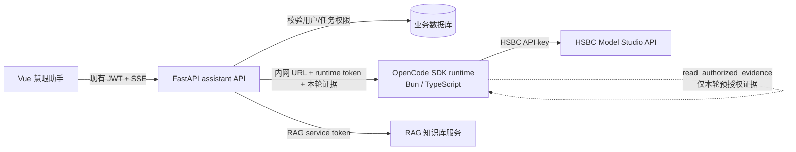
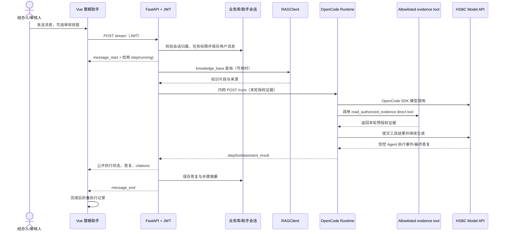

# 慧眼助手：实现状态与协作交接

更新：2026-10-20

本文记录当前 AI 助手模块的实际实现、部署边界、接口和未完成事项。助手属于境外贷款单据审核平台；RAG 服务由独立模块维护，助手仅通过约定 API 查询共享知识库。

## 目标与当前状态

目标是提供可供网页和其他 workflow 共用的审核辅助 Agent：运行时显示真实执行状态，结束后折叠执行记录；最终答复只向用户展示结论与证据；业务技能由受控目录提供；密钥由 HSBC 部署环境注入；所有贷款审核结论仍由有权限人员确认。

本轮实现包括：

- 独立 Bun / TypeScript 服务 `code/assistant-runtime/`，使用锁定的 `@opencode/sdk@2.0.32` 和 `@opencode/plugin@2.0.32`；FastAPI 保持 JWT、任务授权、RAG 适配、审计和稳定接口。
- 模型凭据只放在 runtime 环境。FastAPI 不持有 HSBC 模型 key，只使用 runtime 内部 URL/token；浏览器只持有现有 JWT。
- Runtime 只注册 `read_authorized_evidence` direct tool；其余工具一律 deny。该工具只把 FastAPI 已筛选的本轮证据交给模型，不可读数据库、文件或执行 shell。
- FastAPI 组合当前用户有权访问的任务材料、规则结果和 RAG 知识证据。RAG 查询使用 `knowledge_base` scope、`agentic=true`，不把任务 PDF 交给共享知识库，也不在这里启用外部法律 API。
- `.opencode/skills/` 有六项项目内置审核指引；`GET /api/assistant/skills` 返回目录元信息，消息可通过 `skill_id` 选择指引。它是只读技能目录，当前没有独立的专家审批/发布流程，也不是可安装任意 GitHub 仓库的技能市场。
- Vue 页面使用仓库现有 Vue/Element Plus，并使用 `@copilotkit/vue` 的 assistant message renderer；业务任务、SSE 执行记录和引用仍由现有页面负责。执行状态完成或失败后折叠，不把模型 reasoning 发送到前端。
- 用户消息、助手最终答复、公开步骤摘要和 citations 存入现有助手会话模型。无模型答复时返回错误，不生成本地伪造回答；生成答复会附“以上为审核辅助意见，不是贷款最终审批决定，请由有权限的审核人员复核。”

## 选型与取舍

| 能力 | 采用方案 | 边界 |
|---|---|---|
| Agent SDK | [OpenCode SDK](https://opencode.ai/v2/docs/build/sdk/) 与 [OpenCode 仓库](https://github.com/anomalyco/opencode) | 使用 OpenCode，不使用 OpenAI Agents SDK。SDK 目前在独立 Bun runtime 内运行；FastAPI 保持 Python 业务层。版本由 `bun.lock` 固定。 |
| 技能格式 | [Agent Skills specification](https://agentskills.io/specification) 与 OpenCode `SKILL.md` | 当前只从仓库内置目录加载。没有任意脚本安装器、专家审批工作流或完整商店管理 UI。 |
| 聊天交互 | [CopilotKit Vue](https://github.com/CopilotKit/CopilotKit) 的 `CopilotChatMessageView`、`CopilotChatAssistantMessage`、`CopilotChatInput` | 复用标准消息列表/输入处理、Markdown renderer、多行输入和停止状态；通过消息插槽呈现业务引用与执行记录。认证、SSE 和会话仍由本项目接口控制，不接入另一套 React runtime。 |
| 多人协作 | [Zulip](https://github.com/zulip/zulip) 仍是后续候选；[LibreChat Agent 文档](https://www.librechat.ai/docs/features/agents) 和 [共享链接说明](https://www.librechat.ai/docs/features/shareable_links) 作能力对比 | 当前助手会话是创建者私有会话，没有成员邀请、多人消息广播或共享聊天室 API。待办中心的成员身份/权限源确认后，再评估 Zulip OIDC、审计、网络和备份。 |

选型判断以许可证、锁定版本、安全评审和 HSBC 环境部署验证为准。GitHub 热度只作发现线索，不视作生产成熟度证明。`github-demos/` 里的研究克隆未纳入应用运行时，也不应作为依赖部署。

## 部署拓扑与密钥边界

- HSBC 的 `AI_API_KEY`、兼容 API `AI_BASE_URL` 和 `AI_MODEL` 放在 `code/assistant-runtime/.env` 或等价部署 Secret 中。不要提交 `.env`，不要放进前端变量或 FastAPI `.env`。
- `ASSISTANT_RUNTIME_TOKEN` 在 runtime 与 FastAPI 环境中必须一致且使用随机强密钥；runtime 不应暴露给公网。
- `ASSISTANT_RUNTIME_URL` 从 FastAPI 进程可达。当前 `.env.example` 使用 `http://127.0.0.1:8090`，适用于后端直接运行、runtime 容器通过本机端口映射的方式。若 FastAPI 也容器化，应改为私有容器网络中的服务名。
- Runtime compose 绑定 `127.0.0.1:8090`，使用只读根文件系统、受限 `/tmp`、非 root 用户、丢弃 Linux capabilities 和 no-new-privileges。当前开发机无 Docker，因此本轮未完成容器构建验证。
- RAG URL/token 仍归 RAG 服务部署配置。助手在 RAG 暂不可用时保留本地任务材料/规则证据，并给出知识库不可用提示；能力探测 `/api/assistant/capabilities` 反映 runtime 和 RAG 的实际健康状态。

### 本地启动

1. 在 `code/assistant-runtime/` 复制 `.env.example` 为 `.env`，填写 HSBC 正式提供的 base URL、模型 ID、API key，并与后端设置相同的随机 `ASSISTANT_RUNTIME_TOKEN`。
2. 安装 Bun 后运行 `bun install --frozen-lockfile`、`bun run typecheck`、`bun test`、`bun run build`。有 Docker 的环境可在该目录运行 `docker compose up --build -d`。
3. 后端 `code/backend/.env` 设置 `ASSISTANT_RUNTIME_URL`、同一 runtime token、RAG 服务地址和 RAG token；按项目说明运行 FastAPI。
4. 前端在 `code/frontend/` 执行 `npm ci` 和 `npm run dev`。锁文件包含 Markdown 与 HTML 清理依赖。

从干净 clone 演练时，应分别提供 HSBC 与 RAG 环境的 Secret；不能依赖开发者个人 CCSwitch 或个人 API Key。

## 已实现接口

所有 `/api/assistant` 路由均要求现有 JWT。会话以当前用户隔离；带 `task_code` 时由后端校验访问权限。

| 方法与路径 | 用途 |
|---|---|
| `GET /api/assistant/capabilities` | 探测 OpenCode runtime 与 RAG `/health`，返回 SDK、实际模型名、`configured`、`rag_available`。 |
| `GET /api/assistant/sessions` | 当前用户的会话列表。 |
| `POST /api/assistant/sessions` | 创建私有会话，可选 `task_code`。 |
| `GET /api/assistant/sessions/{id}` | 读取当前用户自己的会话和已持久化消息。 |
| `GET /api/assistant/skills` | 列出审核技能元信息。 |
| `POST /api/assistant/sessions/{id}/messages/stream` | 发送消息并返回 SSE。JSON 字段：`content`（必填）、`task_code`（可选）、`skill_id`（可选）。 |

SSE 事件：`message_start`、`step`、`tool`、`delta`、`citations`、`warning`、`error`、`assistant_result`、`message_end`。浏览器拿到的是公开状态和最终答复；目前 `delta` 是 Agent 完成后对答复的分段传输，不承诺模型 token 级实时输出。工具运行状态来自 OpenCode 事件；步骤摘要会随助手消息保存。raw reasoning、模型密钥和工具原始证据对象不属于公开事件契约。

## 时序图

## 权限与安全边界

- 任务证据由 FastAPI 按当前用户权限读取；`task_code` 只用于定位业务上下文，不由前端声明授权。
- Runtime 为每次 `/runs` 创建独立 OpenCode session，结束、超时或断连时清理 session；runtime 的隔离工作目录不含仓库 `AGENTS.md` 或用户级 OpenCode 配置。
- Runtime SDK agent 只允许 `read_authorized_evidence`；禁用 CodeMode 和其它工具，防止模型获得 shell、文件写入或任意网络能力。
- RAG 当前仅查询共享知识范围；任务单据作为已授权证据由 API 单独提供，不把其自动入库。
- SSE 不发模型 reasoning。完成、超时、SDK 错误均不回退为虚构答案；助手答复不会更改任务审核状态或规则结果。
- 仍需在 HSBC 部署配置中确认内部服务网络、Secret 注入、日志采集和备份方式。容器安全配置已写入 compose，尚待 Docker build/运行验证。

## 验证结果与下一步

本轮已完成的验证：

- `code/backend/.venv/Scripts/python.exe -m unittest tests.test_assistant_api`：16 项通过。
- `code/frontend` Vue TypeScript 检查与 Vite production build：通过。构建仍提示既有的全局 chunk 大于 500 kB；助手自身 view chunk 约 17.3 kB（gzip 约 6.9 kB）。
- 真实 HSBC 兼容 API key/model 连通测试通过；OpenCode runtime 真模型调用和 RAG-backed FastAPI SSE 联调已通过，检查到公开 tool/step 事件、引用持久化及人工复核提示。测试未在文档或日志中输出 key 和证据正文。
- `@opencode/sdk` mock provider 集成测试与 `tsc --noEmit`：通过。测试覆盖 direct tool allowlist、实际工具调用、证据传递、reasoning 不外泄和无授权请求拒绝。
- Docker CLI 当前不可用，故容器构建与健康检查未在此环境执行。
- 浏览器检查确认 `/assistant` 页面可加载，主工作区、快捷问题、输入区和受控只读提示可见；当前工作区的 Vite `/api` 代理仍指向 `127.0.0.1:8000`，但该端口实际运行的是 RAG 服务，助手 API 请求因此返回 404。未重启或改动 RAG 服务；完整页面 API 联调以 FastAPI 服务部署到正确地址后再验收。

后续建议：

1. 在 HSBC 目标机器用部署 Secret 完成干净 clone 的 Bun/Docker/FastAPI/RAG 启动演练，并验证健康状态和取消/超时路径。
2. 与待办中心 owner 对齐任务成员/专家邀请身份与权限源，之后再设计多人共享聊天室；不要把私有会话误扩展成共享会话。
3. 如果要做可治理的技能商店，先补技能来源、专家审核状态、版本、启停与发布审计 API，再实现管理 UI；不要允许运行期安装未审第三方脚本。
4. FastAPI 与 Vite 代理指向正确服务后，通过真实浏览器继续检查窄屏/桌面布局、长答复、失败态、引用和执行记录折叠；当前浏览器只完成了页面可见性检查。

RAG 维护边界：RAG 服务源代码由对应模块维护。本助手只维护 `assistant_service` 中的调用适配、能力探测及助手侧测试，不应在这里改写 `code/rag-service/` 的 UI、路由或索引实现。
