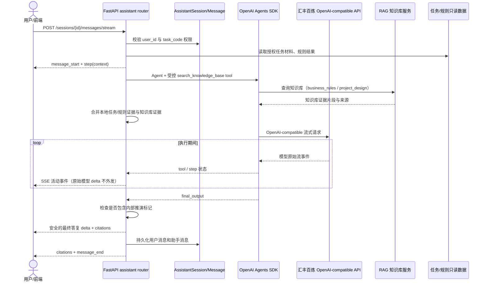

# AI 助手底座通信契约

本模块提供后端智能服务、通信协议和一个隔离的前端助手页面。现有审核/RAG页面不改；前端入口只增加 `/assistant` 路由和顶栏跳转，其他前端、任务编排器和专项审核 Agent 都通过 `/api/assistant` 调用它。

## 技术选型

| 层 | 选型 | 边界 |
| --- | --- | --- |
| Agent 编排 | OpenAI Agents SDK Python `0.4.2` | Agent、function tool、流式事件；通过 OpenAI-compatible client 接入模型服务 |
| 模型服务 | 汇丰提供的阿里云百炼团队 API | `AI_BASE_URL` / `AI_API_KEY` / `AI_MODEL`；密钥只放运行环境，不进仓库 |
| RAG | 现有 `rag_service.RAGClient` | 助手只调用 `search_knowledge_base` 工具，不依赖 RAGFlow 返回格式 |
| API | FastAPI + JSON + SSE | 会话持久化在 `assistant_sessions` / `assistant_messages` |

前端沿用仓库已有的 Vue 3 + Element Plus，不新增 React 或另一套状态系统。问答体验按成熟 agent UI 的运行状态、工具轨迹和流式 Markdown 组织，通信层适配本项目已有的 FastAPI SSE 契约。助手页面的代码边界如下：

### 开源 UI 选型记录

| 项目 | 评估 | 决策 |
| --- | --- | --- |
| [CopilotKit](https://github.com/CopilotKit/CopilotKit) / `@copilotkit/vue` | MIT；约 3.8 万 GitHub stars；官方 Vue 3 组件覆盖消息渲染、Markdown、reasoning/activity、tool slots。Vue 消息组件可接收外部消息，因此保留本项目 SSE 与会话 API。 | 采用 `@copilotkit/vue@1.79.1` 的官方 assistant message renderer；组件动态导入，首次问答前不加载其大块运行时。 |
| [assistant-ui](https://github.com/assistant-ui/assistant-ui) / `@assistant-ui/vue` | MIT；约 1.26 万 stars；Vue 包版本仍为 0.0.x，需要 shared runtime/AI SDK 适配；与当前 FastAPI SSE 消息形状不直接兼容。 | 作为交互设计参考，暂不替换现有传输层。 |
| [Open WebUI](https://github.com/open-webui/open-webui) | 完整可部署产品，后端、认证和会话体系均较完整；嵌入本项目将形成第二套账户、权限和服务栈。 | 不作为嵌入式组件；参考其工具轨迹、引用和会话交互。 |

本模块采用上游 Vue 消息渲染与 Markdown，不复制其整个产品后端。项目的 Agent SDK、汇丰百炼接口、RAG 调用、JWT 权限和历史会话仍由本仓库负责。上游包携带较大的通用 Agent UI 依赖，因此通过异步组件只在首次助手回答时载入；本次生产构建中 CopilotKit 相关最大异步块约 1.67 MB（gzip 约 463 KB），需要在汇丰部署网络实测首轮答复加载体验。当前仍保留本项目 SSE 和数据库消息契约，没有引入 CopilotKit Runtime 服务。

- `code/frontend/src/assistant/api.ts`：只负责 `/api/assistant` 请求和 SSE 解析。
- `code/frontend/src/assistant/types.ts`：会话、消息、步骤和引用的前端契约。
- `code/frontend/src/assistant/markdown.ts`：早期自定义 Markdown helper，目前消息正文改由 CopilotKit Vue renderer 处理；除非重新接入调用点，否则不要把它当作当前渲染入口。
- `code/frontend/src/views/AssistantView.vue`：三栏助手界面、可折叠执行活动、停止生成、官方 CopilotKit assistant message renderer、工具检索轨迹和证据引用面板，并提供一键复制回复。
- `code/frontend/src/router/index.ts`、`code/frontend/src/layouts/MainLayout.vue`：仅提供页面入口，不改变现有业务页面。

`openai-agents==0.4.2` 是当前仓库 `pydantic==2.10.3` 的兼容锁定版本，同时锁定 `openai==2.44.0`。这是因为 `openai==2.45.0` 起新增的 usage 字段会让该 Agents SDK 版本在运行前初始化失败。更新 SDK 时必须重新验证 FastAPI/Pydantic 依赖和网关的 Chat Completions 兼容性。

## 权限和业务边界

- 所有助手接口需要 JWT。
- 会话按 `user_id` 隔离；业务经办人只能带入自己提交的任务，审核人员可以读取任务上下文。
- 助手可以读取任务材料、规则结果和 RAG 证据，生成解释、风险摘要和人工复核草稿。
- 助手不能写入任务状态、改写 `CheckResult`、调用 `/complete` 或 `/return`，也不能直接给出贷款最终审批结论。
- 低置信度、证据冲突或无证据时必须提示人工确认。

## 接口

### `GET /api/assistant/capabilities`

返回 SDK、模型网关、RAG 是否配置以及是否支持流式事件。

### `GET /api/assistant/sessions`

返回当前用户的会话列表。

### `POST /api/assistant/sessions`

```json
{"title":"提款材料核对","task_code":"FOL LN20260315-008"}
```

`task_code` 可省略。带入任务时会立即执行数据级权限校验。

### `GET /api/assistant/sessions/{session_id}`

返回会话消息、执行步骤和引用。

### `POST /api/assistant/sessions/{session_id}/messages/stream`

请求：

```json
{"content":"请解释当前不通过项，并列出需要人工核对的材料","task_code":"FOL LN20260315-008"}
```

响应为 `text/event-stream`。每条事件是标准 SSE 的 `event` + JSON `data`：

| 事件 | 关键字段 | 用途 |
| --- | --- | --- |
| `message_start` | `message_id`, `task_code` | 创建本轮助手消息 |
| `step` | `step.key`, `step.label`, `step.status` | 展示执行步骤时间线；不暴露模型内部思维链 |
| `tool` | `tool.name`, `tool.status` | 展示知识库/证据工具开始和完成 |
| `delta` | `delta` | 渲染最终答复文本片段；不会转发模型原始 delta |
| `citations` | `citations[]` | 文件、规则或知识库证据引用 |
| `message_end` | `message` | 本轮持久化消息和最终状态 |
| `error` | `message` | 可恢复错误 |

前端只需按事件类型更新自己的状态机，不需要知道 Agent SDK 的内部对象。Agent SDK 的原始响应 delta 可能含有思维草稿、工具参数或不完整内容，因此服务端不向浏览器转发这些原始片段；Agent 运行结束后，只对最终 `final_output` 做安全检查，再分片发送 `delta`。因此执行步骤和工具状态会实时显示，答复文本在本轮 Agent 执行结束后才开始出现，不代表逐 token 的模型生成流。

最终输出会检查常见的内部推演/工具规划标记；命中时丢弃模型输出并使用本地审核辅助兜底。历史消息接口也应用相同检查，旧记录若命中则返回“已隐藏”的提示文本，页面正文与复制操作再做一层保护。数据库原始历史不做自动改写，避免静默篡改审计记录。执行轨迹在 `steps` 字段持久化并随会话历史返回；旧记录若没有工具步骤，不会补造历史轨迹。

安全标记检测属于纵深防护，不能替代模型网关对 reasoning channel 的正确隔离。上线前仍需确认 HSBC 百炼部署模型不会把隐藏推理放进 `final_output`，并对真实部署模型补充输出回归样例。

## 时序图



任务材料和规则结果由助手后端按当前用户权限直接读取；RAG 仅负责知识库检索，不接收或替代任务权限校验。任务会话也只查询 `knowledge_base` 范围；RAG 暂不支持 `task_documents` 时，不会因此跳过知识库检索。

## 运行配置

本项目默认使用汇丰比赛提供的百炼团队 API。复制 `code/backend/.env.example` 为 `.env`，并配置：

```dotenv
AI_BASE_URL=https://llm-tlndh47wd9ustbss.cn-beijing.maas.aliyuncs.com/compatible-mode/v1
AI_API_KEY=<从汇丰安全渠道获取的 refresh 后团队密钥>
AI_MODEL=qwen3.8-flash
AI_REQUEST_TIMEOUT=45
RAG_BASE_URL=http://127.0.0.1:8010
RAG_SERVICE_TOKEN=<与 rag-service 的 SERVICE_TOKEN 相同>
RAG_REQUEST_TIMEOUT=15
```

`AI_API_KEY` 应由本机环境变量或部署平台 Secret 注入；团队成员从 Git 拉取代码后，需通过汇丰指定的安全渠道取得同一团队的有效 refresh 密钥，再在各自运行环境设置该变量。不要把 CSV、密钥、`.env` 或密钥写入前端构建变量，也不要通过 Git/聊天记录分发。生产部署还需由部署负责人把该 Secret 配置到 HSBC ECS 的服务运行环境。仅拉取仓库不会自动获得团队密钥，这是凭证管理的必要边界。

模型连接走汇丰百炼 OpenAI 兼容接口的**直连地址**，不经过任何本地代理（如 CCSwitch）。`code/assistant-runtime` 启动时会清除继承的 `HTTP(S)_PROXY` / `ALL_PROXY` 环境变量并设置 `NO_PROXY=*`，确保始终直连 `AI_BASE_URL`；不要在本机代理或 CCSwitch 中拦截该域名，也不要为汇丰模型地址配置代理转发。

本地启动完整助手时，先启动 `code/rag-service`（端口 `8010`），并在两个服务的忽略 `.env` 中分别配置 `SERVICE_TOKEN` 和同值的 `RAG_SERVICE_TOKEN`。RAG 的百炼 Embedding/视觉模型使用汇丰团队 API Key；rag-service 的 `SERVICE_TOKEN` 只是内部服务鉴权，不是模型 API Key。部署到 ECS 时将 `RAG_BASE_URL` 改为服务可达的内网地址，并把两项 Secret 配置到后端运行环境。`rag_available` 表示连接配置已启用；实际检索依赖 RAG 服务已启动且对应知识库已索引。

可在 PowerShell 当前进程中设置本地密钥后启动后端：

```powershell
$env:AI_API_KEY = "<从汇丰安全渠道获取的 refresh 后团队密钥>"
python -m uvicorn app.main:app --port 8000
```

Linux/macOS 服务进程可通过部署平台 Secret 或 systemd `EnvironmentFile` 注入相同变量。未配置模型服务时，接口仍可启动并返回本地演示回答；该模式仅用于界面联调，不代表模型 API 已配置成功。
