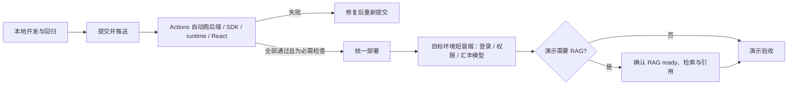

# 慧眼助手总规划

跨模块协作请先看[全组接线总览](../integration/README.md)与[详细接口/时序](../integration/接口与时序.md)：区分业务专项审核与独立助手，明确RAG证据、SDK能力、任务状态和人工处置的边界；新增接口为草案，不代表本模块已实现。

> 当前实现：审核人员与 AI 先讨论，需要时邀请有任务权限的审核同事进入同一会话，阅读历史、共同讨论或继续问 AI。慧眼助手页面与全部助手 API 仅供审核人员；经办人负责提交材料，不进入助手审核会话。助手只提供辅助意见，审核结论必须由有权限人员确认。

**其他模块接入：** 先看[模块接入清单与可运行示例](模块接入.md)，详细字段查[对外接口 V1](对外接口V1.md)与[独立 Python SDK](../../code/assistant-sdk/README.md)。固定前缀 `/api/assistant/v1`，OpenAPI 基线随仓库交付；内部模型/检索实现可继续升级，调用方不直接依赖内部代码。云端隔离预览已发布此版本，正式主站尚未切换。

当前接入交付：`create / ask / resume` 示例已用独立 Python 子进程和真实本机 TCP API 验证，覆盖同键仅一次执行、持久结果恢复及 JWT 失败；API/契约 28 项、SDK 8 项通过。此项使用隔离合成库与 mock 模型，不替代下方真实模型和目标部署验收。

## 1. 当前做到哪里

**当前本机演示入口（2026-10-22）：** [慧眼助手](http://127.0.0.1:5173/assistant)，正式 React 页面代理到本轮助手 API **8003**，再调用已验证的 runtime **8092**；保留旧 8000/8002 服务。通过前端代理的真实汇丰 qwen3.8-flash 问答约 **14.2 秒**，同键重试及游标恢复通过，临时会话已清理。真实 RAG 仍不可用。本机启动/地址覆盖见[部署说明](../../code/assistant-runtime/deploy/README.md#当前本机实例2026-10-22)；不是云端地址或默认端口变更。

**云端预览（已部署）：** **57563ed** 无凭证候选包已上传现有云电脑的独立目录；React 静态构建 → API 8003 → OpenCode 8093 → 汇丰真实问答与双账号协作 **7.29 秒**通过，任务引用/幂等/恢复/撤权均通过。之后又通过云端**真实双浏览器页面验收**：登录、发送与引用、折叠轨迹、搜索/邀请专家、共享历史、具名讨论和撤权均实测通过。预览只监听回环，通过当前开发机 SSH 转发 [5177/assistant](http://127.0.0.1:5177/assistant) 访问；其他电脑需自己的授权隧道，口令走安全渠道。见[隔离预览与正式交付](../../code/assistant-runtime/deploy/preview/README.md)。

**正式主站边界：** 80/8000 原进程与业务库未改，助手预览使用独立合成数据库和随机账号。正式发布仍走仓库统一部署，需交接原 DB/JWT 配置并备份迁移。Linux 干净安装已通过后端 **90** 项、SDK **8** 项及启动/鉴权；云端普通生产配置预检通过，要求真实 RAG 的预检未通过，`rag_available=false`。

| 已实现 | 真实边界 |
|---|---|
| React 正式助手，复用 Ant Design X | [HTML 原型](../../mockup/mockup_assistant_collab.html)仅用于产品讨论 |
| 汇丰模型 → OpenCode SDK → 助手 API → 页面 | 本机与云端隔离预览的真实 HTTP 调用通过；密钥仅在服务端，不依赖 CC Switch |
| 同会话邀请、具名消息、撤销成员 | 仅审核人员；共享前必须关联任务；邀请不授予任务访问权或审批权 |
| 专家服务端搜索、介绍、标签匹配推荐 | 查询全部授权候选后最多返回 50 位；本人资料独立读取，不依赖搜索列表；不编造专家，不自动邀请 |
| 可恢复的 AI 运行及公开事件 | 单人/多人页面统一 runs/events；幂等请求、单会话运行槽、数据库游标 |
| 任务证据、RAG 适配、引用、折叠轨迹 | 中文提问也保留授权任务概要；来源编号绑定本轮送入模型的证据，只有正文引用的来源显示在引用面板；RAG 由另一模块负责，编号可追溯不等于事实已核验 |
| 技能库：目录、加入/移除、版本更新提示 | 仅仓库审核发布的指引；不执行任意远程技能或上传脚本 |
| 独立可安装 Python SDK / 助手 V1 契约 | 只依赖 HTTPX；委托的审核 JWT；不依赖后端源码，独立机器身份尚未实现 |

**尚未验收：** 正式主站/目标 PostgreSQL 与真实 RAG 联合链路、不同同学电脑访问展示、多实例协调与压力测试；云端预览的 SQLite + 汇丰 HTTP 验收不替代这些项目。正文尚非模型 token 实时流，不能据此宣称生产级或给出未经用户测试的高分。

## 2. 架构与模块边界

~~~mermaid
flowchart LR
  R[审核人员] --> UI[React 18 / Ant Design X]
  E[受邀同事] --> UI
  W[业务工作流 / Agent] -->|AssistantClient + 业务 JWT| API
  UI -->|JWT · JSON / 事件游标| API[FastAPI 助手 API]
  API --> ACL[审核角色 AND 成员身份 AND 现有任务权限]
  ACL --> DB[(会话 / 作者 / 运行 / 事件 / 审计)]
  API --> TASK[获准的任务字段 / 规则结果]
  API --> RAG[assistant_knowledge · 业务规则检索]
  API -->|本轮授权上下文 · 私网 token| RT[独立 runtime / OpenCode SDK]
  RT -->|服务端 HSBC key| HSBC[汇丰模型 API]
  RT --> TOOL[只读授权证据工具]
  TOOL -->|本轮证据编号| RT
  RT -->|最终答复与引用编号| API
  API -->|编号校验后仅返回已引用来源| UI
~~~

| 层 | 当前组件 / 主要文件 | 职责 |
|---|---|---|
| 界面 | React 18、Ant Design 5、Ant Design X 1.6.1；AssistantView.tsx | 上游 Sender/Bubble/Conversations/ThoughtChain；成员管理用 Ant Design Drawer/List/Modal |
| 页面适配 | useAssistant.ts、collaboration.ts | JWT 请求、状态、断线回放和目录同步；不做权限决策 |
| 对外边界 | assistant_contract.py、assistant-sdk/hbcn_assistant | V1 版本声明、独立 HTTP SDK、OpenAPI 契约回归；旧路径兼容 |
| 业务边界 | routers/assistant*.py、assistant_collaboration.py | 会话/任务鉴权、运行调度、持久事件、审计 |
| 证据与回答 | assistant_service.py、assistant_knowledge.py | 任务证据、仅业务规则知识检索、专家候选和答复校验；不修改审核状态或 RAG 实现 |
| Agent 执行 | code/assistant-runtime、OpenCode SDK 2.0.32 | 仅本轮只读工具；不直接读业务库或任意业务文件 |
| 数据 | assistant_models.py、独立 Alembic 迁移 | 新增助手专属表，不改队友任务表或 RAG 数据层 |

上游按锁文件安装：[Ant Design X](https://github.com/ant-design/x)（MIT）、[OpenCode](https://github.com/anomalyco/opencode)（MIT）。资源授权借鉴 [LibreChat ACL](https://www.librechat.ai/docs/features/access_control)。只写本项目业务适配，不重复引入认证/聊天框架；升级前先验证 React/Ant Design 和 SDK 兼容性。

## 3. 多人如何协作

~~~mermaid
sequenceDiagram
  actor R as 创建审核人员
  actor E as 受邀专家
  participant API as 助手 API
  participant DB as 数据库
  participant AI as OpenCode / 汇丰
  R->>API: 关联任务、与 AI 对话
  R->>API: 搜索专家，确认共享完整历史并邀请
  API->>DB: 检查角色与任务权限，保存成员/审计
  E->>API: 登录后读取同一会话历史
  E->>API: 发给成员（仅讨论，不调用模型）
  R->>API: 问 AI（content + client_message_id）
  API->>DB: 幂等校验、占用会话运行槽
  API->>AI: 历史 + 授权材料 + 技能
  AI-->>API: 公开步骤、工具结果、最终答复
  API->>DB: 保存事件和最终消息
  par 双方同步
    R->>API: 从游标读取事件
  and
    E->>API: 从游标读取事件
  end
  API-->>E: 同一答复、作者、引用；完成后折叠轨迹
~~~

- 创建者管理成员；成员可讨论/问 AI；创建者和运行发起者可停止 AI。未受邀、停用、撤权或失去任务权限的用户不能继续读取。
- 专家抽屉按姓名/方向/标签做服务端搜索，每次最多 50 位，支持首屏之外的人员；过期搜索结果不覆盖当前结果。本人专业资料独立读取，读取失败不打开空表单、保存失败保留编辑。切换会话使旧邀请/撤权确认失效，需在新会话重新操作。
- 助手路由统一检查数据库中的审核角色，非审核人员返回 403；进行中的私有/共享运行也复核角色，角色撤销后不发布或保存完整答复。历史经办人会话保留数据，但不再授权访问。
- 会话任务固定；切换任务须新建会话。任务授权仍沿用主站角色规则，助手没有擅自实现全平台细粒度任务 ACL。
- 每会话最多一个 AI 运行；期间仍可发讨论，新消息在后续 AI 轮次纳入上下文。
- 相同 client_message_id + 相同内容返回同一运行；同键不同内容返回 409。调用方重试须复用原键，显式重新提问用新键。
- 单人/多人发送者约 0.7 秒读取本轮事件，旁观成员及恢复中的单人会话约 1.8 秒同步，目录约 5 秒刷新；隐藏标签页暂停后台同步。这不是 WebSocket/presence。
- 离开或刷新页面只断开读取，不取消后台运行；重新选择原会话可恢复公开轨迹与最终回答，不重新调用模型。主动点击停止才取消运行。运行中阻止重复提问，但共享会话仍可发成员讨论。进程崩溃后，过期运行明确失败，不自动再次调用模型。
- 助手 API 的 401 表示业务登录 JWT 无效或过期；前端清除该登录态并跳回登录。它与 HSBC 模型 API key、runtime token 是不同凭证，重新登录后再发送；不要将模型凭证填入网页。

## 4. 数据与回答边界

~~~mermaid
erDiagram
  USERS ||--o{ ASSISTANT_SESSIONS : owns
  ASSISTANT_SESSIONS ||--o{ ASSISTANT_MESSAGES : contains
  ASSISTANT_MESSAGES ||--o| ASSISTANT_MESSAGE_AUTHORS : attributed
  USERS ||--o{ ASSISTANT_MEMBERS : joins
  ASSISTANT_SESSIONS ||--o{ ASSISTANT_MEMBERS : admits
  ASSISTANT_SESSIONS ||--o{ ASSISTANT_RUNS : executes
  ASSISTANT_SESSIONS ||--o{ ASSISTANT_EVENTS : appends
  ASSISTANT_SESSIONS ||--o{ ASSISTANT_AUDIT : records
  USERS ||--o| ASSISTANT_EXPERT_PROFILES : maintains
  USERS ||--o{ ASSISTANT_USER_SKILLS : pins
~~~

旧会话继续可用，旧用户消息归属创建者。最终消息保存步骤/引用，新增事件日志支持回放。OpenCode session 每轮临时创建并清理，业务历史由后端管理。

**过程与答案分开：** UI 仅接收公开步骤、工具、答复和引用；未知/reasoning 事件不进正文。runtime 只选成功结束且没有工具调用的最终消息，避免把工具前言当答复。后端还检查文本和人工确认提示，已有明确提醒时不重复追加。

SSE 自行管理数据库会话，不依赖已结束的 HTTP 请求会话；完整答复入库前再次检查权限与运行状态。撤权后服务端立即拒绝后续读取，在线页面在下一次同步时清除历史及任务选择；已经被对方阅读的信息无法收回。

最终答复、作者、`message_end/run_end`、completed 状态和运行槽释放由同一数据库事务提交。最终事件或提交失败则回滚本次答案，不留“历史有答案但运行未完成”的半成品；失败保留已接收的提问并标记 error，不自动重跑模型。

助手时间在 SQLAlchemy 类型边界统一按 UTC 存取，保留既有无时区列，避免 PostgreSQL 会话时区改写时间及过期语义；不修改主站业务字段或全库时区。早期 PG 数据若已受时区偏移，须依据原部署时区审计，不能自动猜测修复。

正文目前在完整答复校验后分段显示，**不是 token 实时流**。运行中步骤/工具状态来自真实事件；不展示内部推理，不制造固定检查项假装执行。增强检索按 RAG 文档预算最多 240 秒，完整助手运行留出 RAG、模型及持久化余量，客户端等待上限 400 秒。

RAG 按现有接口检索共享资料；任务概要、字段/规则结果先经主站授权再读取。自然中文提问不依赖空格分词命中才能保留本地上下文。知识库不可用或本轮输入被截断会显示并持久化依据限制，仍保留已加载授权材料。助手为实际发送给 runtime 的非专家证据分配本轮编号，前端只显示答复里出现且可解析的编号；未读取/不存在的编号会拦截完整答复。专家资料可供推荐，但不会作为审核证据或计数。编号校验只证明来源在本轮输入中，不验证答复是否正确、是否完整或是否忠实概括；仍需审核人员复核。RAG 及外部法规/任务文档 scope 以 RAG 模块实际接口为准。

## 5. 同学如何调用

审核知识检索策略：助手侧 `assistant_knowledge.py` 按 RAG v1.2 调用 `POST /api/v1/retrievals`，仅启用 `business_rules` + `knowledge_base` + `reference`，消费原始来源片段及 sufficient/insufficient/clarification 结果；项目设计、外部法律、任务文档均不混入。检索缺口保留为用户可见限制，主站授权任务材料独立进入回答。助手消息上限为 8,000 字符，RAG 查询上限为 4,000；超过检索上限时不截断或错误重试，而是明确提示并保留已加载的授权任务证据。只改助手专属适配器，不覆盖 RAG 实现或共享 `rag_service.py`。当前隔离云端尚未配置 RAG，真实响应/引用联合链路仍待两模块部署后验收。

页面入口：/assistant?task_code=任务编号，或 /assistant?session_id=会话ID。ID 不授予访问权。所有 API 均要求 Authorization: Bearer 业务JWT。

| API（前缀 /api/assistant/v1；原路径兼容） | 用途 |
|---|---|
| GET /contract | V1 契约、限制与兼容声明 |
| GET /capabilities；GET/POST /sessions | 就绪状态、本人及受邀会话、新建 |
| GET/DELETE /sessions/{id} | 授权历史 / 创建者删除（运行中拒绝） |
| GET /experts?session_id=&q=；GET/PUT /experts/me | 服务端搜索真实人员 / 独立读取、维护本人专业资料 |
| GET/POST /sessions/{id}/members；DELETE /sessions/{id}/members/{user_id} | 查成员、邀请、撤权 |
| POST /sessions/{id}/messages | {content}：具名讨论，不调用模型 |
| POST /sessions/{id}/runs | {content,client_message_id,skill_id?} → 202 和运行 ID |
| GET /sessions/{id}/runs/{run_id} | 运行状态与完成后的最终消息；跨页面/进程取结果，不触发 AI |
| GET /sessions/{id}/events?after_id=&run_id= | events,cursor,has_more,active_run；每页最多 100 条 |
| POST /sessions/{id}/runs/{run_id}/cancel | 创建者/发起者停止运行 |
| GET /sessions/{id}/audit | 创建者查看邀请/撤权/取消记录 |
| GET /skill-library；PUT/DELETE /skill-library/{skill_id} | 发布目录、个人加入/更新/移除 |
| GET /skills；POST /sessions/{id}/messages/stream | 技能目录；SSE 仅兼容旧单人客户端，正式页面统一 runs/events |

事件：message_start / step / tool / delta / citations / message_end / error；协作增加 discussion / members_changed / run_end。持久事件带 id、run_id；message_end 的落库消息为权威正文，run_end.status 为最终运行状态。字段及调试见后端 /docs。

业务工作流安装 `code/assistant-sdk` 后用 `hbcn_assistant.AssistantClient(base_url, user_jwt)`；旧 `app.assistant_client` 仅重新导出该包。委托 JWT 必须属于当前有效审核人员，`client_message_id` 使用调用方保存的业务请求唯一键；提供 start_run/wait 分离与 ask 快捷方法。无需 HSBC key 或 runtime token，不绕过任务权限；自主后台服务身份需另外设计授权。调用及兼容约定以[对外接口 V1](对外接口V1.md)为准。

## 6. 拉取与部署

### 提交与部署的最小检查

助手后端、SDK、runtime、前端及工作流契约变化会触发 [Assistant checks](../../.github/workflows/assistant-ci.yml)：运行助手后端回归、独立 SDK 测试、React 测试/生产构建，以及 OpenCode runtime 的冻结安装、测试、类型检查和构建（Bun 1.4.3）。工作流已固定 setup-bun 官方 v2.2.0 commit。GitHub Actions 工作流本身不会自动启用分支保护；仓库管理员需把 `assistant` job 设为合并必需检查，红灯提交才会被真正挡住。

团队交付时看提交对应的 GitHub Actions 必需检查：全部绿灯后，无需每位同学重复跑完整回归；统一部署者只做目标环境短冒烟，确认迁移、登录/权限、汇丰模型与当次演示所需的 RAG 检索/引用。CI 未运行、未设为必需或未通过时，不按“可直接部署”处理。本机通过和 CI 通过都不能替代环境配置及真实 RAG 联测。

截至 2026-10-22，本地 `lfc` 已有该工作流，但 `origin/lfc` 与 GitHub 默认分支均未包含它；GitHub 返回 workflow not found，因此远端 CI 还没有实际运行。此轮补齐 runtime 门禁后，仍需把审核通过的助手提交发布到仓库、确认 Actions 绿灯，并由仓库管理员设置必需检查，才能按上图交付。

1. 团队授权渠道提供配置。后端按 .env.example 设置 runtime/RAG 地址及 token；runtime 按模板设置 AI_BASE_URL / AI_API_KEY / AI_MODEL。真实 key 不入仓库/浏览器。
2. code/backend：安装 requirements-assistant.txt（包含原 requirements），首次按主站流程初始化业务数据库，再执行下方 Alembic 命令。只增加助手表；旧库缺业务字段时先按业务模块要求升级，不删除/重建业务库。
3. code/assistant-runtime：bun install --frozen-lockfile，bun run start。后端：python -m uvicorn app.main:app --host 127.0.0.1 --port 8000 --workers 1。
4. code/frontend：npm ci、npm run dev。端口变化在忽略提交的 .env.local 设置 HBCN_API_TARGET；生产 npm run build，静态服务设 SPA 回退及 /api 代理，SSE 关闭缓冲。
5. **当前单 API 实例/单 worker**：数据库保存事件/唯一运行槽，执行与取消仍是进程内 asyncio 任务。多实例须先引入持久队列及跨进程取消验证。SQLite 用于本机演示；真实 PostgreSQL/ECS 另做环境验收。

用户指定继续使用已有汇丰云主站。2026-10-22 SSH 只读核对：Ubuntu 24.04，80 是直接运行的 Vite 开发进程且当前前端源码不含助手，8000 为没有助手路由的 FastAPI 登录会话进程；没有部署助手 runtime/表。后端无 `.env` 或 DB/JWT 配置变量，数据库只有业务表，现有 Python 环境缺助手新增依赖。云端细项见[部署交付](../../code/assistant-runtime/deploy/README.md)。现有网站在线不能据此算助手已上线。没有改动云端运行文件或业务库。

云端预检使用 `python -m app.assistant_preflight --require-rag --production`，只读检查助手表/迁移/运行约束、runtime 鉴权与协议、RAG 授权就绪接口，并确认 JWT 密钥不是弱默认值且 `DEBUG=false`；不改库、不消耗模型请求、不输出凭证。普通本机预检可省略 `--production`，但报告仍会列出生产安全状态。首次迁移可从只有业务表的环境创建所有助手表，也兼容已有单人助手数据。runtime 带 token 的 `/readyz` 和每轮请求采用 `assistant_protocol: 2`；capabilities 与实际 AI 运行都会检查该协议，旧进程不能冒充当前就绪。升级后端时需同时发布此版 runtime。RAG 仍使用其既有 `/api/v1/ready`，不拿公开存活接口代替授权就绪。

没有汇丰授权配置的电脑不能直接请求模型；拉取可部署不等于把私密 key 随仓库分发。RAG/OCR/业务审核部署由对应模块负责。

## 7. 验证与文档维护

~~~text
code/backend:           python -m unittest tests.test_assistant_api tests.test_assistant_collaboration tests.test_assistant_atomic tests.test_assistant_evidence tests.test_assistant_preflight tests.test_assistant_contract tests.test_assistant_knowledge tests.test_assistant_timestamps tests.test_rag_service
code/backend:           python -m unittest discover -s ../assistant-sdk/tests
code/frontend:          npm test && npm run build
code/assistant-runtime: bun test && bun run typecheck
code/backend:           python -m alembic -c assistant-alembic.ini upgrade head
~~~

测试覆盖权限、撤权、幂等、并发拒绝、取消/超时、作者、旧消息、技能和 React 邀请/轨迹/异常；mock 不代替真实链路。本机另用汇丰 qwen3.8-flash 完成真实问答（约 11.6 / 16 秒），以及隔离双 JWT 账号的真实模型协作验收（约 12.9 秒）。后端显式执行 python -m tests.live_assistant_acceptance --live 可重做后一项：仅用临时库与合成数据，直接调用真实 ASGI 路由，模型走真实 HTTP；不等于双浏览器/反向代理验收。结果与待办见[当前修改规划](持续优化实施规划.md)。

此前 PostgreSQL 部署回归：本机 WSL/Linux **PostgreSQL 18.3** 在 **Asia/Shanghai** 会话时区下通过首次/重复迁移、合成业务数据/结构保留、4 连接同键并发、双 JWT 协作/结果恢复/撤权；后端综合回归 **90 项**，已核实验收 schema 为零，临时 PG 已停止且文件已删除。该环境的模型为 mock、业务 API 为 ASGI，不是汇丰云端联合验收。运行方法见[部署验收](../../code/assistant-runtime/deploy/README.md)。

第 27 轮本机验证：助手 CI 对应后端 **87 项**、独立 SDK **8 项**、React **30 项**通过，前端 TypeScript 检查和 Vite 生产构建通过（主站入口仍有约 1.82 MB 警告）；OpenCode runtime 在 Bun **1.4.3** 下冻结安装通过、**3 项 / 52 断言**通过、类型检查和构建通过；工作流 YAML 解析通过。当前 GitHub 远端尚无此工作流，因此 Actions 仍未运行；目标运行器结果和必需检查设置待发布后确认。

另以临时 SQLite/ASGI + 汇丰真实 **qwen3.8-flash** 约 **10.1 秒**通过任务字段/引用、单人转共享同次运行、相同历史/事件、幂等、保存游标恢复和撤权；与上述 PG 验收分开。前轮 React **30 项分批通过**及 TypeScript/Vite 构建通过，本轮未改前端。契约仍为 **1.2.0**，OpenAPI **18 路径 / 23 操作**。

SDK **1.1.2** 提供[双账号 HTTP 部署验收命令](../../code/assistant-sdk/README.md)，显式 contract 检查要求 API 至少 1.1.0，接受同主版本增量。此前临时合成库 + 真实 TCP API + 汇丰模型约 **12.6 秒**通过，临时服务已停止；实际 CLI 的 `--require-rag` 未就绪阻断、退出码、无凭证输出均已验证。

本轮真实模型链路 `rag_available=false`；前轮重新探测配置 RAG ready 返回 404、8011 不可达，未宣称真实检索成功。前轮 Node 构建保留主站大 chunk 告警；SDK 1.1.2 wheel 安装通过，此前干净环境独立安装和 Windows/Linux runtime 各 **3 项 / 52 断言**通过，本轮未改 runtime。Linux systemd 模板已离线校验，未安装服务。云端助手、真实 RAG、目标 PostgreSQL和多台团队电脑联合验收仍待完成。

维护三层：[本文](README.md)说当前是什么；[修改规划](持续优化实施规划.md)记录本轮实现和验证；[决策记录](决策记录.md)解释长期取舍。接口/行为落地时同步，不按日期复制。[早期调研](多人协作AI对话调研与优化方案.md)与[旧交接](开发记录与交接.md)是历史，遇冲突以当前代码和本文为准。
