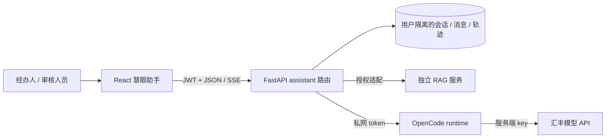
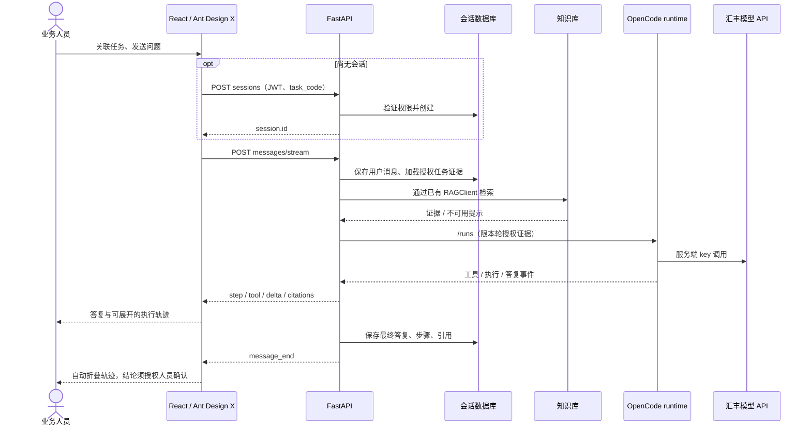

# 慧眼助手：React UI、OpenCode runtime 与业务接口

本文是当前接入说明。早期《开发记录与交接》保留为历史记录，其中旧 UI/SDK 选型不再代表当前实现。

## 技术选择与边界

| 层 | 当前实现 | 职责 |
| --- | --- | --- |
| UI | React 18、Ant Design 5、`@ant-design/x@1.6.1`（MIT） | 直接使用上游 Sender、Bubble、Conversations、ThoughtChain |
| 状态/路由 | React hooks、Zustand、React Router | 共用主站 JWT 登录，助手路由懒加载 |
| 文本 | marked 12 + DOMPurify | 流式 Markdown、表格、代码块，清洗不可信 HTML/链接 |
| 业务后端 | FastAPI `/api/assistant` | 用户/任务授权、证据准备、会话及轨迹持久化 |
| Agent runtime | `code/assistant-runtime`，`@opencode/sdk@2.0.32` | 隔离运行 OpenCode，调用汇丰模型 API |
| 知识库 | RAG 会话负责的服务及 `app/rag_service.py` | 通过已有接口检索；本次未修改 RAG 实现 |

上游：[Ant Design X](https://github.com/ant-design/x)，[1.6.1 发布元数据](https://registry.npmjs.org/@ant-design%2fx/1.6.1)，[OpenCode](https://github.com/anomalyco/opencode)。固定 X 1.6.1 是因为其 peer dependency 对应现有 Ant Design 5；X 2.9.0 要求 Ant Design 6，不应迁移助手时强制全站升级。组件直接来自 npm 上游，业务适配层负责协议、权限和会话，不复制第二套用户系统/运行时。



## 同学如何接入

前端导航到 `/assistant?task_code=${encodeURIComponent(taskCode)}`。不传任务编号可做普通问答；任务相关问题应关联任务。切换任务开启新会话，避免混用材料。前后端均保留用户权限检查，前端选择器不是安全边界。

以下 API 均要求 `Authorization: Bearer <JWT>`：

| 方法/路径 | 入参/返回 | 场景 |
| --- | --- | --- |
| `GET /api/assistant/capabilities` | `configured,model,rag_available,sdk,supports_stream,message` | 实际服务就绪状态；不是每轮请求成功保证 |
| `GET /api/assistant/sessions` | `AssistantSession[]` | 当前用户的会话目录 |
| `POST /api/assistant/sessions` | `{title,task_code?}` → 会话 | 第一条消息时创建，挂载页面不写库 |
| `GET /api/assistant/sessions/{id}` | 会话及 `messages[]` | 历史正文、步骤、引用 |
| `DELETE /api/assistant/sessions/{id}` | `{deleted:true}` | 确认后删除自己的会话 |
| `GET /api/assistant/skills` | 项目发布的技能目录 | 名称、版本、权限；没有远程安装功能 |
| `POST /api/assistant/sessions/{id}/messages/stream` | `{content,task_code?,skill_id?}` → SSE | 最多 8000 字，正常结束必须有 `message_end` |
| `GET /api/tasks?mine=true/false` | 已有任务接口 | 经办人查本人任务；审核人员按现有授权查询 |

### SSE 契约

事件内容均为 JSON，见 `assistant_schemas.py`、`src/assistant/types.ts`。错误事件的 `message` 是字符串；完成事件的 `message` 是持久化消息对象。

| 事件 | 字段 | UI 行为 |
| --- | --- | --- |
| `message_start` | `message_id,task_code` | 本轮开始 |
| `step` | `step:{key,label,detail?,status}` | 更新同 key 业务步骤 |
| `tool` | `tool:{name,status,result_count?}` | 真实授权证据读取状态 |
| `delta` | `delta:string` | 追加公开答复正文 |
| `citations` | `citations[]` | 引用及页码 |
| `message_end` | `message:{id,role,content,status,steps,citations}` | 以落库版本为准，结束 loading，自动折叠步骤 |
| `error` | `message:string` | 显示错误并恢复发送，已有片段标为未完成 |

未知事件（包括 reasoning）不拼接正文。业务操作轨迹不等于模型内部推理；不请求、不展示内部推理。后端负责最终答复检查与审核权限提示。HTTP 401 清理当前失效登录，由受保护路由保留返回路径；403 不清理登录。



停止会取消客户端请求和 reader；已写入的用户消息不会回滚，片段不代表完整结论。若没有 `message_end` 就断流，显示中断，不能无限等待或伪装完成。

## 环境与部署

1. 按 `code/backend/.env.example` 配置主后端：`ASSISTANT_RUNTIME_URL`、`ASSISTANT_RUNTIME_TOKEN`、`RAG_BASE_URL`、`RAG_SERVICE_TOKEN`。各 token 与对应服务匹配。
2. 按 `code/assistant-runtime/.env.example` 配置 runtime：汇丰授权 `AI_BASE_URL`、`AI_API_KEY`、`AI_MODEL` 及 runtime token。本机验证模型为 `qwen3.8-flash`。真实 key 不写入文档/前端，不依赖个人 CC Switch 或中转站。
3. runtime 目录执行 `bun install --frozen-lockfile`、`bun run start`（默认 8090）。主后端执行 `.venv\Scripts\python -m app.seed`（首次）、`.venv\Scripts\python -m uvicorn app.main:app --port 8000`。RAG 按其文档启动（默认 8010）。
4. 前端执行 `npm ci`、`npm run dev`，访问 5173。主后端本机改用 8001 时，在忽略提交的 `.env.local` 设置 `HBCN_API_TARGET=http://127.0.0.1:8001`，重启 Vite。
5. 生产部署使用 `dist/` 与 SPA 回退；`/api`、`/pdf`、`/uploads` 代理主后端。SSE 关闭代理缓冲，延长读超时。runtime/token/key 只在私网服务端可见，不直接对浏览器暴露。

拉取代码后必须通过团队授权方式取得环境配置；仓库只提供模板，没有 key 的电脑不能直接调用模型。RAG UI 独立构建到 `code/rag-service/app/static/ui-build`，由 RAG 服务提供 `/ui/`。

## 验证与交接

```powershell
cd code/frontend
npm ci
npm test
npm run build
cd ../backend
.venv\Scripts\python -m unittest tests.test_assistant_api
cd ../rag-service/ui
npm run build
```

前端测试使用真实 Ant Design X 组件，模拟网络边界，覆盖首条发送、进度/折叠、引用、停止、断流、失败保留草稿、历史、任务技能、401；不替代真实模型验证。真实链路结果见 [React迁移与验证记录](React迁移与验证记录.md)。

多人共享聊天室、邀请专家、远程技能商店尚未实现；会话仍为用户私有，不能分享 session ID 绕过权限。后续须独立定义成员/可见性/审计契约。
