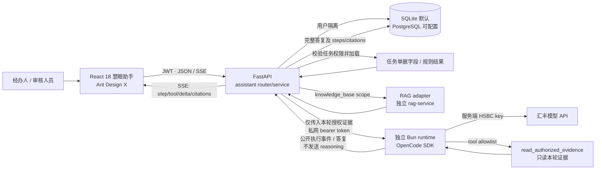
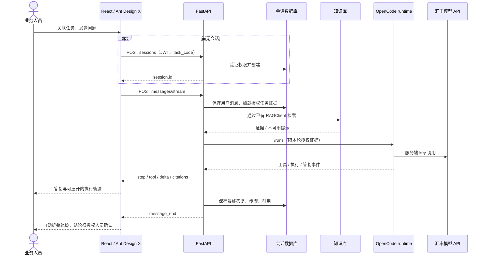

# 慧眼助手总规划：架构、职责与运行方式

本文是慧眼助手的基石文档，记录当前已实现内容与稳定设计。临时改动范围见[本轮修改规划](多人协作AI对话调研与优化方案.md)，重要取舍见[决策记录](决策记录.md)。旧开发记录保留作历史材料，不代表当前实现。

## 文档怎么维护

| 文档 | 回答的问题 | 更新时机 |
|---|---|---|
| 本总规划（本文） | 模块有哪些部分、怎么连接、当前真实状态是什么 | 行为、接口、权限或架构变更落地时，同一改动中更新 |
| [本轮修改规划](多人协作AI对话调研与优化方案.md) | 这一波要改什么、为什么、完成标准是什么 | 开始一波工作时创建；执行中勾选；完成后把已实现事实同步回本文 |
| [决策记录](决策记录.md) | 当时有哪些长期选项、为什么选这个 | 重要取舍被确认时追加；新决策取代旧决策时标记 superseded，不抹去历史 |

**不按日历定期复制。** 以接口/行为/架构变化和阶段完成为同步点；每次发版或竞赛演示前做一次短审阅，清理过期状态。这个做法参考 [MADR 的逐项决策记录](https://adr.github.io/madr/)和 [C4 按层级画架构图](https://c4model.com/diagrams)，只保留团队能用来做决定的信息。

## 技术选择与边界

| 层 | 当前实现 | 职责 |
| --- | --- | --- |
| UI | React 18、Ant Design 5、`@ant-design/x@1.6.1`（MIT） | 直接使用上游 Sender、Bubble、Conversations、ThoughtChain |
| 状态/路由 | React hooks、Zustand、React Router | 共用主站 JWT 登录，助手路由懒加载 |
| 文本 | marked 12 + DOMPurify | 流式 Markdown、表格、代码块，清洗不可信 HTML/链接 |
| 业务后端 | FastAPI `/api/assistant` | 用户/任务授权、证据准备、会话及轨迹持久化 |
| Agent runtime | `code/assistant-runtime`，`@opencode/sdk@2.0.32` | 隔离运行 OpenCode，调用汇丰模型 API |
| 知识库 | RAG 会话负责的服务及 `app/rag_service.py` | 通过已有接口检索；本次未修改 RAG 实现 |

### 谁负责什么

| 部分 | 职责与边界 |
|---|---|
| React 慧眼助手 | 会话、任务选择、消息、公开执行轨迹、引用和技能目录；不承载模型密钥或权限决策 |
| FastAPI 助手 API | JWT/任务授权、证据准备、RAG 适配、会话/消息持久化、SSE 契约；是业务访问边界 |
| OpenCode runtime | 通过服务端配置的汇丰模型生成答复；仅启用本轮授权的只读证据工具，不读业务数据库或文件 |
| RAG 服务 | 检索共享知识库；不替代主站任务权限、规则引擎或人工审批 |
| 业务工作流/其他 Agent | 当前还没有独立的 Agent-to-Agent 服务身份契约；未来应调用 FastAPI 业务接口，不直接接 OpenCode SDK 或共享 runtime session |

技能目前是随仓库发布的只读目录，可选择应用于本轮指引；还没有远程发布、安装或审核流程，因此当前不是技能市场。

上游：[Ant Design X](https://github.com/ant-design/x)，[1.6.1 发布元数据](https://registry.npmjs.org/@ant-design%2fx/1.6.1)，[OpenCode](https://github.com/anomalyco/opencode)。固定 X 1.6.1 是因为其 peer dependency 对应现有 Ant Design 5；X 2.9.0 要求 Ant Design 6，不应迁移助手时强制全站升级。组件直接来自 npm 上游，业务适配层负责协议、权限和会话，不复制第二套用户系统/运行时。

当前锁定 `@opencode/sdk@2.0.32`；截至 2026-10-21，npm 已发布 2.1.2，升级尚未经过本项目回归。是否升级和兼容性理由记录在[本轮修改规划](多人协作AI对话调研与优化方案.md)，不要把当前 pin 描述成全生态最新版本。



当前由主后端保存会话、用户消息和最终助手消息；执行步骤及引用随最终助手消息一起保存。SSE 逐事件还没有独立的持久事件日志，因此断线后不能按事件序号恢复执行过程。OpenCode session 是每轮临时创建并清理的，跨轮上下文由业务后端传入历史消息。

**正文的“流式”需要准确理解：** runtime 当前等模型完整生成后才发送 `assistant_result`；FastAPI 再将完整答复按 80 字符切成 `delta` 事件。页面会逐段显示，但这不是模型 token 到达时的实时流。步骤与工具状态则是在运行过程中按事件显示。若要达到 Copilot/Codex 那种边生成边显示体验，下一步应验证当前 OpenCode SDK/模型通道的真实增量事件能力，并让 runtime 转发文本增量；不可仅靠缩小后端切片大小冒充实时生成。

RAG scope 的实际范围需要按接口解释：`knowledge_base` 会检索 RAG 服务的 `business_rules` 与 `project_design`；任务单据和规则结果由主后端在通过任务权限检查后从业务数据库读取，不走 RAG。`task_documents` 和外部 `law` scope 当前未开放。`rag_available=true` 只代表 RAG 健康检查成功，不代表某条问题一定命中证据或回答质量已验收。

### 当前技术栈和成熟度判断

- 仓库自有前端已统一为 React：主站 React 18 + Ant Design 5，助手复用 `@ant-design/x@1.6.1`；`code/` 扫描无 `.vue` 源文件，两份前端锁文件也没有 Vue 运行时/构建依赖。历史交接记录仍保留为档案，不能视为当前实现。
- AI runtime 使用锁定的 `@opencode/sdk@2.0.32`，未使用 OpenAI Agents SDK。模型 key 放在 runtime 服务端，助手通过 汇丰提供的模型 API 配置调用。
- 任务权限目前沿用主站角色规则；`task_for_user` 对经办人检查任务提交人，对审核人员沿用既有角色权限。它不是可邀请的细粒度任务 ACL。
- 这是适合演示的模块化单用户版本，不应描述为已达到成熟多人协作或生产级：会话目前归属单个用户；SQLite 为默认数据库；执行事件不能按事件序号恢复；回答正文并非模型 token 实时流；RAG 法规与任务文档 scope 未开放；没有多人访问审计。真实部署还需按环境配置数据库、密钥、RAG/runtime 服务并做并发、重连和授权测试。
- GitHub 方案调研及多人对话目标架构见[多人协作 AI 对话调研与优化方案](多人协作AI对话调研与优化方案.md)。

## 同学如何接入

前端导航到 `/assistant?task_code=${encodeURIComponent(taskCode)}`。不传任务编号可做普通问答；任务相关问题应关联任务。切换任务开启新会话，避免混用材料。前后端均保留用户权限检查，前端选择器不是安全边界。

以下 API 均要求 `Authorization: Bearer <JWT>`：

| 方法/路径 | 入参/返回 | 场景 |
| --- | --- | --- |
| `GET /api/assistant/capabilities` | `configured,model,rag_available,sdk,supports_stream,message` | 实际服务就绪状态；不是每轮请求成功保证 |
| `GET /api/assistant/sessions` | `AssistantSession[]` | 当前用户的会话目录 |
| `POST /api/assistant/sessions` | `{title,task_code?}` → 会话 | 第一条消息时创建，挂载页面不写库 |
| `GET /api/assistant/sessions/{id}` | 会话及 `messages[]` | 历史正文、步骤、引用 |
| `DELETE /api/assistant/sessions/{id}` | `{deleted:true}` | 确认后删除自己的会话 |
| `GET /api/assistant/skills` | 项目发布的技能目录 | 名称、版本、权限；没有远程安装功能 |
| `POST /api/assistant/sessions/{id}/messages/stream` | `{content,task_code?,skill_id?}` → SSE | 最多 8000 字，正常结束必须有 `message_end` |
| `GET /api/tasks?mine=true/false` | 已有任务接口 | 经办人查本人任务；审核人员按现有授权查询 |

### SSE 契约

事件内容均为 JSON，见 `assistant_schemas.py`、`src/assistant/types.ts`。错误事件的 `message` 是字符串；完成事件的 `message` 是持久化消息对象。

| 事件 | 字段 | UI 行为 |
| --- | --- | --- |
| `message_start` | `message_id,task_code` | 本轮开始 |
| `step` | `step:{key,label,detail?,status}` | 更新同 key 业务步骤 |
| `tool` | `tool:{name,status,result_count?}` | 真实授权证据读取状态 |
| `delta` | `delta:string` | 追加公开答复正文 |
| `citations` | `citations[]` | 引用及页码 |
| `message_end` | `message:{id,role,content,status,steps,citations}` | 以落库版本为准，结束 loading，自动折叠步骤 |
| `error` | `message:string` | 显示错误并恢复发送，已有片段标为未完成 |

未知事件（包括 reasoning）不拼接正文。业务操作轨迹不等于模型内部推理；不请求、不展示内部推理。后端负责最终答复检查与审核权限提示。HTTP 401 清理当前失效登录，由受保护路由保留返回路径；403 不清理登录。



停止会取消客户端请求和 reader；已写入的用户消息不会回滚，片段不代表完整结论。若没有 `message_end` 就断流，显示中断，不能无限等待或伪装完成。

## 环境与部署

1. 按 `code/backend/.env.example` 配置主后端：`ASSISTANT_RUNTIME_URL`、`ASSISTANT_RUNTIME_TOKEN`、`RAG_BASE_URL`、`RAG_SERVICE_TOKEN`。各 token 与对应服务匹配。
2. 按 `code/assistant-runtime/.env.example` 配置 runtime：汇丰授权 `AI_BASE_URL`、`AI_API_KEY`、`AI_MODEL` 及 runtime token。本机验证模型为 `qwen3.8-flash`。真实 key 不写入文档/前端，不依赖个人 CC Switch 或中转站。
3. runtime 目录执行 `bun install --frozen-lockfile`、`bun run start`（默认 8090）。主后端执行 `.venv\Scripts\python -m app.seed`（首次）、`.venv\Scripts\python -m uvicorn app.main:app --port 8000`。RAG 地址以 `RAG_BASE_URL` 配置为准；模板中的端口只是本地示例，不代表团队当前服务端口。
4. 前端执行 `npm ci`、`npm run dev`，访问 5173。主后端本机改用 8001 时，在忽略提交的 `.env.local` 设置 `HBCN_API_TARGET=http://127.0.0.1:8001`，重启 Vite。
5. 生产部署使用 `dist/` 与 SPA 回退；`/api`、`/pdf`、`/uploads` 代理主后端。SSE 关闭代理缓冲，延长读超时。runtime/token/key 只在私网服务端可见，不直接对浏览器暴露。

拉取代码后必须通过团队授权方式取得环境配置；仓库只提供模板，没有 key 的电脑不能直接调用模型。RAG UI 独立构建到 `code/rag-service/app/static/ui-build`，由 RAG 服务提供 `/ui/`。

## 验证与交接

```powershell
cd code/frontend
npm ci
npm test
npm run build
cd ../backend
.venv\Scripts\python -m unittest tests.test_assistant_api
cd ../rag-service/ui
npm run build
```

前端测试使用真实 Ant Design X 组件，模拟网络边界，覆盖首条发送、进度/折叠、引用、停止、断流、失败保留草稿、历史、任务技能、401；不替代真实模型验证。真实链路结果见 [React迁移与验证记录](React迁移与验证记录.md)。

## 后续优先级

| 顺序 | 优化项 | 进入完成状态的条件 |
|---|---|---|
| P0 | 真正的模型正文增量与稳定公开事件契约 | runtime 能转发真实模型增量；断流、取消和内部 reasoning 隔离有回归 |
| P1 | 多人团队会话 | 成员 + 任务 ACL、幂等 run、有序事件回放、邀请/撤权审计通过双用户验收 |
| P1 | 给前端 workflow/其他 Agent 的受控服务接口 | 明确服务身份、可访问任务范围、会话关联与审计；不让 Agent 直接访问 OpenCode runtime |
| P2 | 技能发布/商店 | 先有审核、版本、来源和权限策略；当前仓库内置只读目录不是商店 |

详细范围与界面方向见[本轮修改规划](多人协作AI对话调研与优化方案.md)。当前会话仍为用户私有，不能分享 session ID 绕过权限。
