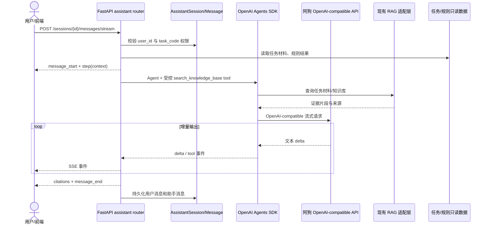

# AI 助手底座通信契约

本模块提供后端智能服务、通信协议和一个隔离的前端助手页面。现有审核/RAG页面不改；前端入口只增加 `/assistant` 路由和顶栏跳转，其他前端、任务编排器和专项审核 Agent 都通过 `/api/assistant` 调用它。

## 技术选型

| 层 | 选型 | 边界 |
| --- | --- | --- |
| Agent 编排 | OpenAI Agents SDK Python `0.4.2` | Agent、function tool、流式事件；通过 OpenAI-compatible client 接阿狗中转站 |
| 模型网关 | `AI_BASE_URL` / `AI_API_KEY` / `AI_MODEL` | 密钥只放运行环境，不进仓库；未配置时使用本地演示降级 |
| RAG | 现有 `rag_service.RAGClient` | 助手只调用 `search_knowledge_base` 工具，不依赖 RAGFlow 返回格式 |
| API | FastAPI + JSON + SSE | 会话持久化在 `assistant_sessions` / `assistant_messages` |

前端沿用仓库已有的 Vue 3 + Element Plus，不新增 React、Tailwind 或另一套状态系统。组件形态参考官方成熟方案 [`@assistant-ui/vue`](https://www.assistant-ui.com/docs/vue) 的 runtime、tool event 和 streaming 设计，通信层则适配本项目已有的 FastAPI SSE 契约。助手页面的代码边界如下：

- `code/frontend/src/assistant/api.ts`：只负责 `/api/assistant` 请求和 SSE 解析。
- `code/frontend/src/assistant/types.ts`：会话、消息、步骤和引用的前端契约。
- `code/frontend/src/assistant/markdown.ts`：零依赖的 Markdown 子集渲染（先转义后替换，XSS 安全），渲染助手回复里的列表、加粗、行内代码、链接等；未引入第三方库，避免与本仓库 Vue 3 构建链耦合。
- `code/frontend/src/views/AssistantView.vue`：三栏助手界面、执行步骤时间线、工具检索轨迹（`tool` 事件）和证据引用面板，并提供一键复制回复。
- `code/frontend/src/router/index.ts`、`code/frontend/src/layouts/MainLayout.vue`：仅提供页面入口，不改变现有业务页面。

`openai-agents==0.4.2` 是当前仓库 `pydantic==2.10.3` 的兼容锁定版本，同时锁定 `openai==2.44.0`。这是因为 `openai==2.45.0` 起新增的 usage 字段会让该 Agents SDK 版本在运行前初始化失败。更新 SDK 时必须重新验证 FastAPI/Pydantic 依赖和网关的 Chat Completions 兼容性。

## 权限和业务边界

- 所有助手接口需要 JWT。
- 会话按 `user_id` 隔离；业务经办人只能带入自己提交的任务，审核人员可以读取任务上下文。
- 助手可以读取任务材料、规则结果和 RAG 证据，生成解释、风险摘要和人工复核草稿。
- 助手不能写入任务状态、改写 `CheckResult`、调用 `/complete` 或 `/return`，也不能直接给出贷款最终审批结论。
- 低置信度、证据冲突或无证据时必须提示人工确认。

## 接口

### `GET /api/assistant/capabilities`

返回 SDK、模型网关、RAG 是否配置以及是否支持流式事件。

### `GET /api/assistant/sessions`

返回当前用户的会话列表。

### `POST /api/assistant/sessions`

```json
{"title":"提款材料核对","task_code":"FOL LN20260315-008"}
```

`task_code` 可省略。带入任务时会立即执行数据级权限校验。

### `GET /api/assistant/sessions/{session_id}`

返回会话消息、执行步骤和引用。

### `POST /api/assistant/sessions/{session_id}/messages/stream`

请求：

```json
{"content":"请解释当前不通过项，并列出需要人工核对的材料","task_code":"FOL LN20260315-008"}
```

响应为 `text/event-stream`。每条事件是标准 SSE 的 `event` + JSON `data`：

| 事件 | 关键字段 | 用途 |
| --- | --- | --- |
| `message_start` | `message_id`, `task_code` | 创建本轮助手消息 |
| `step` | `step.key`, `step.label`, `step.status` | 展示执行步骤时间线；不暴露模型内部思维链 |
| `tool` | `tool.name`, `tool.status` | 展示知识库/证据工具开始和完成 |
| `delta` | `delta` | 增量渲染回答文本 |
| `citations` | `citations[]` | 文件、规则或知识库证据引用 |
| `message_end` | `message` | 本轮持久化消息和最终状态 |
| `error` | `message` | 可恢复错误 |

前端只需按事件类型更新自己的状态机，不需要知道 Agent SDK 的内部对象。

## 时序图



## 运行配置

在 `code/backend/.env` 设置：

```dotenv
AI_BASE_URL=https://your-gateway.example/v1
AI_API_KEY=replace-with-runtime-secret
AI_MODEL=your-chat-model
AI_REQUEST_TIMEOUT=45
```

本机使用 CCSwitch 时，推荐配置为：

```dotenv
AI_BASE_URL=http://127.0.0.1:15721/v1
AI_API_KEY=PROXY_MANAGED
AI_MODEL=gpt-6.1-sol
```

CCSwitch 的 Local Routing 默认监听 `127.0.0.1:15721`；启动代理并启用 Codex 路由后，它会把请求转发到当前选中的提供商。`PROXY_MANAGED` 是 CCSwitch 的路由占位令牌，真实密钥由 CCSwitch 注入，不写入本项目。若切换 CCSwitch 中的模型，只需同步修改 `AI_MODEL`。

不配置上述三个必填项时，接口仍可启动并返回本地演示回答，方便前端联调；生产环境应配置密钥管理和 HTTPS 网关。
