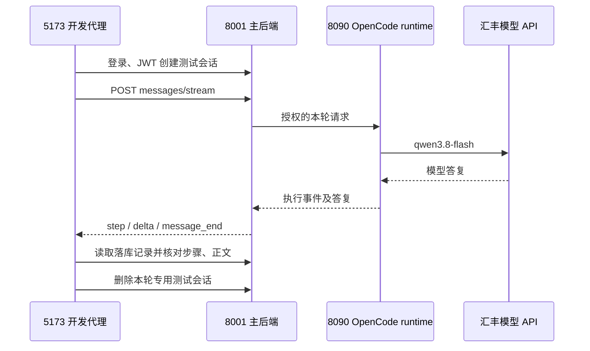

# 慧眼助手 React 迁移与验证记录

记录日期：2026-10-21。迁移基线：`lfc` 分支 `d973298`。当前接入规范以 [README](README.md) 为准。

## 目标及范围

将主站最后残留的 Vue 助手迁入现有 React 架构，恢复登录后的真实问答和业务衔接，删除旧入口，使用成熟聊天组件，并保证执行轨迹与最终回答分离。主站其他业务页面及 RAG 工作台在基线中已经是 React，本次保留其实现。

未回滚整个仓库，未改 RAG 服务、RAGClient、解析/审核 Agent 或其他同学的业务页面。工作区同时存在 RAG 会话改动，提交须逐文件限定范围。

## 上游及实现

- 直接依赖 MIT 许可的 [Ant Design X](https://github.com/ant-design/x)：Sender、Bubble、Conversations、ThoughtChain、XProvider；没有新建聊天组件库。
- 固定 `@ant-design/x@1.6.1`，适配现有 React 18 / Ant Design 5。根据 npm 发布元数据，X 2.9.0 的 Ant Design peer requirement 为 6，迁移本模块时不强制其他页面升级。
- 继续使用现有 `@opencode/sdk@2.0.32` runtime 和汇丰服务端模型配置；本次未更换模型供应商，也未接入个人中转站。
- 自有业务适配在 `useAssistant.ts`：JWT、会话生命周期、SSE、任务和技能参数。主站共用 Zustand 与 React Router，助手按路由懒加载。

删除 `code/frontend/src/views/AssistantView.vue`。扫描 `code/` 无剩余 `.vue` 文件；主站、RAG UI 两份锁文件均无 Vue、Vue Router、Pinia、Element Plus、vue-tsc 或 plugin-vue 依赖。

## 修复的问题

| 问题 | 当前行为 |
| --- | --- |
| React 主站没有注册助手路由，旧文件依赖 Vue Router / Pinia 调用方式 | 顶栏进入受保护的 `/assistant`，助手 API 使用现有 Zustand JWT |
| 过期凭证造成页面报错后无法恢复 | 当前请求 401 清理失效登录并保留返回路径；旧请求的 401 不会注销新登录；403 保留登录 |
| 发送和失败收尾不清晰 | 首条提交时创建会话，失败保留草稿；成功后清空；发送期间可停止接收；断流恢复发送并标记未完成 |
| 过程混进回答、完成后不折叠 | 公开业务步骤放进折叠区，生成中展开，完成/历史默认折叠；未知 reasoning 事件不拼入正文 |
| 同一个操作被多次写入历史 | 后端按 step key 更新最终状态，前端兼容旧历史重复步骤，避免重复 key 和残留运行状态 |
| 锁文件损坏且包含内网包源 | 修复文件头，锁定依赖使用公开 npm registry，可在干净目录安装 |
| 本机 8000 与其他服务冲突 | 开发代理支持忽略提交的 `.env.local` 中的 `HBCN_API_TARGET`，本机使用独立主后端 8001 |

## 验证结果

| 验证 | 结果 |
| --- | --- |
| 主前端 `npm test` | 3 个测试文件、12 项通过 |
| 主前端 `npm run build` | TypeScript 检查及 Vite 生产构建通过 |
| 后端 `python -m unittest tests.test_assistant_api` | 16 项通过，包括权限隔离、错误处理及步骤最终状态持久化 |
| RAG UI `npm run build` | React 工作台构建通过；未修改其源文件 |
| 干净临时目录安装 | 仅复制 package.json / package-lock.json，公开源 `npm ci --ignore-scripts --no-audit --no-fund` 成功，安装 258 个包；此项验证锁文件与包源可用性，安装脚本及构建另在主工作区执行 |
| Vue 清理及依赖扫描 | 自有 `code/` 无 `.vue`，两前端无上述 Vue 依赖 |
| `git diff --check` | 通过 |

前端测试挂载真实 Ant Design X 组件及 React StrictMode，仅模拟网络边界，覆盖按钮发送、执行完成折叠、未知推理事件隔离、Markdown 格式和安全、引用页码、停止、异常断流、会话创建失败保留草稿、历史回放、任务/技能传参、401/403 与碎片 UTF-8 SSE 解码。jsdom 不具备真实排版引擎，测试超时设置为 30 秒以容纳组件测量；本轮未做截图或浏览器像素级验收。

### 汇丰真实链路

经 `http://127.0.0.1:5173` 的开发代理完成登录、创建专用测试会话、发送、流式接收、读取历史及删除该测试会话。此处没有模拟模型或 SSE：

- capabilities 返回 `opencode-sdk@2.0.32`、`configured=true`、`model=qwen3.8-flash`、`rag_available=true`。
- 问题：用两句话说明慧眼助手能做什么，并强调审核结论必须由有权限人员确认。
- 修复后的真实请求耗时约 **12.78 秒**，收到 message_start、step、delta、message_end；同一个 compose 操作虽发送两次状态事件，最终只落库 **1 个 completed 步骤**。
- 正文说明授权单据/规则/知识检索、风险梳理和复核辅助，明确有权限人员确认；另含后端统一人工复核提示。无内部推理或工具调用草稿。
- 未携带具体任务，本轮引用为 0，未编造知识库证据。`rag_available` 仅记录状态接口结果，不等于本轮验证了法规检索质量。
- 历史恰有 user / assistant 两条，正文和步骤与完成事件一致。只删除本轮测试会话，返回 200。未登录访问助手会话 API 返回 401。

## 交接与后续边界

1. 当前本机页面为 `http://127.0.0.1:5173/assistant`，主后端使用 8001；仓库默认代理仍为 8000。端口配置示例在 `code/frontend/.env.example`，个人 `.env.local` 不提交。
2. 同学拉取后按 README 安装、启动主后端/OpenCode runtime/RAG，并通过授权渠道取得服务端环境配置；仓库不包含真实 key。部署时配置 SPA 回退和关闭 SSE 代理缓冲。
3. 助手 JS 已独立拆分，约 158.52 KB（gzip 55.42 KB）；主站既有共享 JS 约 1.82 MB，Vite 有大包提示，构建成功。后续由前端架构负责人拆分 PDF/业务依赖，避免在本模块迁移中重构他人页面。
4. 多人聊天室、专家邀请及远程技能商店未实现。本次保留项目发布的业务技能目录，不宣称具备远程安装或共享会话权限。
5. RAG 服务由独立会话继续迭代；本模块只消费现有接口。部署后还需按最终业务样本验证检索质量与端到端审核流程。
