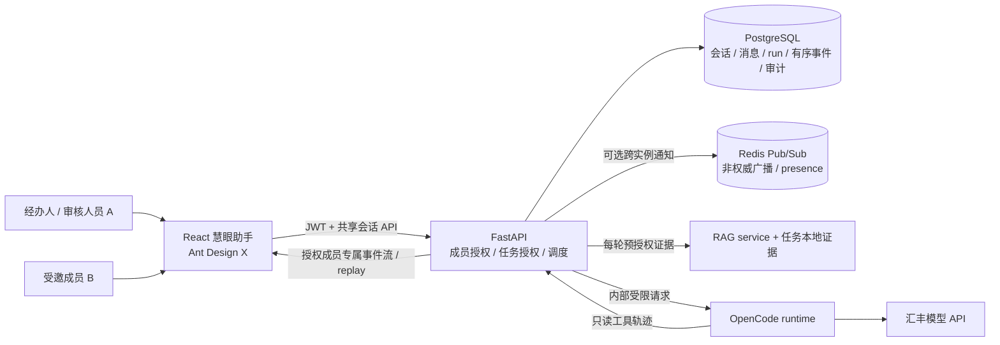
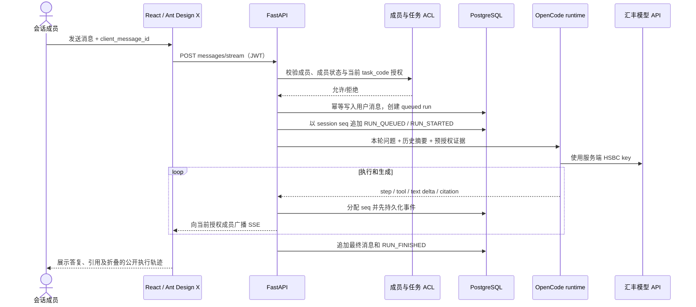
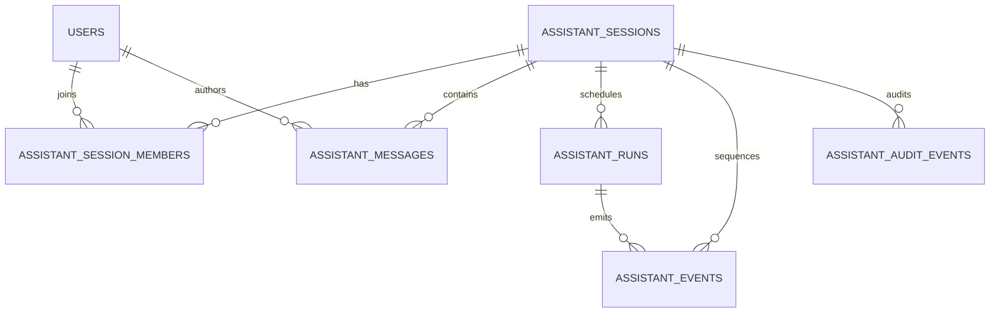

# 慧眼助手：多人协作 AI 对话调研与优化方案

> 调研日期：2026-10-21。本文是基于当前分支代码与上游项目公开文档形成的设计建议，不代表多人共享能力已经实现。当前接口、数据模型与成熟度以[慧眼助手接入说明](README.md)为准。

## 结论

保留当前 React 18 + Ant Design 5 + Ant Design X + FastAPI + OpenCode SDK + 汇丰模型 API 的主链路。多人对话应作为“任务关联的共享会话”建设：先做好成员权限、事件持久化/重放、并发控制和审计，再增加在线状态及共同编辑产物。聊天记录是追加式审计数据，不需要用 CRDT 合并；若以后要多人共同改写一份审核摘要，再单独对该文档评估协同编辑。

不建议把 LibreChat、assistant-ui 或 CopilotKit 整套部署进主应用：它们各自带来运行时、认证/状态或 UI 约定，且会重复现有的汇丰 API、OpenCode 与业务权限边界。应借鉴成熟项目中可拆分的交互和协议，将其转成现有 FastAPI 契约的增量功能。

## 上游项目调研

以下结论基于项目官方 GitHub 与文档；星数会变化，因此不使用星数当作成熟度证明。是否引入依赖以许可证、版本兼容、维护状态和与本项目安全边界的适配情况为准。

| 项目 | 官方资料 | 值得借鉴的能力 | 对本项目的判断 |
| --- | --- | --- | --- |
| [Ant Design X](https://github.com/ant-design/x/) | [组件文档](https://x.ant.design/components/introduce/) | React 聊天组件、Sender、Bubble、Conversations、ThoughtChain | **继续作为当前 UI 基础。** 项目已经使用与 Ant Design 5 配套的 `@ant-design/x@1.6.1`；优先复用上游组件，不重写通用消息与输入控件。 |
| [assistant-ui](https://github.com/assistant-ui/assistant-ui/) | [官方文档](https://www.assistant-ui.com/docs)；[OpenCode adapter](https://github.com/assistant-ui/assistant-ui/tree/main/packages/react-opencode) | 可组合消息/线程原语、流式消息、工具展示、人工确认 | 适合作为交互细节参考；其 OpenCode adapter 标注为实验性，当前没有理由为了换一套 UI/runtime 适配层而替换已经工作的 Ant Design X。若未来做独立原型，再通过真实流协议验证后重评。 |
| [CopilotKit](https://github.com/CopilotKit/CopilotKit/) | [AG-UI 协议](https://docs.ag-ui.com/introduction)；[Human-in-the-loop](https://docs.copilotkit.ai/agent-spec/human-in-the-loop/useInterrupt) | Agent 与 UI 之间的事件协议、可见工具活动、暂停等待人工输入再恢复 | 借鉴 AG-UI 的 run/message/tool 事件分层和显式中断模型；**不增加第二套 agent runtime**。贷款审批结论仍必须由现有有权审核人员在正式工作流中确认。 |
| [LibreChat](https://github.com/danny-avila/LibreChat/) | [官方角色定义](https://github.com/danny-avila/LibreChat/blob/main/packages/data-provider/src/roles.ts) | 用户/群组共享、角色化资源访问、技能与 agent 分享 | 借鉴“先校验成员和资源权限，再返回会话/agent”的访问控制思路；不整套部署，因为它带有独立的用户、provider、数据层和产品配置。 |
| [Yjs](https://github.com/yjs/yjs/) | [官方仓库](https://github.com/yjs/yjs/) | CRDT、多端离线编辑、并发合并 | **不用于聊天记录。** 消息、工具事件和审核留痕应由服务端按序追加、不可静默改写。只有将来多人共同编辑同一份草稿时才评估 Yjs 或同类协同编辑方案。 |
| [OpenCode SDK](https://opencode.ai/docs/sdk/) | 官方 SDK 文档 | 类型化的 session、prompt、事件订阅和权限能力 | 继续作为 runtime 执行引擎；当前仓库固定 `@opencode/sdk@2.0.32`。房间权限、任务授权和业务审计仍由 FastAPI 负责，不能把 SDK session 当作共享会话授权。 |

选型原则与仓库 `AGENTS.md` 一致：React 新功能优先复用已采用的上游组件，只增加业务适配；不另造聊天组件库或通用 Agent 框架。表中“借鉴”是对能力和架构的采用，不是复制其整套产品或未核验的代码片段。

### 依赖版本核对（2026-10-21）

- 前端没有 OpenAI Agents SDK 依赖；runtime 使用 OpenCode SDK。官方 npm 元数据显示 `@opencode/sdk@2.0.32` 于 2026-10-16 发布，`2.1.2` 于 2026-10-21 发布。当前 pin 只落后一个刚发布的次版本，不属于长期废弃框架；仍建议单独核对 2.1.2 的 API/事件差异，再跑 runtime typecheck、mock 集成与真实 HSBC 连通回归后决定升级。[npm 版本记录](https://www.npmjs.com/package/%40opencode/sdk?activeTab=versions)
- 当前 `@ant-design/x@1.6.1` 于 2025-09-12 发布；其 peer 依赖要求 Ant Design `^5.20.3` 和 React 18+。截至核对日，`@ant-design/x@2.9.0` 的 peer 依赖为 Ant Design `^6.1.1`。仓库明确固定主站 Ant Design 5，所以 1.6.1 是为兼容性选择的版本，不等于“全生态最新”；要升级 X 2.x，需先安排全站 Ant Design 6 迁移并回归其他同学的页面。[npm 版本记录](https://www.npmjs.com/package/%40ant-design/x?activeTab=versions)
- 因此“旧技术已清理”的准确说法是：Vue 源码/运行时依赖、OpenAI Agents SDK 未参与当前助手运行；现有 pinned 组件有明确兼容原因。不能笼统承诺所有依赖都为最新版本。

## 当前状态与成熟度判断

### 已实现

- React 18 主站、React RAG UI、Ant Design 5 与助手 Ant Design X UI；仓库自有代码没有 `.vue` 源文件，主站和 RAG UI 锁文件也没有 Vue 运行时/构建依赖。
- FastAPI 使用现有 JWT；助手会话按 `user_id` 隔离。当前 `task_for_user` 会校验经办人是否为任务提交人，审核人员按主站已有角色权限访问；尚无细粒度的任务成员 ACL。
- 独立 Bun runtime 调用锁定的 OpenCode SDK，HSBC 模型凭证仅由服务端配置；模型无直接文件、shell 或任意外网工具权限。
- SSE 在请求期间实时输出步骤和工具状态；完整模型答复生成后再分段发送 `delta`，最终答复、步骤和引用保存到消息记录。
- RAG `knowledge_base` 可查询 `business_rules` 和 `project_design`，并在任务上下文旁提供证据；法规 API 和 RAG task-documents scope 未开放。

### 尚未实现

- 多人会话成员、邀请/撤销、shared room 列表、角色控制、会话级在线状态。
- 独立且持久的执行事件日志、断线游标续传、多实例广播。
- 房间内同一时间多个用户发消息时的幂等与串行调度、持久队列。
- 邀请/撤销/停止运行/成员查看等审计事件与访问撤销后的历史保护。
- 面向多实例部署的数据库验证。后端默认 SQLite，可配置 PostgreSQL；SQLite 不应作为多实例共享聊天室的数据协调层。

正文的增量目前不是真正的 token 流：runtime 先等到整段模型答复，再由 FastAPI 切成 80 字符的 `delta` 事件发送。步骤/工具轨迹才是在运行中实时出现。此实现应标注为“分段回显”，不能用它证明模型是实时逐 token 输出。

因此当前是**演示级单用户助手，模块边界与模型调用链已建立**，不应称作“多人协作已经成熟”或“生产级已完成”。下表是按当前代码能力做的主观工程评分（5 分制），不是用户调研或基准测试；评分用于说明差距，后续应以验收用例重新评定。

| 维度 | 当前评估 | 依据 |
| --- | ---: | --- |
| 聊天 UI 与组件基础 | 3.5 / 5 | 已使用 Ant Design X 的成熟组件、折叠步骤、历史和引用；正文还不是真 token 流，协作成员 UI 未实现。 |
| HSBC + OpenCode 接线 | 4 / 5 | 服务端凭证、独立 runtime 和受限只读工具边界已存在；还需持续做真实网络环境与并发验证。 |
| 证据/RAG 完整度 | 2.5 / 5 | 业务规则/项目设计检索已连通；法规及 task-documents scope 未开放，`rag_available` 不是命中质量指标。 |
| 权限、审计与恢复 | 2 / 5 | 有登录、用户私有会话和任务角色检查；没有细粒度共享 ACL、事件日志/回放与成员审计。 |
| 多人协作 | 1 / 5 | 当前仍是单用户会话，邀请、成员、作者归属、多人并发及撤权均未实现。 |
| 部署韧性 | 2.5 / 5 | 有可拆分服务与环境配置；SQLite 默认值、无事件回放、无多实例广播，需升级部署与故障恢复验证。 |

综合看，**当前有可演示的功能闭环，但离优秀的协作 Agent 产品还有明显距离**；尤其实时生成、共享权限、事件恢复和多人审计没有达到成熟案例常见能力。上表不应被当作“优秀案例横向跑分”，而是基于代码的差距清单。

## 目标用户流程

1. 经办人从有权限的任务详情进入助手，选择“创建团队会话”，或从其本人拥有的会话发出邀请。
2. 只能从当前任务授权范围内邀请同事；没有任务访问权的用户不能因为拿到会话链接而看到任务资料。
3. 房间成员看到同一条按时间排序的聊天记录、发言者身份、AI 回答、折叠的公开执行轨迹和证据引用。发送消息由具体成员署名。
4. AI 回复关联到触发它的用户消息和 `run_id`。所有成员可看相同的进度与结果；新回复不会伪装成任何一个人的发言。
5. 同一房间同时只运行一个 AI 回合；其他成员的消息按服务端顺序排队。成员可以取消自己发起的运行，房主或有权限审核人员可以按策略停止房间运行。
6. 分享的是协作和审核辅助过程，不是贷款审批权限。助手不批准、不拒绝、不改变业务结论；最终结论仍由有权限审核人员在现有业务流程中确认。

## 推荐目标架构

第一版使用 PostgreSQL 作为共享会话及事件的权威存储。SSE 仍沿用当前浏览器到 FastAPI 的带 JWT `fetch` 流；服务端先写入有序事件，再向连接中的成员广播。单实例可从数据库轮询未发送事件；多实例时增加 Redis Pub/Sub 作为唤醒/转发通道，但 PostgreSQL 事件日志仍是恢复依据。Redis presence 是易失状态，不作为审计事实。

## 数据模型建议

保留现有 `assistant_sessions` / `assistant_messages`，通过数据库迁移增量扩充。共享房间的权限不能靠 session ID 难猜或前端隐藏来实现。

| 实体 | 关键字段/约束 | 目的 |
| --- | --- | --- |
| `assistant_sessions` | 现有 `owner_id/user_id`、`task_code`；新增 `visibility`、`next_event_seq`、`active_run_id`、归档状态 | 私有/共享会话与任务范围；未迁移前保持现有私有默认值 |
| `assistant_session_members` | `session_id,user_id,role,invited_by,joined_at,revoked_at`；`(session_id,user_id)` 唯一 | 显式授予和撤销房间成员权限；历史访问在撤销后立即失效 |
| `assistant_messages` | 新增 `author_id`、`run_id`、`parent_message_id`、`client_message_id`；`(session_id,author_id,client_message_id)` 唯一 | 区分发言人、关联 AI 回合、阻止浏览器重试造成重复消息 |
| `assistant_runs` | `id,session_id,requested_by,status,created_at,started_at,finished_at,cancelled_by,error_code` | AI 回合排队/运行状态；一个会话最多一个 active run |
| `assistant_events` | `session_id,seq,run_id,event_id,type,payload_json,created_at`；`(session_id,seq)`、`event_id` 唯一 | 事件先持久化再广播，支持重连回放；payload 做字段白名单和长度限制 |
| `assistant_audit_events` | `session_id,actor_id,action,target_id,created_at,metadata_json` | 留下成员邀请/撤销、角色变更、run 开始/停止、人工中断处理等审计；避免把全文复制到审计日志 |

`role` 初版可用 `owner / contributor / reviewer / viewer`：房主管理成员和房间；参与者发言、发起 AI 回合；审核者可讨论、标记待确认事项，但没有任何隐含的贷款审批授权；只读成员查看。实际审批权限继续由业务任务审核角色控制。角色不能脱离任务 ACL 单独放宽资料权限。

PostgreSQL 中以事务锁住对应 session 行并递增 `next_event_seq`，再插入事件，保证同一房间的序号严格递增；不能仅依赖不同 worker 的进程内计数器。`assistant_runs` 用 partial unique index（仅针对 `queued/running/waiting_human`）约束每房间至多一个活跃 run，队列消费与 `active_run_id` 更新放在同一事务边界内。

## 权限与安全规则

- 每个读取、SSE 连接、消息发送、停止运行、历史回放和引用链接都由服务端检查 `有效会话成员 AND 仍具备关联任务访问权`；失败时返回 404/403，不用共享 URL 代替鉴权。
- `task_code` 若存在，加入房间时检查一次；每个新 run、事件回放和引用跳转时再次检查当前任务授权。任务授权被撤销或成员被移除后，旧 JWT 不应继续拿到新事件；撤销需即时生效。
- 邀请只允许加入当前用户已能访问的任务成员；没有任务范围的普通问答可以按产品规则邀请，但绝不能在后来关联任务时自动泄露该任务历史。
- RAG 证据必须由主后端按任务/知识库 scope 过滤，再传给 runtime。任何共享成员身份都不构成访问原始上传文件的额外权限。
- 不向浏览器发送模型内部 reasoning、隐藏 prompt、密钥、工具参数中的敏感字段或 runtime 内部 session ID。只发送公开业务步骤、允许公开的工具状态、答复和可访问引用。
- 人工确认如未来涉及会改变任务状态的业务动作，应设计具名、限时、可审计的 interrupt/resume 流程；它与“AI 帮忙讨论”以及“最终贷款审批”分开。当前助手工具为只读，不需要添加模拟审批按钮。

## API 草案

以下是新增共享能力的设计草案，**不是当前已有接口**。现有私有接口继续工作；迁移时可以用 `visibility=private` 兼容旧会话。

| 方法/路径 | 用途 | 关键行为 |
| --- | --- | --- |
| `GET /api/assistant/sessions?scope=mine|shared` | 私有/共享房间列表 | 仅返回调用者仍可访问的会话 |
| `POST /api/assistant/sessions` | 创建房间 | `{title,task_code,visibility:"shared"}`；创建者自动为 owner，任务权限先验 |
| `GET /api/assistant/sessions/{id}` | 读取成员、消息与当前 run | 每次都做成员和 task ACL 校验 |
| `POST /api/assistant/sessions/{id}/members` | 邀请成员 | `{user_id,role}`；按任务可访问成员过滤，记录审计 |
| `DELETE /api/assistant/sessions/{id}/members/{user_id}` | 撤销成员 | 立即关闭该成员事件流并拒绝后续读取 |
| `POST /api/assistant/sessions/{id}/messages/stream` | 发送消息并订阅此次事件 | `{content,client_message_id}`；SSE 用 fetch 携带 JWT，重复 `client_message_id` 不得再启动一次模型 |
| `GET /api/assistant/sessions/{id}/events?after_seq=N` | 重新连接并补放事件 | 用 `Last-Event-ID` 或 `after_seq`；权限再次验证；返回严格递增 seq |
| `POST /api/assistant/sessions/{id}/runs/{run_id}/cancel` | 取消 AI 回合 | 发起者或授权房主可取消；写入 `RUN_CANCELLED` 和审计事件 |

共享 SSE 事件以统一外层结构为宜：`{event_id,session_id,run_id,seq,type,created_at,payload}`。可参考 AG-UI 的 run/text/tool 生命周期概念，先保留现有 `step/tool/delta/citations/message_end` 的适配，再由版本化 serializer 转成稳定类型，例如 `RUN_STARTED`、`STEP_UPDATED`、`TOOL_CALL_UPDATED`、`TEXT_DELTA`、`CITATIONS`、`RUN_FINISHED`、`RUN_ERROR`、`RUN_CANCELLED`。只允许公开执行摘要，不把内部思维链当作一种事件类型。

## 分阶段落地

### 阶段 0：补齐当前交互和传输事实

1. 先确认锁定的 OpenCode SDK 2.0.32 和刚发布的 2.1.2，以及汇丰模型 endpoint 是否能提供稳定的 assistant text part 增量事件；如果支持，runtime 在对应 session/run 上转发文本 delta，FastAPI 做安全过滤后直传，不再缓存完整文本后切片。升级版本必须先通过 mock 集成、类型检查和真实 HSBC 链路回归。
2. 若模型网关不提供 token 流，明确显示“正在生成”与真实工具步骤，不显示假 token 动画；保留可停止、超时、取消和错误状态。
3. 将公开 run 事件契约定型并加入测试，确保完成答复后步骤折叠、内部 reasoning 不出现在浏览器事件中。

### 第 1 阶段：安全的共享会话 MVP

1. 后端当前只在启动时使用 SQLAlchemy `create_all` 建表，没有 Alembic 迁移历史；先引入 Alembic，设计 PostgreSQL migration 与回滚方案，再把单用户旧会话迁移为 private 并保证旧 API/前端回归通过。
2. 新增成员表、角色、列表/邀请/撤销 API；所有接口验证成员与 task ACL，并补 401/403/404 测试。
3. 增加消息作者和幂等键、run 状态、单 room 单 active run 的队列/串行策略。
4. 增加持久事件日志、session 内序号、授权 SSE、断线后从 `after_seq` 回放；重连不重新运行模型。
5. Ant Design X 页面增加共享会话标识、成员头像/姓名、邀请面板和 AI 回答归属；用真实组件，不新造消息 UI。

### 第 2 阶段：业务协作体验

成员在线状态、未读提醒、消息引用/回复、将回答保存为待审草稿、审核者批注。若要求多人共同改写一份摘要，先定义草稿版本和冲突接受规则，再评估 Yjs 等 CRDT；聊天消息和审核事件仍只追加。

### 第 3 阶段：人工中断与部署加固

只在出现真实、已授权的外部写操作时增加 typed interrupt/恢复和二次确认；当前不添加会改变贷款结论的 agent tool。完成多 worker Redis 广播、连接数与延迟指标、密钥轮换/服务健康检查、保留期和审计导出后，再进行竞赛演示环境验收。

## 验收测试

1. 两个不同登录用户进入同一共享房间，能看到作者身份、彼此消息、同一个 AI 回答及完整公开步骤。
2. 未邀请用户拿到相同 session ID 仍得到 404/403，不能读取历史、引用、SSE 或停止运行。
3. 移除成员或撤销关联任务权限后，其正在打开的 SSE 也停止发新数据；旧 JWT 无法回放历史事件。
4. 同一 `client_message_id` 重试不会重复插入用户消息或重复调用模型。
5. 两人同时发送时，run 顺序稳定、每 room 只有一个 active run，AI 输出不会交叉到另一问题。
6. SSE 中断后从最后一个 `seq` 继续可补齐事件且无重复；恢复不会再次执行已完成的模型 run。
7. RAG/模型失败时保留显式失败状态、可继续对话；`rag_available` 不被误显示成检索命中保证。
8. 邀请、撤销、角色变化、run 开始/停止及未来的人工中断均有审计记录；助手始终不能写贷款审核结论。
9. UI 对话完成后默认折叠公开步骤；reasoning、提示词、密钥和未授权任务证据不出现在网络响应或页面。

## 实施优先级建议

先做共享成员 ACL 和授权测试，再做持久事件/replay 与并发 run，最后处理在线状态与共同草稿。若按“新建房间/邀请/双人聊天/刷新回放/撤权”五条用户路径都通过，才把多人协作称作演示可用；在这些路径通过前，当前 UI 展示的是单用户助手，不是协作聊天室。
