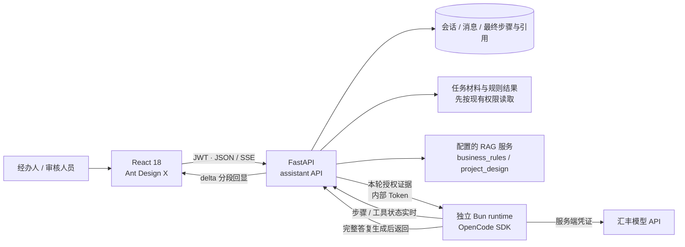
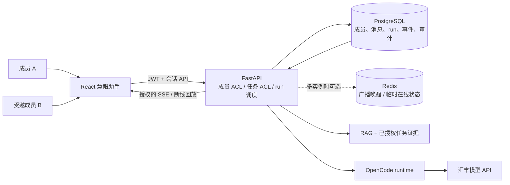
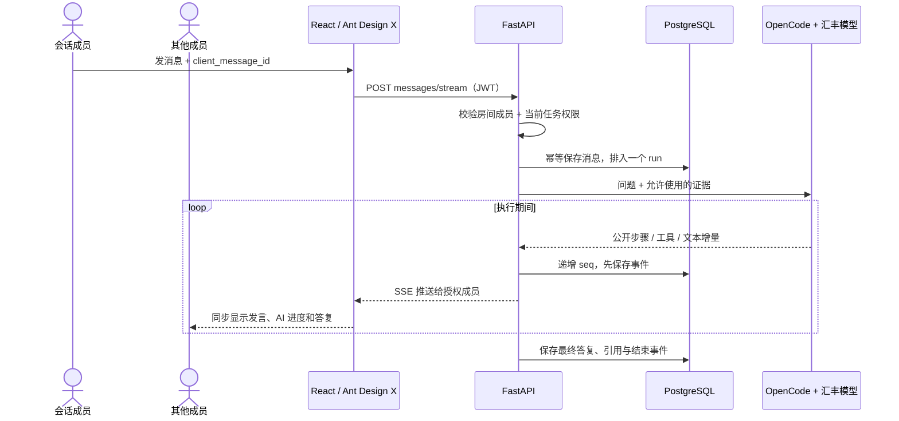
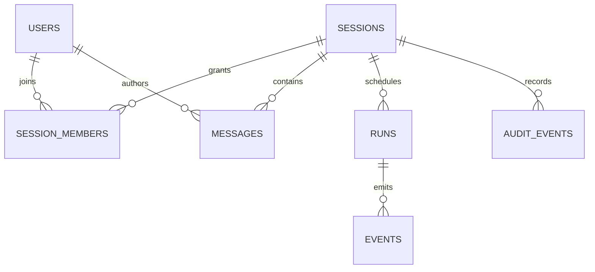
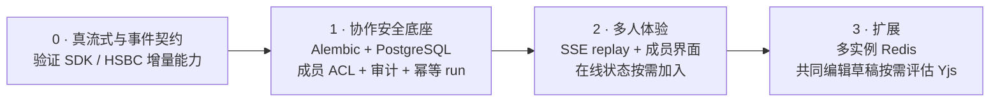

# 慧眼助手多人协作：调研与落地方案

> 本轮修改规划 · 更新：2026-10-21 · 状态：审阅与方向草案完成，待讨论 UI 形态；多人功能尚未实现。总设计见[慧眼助手总规划](README.md)，长期取舍见[决策记录](决策记录.md)。

## 结论先看

**保留 React + Ant Design X + FastAPI + OpenCode SDK + 汇丰模型 API。** 多人功能做成“有任务权限的同事进入同一会话”，服务端负责成员授权、消息顺序和审计；不另接一套聊天后端或 Agent runtime。

当前评分是代码评审估值，不是用户测试成绩：

| 项目 | 当前分（5分） | 主要缺口 |
|---|---:|---|
| 聊天 UI / 汇丰模型接线 | 3.5–4 | 已用成熟组件并走 HSBC/OpenCode 服务端链路；正文还不是真正 token 流 |
| RAG / 权限 / 恢复 | 2–2.5 | 法规 scope 未开放；无细粒度共享 ACL 和事件回放 |
| 多人协作 / 部署韧性 | 1–2.5 | 仍是私有会话；SQLite 默认、无成员审计和多实例事件协调 |

**结论：单人演示链路已成形，离成熟协作助手还有差距。**

## 选型：复用成熟组件，保持业务边界

| 上游项目 | 借鉴点 | 本项目决定 |
|---|---|---|
| [Ant Design X](https://github.com/ant-design/x/) | React 消息、输入、会话、步骤组件 | **继续使用**；1.6.1 兼容现有 Ant Design 5 |
| [assistant-ui](https://github.com/assistant-ui/assistant-ui/) | 流式聊天与可组合消息体验 | 作为交互参考；OpenCode adapter 仍标为 experimental，不替换当前 UI/runtime |
| [CopilotKit / AG-UI](https://github.com/CopilotKit/CopilotKit/) | 统一 run、message、tool 事件；人工中断 | 借鉴事件契约，不部署第二套 Agent runtime |
| [LibreChat](https://github.com/danny-avila/LibreChat/) | 用户、群组和资源权限 | 借鉴成员 ACL，不引入重复的认证、模型和数据层 |
| [Yjs](https://github.com/yjs/yjs/) | 多人共同编辑和冲突合并 | **不用于聊天记录**；仅在未来确有共同编辑草稿时评估 |

版本核对：Ant Design X 2.9.0 要求 Ant Design 6，故当前 Ant Design 5 主站保留 X 1.6.1。OpenCode SDK 2.0.32 于 10 月 16 日发布，2.1.2 于 10 月 21 日发布；不是长期废弃版本，但升级前应验证事件 API、mock 测试和真实 HSBC 链路。[X 版本](https://www.npmjs.com/package/%40ant-design/x?activeTab=versions) · [OpenCode SDK 版本](https://www.npmjs.com/package/%40opencode/sdk?activeTab=versions)

## 本轮审阅结论

| 优先级 | 要补的能力 | 为什么 |
|---|---|---|
| P0 | 核实并接通真正的模型正文增量 | 现在只是完整答复分段回显，动态感和真实生成状态不一致 |
| P1 | 共享会话的成员 ACL、任务 ACL 与审计 | 只有受邀且仍有任务权限的人才可以看材料和聊天记录 |
| P1 | 消息幂等、每房间单 run、事件持久化与续传 | 避免重复调用、答案串线和断线后丢进度 |
| P1 | Alembic + PostgreSQL 部署路径 | SQLite 默认库不能承担多人/多实例协调，当前建表使用 create_all |
| P2 | 团队成员 UI、通知与技能治理 | 当前技能是本地只读目录；邀请专家和技能发布流程未实现 |

## UI 方向草案（先对齐，不生成 HTML）

| 区域 | 建议呈现 |
|---|---|
| 左侧会话栏 | “我的 / 团队”切换；分别新建私聊和团队会话；会话项显示任务号、成员头像和未读状态 |
| 主聊天区 | 顶栏显示会话名、任务锁定标识、成员头像和邀请入口；消息标明发言者；AI 回答带证据引用与可折叠执行轨迹 |
| 底部输入 | 复用 Ant Design X Sender；显示当前运行/排队状态，按权限提供停止按钮 |
| 右侧上下文 | 默认收起为抽屉；需要时查看成员、任务和引用。避免强制三栏挤压聊天宽度 |

推荐新增“团队会话”类型，保留现有个人会话默认私有；不把所有历史会话自动改成共享。待确认的核心 UI 选择：**团队会话是作为“我的会话”旁边的新空间，还是把整个慧眼助手改成默认团队工作区？** 我建议先增加新空间，现有习惯和权限边界更容易保留。

## 当前：已接入，但还是单人会话

现状边界：会话按用户隔离；RAG law 与任务 PDF 检索未开放；SSE 步骤/工具状态会实时出现，但答复正文是完整生成后再按 80 字符切段回显，并非模型 token 实时流。主站无 Vue 源码/运行依赖，也未使用 OpenAI Agents SDK。RAG 服务地址由部署配置决定。

## 目标：一个有权限的团队会话，共享同一条 AI 执行轨迹

Redis 只负责通知和在线状态；PostgreSQL 才是消息、事件和审计的权威记录。单实例先可不加 Redis。

## 一轮对话如何协作

每个房间同时只跑一个 AI run；其他消息排队。断线后用最后的 seq 补事件，不重复调用模型。若 HSBC/OpenCode 通道不支持正文 token 流，显示真实进度，不伪装成逐字实时生成。

## 数据关系与权限

| 数据 | 关键设计 |
|---|---|
| 会话 | visibility private/shared、task_code、next_event_seq；旧会话默认 private |
| 成员 | owner / contributor / reviewer / viewer；可撤销，撤销后立即失去历史和事件访问权 |
| 消息与 run | 作者、client_message_id 幂等键、run_id；每房间最多一个 queued/running run |
| 事件与审计 | session_id + seq 唯一；邀请、撤权、run 停止等写审计，不记录密钥或整份敏感答复 |

**权限必须同时满足：会话有效成员 AND 当前任务仍授权。** 每次读取、发送、SSE 回放、引用访问和取消 run 都在服务端检查。加入会话不等于获得贷款审批权；最终审核结论仍由有权限人员确认。

## API 草案（新增，当前尚不存在）

| API | 用途 |
|---|---|
| POST /sessions | 创建 private/shared 会话，可关联 task_code |
| POST /sessions/{id}/members · DELETE .../members/{user_id} | 邀请、撤销成员 |
| POST /sessions/{id}/messages/stream | 发消息并订阅 SSE；请求带 client_message_id |
| GET /sessions/{id}/events?after_seq=N | 校验权限后续传事件 |
| POST /sessions/{id}/runs/{run_id}/cancel | 授权取消 run，并留下审计 |

路径均挂在现有 /api/assistant 下；现有私有 API 保持兼容。

## 落地顺序与完成标准

验收演示先证明五件事：两位授权成员看到同一消息和 AI 轨迹；未邀请用户不能读；撤权即时生效；刷新后从事件序号续传且不重复调用模型；并发发言不串答案。当前后端启动时用 SQLAlchemy create_all 建表，共享会话前需引入 Alembic；SQLite 不用于多实例共享协调。

> 本方案只定义下一步实现方向；多人会话、事件回放和上述 API 目前都还没有落地。
