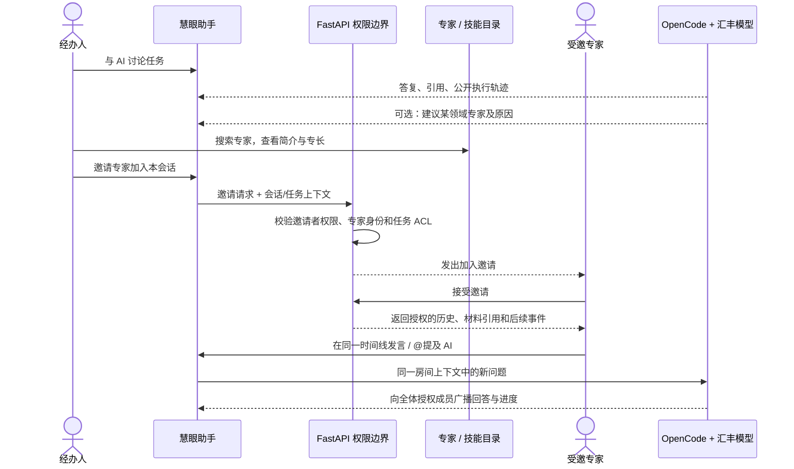
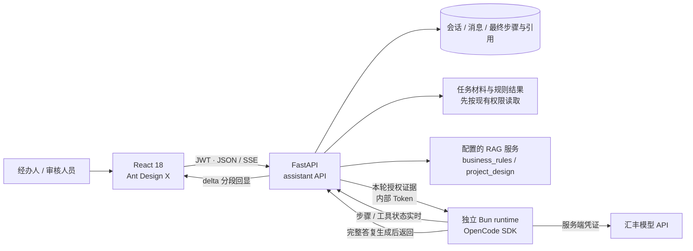
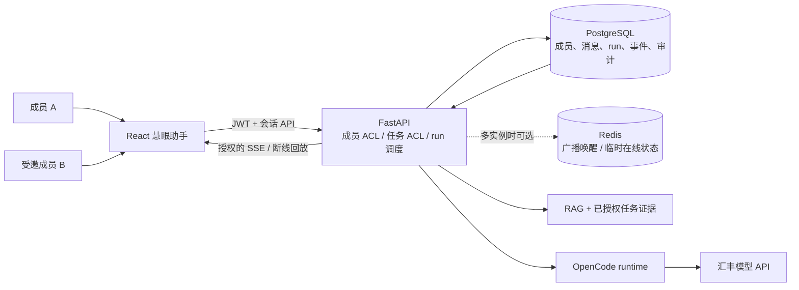
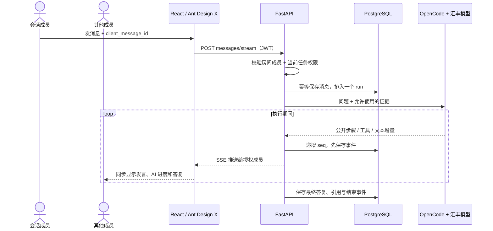
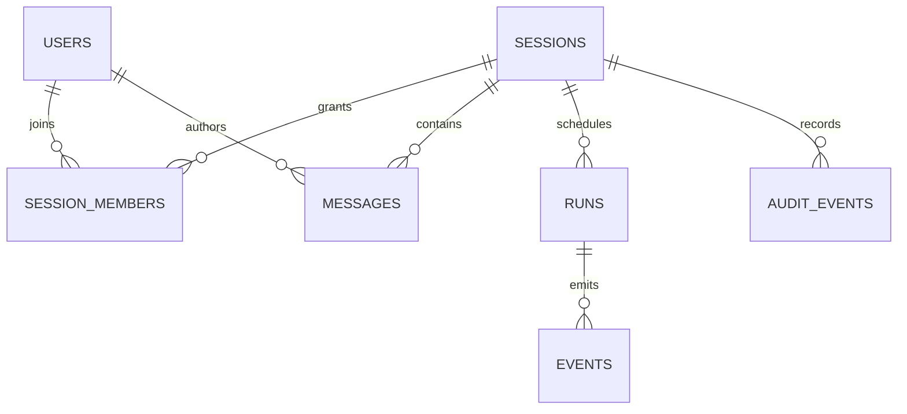
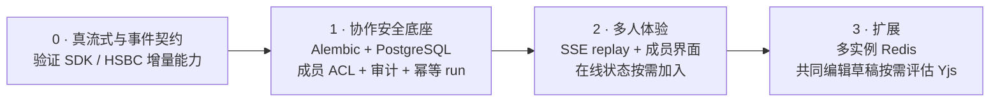

# 慧眼助手多人协作：调研与落地方案

> 本轮修改规划 · 更新：2026-10-21 · 状态：审阅与方向草案完成，待讨论 UI 形态；多人功能尚未实现。总设计见[慧眼助手总规划](README.md)，长期取舍见[决策记录](决策记录.md)。

## 结论先看

**保留 React + Ant Design X + FastAPI + OpenCode SDK + 汇丰模型 API。** 多人功能做成“有任务权限的同事进入同一会话”，服务端负责成员授权、消息顺序和审计；不另接一套聊天后端或 Agent runtime。

当前评分是代码评审估值，不是用户测试成绩：

| 项目 | 当前分（5分） | 主要缺口 |
|---|---:|---|
| 聊天 UI / 汇丰模型接线 | 3.5–4 | 已用成熟组件并走 HSBC/OpenCode 服务端链路；正文还不是真正 token 流 |
| RAG / 权限 / 恢复 | 2–2.5 | 法规 scope 未开放；无细粒度共享 ACL 和事件回放 |
| 多人协作 / 部署韧性 | 1–2.5 | 仍是私有会话；SQLite 默认、无成员审计和多实例事件协调 |

**结论：单人演示链路已成形，离成熟协作助手还有差距。**

## 选型：复用成熟组件，保持业务边界

| 上游项目 | 借鉴点 | 本项目决定 |
|---|---|---|
| [Ant Design X](https://github.com/ant-design/x/) | React 消息、输入、会话、步骤组件 | **继续使用**；1.6.1 兼容现有 Ant Design 5 |
| [assistant-ui](https://github.com/assistant-ui/assistant-ui/) | 流式聊天与可组合消息体验 | 作为交互参考；OpenCode adapter 仍标为 experimental，不替换当前 UI/runtime |
| [CopilotKit / AG-UI](https://github.com/CopilotKit/CopilotKit/) | 统一 run、message、tool 事件；人工中断 | 借鉴事件契约，不部署第二套 Agent runtime |
| [LibreChat](https://github.com/danny-avila/LibreChat/) | 用户、群组和资源权限 | 借鉴成员 ACL，不引入重复的认证、模型和数据层 |
| [Yjs](https://github.com/yjs/yjs/) | 多人共同编辑和冲突合并 | **不用于聊天记录**；仅在未来确有共同编辑草稿时评估 |

版本核对：Ant Design X 2.9.0 要求 Ant Design 6，故当前 Ant Design 5 主站保留 X 1.6.1。OpenCode SDK 2.0.32 于 10 月 16 日发布，2.1.2 于 10 月 21 日发布；不是长期废弃版本，但升级前应验证事件 API、mock 测试和真实 HSBC 链路。[X 版本](https://www.npmjs.com/package/%40ant-design/x?activeTab=versions) · [OpenCode SDK 版本](https://www.npmjs.com/package/%40opencode/sdk?activeTab=versions)

## 本轮审阅结论

| 优先级 | 要补的能力 | 为什么 |
|---|---|---|
| P0 | 核实并接通真正的模型正文增量 | 现在只是完整答复分段回显，动态感和真实生成状态不一致 |
| P1 | 共享会话的成员 ACL、任务 ACL 与审计 | 只有受邀且仍有任务权限的人才可以看材料和聊天记录 |
| P1 | 消息幂等、每房间单 run、事件持久化与续传 | 避免重复调用、答案串线和断线后丢进度 |
| P1 | Alembic + PostgreSQL 部署路径 | SQLite 默认库不能承担多人/多实例协调，当前建表使用 create_all |
| P2 | 团队成员 UI、通知与技能治理 | 当前技能是本地只读目录；邀请专家和技能发布流程未实现 |

## 多人 + AI：产品流程草案（先对齐，不生成 HTML）

这里的“个人会话”是**一个人和 AI 的会话**，不是只能和 AI 私聊、不能再邀请同事的另一套产品。建议同一条会话可以从个人使用转成协作：经办人先和 AI 梳理问题；需要专业判断时，AI 给出专家建议或经办人打开专家库搜索；经办人确认邀请；受邀专家进入同一个房间，看到获准分享的已有对话与任务证据，再与经办人和 AI 继续交流。

邀请确认需要清楚说明“受邀者会看到哪些历史内容、任务材料和引用”。默认可建议共享当前会话的完整上下文，以便专家接上讨论；若不应暴露早期草稿，可另提供“从此处创建协作副本”，而不是暗中隐藏历史。无论哪种方式，加入房间都不能绕过任务权限，也不授予贷款审批权。

| 区域 | UI 草案 |
|---|---|
| 左侧导航 | “与 AI 的个人会话”和“协作会话”两个列表；个人会话仍能开始使用，邀请专家后可在原会话转为共享，不自动分享旧会话 |
| 主聊天区 | 同一消息时间线显示经办人、专家、AI 的头像/身份；支持 @提及、引用、可折叠 AI 执行轨迹和证据来源 |
| 会话顶栏 | 任务范围、成员头像、邀请入口、当前共享范围；撤销成员后立即失去历史和实时流访问 |
| 右侧抽屉 | “成员 / 专家 / 技能 / 任务材料”标签；默认不常驻，搜索专家并看专长后可直接邀请 |
| AI 专家推荐 | 给出匹配理由和可见的专业标签；由经办人点击邀请，不自动把客户/任务内容发送给专家 |
| 技能目录 | 搜索助手可调用的受控能力，显示用途、来源、版本、审核状态与所需权限；技能不是人，也不等于贷款审批权限 |

**概念上分三类，避免“专家”混淆：**“同事专家”是可加入房间的人；“AI 专家”若未来提供，是带角色定义的专用助手；“Skill”是 AI 可按权限调用的可复用能力。第一版建议先做同事专家目录 + 技能目录，把 AI 专家角色作为目录中的独立类型或后续阶段。

## GitHub 案例：有真实相似点，但没有一个成熟项目完整覆盖

| 项目 | 确实相似的能力 | 评估与可借鉴点 |
|---|---|---|
| [LibreChat Agents Marketplace](https://www.librechat.ai/docs/features/agents) | 可搜索 AI Agent 名称/描述，查看详情、置顶、启动会话；资源 ACL 支持用户、群组和角色，且有 Viewer / Editor / Owner。也有 Skills 权限 | 适合借鉴“专家/技能目录卡片 + 详情 + 分级授权”。但它的[会话分享链接是只读快照](https://www.librechat.ai/docs/features/shareable_links)，登录者只能复制成自己的会话继续，不是多人共同写同一条聊天 |
| [a7t.chat](https://github.com/a7t-ai/chat) | 个人会话可邀请账号共同加入；文档描述了 view / suggest / edit / prompt 等协作者能力，prompt 成员可在同一会话发起 AI 回合 | 是“先自己聊，再拉人进同一上下文”最直接的交互参考。仓库规模和维护团队较小，适合学流程，不作为银行业务系统的直接部署底座 |
| [RoomTalk](https://github.com/Skymore/roomtalk) | 有邀请房间、成员角色、AI 实时聊天、消息持久化、断线恢复，以及专家角色预设 | 适合观察“房间 + AI + 成员侧栏 + 活动轨迹”如何组合。仓库自述采用 React/Vite、Socket.IO、Redis/PostgreSQL；目前贡献者很少，且其模型/存储/身份边界不等于本项目的汇丰部署条件 |
| [Synapse](https://github.com/zai-org/synapse) | 把 conversation 作为人和 AI teammate 的共同协作边界；skills、插件、Agent 等资源有独立授权与审计模型 | 概念上最接近“人类专家 + AI + 能力目录”。但仓库明确标注仍处于早期设计/实现阶段，不能当成已经成熟稳定的可直接部署方案 |
| [Nava Skills Hub](https://github.com/navapbc/skills-registry) | 搜索技能/Agent 条目，记录来源、类型、状态、可见性，并为审批、拒绝、角色变更保留审计 | 适合借鉴技能库治理字段和审核流程；它绑定组织自己的云架构，不需要照搬其 AWS 实现 |

**结论：**“多人同聊”与“专家/技能目录”已经分别有成熟度不同的先例；我没有找到一个可直接拿来、同时具备以上全部能力并符合汇丰密钥、任务 ACL、法规证据隔离要求的成熟仓库。更稳妥的路线是保留当前 React / Ant Design X / FastAPI / OpenCode 主链路，只借鉴这些项目的房间交互、目录卡片和 ACL 设计；不整套替换主应用。特别是技能目录必须受控审核，不能允许用户安装未经审核的任意 skill。

## 需要对齐的两个产品规则

1. **“专家”是否指内部同事？**我建议第一版定义为内部有账号、可被权限系统识别的业务专家；其资料由管理员维护，至少包含姓名/团队、专长标签、可参与的业务范围和可用状态。AI 专家是另一类目录项，不混进人类成员列表。
2. **邀请后专家能看多早的上下文？**建议默认加入同一会话并看到完整会话历史及仍有权访问的任务证据，邀请确认页明确告知；需要保留私密草稿时再选择“从此处创建协作副本”。请确认是否符合你的预期。

## 当前：已接入，但还是单人会话

现状边界：会话按用户隔离；RAG law 与任务 PDF 检索未开放；SSE 步骤/工具状态会实时出现，但答复正文是完整生成后再按 80 字符切段回显，并非模型 token 实时流。主站无 Vue 源码/运行依赖，也未使用 OpenAI Agents SDK。RAG 服务地址由部署配置决定。

## 目标：一个有权限的团队会话，共享同一条 AI 执行轨迹

Redis 只负责通知和在线状态；PostgreSQL 才是消息、事件和审计的权威记录。单实例先可不加 Redis。

## 一轮对话如何协作

每个房间同时只跑一个 AI run；其他消息排队。断线后用最后的 seq 补事件，不重复调用模型。若 HSBC/OpenCode 通道不支持正文 token 流，显示真实进度，不伪装成逐字实时生成。

## 数据关系与权限

| 数据 | 关键设计 |
|---|---|
| 会话 | visibility private/shared、task_code、next_event_seq；旧会话默认 private |
| 成员 | owner / contributor / reviewer / viewer；可撤销，撤销后立即失去历史和事件访问权 |
| 消息与 run | 作者、client_message_id 幂等键、run_id；每房间最多一个 queued/running run |
| 事件与审计 | session_id + seq 唯一；邀请、撤权、run 停止等写审计，不记录密钥或整份敏感答复 |

**权限必须同时满足：会话有效成员 AND 当前任务仍授权。** 每次读取、发送、SSE 回放、引用访问和取消 run 都在服务端检查。加入会话不等于获得贷款审批权；最终审核结论仍由有权限人员确认。

## API 草案（新增，当前尚不存在）

| API | 用途 |
|---|---|
| POST /sessions | 创建 private/shared 会话，可关联 task_code |
| POST /sessions/{id}/members · DELETE .../members/{user_id} | 邀请、撤销成员 |
| POST /sessions/{id}/messages/stream | 发消息并订阅 SSE；请求带 client_message_id |
| GET /sessions/{id}/events?after_seq=N | 校验权限后续传事件 |
| POST /sessions/{id}/runs/{run_id}/cancel | 授权取消 run，并留下审计 |

路径均挂在现有 /api/assistant 下；现有私有 API 保持兼容。

## 落地顺序与完成标准

验收演示先证明五件事：两位授权成员看到同一消息和 AI 轨迹；未邀请用户不能读；撤权即时生效；刷新后从事件序号续传且不重复调用模型；并发发言不串答案。当前后端启动时用 SQLAlchemy create_all 建表，共享会话前需引入 Alembic；SQLite 不用于多实例共享协调。

> 本方案只定义下一步实现方向；多人会话、事件回放和上述 API 目前都还没有落地。
