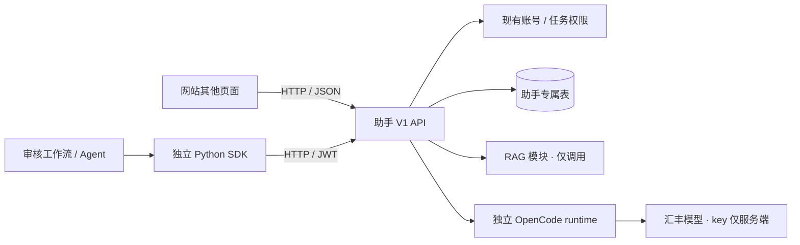
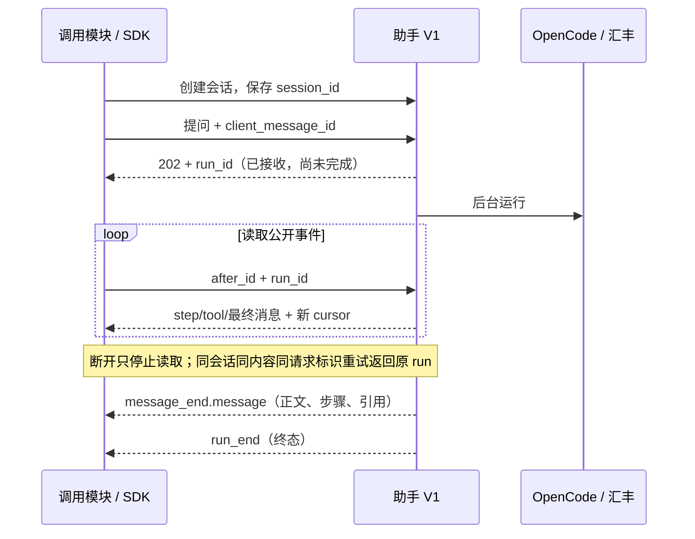

# 慧眼助手 · 对外接口 V1

**给接入同学：** 网站地址 + 有效审核人员 JWT 即可调用；不需要 HSBC key、runtime token 或助手内部代码。契约 **1.2.0**，统一前缀 **`/api/assistant/v1`**。1.1 增加运行结果查询，1.2 增加本人专业资料读取；均兼容既有请求。已实现并有回归；目标云站须部署该版本后才可调用，不能把本机验证理解为云端已上线。

快速接入看[模块接入清单](模块接入.md)；可运行 [create / ask / resume 示例](../../code/assistant-sdk/examples/workflow.py)展示独立安装、保存运行 ID 与只读恢复。

## 1. 模块边界



| 提供什么 | 调用方不需要知道什么 |
|---|---|
| 会话、AI 问答、公开步骤、引用、专家协作、技能目录 | 内部提示词、模型供应商配置、runtime 私网协议 |
| 版本化 HTTP API、可安装 Python SDK、OpenAPI 基线 | SQLAlchemy 表结构、React 状态、OpenCode SDK 调用细节 |

助手 API 当前作为主后端内独立业务模块挂载，共用身份和任务库；runtime 独立进程。**并非已拆出独立数据库/认证服务。** 业务账号、任务提交/审批归主站；RAG 实现归知识库模块。调用方不要 import `assistant_service`、直接写助手表或调用 runtime。

## 2. 最少接这 5 个接口

以下路径均相对于统一前缀；每次请求带 `Authorization: Bearer <审核人员JWT>`。

| 方法 / 路径 | 输入 | 返回 / 用途 |
|---|---|---|
| GET `/contract` | 无 | 契约版本、公开事件、限制；不探测模型 |
| POST `/sessions` | `title?`, `task_code?` | 201，会话 `id`；调用方保存并复用 |
| POST `/sessions/{id}/runs` | `content`, `client_message_id`, `skill_id?` | 202，运行 `id/status/session_id/user_id/client_message_id` |
| GET `/sessions/{id}/events` | `after_id=0`, `run_id?` | `events/cursor/has_more/active_run`；按游标读取 |
| GET `/sessions/{id}` | 无 | 完整授权历史、`active_run/event_cursor`；用于恢复 |
| GET `/sessions/{id}/runs/{run_id}`（可选，1.1 新增） | 无 | 运行元数据 + `message`；`message` 仅完成后有值，用于另一页面/进程取结果 |

`GET /capabilities` 是可选的运行环境检查：`configured` 不保证下一次模型调用成功；知识库独立看 `rag_available`。业务工作流的聊天 run 不等于专项审核 run，也不会修改任务审核状态。

```json
{"content":"解释此任务的复核重点","client_message_id":"task001_explain_0001","skill_id":null}
```

`content` 去首尾空白后 1–8000 字；请求标识 8–64 位 `[a-zA-Z0-9_-]`。调用方必须保存请求标识以安全重试；服务端兼容缺省时会生成新标识，因此缺省重发不能幂等。技能来自 `GET /skills`，不要传空字符串。会话任务固定，切换任务新建会话。

其他 React 页面可直接调用 HTTP，无需加载助手聊天组件：

```typescript
const response = await fetch(`/api/assistant/v1/sessions/${sessionId}/runs`, {
  method: 'POST',
  headers: { Authorization: `Bearer ${reviewerJwt}`, 'Content-Type': 'application/json' },
  body: JSON.stringify({ content: '解释本任务复核点', client_message_id: savedRequestId }),
})
if (!response.ok) throw new Error(`助手请求失败：${response.status}`)
const run = await response.json() // 保存 run.id，再按表中 events 接口读取
```



## 3. 成功、失败和恢复

- `message_end.message` 才是可展示的完整答复：含 `id/role/content/status/steps/citations/created_at/author_id/author_name/run_id`。保留“结论由有权限人员确认”的边界，不将正文自动写成业务审批。
- `step/tool` 是公开操作状态；`delta` 是完整答复校验后的回显片段，**不承诺真实 token 流**。未知事件/可选字段忽略；不要把内部 reasoning 当公开协议。
- 事件 `id` 和分页 `cursor` 是不透明整数，不连续也正常；按 `id` 去重并保存新游标。`has_more=true` 继续读取，避免跳页。成功正文和引用以最终消息为准。
- `run_end.status=error/cancelled` 是失败/取消；HTTP 200 的事件页、202 的运行、模型已连接均不代表成功。运行状态只有 `running/completed/error/cancelled`。
- 同会话每次仅一个活跃 AI；同身份、同会话、同标识与同内容重试返回原运行。相同标识换内容或并行另起运行返回 409。讨论消息不是 AI 运行。
- 客户端超时/离开页面不取消后台运行；用原 session/run 重读即可。显式停止用 `POST /sessions/{id}/runs/{run_id}/cancel`，仅创建者/发起者可用。当前后台 worker 单实例单进程；重启后过期运行失败，不自动付费重跑。
- 保存的游标可能已越过最终消息；此时直接 GET 对应 run 取 `message`，SDK `wait(..., after_id=cursor)` 会处理。未知/其他会话 run 返回 404，撤权后同样不可取回；查询不重跑 AI。完成状态却缺失持久结果时 SDK 报 `result_unavailable`，不伪造成功。消息 `created_at` 统一 UTC，事件/历史/运行结果采用同一 DTO。
- 服务端最终消息、作者、完成事件与 completed 状态同事务提交。最终写入失败不留已完成答案；服务会尝试记录 error、释放运行槽，数据库持续故障或进程中断则由原有超时恢复机制处理；不自动重跑模型。

| HTTP / 异常 | 调用方处理 |
|---|---|
| 401 | 业务 JWT 失效；重新登录，不能改填模型 key |
| 403 | 角色或管理权限不足；不可绕过 |
| 404 | 资源不存在或无权读取；不推断他人资源是否存在 |
| 409 | 当前运行繁忙、任务冲突或请求标识复用不一致；恢复原运行或修正请求 |
| 422 | 参数校验失败；`detail` 为校验列表，其余业务错误通常是 `detail` 文本 |
| 网络超时 / 5xx | 先重读原运行或用原标识恢复，不直接创建新请求付费重试 |

SDK 使用 `httpx.HTTPStatusError` 保留状态码，终态失败用 `AssistantRunError(run_id,status)`；`TimeoutError` 不表示后台已取消。

## 4. 专家协作与技能

| 接口 | 作用 / 权限 |
|---|---|
| GET `/experts?session_id=&q=` | 服务端搜索真实审核账号，先过滤关键词再取最多 50 位；提供 session_id 时同时过滤任务权限；介绍不代表认证资质 |
| GET/PUT `/experts/me` | 独立读取/维护当前审核人员本人资料 `{specialty,bio,tags}`，不受目录上限/搜索词影响；无资料时 GET 返回空字段，不接受其他用户 ID |
| GET/POST `/sessions/{id}/members`；DELETE `.../members/{user_id}` | 查询/邀请/撤权；仅创建者管理，邀请前告知共享完整历史 |
| POST `/sessions/{id}/messages` | `{"content":"给成员的讨论"}`，201，具名消息；不调用模型 |
| GET `/skills`；GET `/skill-library` | 已审核技能及个人安装状态，不执行任意上传代码 |
| PUT/DELETE `/skill-library/{skill_id}` | 加入/更新或移出个人库；不扩大数据权限 |
| GET/DELETE `/sessions/{id}`；GET `/sessions` | 读取/列举授权会话；创建者可删除，活跃运行先停止 |
| GET `/sessions/{id}/audit` | 创建者查看成员变更等审计 |

共享会话须关联任务；受邀者仍须有该任务访问权。当前任务权限沿用主站审核角色规则，尚无新增的细粒度任务 ACL。经办人不能调用助手。无人值守机器身份尚未提供，工作流使用获准审核人员的委托 JWT，不使用 runtime token 绕过身份。

审核证据默认只取授权任务材料/规则结果与知识库 `business_rules`；项目设计方案不作为业务审核依据。知识库范围/结构不符或服务不可用时，答复的依据限制会保留，调用方应展示该限制。不会自动切换到项目设计、外部法规或未经授权的任务文档范围。

## 5. 交付与兼容约定

1. Python 调用方从仓库根目录执行 `python -m pip install ./code/assistant-sdk`，按 [SDK 示例](../../code/assistant-sdk/README.md)接入；其他语言直接用 [OpenAPI](contracts/assistant-v1.openapi.json)。
2. 对外 V1 与原 `/api/assistant` 共用同一实现/数据/权限；原路径保留兼容。正式助手前端已改用 V1。旧 SSE 仅兼容，新增接入使用 runs/events。
3. V1 允许增加可选字段/事件；删除字段、改变必填项/含义/鉴权等破坏性变化须新主版本及迁移说明。SDK 与运行协议分别版本化，内部升级不要求调用方跟着改模型 SDK。
4. OpenAPI 基线与自动契约测试一起提交；更新先评审，再在 backend 执行 `python -m scripts.export_assistant_contract`，不得仅更新快照来掩盖破坏性变更。
5. 部署仍按[助手部署说明](../../code/assistant-runtime/deploy/README.md)配置并迁移；后端安装 `requirements-assistant.txt` 会安装独立 SDK。当前仅支持一个 API worker。云端部署和双账号/真实模型验收另计。
6. SDK 1.1.1 起提供 `python -m hbcn_assistant.verify`，按 [SDK 说明](../../code/assistant-sdk/README.md)对网站运行双 JWT 的真实 HTTP 验收；临时会话自动清理，失败返回非零。当前 SDK 1.1.2 的显式 contract 检查要求 API 至少 1.1.0，接受 1.2 等同主版本增量；客户端版本与服务端契约分别管理。
