# 慧眼助手 · 持续优化实施规划

> 状态：最近迭代覆盖引用读屏/键盘返回、长会话滚动、活动会话恢复、撤权清理、会话间 Skill 隔离及窄屏 Skill 编辑；前端助手全套 **51/51**、后端助手 **98/98**，浏览器 Skill/协作流程 **13/13**、草稿流程 **4/4**，Vite 生产构建通过（助手 JS **214.12 KB / gzip 72.87 KB**）。全站 TypeScript 检查仍被主站 `DashboardView.tsx` 缺少 `dayjs` 阻断；主站入口约 1.83 MB，有分包警告。合成验收未调用 AI/RAG。汇丰真实模型、目标环境 RAG 与正式主站发布尚未验收，不能把 mock 说成真实联通。总目标：审核人员与 AI 协作，需要时邀请真实专家进入同一会话；基于授权证据工作、使用汇丰资源，并支持同学拉取仓库部署。总设计见 [README](README.md)。

本轮在 `lfc-assistant` 隔离工作树复验了全部助手前后端与浏览器流程。个人技能编辑器的保存中关闭保护、窄屏固定保存操作区和完整测试结果见下方第 46 轮及[核心测试集](核心测试集.md)。

## 第 46 轮：保护保存中的技能编辑并适配窄屏

**审核人员遇到的问题：**网络较慢时，技能保存尚未返回，仍可尝试按 Escape、点遮罩或关闭按钮离开，造成保存结果不确定；手机屏幕较矮或出现版本冲突信息时，编辑正文和底部操作需要争抢空间。

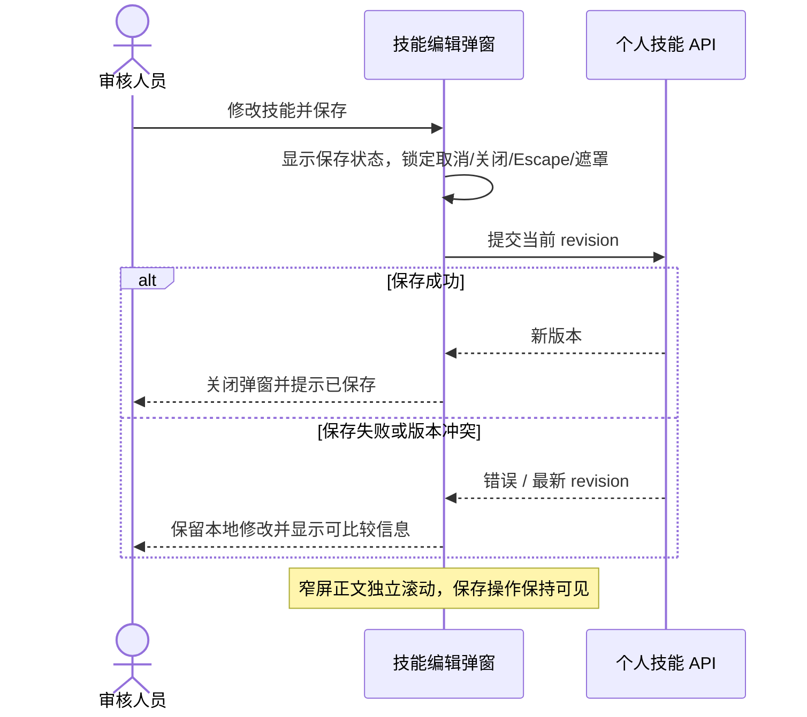

- **修正：**保存期间禁用取消、右上角关闭、Escape 和遮罩关闭；窄屏编辑弹窗限制在可视高度内，正文滚动，标题与底部按钮保持固定。
- **核心验收：**前端助手 **7 个文件、51/51**，新增保存未返回时不能关闭且完成后自动收起；Skill 文件 **7/7**。窄屏 Playwright **13/13 阶段**，在 320×420 检查编辑内容和保存按钮在可视区且正文可滚动；草稿/任务切换流程 **4/4**。助手后端 **8 个文件、98/98**。Vite 生产构建通过，3,188 modules，助手 JS **214.12 KB / gzip 72.87 KB**。
- **边界与观察：**本地合成浏览器没有调用 AI/RAG，异常 **0**，临时数据清理完成。PDF 原件绘制在一次运行中碰到 30 秒等待超时，整套流程重跑后通过；继续观察繁忙机器下 PDF 预览等待稳定性。全站 `tsc -b` 只报既有主站 `DashboardView.tsx` 缺少 `dayjs`；没有修改主站依赖或页面。真实 HSBC 模型、目标环境 RAG 与正式部署仍未验收。
- **下一轮：**复核读屏工具中的编辑弹窗名称/焦点和保存状态播报；在授权目标环境核验真实模型、RAG 以及慢网络下的保存/重连。

## 第 40 轮：来源列表读屏名称

**审核人员遇到的问题：**引用链接可以读出依据编号，自动定位后也会播报来源，但被定位的有序列表没有名称；使用屏幕阅读器浏览长依据时，无法快速确认当前列表属于本轮答复。

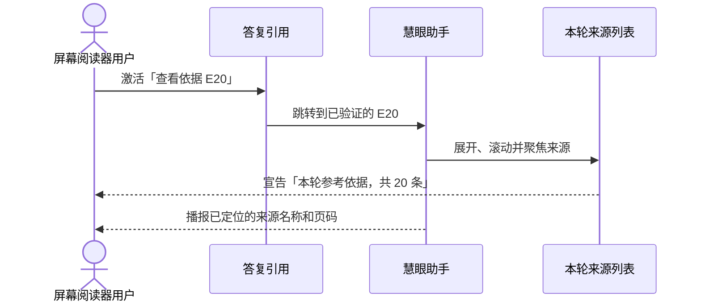

- **修正：**给来源有序列表增加动态可访问名称，保留原生列表语义；引用链接、来源焦点和定位成功播报继续使用同一编号。
- **验收：**助手页面真实 Ant Design 组件回归 **16/16**；窄屏 Edge/Playwright 流程 **10/10**，以键盘激活 `[E20]` 后通过可访问角色和名称找到 20 条来源列表，确认目标获得焦点；浏览器异常 **0**，AI/RAG 调用 **0**。Vite 生产构建通过，助手 JS **212.71 KB / gzip 72.46 KB**。
- **限制：**这是 DOM/浏览器可访问名称验证，不替代 NVDA/JAWS/VoiceOver 实机读屏验收，也不验证模型生成的依据事实。
- **下一轮：**对话页面键盘从答复引用进入来源后，验证 Escape/返回阅读位置的行为；再审查长对话中自动滚动是否尊重审核人员手动阅读位置。

## 第 41 轮：长会话回到最新

**审核人员遇到的问题：**在长会话里向上查看历史答复和依据时，页面会尊重手动阅读位置；但看完后没有快捷方式回到最新消息，只能拖动滚动条。

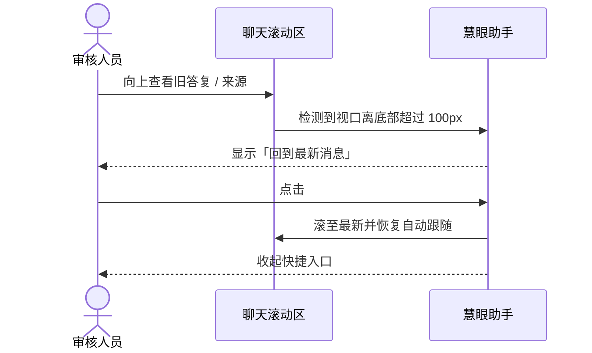

- **修正：**保留审核人员上翻时不被新内容抢走视口的行为；在偏离底部时提供浮动回到底部按钮，点击后恢复自动跟随。按钮使用显式可访问名称，不挤占输入区。
- **验收：**助手真实组件发送/流式用例定向 **1/1**；流式 `message_end` 后断言 `scrollTop` 仍为审核人停留的 **400px**，按钮仍在，点击才滚到底部。窄屏 loopback 浏览器 **11/11 阶段**，模拟长历史溢出并在 **320px** 检查按钮完整位于视口内、没有压住输入区；模型/RAG 调用 **0**、浏览器异常 **0**。Vite 生产构建通过，助手 JS **213.01 KB / gzip 72.55 KB**。
- **限制：**本轮没有重跑其余助手测试文件；上一轮整组基线 **44/44**。移动端阶段通过浏览器模拟，不替代真实手机触控和软键盘验收。
- **下一轮：**在 NVDA/JAWS/VoiceOver 中做实际读屏验收；再检查刷新恢复、运行重连与长会话滚动位置共同作用时，阅读位置是否稳定。

## 第 42 轮：引用定位支持 Escape 返回

**审核人员遇到的问题：**键盘用户从答复引用跳到依据并读完后，需要回到原答复继续阅读；此前焦点停留在来源条目，用户只能手动 Tab 穿过其他控件寻找原引用。

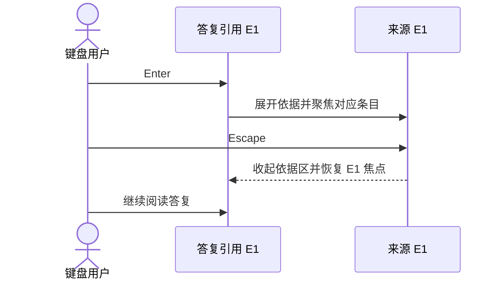

- **修正：**定位时保存原引用链接；来源条目或其内部控件聚焦时按 Escape，收起依据区并在过渡后把焦点送回原链接。
- **验收：**真实 Ant Design 组件引用定位用例 **1/1**；窄屏 loopback 浏览器 **11/11 阶段**，通过键盘打开 E1、Escape 收起并恢复 E1 焦点，再展开来源打开任务原件；PDF 服务 200 且等待 loading 结束后画布有实际绘制像素。浏览器异常 **0**、AI/RAG 调用 **0**。Vite 构建通过，助手 JS **213.20 KB / gzip 72.63 KB**。
- **限制：**读屏名称和焦点行为通过浏览器可访问树验证，尚未使用 NVDA、JAWS 或 VoiceOver 实机验收。
- **下一轮：**实机读屏与刷新恢复/运行重连时的引用焦点和阅读位置验证。

## 第 43 轮：活动会话短暂断线后继续恢复

**审核人员遇到的问题：**正在运行的私有审核会话每 1.8 秒同步一次。网络抖动或服务暂时返回 5xx 时，旧逻辑会清空已显示消息并停止活动运行轮询；审核人可能误以为任务消失，甚至再次提问。

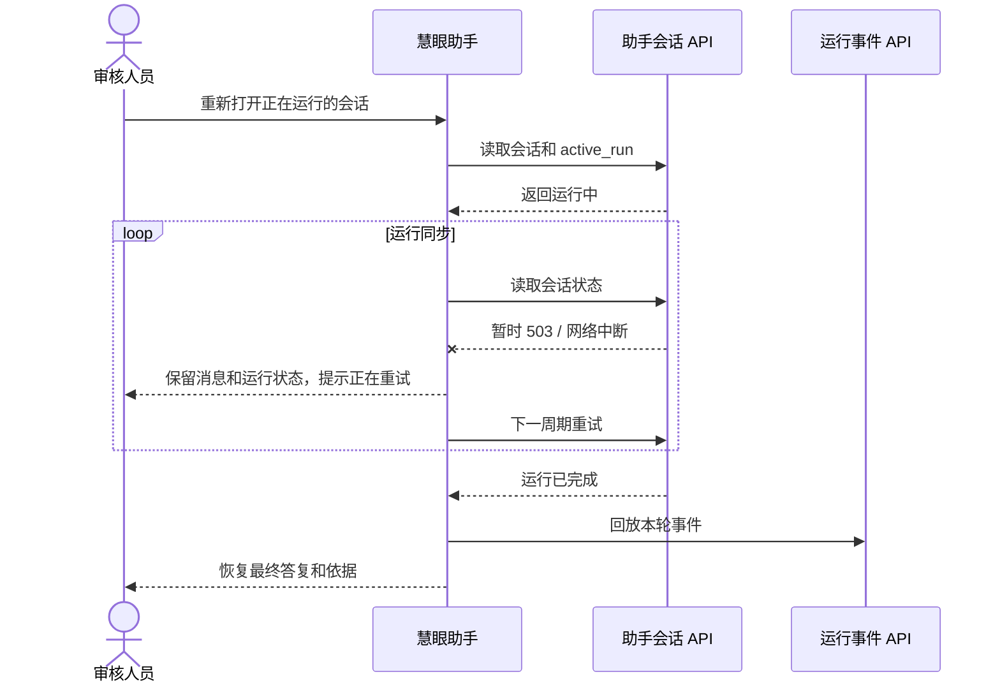

- **修正：**API 错误保留 HTTP 状态码；网络/5xx 暂时失败保留消息、活动运行及事件游标，继续轮询并提示不要重复发送。成功同步后清除连接提示；401/403/404 清空受保护材料、技能和运行态，并离开失效会话。
- **验收：**活动恢复/撤权状态和助手 API 两个测试文件 **10/10**；覆盖 503 后重试并恢复完成答复、403 后立即清理上下文、403 状态保留。Vite 生产构建通过，助手 JS **213.60 KB / gzip 72.76 KB**。
- **验收：**状态/API 两个定向测试文件 **10/10**；浏览器 loopback 流程 **12/12**，真实页面依次读到活动会话、503 恢复提示、已完成答复；既有运行请求计数不增加，临时会话清理完成。模型/RAG 调用 **0**、浏览器异常 **0**。Vite 生产构建通过；全站类型检查仍受主站缺少 `dayjs` 阻断。整组前端 **44/44** 为本轮改动前基线。
- **限制：**这是本地浏览器和合成 503 响应验收，不等同于汇丰目标环境的真实断网、代理恢复或多标签联测。
- **下一轮：**在共享测试环境验证真实服务短暂不可用后的恢复，并覆盖登录过期、会话撤权与多个标签页同时打开的行为。

## 第 44 轮：会话撤权后清除已选 Skill

**审核人员遇到的问题：**会话目录轮询先发现当前会话已不再可见时，页面会清空消息、任务和运行状态；但旧会话选中的 Skill 仍留在输入框。审核人接着开始新会话时，旧技能可能被无意带入新问题。

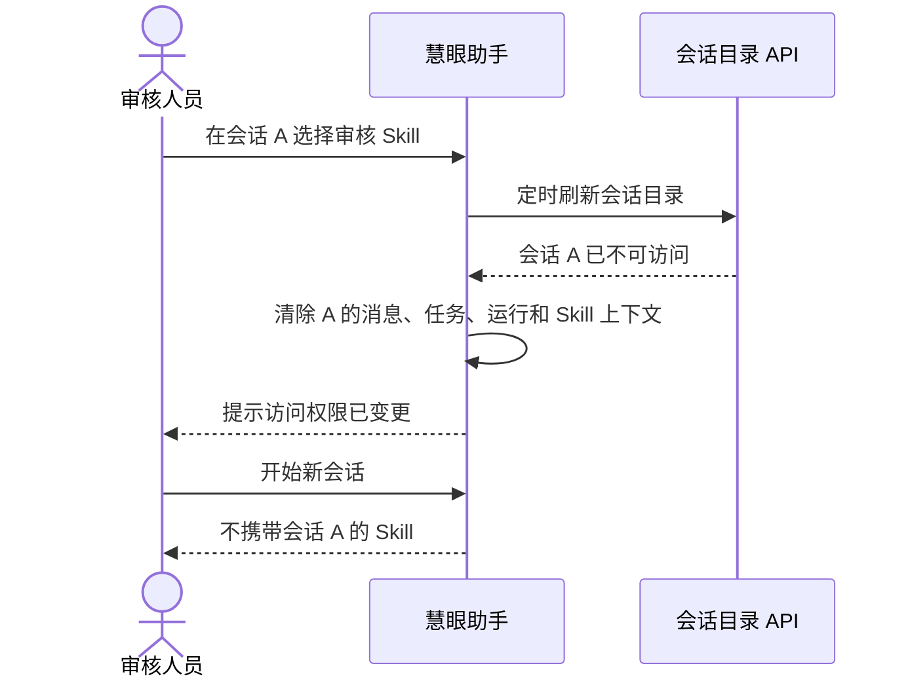

- **修正：**目录轮询确认当前会话消失时同步清除 Skill；与会话详情接口返回 401/403/404 时的上下文清理保持一致。
- **验收：**权限/活动恢复 hook 测试 **5/5**，助手页面撤权组件用例 **1/1**，确认提示出现、草稿清空且 Skill 标签消失；Vite 生产打包通过，助手 JS **213.61 KB / gzip 72.77 KB**。上轮 loopback 浏览器断线恢复 **12/12**；本轮未重复跑全套浏览器。
- **限制：**撤权页面用例运行在 jsdom/真实 Ant Design 组件上，尚未在目标环境验证权限变更推送时序；全站 TypeScript 构建检查仍被主站缺少 `dayjs` 阻断。
- **下一轮：**补真实组件撤权场景，验证 Skill 标签确实消失且新会话请求不携带旧 Skill；再覆盖会话切换、未发送草稿与任务上下文组合。

## 第 45 轮：会话切换时由状态层隔离 Skill

**审核人员遇到的问题：**Skill 原本只由助手页面的任务/会话切换处理器清空。若 SDK 宿主或其他页面直接调用 `useAssistant` 新建或恢复会话，hook 会残留旧 Skill，下一条问题可能收到与当前会话无关的指引。

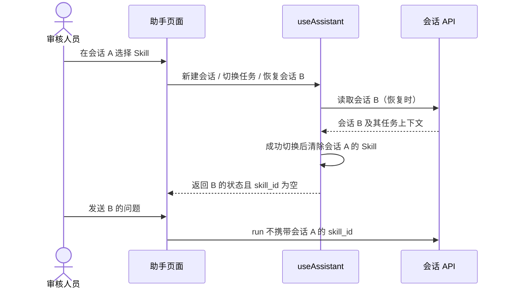

- **修正：**在状态层 `newConversation` 和成功的 `selectSession` 中统一清空 Skill；会话读取失败时不清理当前会话上下文。页面仍负责同步清空草稿和讨论模式，避免把 UI 临时状态塞入 hook。
- **验证：**前端助手全套 **7 个文件、50/50**；覆盖新建、任务切换、历史恢复、撤权、发送、SSE/API、Skill、专家协作和 Markdown。后端助手相关全套 **8 个文件、98/98**，覆盖 API/SSE、权限、证据、RAG v1 合约、原子提交和时间戳。浏览器此前 **12/12**，Vite 构建通过。
- **发布门禁：**`tsc -b` 失败点为主站 `DashboardView.tsx` 缺少 `dayjs`；不是助手类型错误。本轮不改该主站页面或全局依赖，因此生产打包（Vite）通过，但标准 `npm run build` 仍未通过。
- **未解决：**真实汇丰模型与目标环境 RAG/MCP 联调未执行；浏览器断网验收用 loopback 503 夹具；全站 `dayjs` 需主站依赖所有者修复。助手不能代替审核 workflow，也不能形成最终审批决定。
- **RAG 合约观察：**助手适配按 v1.2 起兼容 1.x；1.3.3 契约摘要及错误脱敏规则、请求字段和失败降级矩阵记录在[核心测试集](核心测试集.md)。助手只发送约定的五个字段；新增 1.3.3 readiness/检索兼容与脱敏 422 回归，且 capabilities 不兼容提示已有前后端断言。RAG 分支给出的 0.5.3/HTTP 1.3.3 摘要尚不代表该版本已集成或部署；真实目标环境联调仍待完成。
- **下一轮：**复核完整助手变更集与迁移、部署脚本后，在该隔离分支提交已通过的助手改动；目标环境真实联调另行标注门禁，不把本机合成验证当作端到端生产证明。

## 第 39 轮：从答复引用直达授权依据

**审核人员遇到的问题：**回答中虽然显示 `[E1]`，来源却藏在折叠面板里；引用多、文件名长或手机屏幕较窄时，用户需要手动展开并在长列表中查找。

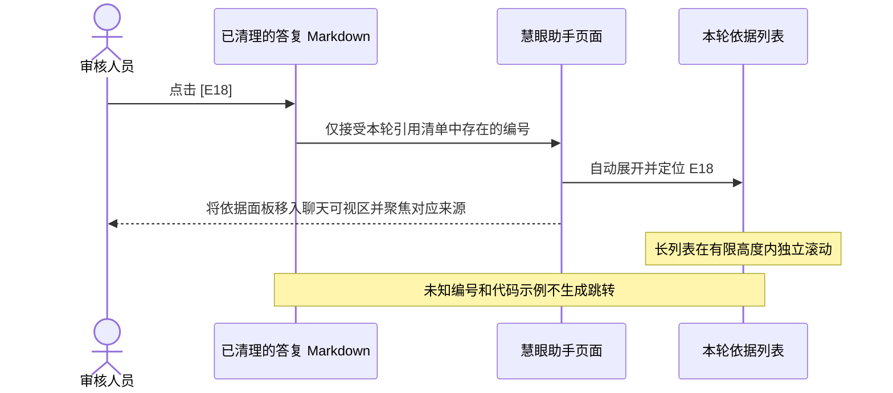

- **修正：**在 DOMPurify 清理后的 Markdown 文本节点中，只将已验证的 `E数字` 引用生成为链接；代码片段、已有链接和未知编号不处理。跳转先滚动聊天窗口显示依据区，再在依据内部滚到目标并聚焦。依据列表最高为 42vh/360px；超宽表格仅在答复正文内滚动。
- **验收：**Ant Design 真实组件定向测试 **17/17**，完整前端 **7 文件/43 项**；Edge loopback 合成浏览器 **9/9 阶段**，在 390×420 视口注入 20 条长来源，以 Tab + Enter 先打开并定位 `[E20]`，再在面板已展开时跳到重复出现的 `[E1]`；两次都聚焦目标。来源独立滚动、表格内部横滚、无整页横向溢出。浏览器未调用模型/RAG，临时会话和技能清理成功。Vite 生产打包通过，助手 chunk **210.39 KB / gzip 71.63 KB**；主站入口仍为 **1.83 MB**。`tsc -b` 仅报主站 `DashboardView.tsx` 缺少 `dayjs`。
- **边界：**证据来自隔离合成会话，验证的是页面定位和布局，不验证 HSBC 模型、RAG、原文 PDF 定位或证据事实正确性。
- **下一轮：**补屏幕阅读器对引用编号、来源列表项和自动定位结果的读出验证；之后用真实任务引用检查 PDF/页码定位能力，并继续验证真实模型/RAG 可用时的引用样式与来源完整性。

## 第 38 轮：历史会话操作支持键盘访问

**审核人员遇到的问题：**Ant Design X 默认历史菜单图标不可通过 Tab 聚焦，且仅在悬停时显示；触屏或键盘用户不容易找到删除等会话操作。

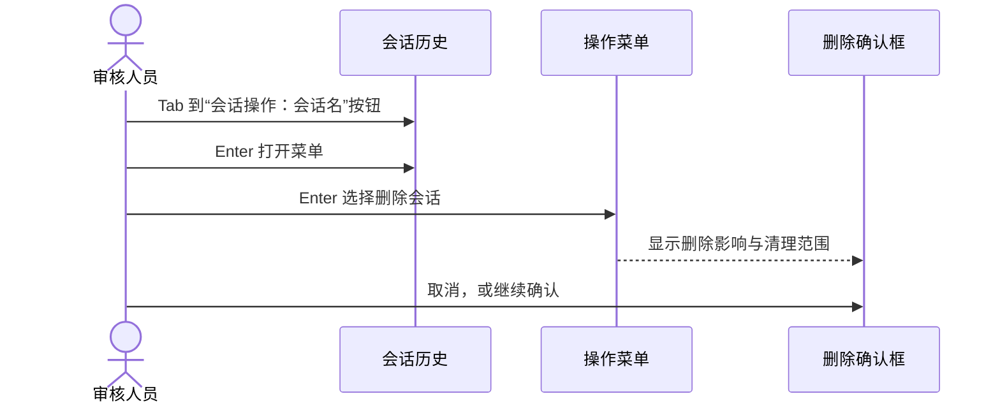

- **修正：**使用 Ant Design X `Conversations.menu.trigger` 扩展点，替换默认 `tabIndex=-1` 图标为具名、可聚焦且始终可见的按钮；沿用原菜单及权限禁用逻辑。
- **验收：**真实 React 组件检查菜单入口为可聚焦按钮；loopback 浏览器在手机历史抽屉中以 Enter 打开菜单并以 Enter 进入确认框，再取消保留草稿/Skill，之后确认删除。全流程 **8/8 阶段通过**；完整前端回归 **7 文件/41 项通过**；Vite 生产构建通过，助手脚本 **208.13 KB / gzip 70.82 KB**，主站入口 **1.83 MB** 警告仍在。测试明确等待抽屉动画结束后检查真实视口边界，避免转场时读坐标造成偶发失败。
- **边界：**键盘测试覆盖会话菜单进入与删除确认，尚未覆盖屏幕阅读器及所有弹窗的 Escape 键行为；模型/RAG 不属于这组 UI 验收。
- **下一轮：**检查聊天消息引用、执行轨迹和历史菜单的完整键盘焦点顺序；再覆盖长引用标题与窄屏折叠交互。

## 第 37 轮：删除当前会话后不带走旧草稿和 Skill

**审核人员遇到的问题：**删除当前任务会话会切到新会话，但旧逻辑没有同步清理输入框草稿与已选 Skill，可能把上一任务的上下文误带到下一问。

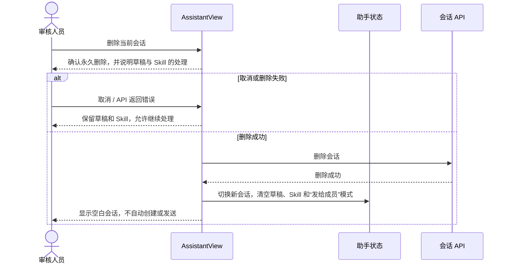

- **修正：**会话删除状态适配返回成功/失败；仅当成功删除当前会话时，页面才清空未发送内容、待用 Skill 和成员发送模式。确认框提前说明清理范围；取消/失败不清空任何用户输入。
- **验收：**真实 Ant Design X 会话菜单和确认框组件测试覆盖取消、删除 API 失败、删除成功三种结果；失败/取消保留草稿及 Skill，成功后两者清空，且不新建会话、不发模型请求。前端完整回归 **7 文件/41 项通过**；loopback 浏览器验收 **8/8 阶段通过**，含手机历史抽屉里的取消/确认删除和后续协作页面回归；模型/RAG 调用 0、页面异常 0、临时数据清理成功。Vite 生产构建通过，助手脚本 **207.68 KB / gzip 70.70 KB**，主站入口 **1.83 MB** 警告仍在。TypeScript 检查仍被主站 `DashboardView.tsx` 缺少 `dayjs` 阻断。
- **边界：**该修正不改变非当前会话删除的草稿；无目标手机键盘验收。助手 API 仍依赖主站统一 JWT 和权限校验。
- **下一轮：**补浏览器端真实菜单键盘可达性，并继续检查多任务切换、未发送草稿与历史恢复的组合场景。

## 第 36 轮：长专家姓名不会撑破手机窄屏

**审核人员遇到的问题：**专家姓名受数据层约束最多 128 个字符；长英文姓名没有空格时，可能把协作卡片撑出抽屉并挤掉邀请操作。

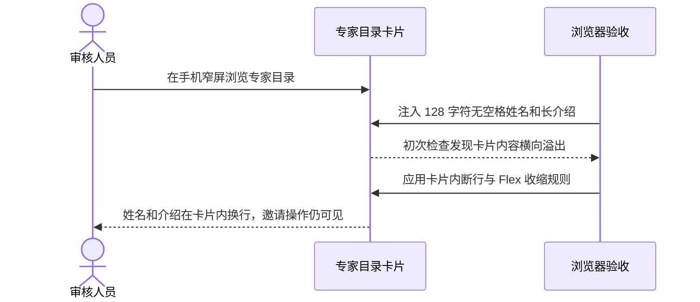

- **修正：**专家卡片限制内容最小宽度；姓名、介绍和资料来源允许在任意字符处换行；邀请按钮保持原尺寸。
- **验收：**第一次压力运行测得 3,079px 内容溢出，复现缺陷；修复后 Edge 合成浏览器验收 **7/7** 阶段通过，长姓名卡片不超出容器，滚到长介绍末尾后邀请按钮可达。24 人列表末项可滚动到，最终审核权限说明固定可见；页面异常 0、模型/RAG 调用 0、临时数据清理成功。前端完整回归 **7 文件/40 项通过**；Vite 生产构建通过。TypeScript 项目检查单独执行仍报既有 `DashboardView.tsx` 缺少 `dayjs`，本轮未修改该页面、全局依赖或其功能。
- **边界：**测试使用 390×420 浏览器视口和合成资料，没有替换生产目录或邀请/撤权；尚未覆盖真实手机键盘与屏幕阅读器。
- **下一轮：**检查超长专家介绍和标签密集时的阅读层次、邀请按钮操作；实机或目标云端验收在获得可用环境后再执行。

## 第 35 轮：多人成员列表保持可滚动，权限说明持续可见

**审核人员遇到的问题：**会话成员增加后，手机窄屏上能否找到列表末尾成员，同时仍看清成员权限与审核结论归属？

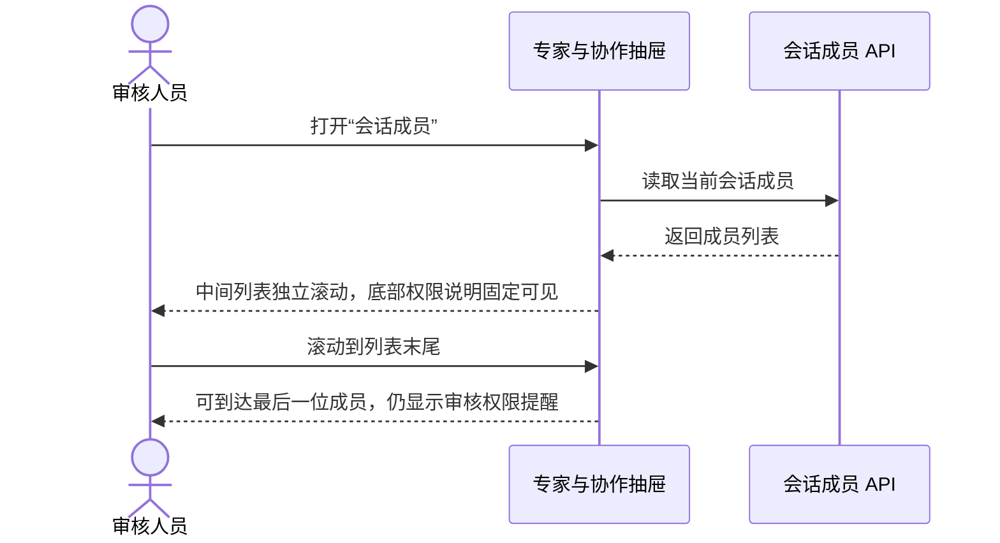

- **结果：**390×420 视口注入 24 条本地合成成员后，当前独立滚动列表和固定底栏满足要求，无需改运行时 UI；已将成员压力场景加入浏览器验收，避免后续样式修改造成回归。
- **验收：**Edge 合成浏览器验收 7/7 阶段通过；检查末位成员处于滚动区内、底部“最终结论必须由有权限的审核人员确认”可见。页面异常 0；两次 AI run 均由本地 409 拦截，模型/RAG 请求 0；临时技能、会话清理成功。
- **边界：**使用合成成员与浏览器缩小视口，不代表真实手机软键盘、超长姓名或屏幕阅读器验收；未邀请或修改任何成员。
- **下一轮：**优先检查窄屏下超长姓名和长专家简介的换行/操作可达；再按真实 HSBC 凭证及 RAG 联调条件做端到端验收。目标环境权限或配置不足时记录为待办，不以本地夹具替代。

## 第 34 轮：窄屏资料编辑不再遮住保存按钮

**审核人员遇到的问题：**在 320×420 的移动视口打开“我的专业资料”，原弹窗高度超过屏幕，审核人看得到资料字段，却够不到底部的保存操作。

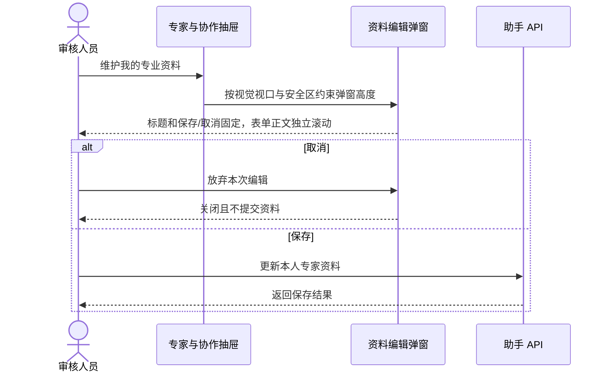

- **实现：**移动端弹窗高度按 `100dvh` 和安全区计算，扣除 Ant Design 弹窗外层留白；表单正文滚动，标题和底部操作保持可见。
- **核心验收：**协作组件测试 **8/8**；Vite 生产构建通过。Edge 合成浏览器回归 **7/7**，新增 320×420 移动设备模式；等待入场动画完成后检查弹窗与保存按钮均未越出视觉视口，正文可滚动，取消后不提交并关闭。run 请求均由本地 409 夹具拦截，模型/RAG 调用 **0**。
- **设备测试边界：**移动浏览器模式和 420px 高视口验证布局约束，不等于真实 iOS/Android 软件键盘验收；仍需在目标手机与实际键盘下检查。
- **构建边界：**完整 TypeScript 检查仍由助手以外的主站 `DashboardView.tsx` 缺少 `dayjs` 阻断；本轮未改该页面或全局依赖。
- **下一轮（第 35 轮）优先级：**真实手机键盘下复核资料编辑、邀请确认和成员列表；获得授权预览访问后做个人技能汇丰模型对照测试；RAG 服务可联调后验证 readiness、检索与引用。主站 `dayjs` 由对应依赖所有者补齐。

## 第 33 轮：手机窄屏下保持专家协作操作可达

**审核人员遇到的问题：**旧抽屉把搜索框、专家列表和资料入口放在同一段滚动内容里。候选人较多或手机可视高度变小时，搜索和底部操作会离开屏幕；审核人也需要确认无任务的普通会话不能邀请专家。

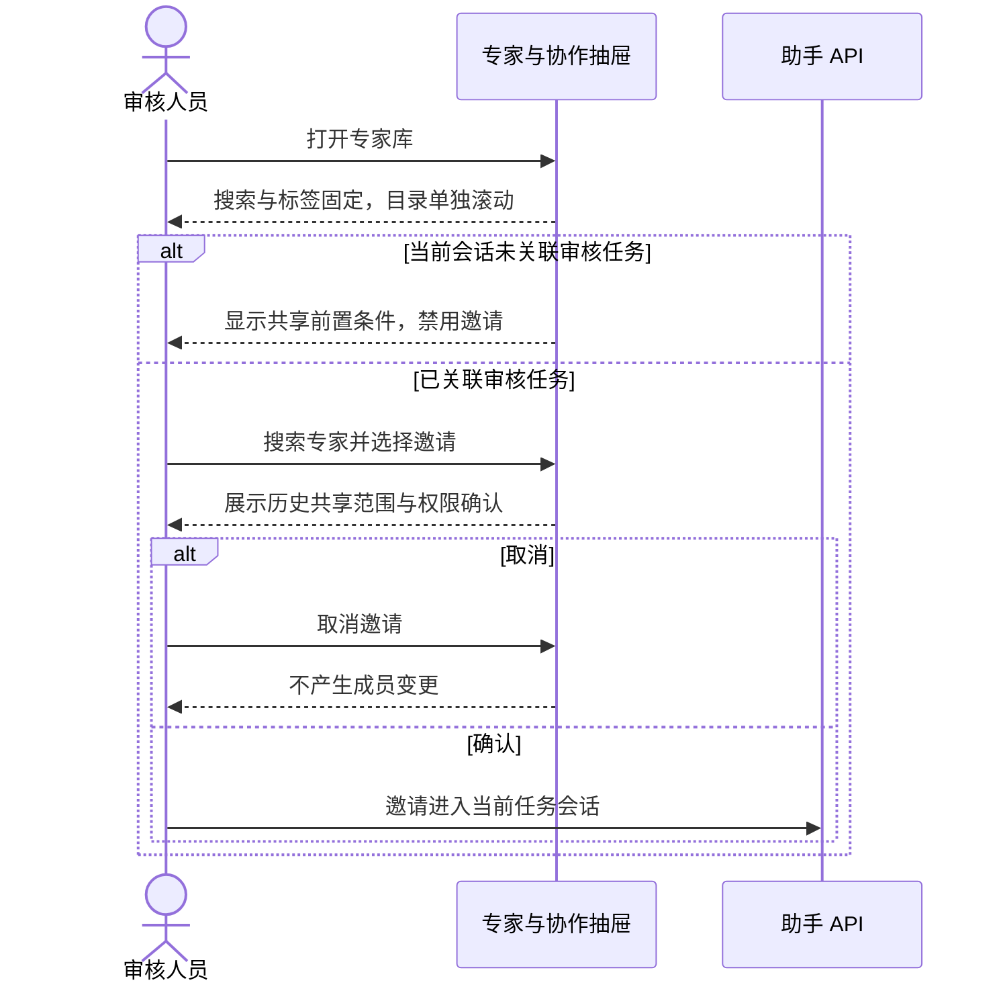

- **实现：**抽屉搜索、标签和底栏固定；专家/成员列表使用独立可聚焦滚动区；底栏留出设备安全区。邀请规则仍要求会话关联任务且本人有管理权限。
- **核心验收：**真实 Ant Design 组件回归 **21/21**（助手页面 13 项、协作组件 8 项）；Vite 生产打包成功。Edge 本地浏览器使用一次性数据库和合成专家目录 **6/6**：390×420 视口列表独立滚动、搜索和资料入口可见、普通会话邀请被禁用、关联合成任务后确认操作可见且取消无成员变更；2 个 AI run 均被本地 409 拦截，模型/RAG 调用 **0**，临时技能已清理。
- **设备测试边界：**浏览器把视口缩到 390×420 模拟软键盘占用空间，不代表真实 iOS/Android 键盘或设备验收。窄屏实际设备、资料编辑弹窗和成员列表长内容仍需后续实机检查。
- **构建边界：**完整 TypeScript 检查仍由助手以外的主站 `DashboardView.tsx` 缺少 `dayjs` 阻断；本轮没有改其页面或全局依赖。
- **下一轮（第 34 轮）优先级：**获得授权预览访问后，对个人技能做汇丰真实模型对照测试；实机检查资料编辑弹窗、成员列表和软键盘；RAG 服务可联调后验证 readiness、检索与引用。主站 `dayjs` 由对应依赖所有者补齐。

## 第 32 轮：技能版本冲突时保住审核员的修改

**真实用户问题：**审核员编辑个人技能期间，另一处已保存了新版本；再次保存会收到 409。旧界面只弹短暂 Toast，表单错误还显示在模态框后面；用户不知道旧 revision 不可重试，也不清楚服务器已有哪些变化。打开后没有编辑就取消，也不应误提示“放弃修改”。

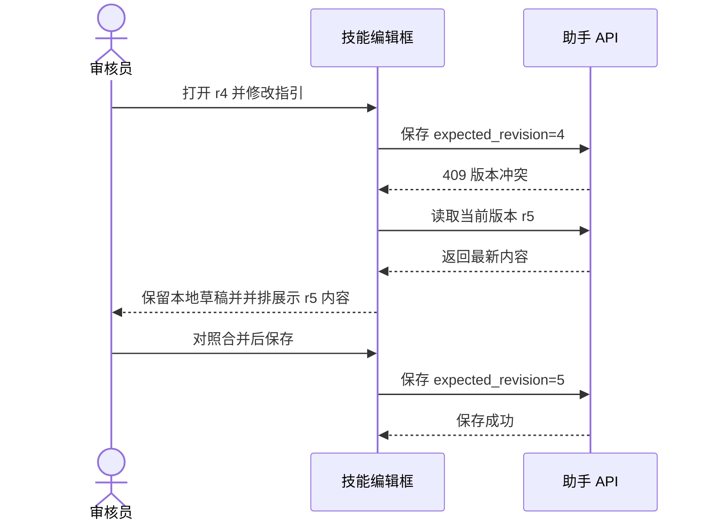

- **实现：**协作 API 错误保留 HTTP 状态；编辑框内显示可读冲突说明和服务端最新 revision/内容，当前输入保持不动；审核员合并后用新 revision 再保存。未修改表单按字段快照判断，避免仅打开后取消也弹丢弃确认。新建技能每次从空值开始。
- **核心验收：**技能库与协作 API 两个完整组件测试文件 **10/10**；覆盖无改动关闭、修改后取消/继续、409 拉新版本、草稿保留及基于新 revision 保存。Vite 生产构建通过；完整类型检查仍被主站 Dashboard 的缺失 `dayjs` 阻断。
- **真实链路限制：**当前本机没有 HSBC/runtime 配置，云端预览也没有配置 SSH alias、授权账号文件或访问 URL；无法用本轮代码做真实 HSBC 技能注入。隔离预览部署的是旧候选包，不会冒充已验收本轮功能。
- **下一轮（第 33 轮）优先级：**在获得获准的预览访问渠道后，对个人技能做汇丰真实模型对照测试；扩展移动端专家抽屉的软键盘/滚动验收；RAG 服务进入可联调环境后实测 readiness、检索和引用。主站 `dayjs` 由对应依赖所有者处理。

## 第 31 轮：切换协作会话时明确消息对象，并适配手机抽屉

**真实用户问题：**审核人员在共享会话选择“发给成员”后，如果直接切换到另一段共享会话，旧模式会残留；用户点发送可能以为在问 AI，实际只发了成员讨论。专家与协作抽屉在手机窄屏也必须留在可视区域内。

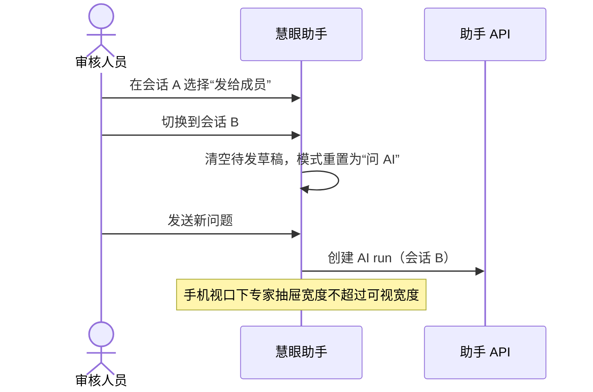

- **实现：**会话/任务上下文切换统一清空旧草稿、撤销待用技能并恢复“问 AI”；保留草稿时先确认。协作抽屉按视口收缩，避免 390px 手机横向越界。
- **核心验收：**助手页面、个人技能、专家协作、状态、API 与 Markdown 共 37 项组件场景通过；草稿/任务切换浏览器回归 4/4、技能/协作浏览器回归 6/6；不发模型/RAG 请求。后端助手 API/协作/readiness/contract 共 64 项通过。Vite build 成功；全站类型检查受非助手 `DashboardView.tsx` 缺少 `dayjs` 阻断。
- **构建限制：**完整 TypeScript 检查仍可能受主站 `DashboardView.tsx` 缺少 `dayjs` 影响；不在助手模块内修改该页面或全站依赖。
- **下一轮（第 32 轮）优先级：**先完成技能指引的汇丰模型真实联测；再复核专家加入后问 AI/发言模式、权限丢失后的历史清理，并检查窄屏键盘/弹层；持续跟踪目标环境 RAG 联合验收。

## 第 30 轮：让审核员能维护并明确使用个人技能

**实际任务：**审核员需要找到适合当前复核的技能，必要时编写自己的检查指引，再明确决定让它参与哪一条 AI 提问。

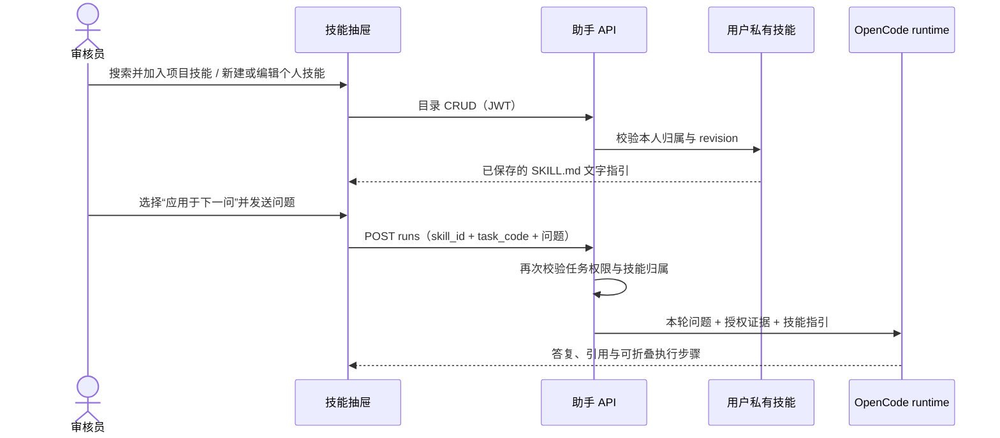

- **实现：**个人技能使用 OpenCode `SKILL.md` 文本格式；增删改查仅属当前审核人员，更新使用 `expected_revision`；项目发布技能仍只读。选择技能不会立即发送，只有下一条 AI run 接收后才消费，不将技能冒充文件上下文。
- **边界：**技能不新增工具、材料访问或审批权限；个人指引只影响本轮提示。用户必须检查结果，审核结论由有权限人员确认。
- **验收：**后端助手 API/协作/预检/契约共 64 项通过，OpenAPI 导出到 1.3.0。助手页面与技能抽屉组件共 15/15、loopback 浏览器 5/5：目录搜索并加入、个人技能新建/读取/编辑/删除、取消删除保留技能、未保存修改保护、390px 抽屉无溢出、选择后 run 请求携带 `skill_id` 且被拒问题保留。浏览器拦截 run 请求，不调用模型或 RAG；真实模型对个人指引的处理仍待联测。
- **资源和范围：**新增助手专属 Alembic 表；不修改 RAG 或主站业务流程。格式来源见 [OpenCode Skills](https://opencode.ai/docs/skills/)；UI 复用 [Ant Design Drawer](https://ant.design/components/drawer/) 和 [Form](https://ant.design/components/form/)。
- **构建：**全站 `npm run build` 仍受既有非助手 `DashboardView.tsx` 缺少 `dayjs` 阻断；本轮只修助手范围并单独运行组件测试。

## 第 29 轮：切换任务前保护未发送草稿

**真实用户问题：**审核员写好一个问题后，点“新建会话”、切换历史或更换审核任务，旧实现会直接清空输入；跨任务时还可能让人误以为问题已经带入新材料上下文。

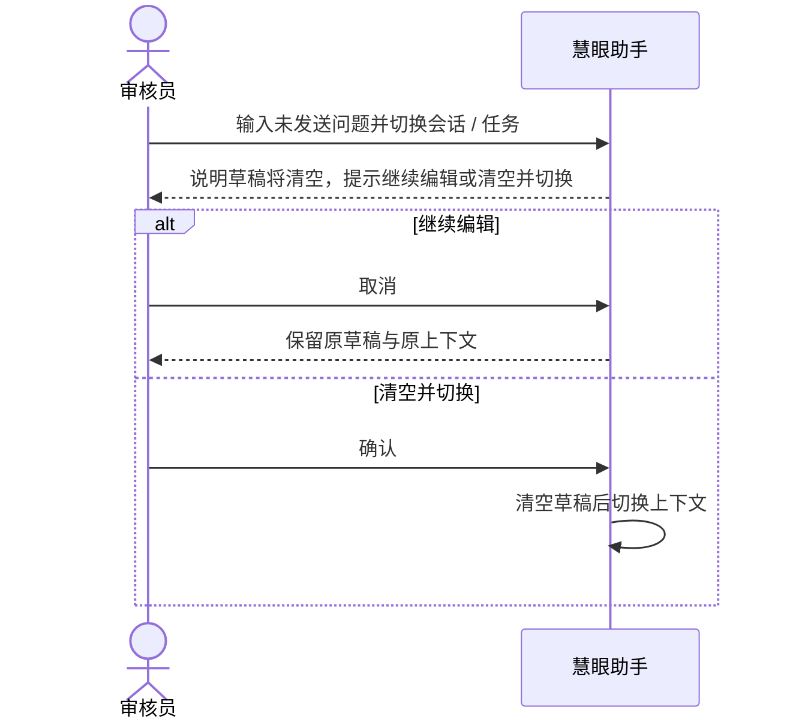

- **实现边界：**只改 `AssistantView.tsx` 的切换入口；无草稿时沿用直接切换。有草稿时取消不动输入/任务/历史，确认后清空并切换；该保护不会创建会话或触发模型请求。
- **核心验收：**助手页面组件回归 **12/12**；真实本地浏览器 **4/4**：新建会话、任务 A→B、跨任务历史、390px 手机弹窗。取消保留原草稿/上下文，确认才清空；无模型请求、无页面异常，合成会话清理成功。详细命令见[核心测试集](核心测试集.md)。
- **构建边界：**生产构建被非助手 `DashboardView.tsx` 的既有 `dayjs` 缺失导入阻断；没有为绕过全站错误改同学页面或全局依赖。助手交互测试通过不等于全站构建已通过。
- **云端边界（只读联调反馈，2026-10-23）：**`lfc-test` 预览的 web/API/runtime 健康检查为 200、runtime 协议为 2 且服务 Active；该部署目录版本标记为 `57563ed`，而本分支基线为 `ceafa40`，交付前须对齐候选版本。部署目录仅有一个 release，`current` 指向 `57563ed`，没有已证实的前一版本可供回滚；停止预览并保留数据不等于验证过版本回滚。预览未配置 RAG URL/token，8011 未监听，因此只能说明助手 API/runtime/模型路径可用，不能宣称助手到 RAG 全链路已验收。

## 第 28 轮验收记录

**第 28 轮：验证助手只接入兼容的 RAG v1.2 服务**

- [x] 对照 RAG 同学当前公开契约，确认增强检索路径、business_rules scope、knowledge_base source、reference purpose 及版本响应头。
- [x] 助手 readiness 和每次 retrieval 都要求 `X-RAG-Contract-Version >= 1.2.0` 且主版本为 1；缺失、非法、旧版本和新主版本不报 ready/不接收证据，并接受未来兼容 v1 次版本。
- [x] 助手后端回归 **91 项通过**；版本覆盖、降级 readiness、业务 API 能力状态均有验证。只改助手适配、助手路由和助手测试，没有改 RAG 源码。
- [ ] 云端真实 RAG 响应头、ready、证据检索和引用仍待双方部署后联合验收。

**当轮验收：** 定向 readiness/adapter 27 项通过；合并全套 CI 后端命令 91/91 通过。首轮全套发现两个旧 mock 未含版本头/诊断字段；更新夹具及兼容读取后重跑通过。默认环境只读预检退出码 1：数据库迁移通过，runtime `contract_missing`、RAG HTTP 404、生产 JWT/DEBUG 未就绪。临时覆盖到验收 runtime 8092 后，数据库和协议 2 runtime ready，模型配置为 qwen3.8-flash；RAG 8011 不可达、生产安全项仍未就绪。所有探测均未发起检索或模型调用。RAG 契约仅从共享工作区只读核对，未启动、变更或打断其服务。

## 下一轮（第 35 轮）优先级

- **P0 · 技能真实模型联测：**在隔离合成任务和授权账号下，使用汇丰模型验证已选个人指引确实进入本轮模型上下文；验证未选择时不带入、拒绝运行后技能不被消费。RAG 不可用时明确标记，不以本地回退冒充知识库回答。
- **P1 · 未保存技能表单：**验证关闭/切换标签前会提示，继续编辑保留内容，确认放弃才清空；验证并发编辑收到 409 后保留本地内容并引导刷新。
- **P1 · 专家抽屉移动端：**本轮已验证 390×420 抽屉与 320×420 资料弹窗；下一步用真实手机/软键盘检查成员列表和各弹窗。
- **P1 · 发布门禁：**`DashboardView.tsx` 缺失 `dayjs` 阻断全站 TypeScript 构建，交给主站依赖所有者补齐后再跑 `npm run build`；助手范围内不改队友页面或全站依赖。
- **联调缺口：**云端助手预览尚未配置可用 RAG 地址；服务进入目标环境后再做真实响应头、ready、证据检索与引用联合验收。
- **验收方式：**新增交互优先用真实 Ant Design 组件和 loopback Playwright 合成夹具验证；模型/RAG 使用独立真实链路验收，资源未就绪时明确标为未验收，不用 mock 代替。

**第 27 轮：把 OpenCode runtime 纳入助手发布门禁**

- [x] 修正 CI 原先只覆盖后端、独立 SDK、React 测试与前端构建，未监听或验证实际 OpenCode runtime 的缺口。
- [x] runtime 变更现在触发工作流；CI 按锁文件安装依赖，并运行 `bun test`、`bun run typecheck`、`bun run build`；Bun 固定 1.4.3，setup-bun 固定官方 v2.2.0 commit。
- [x] 本机助手后端 87 项、Python SDK 8 项、React 30 项、OpenCode runtime 3 项 / 52 断言、前端/runtime 类型检查与构建通过；Actions YAML 解析通过。
- [ ] `origin/lfc` 和 GitHub 默认分支均没有工作流，因此远端 Actions 尚未运行、必需检查尚未设置。目标环境仍需短冒烟，真实 RAG 仍需联合验收。

**当轮验收：** Node v24.19.0 本机执行前端测试与构建，主站入口约 1.82 MB 警告仍存在；后端使用仓库 Python 3.12 venv；Bun 1.4.3 冻结安装、3 项 / 52 断言、严格类型检查及发布构建通过。Bun 二进制来自官方 npm 包，SHA-512 与 registry 元数据一致，只放入系统临时目录。工作流与三份模块文档已更新；CI 的 Ubuntu runner 结果仍待工作流发布后确认。

**第 26 轮：严格处理 RAG 查询长度边界**

- [x] 对齐助手 8,000 字符输入与 RAG 4,000 字符检索上限；超长问题不静默截断、不发送无效请求，显示明确的知识检索限制并保留已授权任务材料。
- [x] RAG 适配器 12 项与助手后端回归 87 项通过；SDK 8 项、前端 30 项和生产构建沿用上一轮已通过的结果，本轮没有改动其源码。
- [ ] 真实 RAG 请求仍需等该模块服务进入可联测环境。

**当轮执行记录：** 2026-10-22，超长问题集成测试确认不发 RAG 请求、保留任务证据并向用户显示明确限制；恰好 4,000 字符的问题会完整发送。助手后端 87/87 通过；助手安装清单 pip dry-run 通过。CI 工作流尚未由远端 GitHub 执行，不能以本机契约测试描述为真实 RAG 联通。

**第 25 轮：助手接入增强 RAG 契约（代码完成，真实服务待验收）**

- [x] 只改助手专属适配器，按 RAG v1.2 `/retrievals` 请求 `business_rules`、`knowledge_base` 和 `reference`；不改 RAG 引擎/共享适配器，不把任务材料交给共享服务。
- [x] 校验来源范围和结构，保留原文片段、chunk/document/page/score；把 insufficient、clarification 和 missing 转为回答限制，候选本身不当作最终审核结论。
- [x] 对齐最长时限：RAG 请求 300 秒（服务预算 240 秒）、整体运行 360 秒、run 到期 390 秒、UI/SDK 等待 400 秒；旧共享 RAG 适配器仍保留自身较短时限。
- [x] 本机回归通过：后端 84 项、独立 SDK 8 项、前端 30 项、TypeScript 检查和 Vite 生产构建；新增按助手相关路径触发的 GitHub Actions 检查。
- [ ] 真实云端 RAG 服务/引用联测仍未通过；本机契约测试和 CI 不代表 RAG 已联通。

**当轮执行记录：** 2026-10-22，Windows 本机后端 84/84、SDK 8/8、前端 30/30、生产构建通过。构建仍报告主站入口 chunk 约 1.82 MB；本轮未改其他页面拆包。此前直接用系统 Python/命令行 npm 的尝试因环境未配置失败，随后改用仓库 `.venv` 与已安装的 Node 运行时完成验证。CI 工作流尚未由远端 GitHub 执行；也不能以 API mock 或本机测试描述为真实 RAG 联通。

**第 24 轮：云端双浏览器页面验收（通过）**

- [x] 复核预览入口可访问；保持主站与 RAG 同学改动的边界。
- [x] 新增显式运行的 Playwright 页面验收脚本：两个独立登录上下文、真实发送、专家搜索/共享确认、历史与具名讨论同步、撤权清空及 API 拒绝，最后删除临时会话。
- [x] 云端隔离预览真实页面通过 Edge 两个独立浏览器上下文：审核账号发送汇丰真实回答及任务引用、完成后轨迹折叠；专家搜索与确认邀请后可读相同历史并发送具名讨论；撤权后页面清空且读取 API 返回 404。退出码 0、无未捕获页面错误、临时会话删除成功；无凭证/浏览器状态/trace 输出。
- [x] 修正本文件顶部仍称“未部署助手”的过时状态；第 22 轮保留为当时记录，当前部署以第 23/24 轮为准。

本轮测试脚本与锁文件见[隔离预览说明](../../code/assistant-runtime/deploy/preview/README.md#可复用的双浏览器页面验收)。真实检索、正式主站、目标 PostgreSQL 与多机访问仍未验收。

**第 22 轮：固定版本交付与云站发布前核对**

- [x] 再次通过固定指纹 SSH 只读核对现有 ECS：Ubuntu 24.04.5，仅 80/8000；无助手前端/V1/runtime/助手表，无 backend `.env` 和 DB/JWT/assistant 进程变量。没有上传、迁移、安装或切换远端服务。
- [x] 由已提交源码 **57563ed** 生成候选包 **8,121,932 bytes**，155 个源码/构建文件和交付说明/逐文件 SHA-256 清单；包含当前前端静态构建，不含 `.env`、业务库、uploads、RAG 实现/数据、node_modules 或 Windows runtime dist。配置中实际密钥值扫描未命中。
- [x] TypeScript/Vite 构建通过（保留主站大 chunk 告警）；Bun 1.4.3 类型检查、构建及 **3 项 / 52 断言**通过。Windows runtime 只作为本机验证，目标 Linux 按锁文件重新构建。
- [x] 将候选包解到独立临时目录，直接运行归档内 API/契约 **28 项**、SDK **8 项**回归通过；验证目录已删除。不是只测试工作区，也不等于目标 Linux/云站部署验收。
- [x] 用户确认可以先部署独立云端预览，正式版本通过仓库提交并统一发布；预览未切换主站。正式主站仍须交接 DB 绝对位置、JWT、安全配置与回滚归属；真实 RAG 地址/授权就绪及联合验收仍待模块部署。

候选包：`huiyan-assistant-57563ed.tar.gz`；SHA-256 为 `b1529ef07bb7f9d385c06aebcf0a1e733963ccff6db6b862181df26937fb2d8b`。交付范围及切换前清单见[发布说明](../../code/assistant-runtime/deploy/README.md#6-候选交付与切换前交接)。第 22 轮生成包时尚未上传；第 23 轮已上传云端隔离预览并核对哈希，未提交二进制；源码在仓库按固定 commit 获取。

**第 21 轮：恢复可演示的正式本机入口**

- [x] 只读复核：8000、8002 仍是没有 V1 的旧 API；8010 无 RAG ready，8011 未监听；默认 runtime 就绪接口 404，而 8092 已通过协议 2 与鉴权检查。不将旧进程存活视为当前模块可用。
- [x] 保留旧服务，启动当前源码主后端 **8003**（单 worker、进程环境 `ASSISTANT_RUNTIME_URL=http://127.0.0.1:8092`、`DEBUG=false`）；启动 React/Vite **5173**，进程环境 `HBCN_API_TARGET=http://127.0.0.1:8003`。未改共享 `.env`、未执行 seed 或助手迁移；既有本机库只读预检已通过。
- [x] 经正式前端代理登录既有种子审核账号 → V1/独立 SDK → 汇丰真实 **qwen3.8-flash**，约 **14.2 秒**完成两句能力说明；最终正文无内部过程片段，同键返回同一 run，保存游标后恢复权威结果通过。验收临时会话已删除，页面入口继续运行。
- [x] 同步[部署说明中的本机实例](../../code/assistant-runtime/deploy/README.md#当前本机实例2026-10-22)；服务地址为本机临时进程覆盖，其他电脑仍须填各自批准配置，不能照抄成生产地址。
- [ ] 真实 RAG 未就绪（本次 `rag_available=false`），云端部署会话无新发布交接；目标 RAG/云站联合验收仍未完成。本轮只验证 HTTP 与真实模型，不宣称重新完成双浏览器或负载验收。

**第 20 轮：模块交付与固定调用入口**

- [x] 复核既有独立 SDK、V1 API 与 OpenAPI 基线；保持契约 **1.2.0**、SDK **1.1.2**，不重复造框架。
- [x] 新增[模块接入清单](模块接入.md)：架构/时序、按场景接口、调用方保存的四项标识、权限/兼容边界及未提供能力。
- [x] 增加独立 `create / ask / resume` 调用示例；先返回运行 ID，再等待，支持只读取恢复；凭证由环境变量提供，不打印上游错误正文。
- [x] 既有助手 API/契约 **28 项**、独立 SDK **8 项**通过；另起临时本机 TCP API，以独立 Python 子进程运行示例，创建/提问/恢复、同键仅一次模型执行、权威消息一致、无效 JWT 401、缺配置退出码 1 和无凭证输出通过。测试库为隔离合成 SQLite、模型为 mock；临时监听已关闭，不代表云端或真实 RAG 验收。
- [x] 对外版本与 OpenAPI 不变，无需调用方迁移；本轮不改前端、RAG、主站业务流程或云站。上轮构建结果仍见总规划，本轮未重跑无变更前端。

**第 19 轮：真实 PostgreSQL 部署回归（本机通过）**

- [x] 临时本机 WSL/Linux PostgreSQL **18.3**、随机助手验收 schema、合成业务数据；不改汇丰数据库/主站/RAG。
- [x] 首次及重复助手迁移、业务数据/结构保留、4 个独立连接同键并发准入、单运行槽、双 JWT 协作/持久结果/撤权通过。固定 PG 会话时区 **Asia/Shanghai**，验证 UTC 与 300 秒过期时间。
- [x] 修复真实 PG 暴露的两个问题：查重与运行槽查询间的同键竞态误报 409；aware datetime 写入无时区列被 PG 会话时区偏移 8 小时。使用 SQLAlchemy TypeDecorator，仅适配助手时间字段，物理列结构与业务字段不变。
- [x] 后端 **90 项**、SDK **8 项**通过；真实 PG 验收模型为 mock/业务 API 为 ASGI。另以临时 SQLite + 汇丰真实 qwen3.8-flash 约 **10.1 秒**验证协作/字段/引用/恢复，明确不是“真实 PG + 汇丰 + 云站”联合验收。
- [x] 交付显式 PostgreSQL 验收命令和随机 schema 自动清理；已确认测试 schema 清空，临时 PG 已停止且文件已删除；临时库主应用启动和 /docs 通过。本轮不改前端、runtime 或对外 V1 契约。
- [ ] 汇丰云站发布、目标数据库/真实 RAG 联合验收仍待推进；历史 PG 时间如已由旧代码偏移，须按原会话时区人工审计，不猜测批量修复。

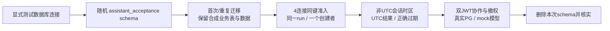

**第 18 轮：真实专家搜索与本人资料（本机通过）**

- [x] 专家目录使用已有服务端 q 搜索，输入节流并丢弃过期响应；明确最多 50 位，搜索结果可包含默认首屏之外人员。
- [x] 本人资料独立读取，编辑不依赖当前搜索结果；读取失败不打开空表单，保存失败保留编辑；切换会话后旧邀请确认不执行，旧响应不污染新会话。
- [x] V1 兼容新增 GET /experts/me，契约 **1.2.0**；OpenAPI **18 路径 / 23 操作**，无既有字段或请求变更。SDK **1.1.2** 显式 contract 检查最低 1.1.0 并接受同主版本扩展。
- [x] 后端 **87 项**、SDK **8 项**通过；React 全套 **29 项**通过后补一项会话切换回归，最终协作文件 **8 项**复测通过（合计 **30 项分批通过**）；TypeScript/Vite 生产构建通过，主站大 chunk 告警保留。
- [x] 汇丰真实 qwen3.8-flash 约 **17.9 秒**通过 V1/SDK、任务字段与引用、同历史/事件、幂等、恢复与撤权；临时合成业务库/ASGI + 真实模型 HTTP，不是浏览器/云端验收。
- [x] 复核修复上一轮兼容 SSE 漏发 completed run_end 的问题；直连客户端现在收到 message_end 后一个完成终态，数据库不重复落事件，故障测试同步验证。
- [ ] RAG 最新只读复核仍是配置地址 ready 404、8011 不可达；云站交接仍待提供，不改其他模块。

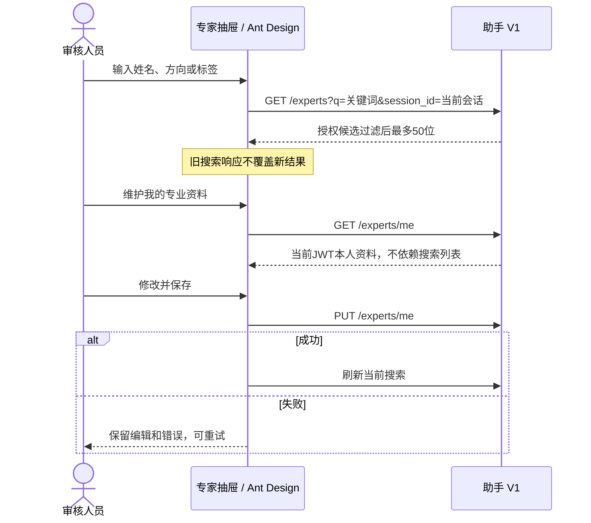

**第 17 轮：完成结果原子提交（本机通过）**

- [x] 最终消息、作者、完成事件、运行终态及运行槽释放在同一事务提交；V1 不变，不重复写成功终态。
- [x] 新增 **3 项**真实数据库/API 测试，覆盖正式 runs 与兼容 SSE：检查每次提交时的完成一致性，并注入 message_end、run_end 写入失败和最终 commit 失败。失败回滚答案/成功事件，保留用户提问，运行 error 并释放槽。
- [x] 后端 **86 项**、SDK **7 项**通过；汇丰真实 qwen3.8-flash 约 **14.3 秒**通过任务字段/引用、单人转共享同次运行、历史/事件一致、幂等、保存游标恢复和撤权。模型为真实 HTTP，业务 API 使用临时合成库/ASGI，不是云站或浏览器验收。
- [x] 同步总规划及接口恢复说明；临时库主应用启动、/docs 和 V1 OpenAPI 检查通过；直接 Node 执行 tsc/Vite 构建通过，保留主站大 chunk 告警。未改前端、RAG、数据库结构或云站。

```mermaid
sequenceDiagram
  participant M as 模型
  participant A as 助手运行
  participant D as 助手数据库
  participant C as 页面 / SDK
  M-->>A: 校验后的最终答复
  A->>D: 同一事务：消息+作者+完成事件+终态+释放槽
  alt 提交成功
    D-->>A: commit
    A-->>C: 历史 / events / run 查询一致
  else 事件写入或提交失败
    A->>D: rollback；记录 error 并释放槽
    A-->>C: 运行失败，无已完成答案，不自动重跑
  end
```

**第 16 轮：真实 HTTP 部署验收（本机通过，云站待发布）**

- [x] SDK **1.1.1** 交付可对网站地址运行的双 JWT 验收命令；只新增临时助手会话，不写任务、账号、专家资料；对外契约保持 **1.1.0**。
- [x] 检查 V1/运行就绪、未邀请隔离、同历史/答案、引用、幂等/游标恢复、撤权和清理；失败退出非零，只输出安全阶段名。
- [x] 本机临时合成 API 经真实 TCP + 汇丰模型约 **12.6 秒**通过；临时会话已清理、临时 API 已停止。不是云端或浏览器验收。
- [x] 后端 **83 项**、独立 SDK **7 项**通过；实际 CLI 的 `--require-rag` 在未就绪时先于写入/模型调用失败，退出码和无凭证输出验证通过。
- [ ] 真实 RAG 与云站仍待发布/就绪；`rag_available=false` 明示，不因问答成功而宣称知识库已联通。本轮未改前端和 runtime 实现。

**第 15 轮：审核知识范围接线（助手侧验证通过，真实 RAG 待就绪）**

- [x] 助手通过 HTTPX 调用 RAG 现有 `/api/v1/query`，固定 business_rules；不混入项目设计，不发送 task_code/用户 JWT 到共享知识接口。
- [x] 校验响应 scope、片段结构与 metadata.scope；范围不符或异常时拒绝外部证据，显示依据限制并保留任务证据；总候选限制 6 条，超额显示限制。
- [x] 后端 **81 项**通过，含新增 **6 项**请求/鉴权/范围/异常测试；`test_rag_service.py` 仅调整两处助手调用 mock，RAG/shared adapter 实现未改。
- [x] 汇丰真实模型隔离验收约 **10.7 秒**通过：仅授权任务证据、具名协作、引用、SDK/游标恢复与撤权。不是知识库检索成功验收。
- [ ] 只读复核：8010 的授权 ready 返回 404，8011 当前不可达。待 RAG 模块启动/发布现有服务后，复验真实业务规则检索、引用与 capabilities；不代启/覆盖该模块。
- 本轮未改前端、SDK 或 runtime，沿用前轮相应验收记录；V1 外部协议不变。

**第 14 轮：调用方可直接取回运行结果（本机验收通过）**

- [x] 新增 `GET /sessions/{id}/runs/{run_id}`，复用会话权限并验证运行归属；仅 completed 返回最终消息，其他状态不暴露中间结果，不调用模型。
- [x] SDK 新增 `run`；`wait` 在保存游标越过最终消息/只读到完成事件时读取持久结果，缺失结果明确失败，不误报完成或重新提问。
- [x] 覆盖完成/运行中/失败/取消、跨会话及撤权；修正 SQLite 时区丢失造成的事件/历史时间格式差异，最终消息统一 DTO/UTC。
- [x] 兼容扩展为 **1.1.0**，同一 V1 前缀；OpenAPI 增至 **18 路径 / 22 操作**。后端 **75 项**、SDK **7 项**通过；汇丰真实 **qwen3.8-flash** 约 **18.6 秒**验证按 run 取回同一答案及越过完成事件后的游标恢复。
- [x] 同步接入文档、总规划；本轮未改前端，沿用上一轮 **26 项 + 构建**记录，不重报为本轮浏览器/云端验收。
- 边界：仅增加兼容接口；不改任务审批、RAG、数据库结构或云端部署。

**第 13 轮：发布可接入的助手 V1（仓库接入基线通过）**

- [x] 固定 `/api/assistant/v1`，旧路径兼容；鉴权、任务权限和业务实现共用一份，不复制业务服务；正式前端已用 V1。
- [x] 独立可安装 `code/assistant-sdk`，仅依赖 HTTPX，不依赖 FastAPI/ORM/OpenCode；干净虚拟环境 wheel 安装/导入通过。
- [x] `GET /contract` 声明 1.0.0；交付 **17 路径 / 21 操作** OpenAPI 基线、最小调用示例及错误/幂等/取消说明；新增契约测试，变更须先评审再更新基线。
- [x] 后端 **73 项**、SDK **4 项**、前端 **26 项**与生产构建通过；V1/旧入口同权限/数据，安装后的 SDK 经真实 ASGI 路由验证幂等/回放。
- [x] 主应用使用临时数据库启动，`/docs` 与新旧助手 OpenAPI 路径均通过；未使用或修改实际业务库。
- [x] 汇丰 **qwen3.8-flash** 经 V1 的真实问答与独立 SDK 幂等回放约 **25.2 秒**通过；临时合成库、业务 API 使用 ASGITransport，模型为真实 HTTP。未改云端或 RAG；总规划和决策已同步。
- 边界：业务模块可独立调用，不等同于拆分业务库/认证；不修改专项审核、RAG 或云端部署。
- 接入同学只需看[对外接口 V1](对外接口V1.md)，不依赖本修改历史；云端调用前仍需发布该版本。

**第 12 轮：统一可恢复运行（本机验证通过）**

- [x] 单人/多人页面统一复用已有 runs/events 接口；刷新、离开页面不取消后台 AI，不新增模型调用。
- [x] 主动停止才发取消请求；恢复中的单人会话同步公开轨迹和最终答复，已有运行时阻止重复提问；服务器拒绝接收时保留草稿，回放期间完成的答复采用服务端最终消息。
- [x] 前端 **26 项**测试和生产构建通过，后端协作 **20 项**通过。隔离库 + 汇丰真实 **qwen3.8-flash** 约 **21.1 秒**通过：单人后台运行、重新打开、邀请后同次运行、同历史/事件、字段/引用、幂等与撤权。
- [x] 同步总规划和决策记录。以上页面行为由组件/状态测试验证；真实模型走 HTTP、业务 API 走 ASGITransport，不报成新双浏览器或云端验收。
- 边界：保留既有 SSE 接口供兼容客户端使用；不改 RAG、模型实现或主站部署。

```mermaid
sequenceDiagram
  actor R as 审核人员
  participant UI as React 助手
  participant API as 助手 API
  participant AI as OpenCode / 汇丰
  R->>UI: 单人或多人会话提问
  UI->>API: 创建运行（幂等键）
  API-->>UI: 同一次运行 ID
  API->>AI: 后台执行
  R->>UI: 刷新 / 离开
  Note over API,AI: 读取连接关闭，后台运行继续
  R->>UI: 重新选择原会话
  UI->>API: 读取历史、运行及事件游标
  API-->>UI: 公开轨迹或最终答复，不重新调用模型
  opt 主动停止
    UI->>API: 取消指定运行
    API->>AI: 中断执行
  end
```

**第 11 轮：对齐审核人员角色边界**

- [x] 按用户业务要求收束助手：经办人提交材料，审核人员与 AI/受邀审核专家讨论；助手页面与全部 API 统一要求 reviewer。只改助手入口与鉴权接线，不改主站提交/审核流程或 RAG。
- [x] 顶栏隐藏经办人入口；直接访问助手页回工作台；直接调用助手/技能/协作/运行 API 返回 403，不调用模型。
- [x] 私有和共享运行持续复核真实账号角色；角色降级后不发出或保存完整答复，运行槽释放；历史数据保留。
- [x] 最终回归：后端助手 **60 项**与 RAG 客户端 **9 项**合计 **69 项**通过；前端 **21 项**与生产构建通过。包含生成中角色撤销测试；主站大 chunk 警告仍存在，未扩展改其他模块包体。
- [ ] 云端发布、配置交接和目标机双账号验收仍待完成；本轮本机测试不替代该验收。

云主站只读复核（2026-10-22）：网站已运行，但前端为 Vite dev、后端为 root 登录会话进程；没有生产 release、助手前端/API、runtime 或表；backend `.env` 与 DB/JWT 进程配置缺失，Python 环境未装 Alembic/HTTPX。Linux runtime 发布模板用于后续部署助手，不要求重装现有主站。以[部署文档的实机记录](../../code/assistant-runtime/deploy/README.md)为准。尚待站点负责人提供配置/进程发布交接；本机助手验收不能替代云端部署。

**第 8 轮交付：对齐现有云主站的部署接线**

- [x] runtime /readyz 明示助手内部协议 2；旧进程即便返回 ready，也不能通过当前后端验收。
- [x] AI 调用先校验协议与授权再检索；版本、地址或鉴权失败给出可操作提示，未通过不检索/调用模型，不输出私密配置。
- [x] 对齐配置模板占位说明，补 Windows / Linux 启动路径及端口关系图；不替同学改 .env。
- [x] 后端 **56 项**、Windows/Linux runtime 各 **3 项 / 52 断言**通过；前端类型检查/构建通过。旧实例被拒绝、新实例就绪与汇丰真实问答复测通过，约 **21.7 秒**。
- [x] 按用户指定只读查看现有汇丰云环境：Ubuntu 24.04，80 是 Vite 开发服务器（无助手路由/Ant Design X/静态 dist），8000 是从 root 登录 shell 启动的 FastAPI（OpenAPI 无助手路由），助手 runtime/表也未部署；backend `.env` 和 DB/JWT 进程配置缺失，Python 环境未装 Alembic/HTTPX。业务库已有 review_comment/supplement_note；未改远端文件、配置、进程或数据。Linux 包只提供助手 runtime 部署模板，不是网站重装包。
- [x] 补齐仅有业务表时的助手首次迁移；临时业务库迁移两次通过，哨兵用户和业务表结构保留，不依赖应用启动 create_all。
- [x] 交接文档收束为当前三份文档的入口，移除与 React/多人接口现状冲突的 Vue/旧接口部署说明。
- [ ] 由现有主站发布流程切入助手固定 release，备份业务库并执行助手迁移；云端双账号/真实模型/引用/撤权验收，非本机替代。

**第 9 轮交付：登录错误诊断与回归稳定性**

- [x] 交接入口移除过时 Vue/私聊接口部署说明；当前实现、轮次和决策分别指向总规划、修改规划和决策记录。
- [x] 业务 API 返回 401 时前端清除失效 JWT 并要求重新登录；该凭证不是 HSBC 模型 API key 或 runtime token。补入总规划，帮助演示时区分凭证类型。
- [x] 实际 Ant Design X 交互全套 **20/20** 通过；并行运行曾触发 30 秒单测超时，隔离重跑通过后将 Vitest 限时调至 60 秒。前端生产构建通过，助手 view 独立分包；后端 **56 项**通过。
- [x] 对齐助手 RAG 示例地址与当前验收服务：由过时 8010 改为 8011；只改示例配置和助手文档，不改个人 `.env` 或 RAG 模块。只读探测确认本机 8010 仍是旧接口且没有 `/api/v1/ready`，8011 当前未监听。
- [ ] 本机 `assistant_preflight --require-rag` 未通过：仓库数据库迁移检查通过，默认 runtime 不满足 protocol 2；本机 `.env` 仍指向旧 8010，目标 8011 未启动，系统 Python 不含 Alembic。需由 RAG 模块按其流程启动/发布后复验，不把本机状态说成云端状态。

**第 10 轮交付：云端预检与凭证安全门槛**

- [x] 助手预检增加 `--production`：只读校验 JWT 不为弱/默认值且 `DEBUG=false`；普通开发预检不被阻断，但明确报告 production_ready。报告不含 secret 内容。
- [x] 对齐 RAG 验收端口 8011；助手示例配置与发布文档不再默认连接旧 8010；个人 `.env` 与 RAG 模块未改。
- [x] 后端助手全套 **58 项**、RAG 适配/预检 **18 项**通过；预检专用新增覆盖生产模式拒绝弱密钥/DEBUG 与接受合规设置。
- [ ] 当前本机生产预检明确未就绪：数据库迁移通过；JWT 为默认值且 DEBUG 开启；runtime `/readyz` 缺失；旧 RAG 8010 的 `/api/v1/ready` 返回 404、8011 未监听。需安全注入生产配置并对齐服务版本后复验；这不代表云端运行配置已确认相同。
- [ ] 汇丰云端仍未部署助手：须由主站负责人提供 DB/JWT 与进程发布/回滚交接，再做目标机生产预检和双账号验收。

**第 7 轮交付：依据与回答一致性**

- [x] 中文自然提问仍提供获准任务概要、材料字段与规则结果；不因关键词未命中丢失任务上下文。
- [x] 每轮编号仅对应 runtime 收到的证据；引用列表只收答复正文实际引用，不把专家资料或所有检索候选显示成依据。
- [x] 未读取/不存在的引用拦截完整答复；检索、截断和未标注依据提示持久化，折叠轨迹后仍可见。
- [x] 明确编号校验仅证明来源可追溯；后端、前端、runtime 回归和文档同步。真实汇丰任务问答及多人 API 复测通过。

**第 6 轮交付：**

- [x] runtime 与 RAG 鉴权就绪探针：令牌不匹配不能显示就绪；探针不消耗模型请求。
- [x] 只读部署预检：现有数据库/助手迁移与约束、内部服务授权；报错不输出密钥或连接串。
- [x] Linux 发布验证：Ubuntu/WSL2，固定 Bun 1.4.3，锁文件安装、类型检查、源码/发布包与构建全部通过；systemd 模板离线校验通过，未安装服务。
- [x] 回归、部署说明与总规划同步；正式比赛 ECS/团队电脑仍单独验收。

- [x] 正式 React 页面：专家搜索、介绍、邀请、成员撤销、具名发言；无模拟身份选择器。
- [x] 多人 API：独立 JWT 账号读取同一历史、成员消息及公开 AI 事件（隔离测试库验证；模型 mock）。
- [x] 服务端：成员权限与原有任务授权同时检查；邀请不授予审批权。
- [x] 运行可靠性：每会话单个 AI 运行、请求幂等、持久游标、协作读连接断开不重复调用模型。
- [x] 技能库与业务 SDK：审核发布目录、个人加入/移除/版本提示，委托 JWT 的 AssistantClient。
- [x] 自测：后端权限/撤权/并发/重试回归，React 交互测试，类型检查及构建。
- [x] 文档：事实同步总规划；部署限制和待申请资源单列。
- [x] 本机双浏览器身份验收：两个独立来源/登录账号，真实前端 HTTP 与汇丰模型；邀请、历史、具名讨论、AI 回答、撤权清屏通过。
- [ ] 两台团队电脑/正式账号、汇丰 ECS/PostgreSQL 环境验收。

## 分轮推进

| 轮次 | 工作 | 验收 |
|---|---|---|
| 1 · 协作底座 | 新增助手专属成员、作者、运行、事件、审计表；兼容旧会话 | 未邀请不可读；撤权后不可读；旧数据可继续使用 |
| 2 · 正式体验 | 复用 Ant Design X 消息/输入/轨迹，Ant Design Drawer/List/Modal 管理专家和成员 | 两个真实账号共用上下文；成员讨论可不触发 AI |
| 3 · 稳定性 | 幂等运行、单会话并发保护、事件回放、异常/取消 | 重试不重复扣模型调用；失败恢复可发送；轨迹只呈现公开事件 |
| 4 · 扩展与部署 | 技能治理、受控服务身份、真实增量评估、部署/性能与演示验收 | 逐项实测后勾选；资源不足明确提出，不静默降级 |

```mermaid
flowchart LR
  A[审核人员] --> UI[React · Ant Design X]
  B[受邀专家] --> UI
  UI -->|JWT| API[FastAPI 助手边界]
  API --> ACL[会话成员 AND 现有任务授权]
  ACL --> DB[(成员 / 具名消息 / 运行 / 事件 / 审计)]
  API --> RT[现有 OpenCode SDK runtime]
  RT --> HSBC[汇丰模型 API]
  RT --> TOOL[只读本轮证据]
  TOOL -->|编号 E1 / E2| RT
  RT -->|正文标出的编号| API
  API -->|仅匹配来源| UI
  API --> RAG[现有 RAG 接口 · 不改其实现]
```

```mermaid
sequenceDiagram
  actor R as 审核人员
  actor E as 受邀专家
  participant API as 助手 API
  participant DB as 权威记录
  participant AI as OpenCode / 汇丰
  R->>API: 邀请专家
  API->>DB: 校验双重权限，保存成员和审计
  E->>API: 获取授权历史和事件游标
  R->>API: 发起 AI 运行（幂等键）
  API->>DB: 占用会话运行槽
  API->>AI: 授权上下文
  AI->>AI: 只读工具取得本轮材料与编号
  AI-->>API: 正文 + 本轮引用编号
  API->>API: 校验编号，只公开被引用来源
  API-->>R: 若证据未标注或被截断，显示依据限制
  API->>DB: 先保存事件，再供双方读取
  E->>API: 续读事件；发讨论消息
  API-->>E: 同一对话，无重复模型调用
```

## 已核对的取舍

- 上游组件继续用 [Ant Design X](https://github.com/ant-design/x)；成员/邀请借鉴 [LibreChat ACL](https://www.librechat.ai/docs/features/access_control) 的资源权限思路。只写本项目业务适配，不部署第二套认证或聊天系统。
- 模型执行继续用 [OpenCode](https://github.com/anomalyco/opencode)；锁定版本先通过现有回归，不为“最新”盲目升级。
- 当前主站任务权限是角色规则，尚无独立细粒度任务 ACL。助手必须复用并如实说明这一边界，不能声称完成了全平台 ACL。
- 新表独立，避免改队友现有任务表/RAG；旧会话默认私有，协作只向同样有任务访问权的审核人员开放。
- 先用数据库事件和有游标的增量读取完成可恢复协作；不用 CRDT 修改聊天历史。多实例/持久队列上线前单独验收。
- 正文目前是完整答复后分段回显。真实 token 流必须先核对 SDK 的事件与输出安全，不能把动画叫作真实推理。

## 每轮完成记录

**最新结论（2026-10-22）：** 第 9 轮已部署云端隔离预览，第 24 轮通过真实双浏览器页面协作验收；正式主站未切换，真实 RAG 仍未就绪。下表保留各轮当时的边界，以本段和[总规划](README.md)判断当前状态。

| 轮次 | 审阅、测试结果 | 剩余项 |
|---|---|---|
| 1 · 协作底座 | 新增 7 张助手表，成员/任务双重授权、撤权/停用、旧会话兼容；独立 Alembic 增量迁移重复运行通过 | 业务任务 ACL 仍沿用主站 |
| 2 · 正式体验 | React 专家/成员抽屉、邀请确认、具名讨论、问 AI/发给成员、技能个人库；本机页面已检查目录、技能加入、折叠轨迹 | 尚未进行两台团队电脑的浏览器验收 |
| 3 · 可靠性 | 幂等、单运行、事件回放、超时/取消、作者防伪和隔离；最终后端 33 项、前端 17 项通过；runtime 2 项/18 断言通过；两端类型检查及前端构建通过 | 主站大包告警仍存在，助手为独立懒加载 chunk |
| 4 · 模型与部署 | 汇丰真实问答约 11.6 / 16 秒；隔离双 JWT + 真实模型协作验收约 12.9 秒；本机迁移成功 | ECS、真实 PostgreSQL、压力测试未验收 |
| 审核修正 | 排除工具前言/reasoning；两句话不重复提醒；降权隐藏共享目录；讨论防重复点击；预检查已停止时不启动模型；补齐 OpenAPI 响应契约 | 相关回归通过；本轮实现事实已同步总规划 |
| 5 · 真实页面回归 | 修复任务首问 SSE 的数据库生命周期、撤权目录先刷新时残留历史、详情权限滞后；取消后禁止提交完整答复；识别“具备相应权限”提醒 | 后端 **35**、前端 **19** 项通过；类型检查及生产构建通过 |
| 5 · 发布与协作验收 | runtime 源码/无源码无 node_modules 的隔离发布包均通过工具/权限/输出测试，连同单测共 **3 项 / 32 断言**；真实双 JWT API 约 **15.4 秒**通过；双浏览器 UI 全链路通过 | Windows 发布包已测；Linux 容器/ECS、真实 PostgreSQL、团队跨电脑未测 |
| 6 · 部署交付 | 新增鉴权就绪、只读预检、systemd 模板和 Linux 隔离验收脚本；后端 **43** 项通过，前端 **19** 项既有回归通过且本轮重新构建通过；Windows/Linux runtime 各 **3 项 / 42 断言**通过 | 本机普通问答预检通过；要求 RAG 资源就绪时未通过，不改 RAG 同学代码 |
| 6 · 实际调用 | 新探针正确令牌就绪、错误令牌拒绝；汇丰 qwen3.8-flash 真实多人 API 协作复测约 **26.3 秒**通过 | Linux 测试模型为本机 mock，不能把它称为 Linux 上汇丰真实调用 |
| 7 · 引用与上下文 | 后端 **51 项**通过；React **20 项分批通过**，7 项页面交互完整复测通过；类型检查/生产构建通过；Linux runtime 源码/独立发布包 **3 项 / 44 断言**通过。确认中文任务字段、编号和来源的绑定；未知引用拦截、截断提示及专家计数排除均有回归 | 全套前端曾有单项 30 秒超时；单项与整文件复测通过，保留记录，不提高产品超时。真实模型单独复测 |
| 7 · 汇丰真实复测 | 最新 runtime + qwen3.8-flash，隔离合成任务与双 JWT；任务 USD / 100 正确进入答复、正文编号指向任务概要、共同历史/事件、幂等及撤权验收通过，约 **28.3 秒** | 默认环境指向其他旧 runtime，就绪检查未通过；本次显式使用验收实例 8092。不能据此宣称默认环境或 ECS 已验收 |
| 8 · 版本与首次安装 | 协议 2 双向检查，调用前阻断旧进程；补齐只有业务表时的助手首次迁移。后端 **56** 项通过，Windows/Linux runtime 各 **3 项 / 52 断言**通过，前端构建通过；真实 HSBC 复测约 **21.7 秒** | 本机 8092 新实例就绪；默认 RAG 就绪接口仍返回 404。此轮不改 RAG 代码或地址，不冒称知识库整链路通过 |
| 8 · 现有云主站 | 按用户指定只读 SSH：Ubuntu 24.04/x86_64，/home/frontend 的 Vite dev 在 80，依赖和源码没有助手；/home/backend API 在 8000 且没有助手路由。二者由 transient login session 启动，无固定生产发布单元；助手 runtime/表没有部署。backend `.env` 与 DB/JWT 进程配置缺失，Python 环境缺 Alembic/HTTPX | 需先由站点负责人交接配置与进程/发布回滚所有权，再发布助手前端路由、后端和 runtime；不可直接覆盖现有主站。Linux 包是 runtime 部署模板。当前未改云端运行状态 |
| 9 · 云端隔离预览 | 用户授权后部署固定 57563ed；独立目录/账号/合成 SQLite，Nginx 5174、API 8003、runtime 8093 全部回环；汇丰真实 HTTP 双账号协作 **7.29 秒**通过；Linux 干净安装后端 **90** / SDK **8** 通过 | 正式 80/8000 未切换；真实 RAG、云端双浏览器与目标 PG 联合验收未完成；预览通过 SSH 转发访问 |
| 10 · 云端真实页面验收 | React 页面两独立登录上下文：汇丰模型问答/引用/折叠轨迹，搜索并邀请专家、共享历史、具名讨论同步、撤权清空及 API 拒绝；无页面异常，临时会话清理通过；加入 Playwright 锁定依赖与脚本 | 正式主站、RAG、PG 联合部署及不同电脑跨网展示仍未验收；使用批准的合成账号和 SSH 本地转发 |
| 27 · 发布门禁补齐 | 助手 CI 加入 OpenCode runtime 监听、冻结安装、Bun 测试/类型检查/构建；本机后端 87、SDK 8、React 30、runtime 3 项 / 52 断言及两端构建均通过 | 远端分支和默认分支没有 workflow；Actions、必需检查、正式环境及 RAG 仍待发布验收 |
| 28 · RAG 契约版本保护 | 助手 readiness 与每次检索验证 RAG `X-RAG-Contract-Version`；缺失、旧版和新主版本拒绝，91 项助手后端回归通过 | 只通过契约 mock 验证；真实 RAG ready、响应头及检索引用仍待联测 |

### 第 9 轮修改清单与验收

- 新增隔离预览 systemd/Nginx 模板与[交接说明](../../code/assistant-runtime/deploy/preview/README.md)；不改主站和 RAG。
- 修复云端安全托管问题：OpenCode 初始化时会缓存 HOME，服务须在进程启动前设置私有状态目录，并仅放行该目录写入。正式 runtime 模板同样修正；保留只读 release、安全隔离和专用账号。
- 真实问答检查经过 Nginx，验证邀请、具名讨论、共享历史、任务引用、幂等、持久结果/游标恢复及撤权；所有临时会话清理，预览库仅保留 2 个合成账号和 1 个任务。
- 普通 `--production` 只读预检、未登录返回 401、静态资源类型、原主站仍返回 200 通过；`--require-rag --production` 未通过，未配置真实 RAG，不隐藏失败。
- 助手相关路径变化会由 `.github/workflows/assistant-ci.yml` 自动运行后端、SDK、前端测试与构建；当前仓库没有配置分支保护，管理员仍需把该检查设为合并必需项，才能真正阻止红灯版本合并。
- CI 通过后无需每位同学手动重跑整套开发回归；统一部署者仍要针对目标环境做一次短冒烟：配置/迁移、登录与权限、真实汇丰模型调用；若演示需要 RAG，还须验证授权 ready、真实检索和引用。CI 不含密钥，也不代替目标环境验收。

### 第 5 轮修正依据

- **真实页面发现，先复现再修：** 生产 SQLAlchemy 默认提交后过期，FastAPI 在 SSE 消费前释放请求依赖，任务首问触发 DetachedInstanceError。原测试关闭了过期行为而漏检；新增默认过期配置回归，流自行管理 DB 会话，只跨边界传标量 ID。
- **撤权时清除已显示历史：** 目录可能先于房间轮询返回；原逻辑会停止共享轮询却保留正文。现在同时清除历史、运行、任务关联和当前选择，忽略过时响应。
- **完成前再校验：** 模型返回后再次检查运行状态及任务/成员权限，取消的运行不能保存一条“已完成”答案。
- **发布产物独立验证：** 按 [Bun bundler](https://bun.sh/docs/bundler) 构建 target=bun，临时目录仅放 dist 与技能，断开项目 node_modules，仍通过同一工具调用和最终答案契约；这不代替 Linux 原生依赖验收。

### 第 6 轮部署验收

```mermaid
flowchart LR
  P[只读预检] --> DB[现有数据库<br/>字段 / 迁移 / 唯一约束]
  P --> RT[runtime /readyz<br/>令牌 + 本地配置]
  P --> RAG[RAG /api/v1/ready<br/>既有鉴权资源契约]
  DB --> G{依赖通过?}
  RT --> G
  RAG --> G
  G -->|是| LIVE[另做实际问答 / 协作 / 引用验收]
  G -->|否| FIX[修复具体依赖<br/>不写库、不伪装联通]
```

- [发布说明与模板](../../code/assistant-runtime/deploy/README.md)使用现有 systemd，不创建自制守护框架；配置参考 [systemd.exec](https://www.freedesktop.org/software/systemd/man/latest/systemd.exec.html)。本机 Ubuntu 校验临时替换路径后的模板，不代表服务已在 ECS 安装。
- `bash code/assistant-runtime/scripts/linux-acceptance.sh` 在 /tmp 隔离目录安装官方固定 Bun 与锁定依赖，不复制 .env，结束自动清理。本轮最终 3 项/42 断言、类型检查、构建与 unit 语法均通过。
- 发布包测试曾一次在模型请求前失败，单项诊断及最终完整回归通过；保留更完整的测试失败日志。Linux 脚本最初缺少 Bun 的 PATH，已修正后完整重跑通过。没有放宽产品超时或绕过断言。
- 只读预检已实测：普通助手依赖通过；带 --require-rag 未通过，runtime 与数据库均通过，当前 RAG 地址的 /api/v1/ready 返回 **404**。说明当前进程/地址未提供此就绪契约，不能据此推断数据库故障；由 RAG 模块对齐版本/地址后复验。不修改其引擎、数据或资源设置，也不靠公开 health 掩盖此项。
- 为区分资源故障与接口版本差异，另用现有 RAGClient 实测通用检索，返回 **4 条证据、0 条警告**；未读取/公开其内容。因此当前结论是“检索可调用，就绪契约未对齐”，不是“知识库已故障”。

### 第 7 轮修正依据

- 原本按空格匹配本地 JSON，中文自然提问可能漏掉全部任务字段；现在默认保留任务概要及最多 7 条材料/规则片段，截断时提示缩小范围。检索引擎仍由 RAG 模块负责。
- 工具读取不等于逐条引用：只为本轮实际工具输入分配 E1/E2，正文使用 `[E1]` 后才显示对应来源；未读取、越界或未知编号不进入正式答复。专家介绍没有审核证据编号。
- `citations` 新增可选 reference_id / source_id，保留既有 id / label / source / detail / page；旧消息继续按原格式显示，不给历史记录追补虚构编号。
- 编号映射只检查来源归属，不自动证明陈述受该来源支持；语义核验、法规适用性及完整性仍须人工审核。

## 本机验收与部署边界

- 正式验收页面：http://127.0.0.1:5174/assistant ，本轮 API 8022、runtime 8092。使用独立端口，未停止同学的服务；端口为当前进程设置，不修改团队环境模板。
- 页面检查发现旧 SQLite 缺少主站模型已有的 review_comment / supplement_note。已先备份本地库，再补齐两个可空 TEXT 字段；保留现有业务数据。没有修改队友业务源码，没有把任务表变更混入助手迁移。
- 本轮迁移先在临时旧库执行两次：仅增加助手表/迁移版本，任务列不变；再对本机库执行成功。
- 不把单次模型成功当质量测评。多人授权/幂等测试 mock 外部模型；真实模型单独验证，没有在业务数据中填入虚构专家。
- 新增显式运行的真实链路脚本：后端执行 `python -m tests.live_assistant_acceptance --live`。新进程临时 SQLite、随机测试口令、合成任务、真实 JWT/API/OpenCode/汇丰模型；不写现有业务库、不输出凭证。HTTPX 直接调用真实 ASGI 应用，未覆盖浏览器/反向代理网络。
- 该脚本已通过：同会话邀请、成员讨论、真实模型问答、双方相同历史/事件、同键返回同一运行、撤权立即拒绝访问及审计；不冒充两台电脑的浏览器验收。
- 本轮另以真实网络完成浏览器验收：临时 API 8033、前端 5175/5176 分别登录合成审核人员/专家；关联合成任务首次问答 → 邀请确认 → 专家看到历史 → 具名讨论 → 专家问 AI/创建者同步 → 自动折叠轨迹 → 撤权后专家目录与历史清空。使用真实汇丰 qwen3.8-flash；测试账号不进入业务库。
- 重做浏览器验收：后端 `python -m tests.live_assistant_acceptance --browser-fixture --port 8033`，两个前端进程的 HBCN_API_TARGET 均指向 8033，用不同端口隔离登录存储。账号 acceptance-owner / acceptance-expert，公开测试口令 local-acceptance-only；仅监听 127.0.0.1、临时数据库，结束即清理，禁止拿这些合成账号初始化共享环境。
- 第 5 轮所有测试通过后，正式本机 API 8022 已重启加载修正；前端主站大包告警仍存在，未为消除告警改动队友页面。

## 下一轮进入条件

| 优先级 | 要做什么 | 需要的验收/资源 |
|---|---|---|
| P0 · 正式发布 | 云端隔离预览已完成；用户在预览验收后，提交仓库并由团队统一发布到主站，再做简短目标环境验收 | 交接主站 DB/JWT/进程和回滚窗口；备份原库后迁移，不能覆盖 /home 目录或沿用合成预览库 |
| P0 · CI 生效 | 将助手工作流发布到 GitHub，确认后端/SDK/runtime/前端四层均绿，再设 `assistant` 为合并必需检查 | 本机四层回归已通过；当前远端没有工作流，Actions 结果及必需检查仍待确认 |
| P0 · RAG 就绪 | RAG 模块发布其契约后，在预览/正式环境配置服务 URL 与 token，检查 `/api/v1/ready` 并运行真实 `/retrievals` 引用验收 | 当前隔离预览未配置；以前探测的旧地址返回过 404，不代表新契约服务故障。契约 mock 通过不等于真实知识库已联通 |
| P1 · 真正正文增量 | SDK 增量输出通道先区分最终答案、工具前言和内部 reasoning，再转发 | 现有模型验证事件契约；中断不能产生已完成假答案 |
| P1 · 扩容 | 持久任务队列、跨进程取消和广播 | 确认队列/数据库资源后实施；当前明确 workers=1，不冒充多实例 |
| P2 · 工作流深接线 | 机器身份/任务 scope、待办中心邀请通知 | 与主站鉴权/待办模块确定契约；现有委托 JWT SDK 可先使用 |
| P2 · 技能发布 | 团队审核、来源验证、版本推广 | 目前仅仓库发布目录，不开放任意代码执行或 URL 安装 |

只修改助手目录、助手路由/模型适配及其测试。RAG、OCR、任务审核流程与同学工作区改动保持各自所有权。
