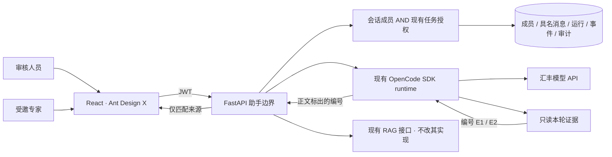
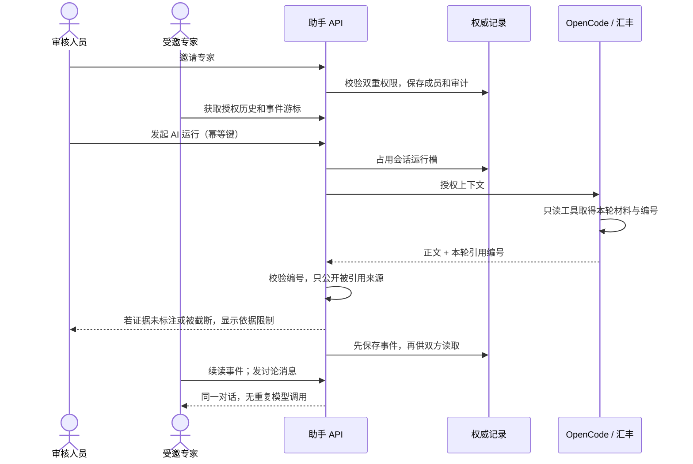
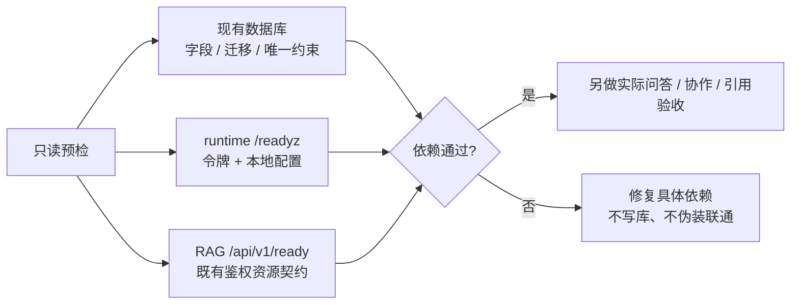

# 慧眼助手 · 持续优化实施规划

> 状态：本机多人协作、汇丰模型及 Windows/Linux runtime 发布包已验收；汇丰云电脑已运行主站，但尚未部署助手。Linux 包是部署助手 runtime 的模板，不是对现有网站的重装要求。当前配置的 RAG 资源就绪未通过，比赛环境验收待推进。总目标：审核人员先与 AI 工作，需要时邀请真实专家进入同一会话；基于授权证据协作，使用汇丰模型资源，拉取仓库后按模板即可部署。总设计见 [README](README.md)。

## 本轮要看到什么

**第 11 轮：对齐审核人员角色边界**

- [x] 按用户业务要求收束助手：经办人提交材料，审核人员与 AI/受邀审核专家讨论；助手页面与全部 API 统一要求 reviewer。只改助手入口与鉴权接线，不改主站提交/审核流程或 RAG。
- [x] 顶栏隐藏经办人入口；直接访问助手页回工作台；直接调用助手/技能/协作/运行 API 返回 403，不调用模型。
- [x] 私有和共享运行持续复核真实账号角色；角色降级后不发出或保存完整答复，运行槽释放；历史数据保留。
- [x] 最终回归：后端助手 **60 项**与 RAG 客户端 **9 项**合计 **69 项**通过；前端 **21 项**与生产构建通过。包含生成中角色撤销测试；主站大 chunk 警告仍存在，未扩展改其他模块包体。
- [ ] 云端发布、配置交接和目标机双账号验收仍待完成；本轮本机测试不替代该验收。

云主站只读复核（2026-10-22）：网站已运行，但前端为 Vite dev、后端为 root 登录会话进程；没有生产 release、助手前端/API、runtime 或表；backend `.env` 与 DB/JWT 进程配置缺失，Python 环境未装 Alembic/HTTPX。Linux runtime 发布模板用于后续部署助手，不要求重装现有主站。以[部署文档的实机记录](../../code/assistant-runtime/deploy/README.md)为准。尚待站点负责人提供配置/进程发布交接；本机助手验收不能替代云端部署。

**第 8 轮交付：对齐现有云主站的部署接线**

- [x] runtime /readyz 明示助手内部协议 2；旧进程即便返回 ready，也不能通过当前后端验收。
- [x] AI 调用先校验协议与授权再检索；版本、地址或鉴权失败给出可操作提示，未通过不检索/调用模型，不输出私密配置。
- [x] 对齐配置模板占位说明，补 Windows / Linux 启动路径及端口关系图；不替同学改 .env。
- [x] 后端 **56 项**、Windows/Linux runtime 各 **3 项 / 52 断言**通过；前端类型检查/构建通过。旧实例被拒绝、新实例就绪与汇丰真实问答复测通过，约 **21.7 秒**。
- [x] 按用户指定只读查看现有汇丰云环境：Ubuntu 24.04，80 是 Vite 开发服务器（无助手路由/Ant Design X/静态 dist），8000 是从 root 登录 shell 启动的 FastAPI（OpenAPI 无助手路由），助手 runtime/表也未部署；backend `.env` 和 DB/JWT 进程配置缺失，Python 环境未装 Alembic/HTTPX。业务库已有 review_comment/supplement_note；未改远端文件、配置、进程或数据。Linux 包只提供助手 runtime 部署模板，不是网站重装包。
- [x] 补齐仅有业务表时的助手首次迁移；临时业务库迁移两次通过，哨兵用户和业务表结构保留，不依赖应用启动 create_all。
- [x] 交接文档收束为当前三份文档的入口，移除与 React/多人接口现状冲突的 Vue/旧接口部署说明。
- [ ] 由现有主站发布流程切入助手固定 release，备份业务库并执行助手迁移；云端双账号/真实模型/引用/撤权验收，非本机替代。

**第 9 轮交付：登录错误诊断与回归稳定性**

- [x] 交接入口移除过时 Vue/私聊接口部署说明；当前实现、轮次和决策分别指向总规划、修改规划和决策记录。
- [x] 业务 API 返回 401 时前端清除失效 JWT 并要求重新登录；该凭证不是 HSBC 模型 API key 或 runtime token。补入总规划，帮助演示时区分凭证类型。
- [x] 实际 Ant Design X 交互全套 **20/20** 通过；并行运行曾触发 30 秒单测超时，隔离重跑通过后将 Vitest 限时调至 60 秒。前端生产构建通过，助手 view 独立分包；后端 **56 项**通过。
- [x] 对齐助手 RAG 示例地址与当前验收服务：由过时 8010 改为 8011；只改示例配置和助手文档，不改个人 `.env` 或 RAG 模块。只读探测确认本机 8010 仍是旧接口且没有 `/api/v1/ready`，8011 当前未监听。
- [ ] 本机 `assistant_preflight --require-rag` 未通过：仓库数据库迁移检查通过，默认 runtime 不满足 protocol 2；本机 `.env` 仍指向旧 8010，目标 8011 未启动，系统 Python 不含 Alembic。需由 RAG 模块按其流程启动/发布后复验，不把本机状态说成云端状态。

**第 10 轮交付：云端预检与凭证安全门槛**

- [x] 助手预检增加 `--production`：只读校验 JWT 不为弱/默认值且 `DEBUG=false`；普通开发预检不被阻断，但明确报告 production_ready。报告不含 secret 内容。
- [x] 对齐 RAG 验收端口 8011；助手示例配置与发布文档不再默认连接旧 8010；个人 `.env` 与 RAG 模块未改。
- [x] 后端助手全套 **58 项**、RAG 适配/预检 **18 项**通过；预检专用新增覆盖生产模式拒绝弱密钥/DEBUG 与接受合规设置。
- [ ] 当前本机生产预检明确未就绪：数据库迁移通过；JWT 为默认值且 DEBUG 开启；runtime `/readyz` 缺失；旧 RAG 8010 的 `/api/v1/ready` 返回 404、8011 未监听。需安全注入生产配置并对齐服务版本后复验；这不代表云端运行配置已确认相同。
- [ ] 汇丰云端仍未部署助手：须由主站负责人提供 DB/JWT 与进程发布/回滚交接，再做目标机生产预检和双账号验收。

**第 7 轮交付：依据与回答一致性**

- [x] 中文自然提问仍提供获准任务概要、材料字段与规则结果；不因关键词未命中丢失任务上下文。
- [x] 每轮编号仅对应 runtime 收到的证据；引用列表只收答复正文实际引用，不把专家资料或所有检索候选显示成依据。
- [x] 未读取/不存在的引用拦截完整答复；检索、截断和未标注依据提示持久化，折叠轨迹后仍可见。
- [x] 明确编号校验仅证明来源可追溯；后端、前端、runtime 回归和文档同步。真实汇丰任务问答及多人 API 复测通过。

**第 6 轮交付：**

- [x] runtime 与 RAG 鉴权就绪探针：令牌不匹配不能显示就绪；探针不消耗模型请求。
- [x] 只读部署预检：现有数据库/助手迁移与约束、内部服务授权；报错不输出密钥或连接串。
- [x] Linux 发布验证：Ubuntu/WSL2，固定 Bun 1.4.3，锁文件安装、类型检查、源码/发布包与构建全部通过；systemd 模板离线校验通过，未安装服务。
- [x] 回归、部署说明与总规划同步；正式比赛 ECS/团队电脑仍单独验收。

- [x] 正式 React 页面：专家搜索、介绍、邀请、成员撤销、具名发言；无模拟身份选择器。
- [x] 多人 API：独立 JWT 账号读取同一历史、成员消息及公开 AI 事件（隔离测试库验证；模型 mock）。
- [x] 服务端：成员权限与原有任务授权同时检查；邀请不授予审批权。
- [x] 运行可靠性：每会话单个 AI 运行、请求幂等、持久游标、协作读连接断开不重复调用模型。
- [x] 技能库与业务 SDK：审核发布目录、个人加入/移除/版本提示，委托 JWT 的 AssistantClient。
- [x] 自测：后端权限/撤权/并发/重试回归，React 交互测试，类型检查及构建。
- [x] 文档：事实同步总规划；部署限制和待申请资源单列。
- [x] 本机双浏览器身份验收：两个独立来源/登录账号，真实前端 HTTP 与汇丰模型；邀请、历史、具名讨论、AI 回答、撤权清屏通过。
- [ ] 两台团队电脑/正式账号、汇丰 ECS/PostgreSQL 环境验收。

## 分轮推进

| 轮次 | 工作 | 验收 |
|---|---|---|
| 1 · 协作底座 | 新增助手专属成员、作者、运行、事件、审计表；兼容旧会话 | 未邀请不可读；撤权后不可读；旧数据可继续使用 |
| 2 · 正式体验 | 复用 Ant Design X 消息/输入/轨迹，Ant Design Drawer/List/Modal 管理专家和成员 | 两个真实账号共用上下文；成员讨论可不触发 AI |
| 3 · 稳定性 | 幂等运行、单会话并发保护、事件回放、异常/取消 | 重试不重复扣模型调用；失败恢复可发送；轨迹只呈现公开事件 |
| 4 · 扩展与部署 | 技能治理、受控服务身份、真实增量评估、部署/性能与演示验收 | 逐项实测后勾选；资源不足明确提出，不静默降级 |

## 已核对的取舍

- 上游组件继续用 [Ant Design X](https://github.com/ant-design/x)；成员/邀请借鉴 [LibreChat ACL](https://www.librechat.ai/docs/features/access_control) 的资源权限思路。只写本项目业务适配，不部署第二套认证或聊天系统。
- 模型执行继续用 [OpenCode](https://github.com/anomalyco/opencode)；锁定版本先通过现有回归，不为“最新”盲目升级。
- 当前主站任务权限是角色规则，尚无独立细粒度任务 ACL。助手必须复用并如实说明这一边界，不能声称完成了全平台 ACL。
- 新表独立，避免改队友现有任务表/RAG；旧会话默认私有，协作只向同样有任务访问权的审核人员开放。
- 先用数据库事件和有游标的增量读取完成可恢复协作；不用 CRDT 修改聊天历史。多实例/持久队列上线前单独验收。
- 正文目前是完整答复后分段回显。真实 token 流必须先核对 SDK 的事件与输出安全，不能把动画叫作真实推理。

## 每轮完成记录

| 轮次 | 审阅、测试结果 | 剩余项 |
|---|---|---|
| 1 · 协作底座 | 新增 7 张助手表，成员/任务双重授权、撤权/停用、旧会话兼容；独立 Alembic 增量迁移重复运行通过 | 业务任务 ACL 仍沿用主站 |
| 2 · 正式体验 | React 专家/成员抽屉、邀请确认、具名讨论、问 AI/发给成员、技能个人库；本机页面已检查目录、技能加入、折叠轨迹 | 尚未进行两台团队电脑的浏览器验收 |
| 3 · 可靠性 | 幂等、单运行、事件回放、超时/取消、作者防伪和隔离；最终后端 33 项、前端 17 项通过；runtime 2 项/18 断言通过；两端类型检查及前端构建通过 | 主站大包告警仍存在，助手为独立懒加载 chunk |
| 4 · 模型与部署 | 汇丰真实问答约 11.6 / 16 秒；隔离双 JWT + 真实模型协作验收约 12.9 秒；本机迁移成功 | ECS、真实 PostgreSQL、压力测试未验收 |
| 审核修正 | 排除工具前言/reasoning；两句话不重复提醒；降权隐藏共享目录；讨论防重复点击；预检查已停止时不启动模型；补齐 OpenAPI 响应契约 | 相关回归通过；本轮实现事实已同步总规划 |
| 5 · 真实页面回归 | 修复任务首问 SSE 的数据库生命周期、撤权目录先刷新时残留历史、详情权限滞后；取消后禁止提交完整答复；识别“具备相应权限”提醒 | 后端 **35**、前端 **19** 项通过；类型检查及生产构建通过 |
| 5 · 发布与协作验收 | runtime 源码/无源码无 node_modules 的隔离发布包均通过工具/权限/输出测试，连同单测共 **3 项 / 32 断言**；真实双 JWT API 约 **15.4 秒**通过；双浏览器 UI 全链路通过 | Windows 发布包已测；Linux 容器/ECS、真实 PostgreSQL、团队跨电脑未测 |
| 6 · 部署交付 | 新增鉴权就绪、只读预检、systemd 模板和 Linux 隔离验收脚本；后端 **43** 项通过，前端 **19** 项既有回归通过且本轮重新构建通过；Windows/Linux runtime 各 **3 项 / 42 断言**通过 | 本机普通问答预检通过；要求 RAG 资源就绪时未通过，不改 RAG 同学代码 |
| 6 · 实际调用 | 新探针正确令牌就绪、错误令牌拒绝；汇丰 qwen3.8-flash 真实多人 API 协作复测约 **26.3 秒**通过 | Linux 测试模型为本机 mock，不能把它称为 Linux 上汇丰真实调用 |
| 7 · 引用与上下文 | 后端 **51 项**通过；React **20 项分批通过**，7 项页面交互完整复测通过；类型检查/生产构建通过；Linux runtime 源码/独立发布包 **3 项 / 44 断言**通过。确认中文任务字段、编号和来源的绑定；未知引用拦截、截断提示及专家计数排除均有回归 | 全套前端曾有单项 30 秒超时；单项与整文件复测通过，保留记录，不提高产品超时。真实模型单独复测 |
| 7 · 汇丰真实复测 | 最新 runtime + qwen3.8-flash，隔离合成任务与双 JWT；任务 USD / 100 正确进入答复、正文编号指向任务概要、共同历史/事件、幂等及撤权验收通过，约 **28.3 秒** | 默认环境指向其他旧 runtime，就绪检查未通过；本次显式使用验收实例 8092。不能据此宣称默认环境或 ECS 已验收 |
| 8 · 版本与首次安装 | 协议 2 双向检查，调用前阻断旧进程；补齐只有业务表时的助手首次迁移。后端 **56** 项通过，Windows/Linux runtime 各 **3 项 / 52 断言**通过，前端构建通过；真实 HSBC 复测约 **21.7 秒** | 本机 8092 新实例就绪；默认 RAG 就绪接口仍返回 404。此轮不改 RAG 代码或地址，不冒称知识库整链路通过 |
| 8 · 现有云主站 | 按用户指定只读 SSH：Ubuntu 24.04/x86_64，/home/frontend 的 Vite dev 在 80，依赖和源码没有助手；/home/backend API 在 8000 且没有助手路由。二者由 transient login session 启动，无固定生产发布单元；助手 runtime/表没有部署。backend `.env` 与 DB/JWT 进程配置缺失，Python 环境缺 Alembic/HTTPX | 需先由站点负责人交接配置与进程/发布回滚所有权，再发布助手前端路由、后端和 runtime；不可直接覆盖现有主站。Linux 包是 runtime 部署模板。当前未改云端运行状态 |

### 第 5 轮修正依据

- **真实页面发现，先复现再修：** 生产 SQLAlchemy 默认提交后过期，FastAPI 在 SSE 消费前释放请求依赖，任务首问触发 DetachedInstanceError。原测试关闭了过期行为而漏检；新增默认过期配置回归，流自行管理 DB 会话，只跨边界传标量 ID。
- **撤权时清除已显示历史：** 目录可能先于房间轮询返回；原逻辑会停止共享轮询却保留正文。现在同时清除历史、运行、任务关联和当前选择，忽略过时响应。
- **完成前再校验：** 模型返回后再次检查运行状态及任务/成员权限，取消的运行不能保存一条“已完成”答案。
- **发布产物独立验证：** 按 [Bun bundler](https://bun.sh/docs/bundler) 构建 target=bun，临时目录仅放 dist 与技能，断开项目 node_modules，仍通过同一工具调用和最终答案契约；这不代替 Linux 原生依赖验收。

### 第 6 轮部署验收

- [发布说明与模板](../../code/assistant-runtime/deploy/README.md)使用现有 systemd，不创建自制守护框架；配置参考 [systemd.exec](https://www.freedesktop.org/software/systemd/man/latest/systemd.exec.html)。本机 Ubuntu 校验临时替换路径后的模板，不代表服务已在 ECS 安装。
- `bash code/assistant-runtime/scripts/linux-acceptance.sh` 在 /tmp 隔离目录安装官方固定 Bun 与锁定依赖，不复制 .env，结束自动清理。本轮最终 3 项/42 断言、类型检查、构建与 unit 语法均通过。
- 发布包测试曾一次在模型请求前失败，单项诊断及最终完整回归通过；保留更完整的测试失败日志。Linux 脚本最初缺少 Bun 的 PATH，已修正后完整重跑通过。没有放宽产品超时或绕过断言。
- 只读预检已实测：普通助手依赖通过；带 --require-rag 未通过，runtime 与数据库均通过，当前 RAG 地址的 /api/v1/ready 返回 **404**。说明当前进程/地址未提供此就绪契约，不能据此推断数据库故障；由 RAG 模块对齐版本/地址后复验。不修改其引擎、数据或资源设置，也不靠公开 health 掩盖此项。
- 为区分资源故障与接口版本差异，另用现有 RAGClient 实测通用检索，返回 **4 条证据、0 条警告**；未读取/公开其内容。因此当前结论是“检索可调用，就绪契约未对齐”，不是“知识库已故障”。

### 第 7 轮修正依据

- 原本按空格匹配本地 JSON，中文自然提问可能漏掉全部任务字段；现在默认保留任务概要及最多 7 条材料/规则片段，截断时提示缩小范围。检索引擎仍由 RAG 模块负责。
- 工具读取不等于逐条引用：只为本轮实际工具输入分配 E1/E2，正文使用 `[E1]` 后才显示对应来源；未读取、越界或未知编号不进入正式答复。专家介绍没有审核证据编号。
- `citations` 新增可选 reference_id / source_id，保留既有 id / label / source / detail / page；旧消息继续按原格式显示，不给历史记录追补虚构编号。
- 编号映射只检查来源归属，不自动证明陈述受该来源支持；语义核验、法规适用性及完整性仍须人工审核。

## 本机验收与部署边界

- 正式验收页面：http://127.0.0.1:5174/assistant ，本轮 API 8022、runtime 8092。使用独立端口，未停止同学的服务；端口为当前进程设置，不修改团队环境模板。
- 页面检查发现旧 SQLite 缺少主站模型已有的 review_comment / supplement_note。已先备份本地库，再补齐两个可空 TEXT 字段；保留现有业务数据。没有修改队友业务源码，没有把任务表变更混入助手迁移。
- 本轮迁移先在临时旧库执行两次：仅增加助手表/迁移版本，任务列不变；再对本机库执行成功。
- 不把单次模型成功当质量测评。多人授权/幂等测试 mock 外部模型；真实模型单独验证，没有在业务数据中填入虚构专家。
- 新增显式运行的真实链路脚本：后端执行 `python -m tests.live_assistant_acceptance --live`。新进程临时 SQLite、随机测试口令、合成任务、真实 JWT/API/OpenCode/汇丰模型；不写现有业务库、不输出凭证。HTTPX 直接调用真实 ASGI 应用，未覆盖浏览器/反向代理网络。
- 该脚本已通过：同会话邀请、成员讨论、真实模型问答、双方相同历史/事件、同键返回同一运行、撤权立即拒绝访问及审计；不冒充两台电脑的浏览器验收。
- 本轮另以真实网络完成浏览器验收：临时 API 8033、前端 5175/5176 分别登录合成审核人员/专家；关联合成任务首次问答 → 邀请确认 → 专家看到历史 → 具名讨论 → 专家问 AI/创建者同步 → 自动折叠轨迹 → 撤权后专家目录与历史清空。使用真实汇丰 qwen3.8-flash；测试账号不进入业务库。
- 重做浏览器验收：后端 `python -m tests.live_assistant_acceptance --browser-fixture --port 8033`，两个前端进程的 HBCN_API_TARGET 均指向 8033，用不同端口隔离登录存储。账号 acceptance-owner / acceptance-expert，公开测试口令 local-acceptance-only；仅监听 127.0.0.1、临时数据库，结束即清理，禁止拿这些合成账号初始化共享环境。
- 第 5 轮所有测试通过后，正式本机 API 8022 已重启加载修正；前端主站大包告警仍存在，未为消除告警改动队友页面。

## 下一轮进入条件

| 优先级 | 要做什么 | 需要的验收/资源 |
|---|---|---|
| P0 · 演示环境 | 沿用汇丰 Linux 云电脑，版本化发布主站前端（含助手路由）、业务 API 与 OpenCode runtime；再做团队双账号问答/协作验收 | 已只读 SSH 确认当前为 Vite dev + 登录会话进程，不是可切换静态/服务 release。需站点负责人确认入口 owner、进程移交和回滚窗口；备份原库后迁移，不能只在 /home 原路径覆盖 |
| P0 · RAG 就绪 | 由 RAG 模块对齐 /api/v1/ready 的运行版本/地址，再复测引用整链路 | 当前探针返回 404；不等于检索或数据库故障，也不能宣称知识库整链路通过 |
| P1 · 真正正文增量 | SDK 增量输出通道先区分最终答案、工具前言和内部 reasoning，再转发 | 现有模型验证事件契约；中断不能产生已完成假答案 |
| P1 · 扩容 | 持久任务队列、跨进程取消和广播 | 确认队列/数据库资源后实施；当前明确 workers=1，不冒充多实例 |
| P2 · 工作流深接线 | 机器身份/任务 scope、待办中心邀请通知 | 与主站鉴权/待办模块确定契约；现有委托 JWT SDK 可先使用 |
| P2 · 技能发布 | 团队审核、来源验证、版本推广 | 目前仅仓库发布目录，不开放任意代码执行或 URL 安装 |

只修改助手目录、助手路由/模型适配及其测试。RAG、OCR、任务审核流程与同学工作区改动保持各自所有权。
