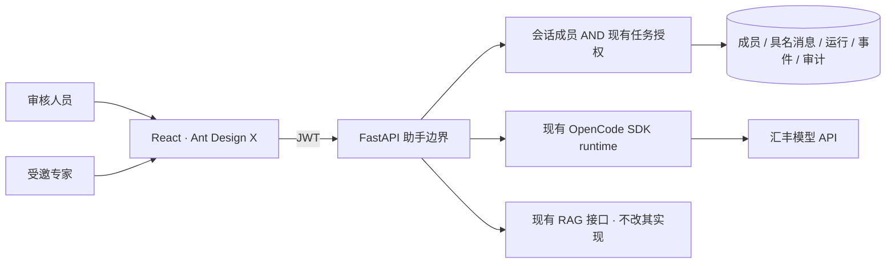
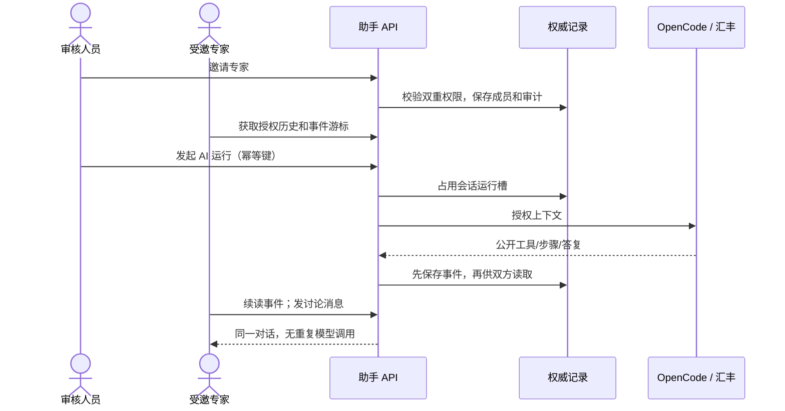

# 慧眼助手 · 持续优化实施规划

> 状态：第 1–3 轮及本机真实模型协作验收已完成；比赛环境验收仍待推进。总目标：审核人员先与 AI 工作，需要时邀请真实专家进入同一会话；基于授权证据协作，使用汇丰模型资源，拉取仓库后按模板即可部署。总设计见 [README](README.md)。

## 本轮要看到什么

- [x] 正式 React 页面：专家搜索、介绍、邀请、成员撤销、具名发言；无模拟身份选择器。
- [x] 多人 API：独立 JWT 账号读取同一历史、成员消息及公开 AI 事件（隔离测试库验证；模型 mock）。
- [x] 服务端：成员权限与原有任务授权同时检查；邀请不授予审批权。
- [x] 运行可靠性：每会话单个 AI 运行、请求幂等、持久游标、协作读连接断开不重复调用模型。
- [x] 技能库与业务 SDK：审核发布目录、个人加入/移除/版本提示，委托 JWT 的 AssistantClient。
- [x] 自测：后端权限/撤权/并发/重试回归，React 交互测试，类型检查及构建。
- [x] 文档：事实同步总规划；部署限制和待申请资源单列。
- [ ] 真实双浏览器/团队账号会话验收，汇丰 ECS/PostgreSQL 环境验收。

## 分轮推进

| 轮次 | 工作 | 验收 |
|---|---|---|
| 1 · 协作底座 | 新增助手专属成员、作者、运行、事件、审计表；兼容旧会话 | 未邀请不可读；撤权后不可读；旧数据可继续使用 |
| 2 · 正式体验 | 复用 Ant Design X 消息/输入/轨迹，Ant Design Drawer/List/Modal 管理专家和成员 | 两个真实账号共用上下文；成员讨论可不触发 AI |
| 3 · 稳定性 | 幂等运行、单会话并发保护、事件回放、异常/取消 | 重试不重复扣模型调用；失败恢复可发送；轨迹只呈现公开事件 |
| 4 · 扩展与部署 | 技能治理、受控服务身份、真实增量评估、部署/性能与演示验收 | 逐项实测后勾选；资源不足明确提出，不静默降级 |

## 已核对的取舍

- 上游组件继续用 [Ant Design X](https://github.com/ant-design/x)；成员/邀请借鉴 [LibreChat ACL](https://www.librechat.ai/docs/features/access_control) 的资源权限思路。只写本项目业务适配，不部署第二套认证或聊天系统。
- 模型执行继续用 [OpenCode](https://github.com/anomalyco/opencode)；锁定版本先通过现有回归，不为“最新”盲目升级。
- 当前主站任务权限是角色规则，尚无独立细粒度任务 ACL。助手必须复用并如实说明这一边界，不能声称完成了全平台 ACL。
- 新表独立，避免改队友现有任务表/RAG；旧会话默认私有，协作只向同样有任务访问权的审核人员开放。
- 先用数据库事件和有游标的增量读取完成可恢复协作；不用 CRDT 修改聊天历史。多实例/持久队列上线前单独验收。
- 正文目前是完整答复后分段回显。真实 token 流必须先核对 SDK 的事件与输出安全，不能把动画叫作真实推理。

## 每轮完成记录

| 轮次 | 审阅、测试结果 | 剩余项 |
|---|---|---|
| 1 · 协作底座 | 新增 7 张助手表，成员/任务双重授权、撤权/停用、旧会话兼容；独立 Alembic 增量迁移重复运行通过 | 业务任务 ACL 仍沿用主站 |
| 2 · 正式体验 | React 专家/成员抽屉、邀请确认、具名讨论、问 AI/发给成员、技能个人库；本机页面已检查目录、技能加入、折叠轨迹 | 尚未进行两台团队电脑的浏览器验收 |
| 3 · 可靠性 | 幂等、单运行、事件回放、超时/取消、作者防伪和隔离；最终后端 33 项、前端 17 项通过；runtime 2 项/18 断言通过；两端类型检查及前端构建通过 | 主站大包告警仍存在，助手为独立懒加载 chunk |
| 4 · 模型与部署 | 汇丰真实问答约 11.6 / 16 秒；隔离双 JWT + 真实模型协作验收约 12.9 秒；本机迁移成功 | ECS、真实 PostgreSQL、压力测试未验收 |
| 审核修正 | 排除工具前言/reasoning；两句话不重复提醒；降权隐藏共享目录；讨论防重复点击；预检查已停止时不启动模型；补齐 OpenAPI 响应契约 | 相关回归通过；本轮实现事实已同步总规划 |

## 本机验收与部署边界

- 正式验收页面：http://127.0.0.1:5174/assistant ，本轮 API 8022、runtime 8092。使用独立端口，未停止同学的服务；端口为当前进程设置，不修改团队环境模板。
- 页面检查发现旧 SQLite 缺少主站模型已有的 review_comment / supplement_note。已先备份本地库，再补齐两个可空 TEXT 字段；保留现有业务数据。没有修改队友业务源码，没有把任务表变更混入助手迁移。
- 本轮迁移先在临时旧库执行两次：仅增加助手表/迁移版本，任务列不变；再对本机库执行成功。
- 不把单次模型成功当质量测评。多人授权/幂等测试 mock 外部模型；真实模型单独验证，没有在业务数据中填入虚构专家。
- 新增显式运行的真实链路脚本：后端执行 `python -m tests.live_assistant_acceptance --live`。新进程临时 SQLite、随机测试口令、合成任务、真实 JWT/API/OpenCode/汇丰模型；不写现有业务库、不输出凭证。HTTPX 直接调用真实 ASGI 应用，未覆盖浏览器/反向代理网络。
- 该脚本已通过：同会话邀请、成员讨论、真实模型问答、双方相同历史/事件、同键返回同一运行、撤权立即拒绝访问及审计；不冒充两台电脑的浏览器验收。

## 下一轮进入条件

| 优先级 | 要做什么 | 需要的验收/资源 |
|---|---|---|
| P0 · 演示环境 | 团队两个真实审核账号进入同会话，验证邀请/撤权；部署到比赛环境 | 团队账号、汇丰 ECS 访问方式及环境变量交付；不分发私密 key |
| P1 · 真正正文增量 | SDK 增量输出通道先区分最终答案、工具前言和内部 reasoning，再转发 | 现有模型验证事件契约；中断不能产生已完成假答案 |
| P1 · 扩容 | 持久任务队列、跨进程取消和广播 | 确认队列/数据库资源后实施；当前明确 workers=1，不冒充多实例 |
| P2 · 工作流深接线 | 机器身份/任务 scope、待办中心邀请通知 | 与主站鉴权/待办模块确定契约；现有委托 JWT SDK 可先使用 |
| P2 · 技能发布 | 团队审核、来源验证、版本推广 | 目前仅仓库发布目录，不开放任意代码执行或 URL 安装 |

只修改助手目录、助手路由/模型适配及其测试。RAG、OCR、任务审核流程与同学工作区改动保持各自所有权。
