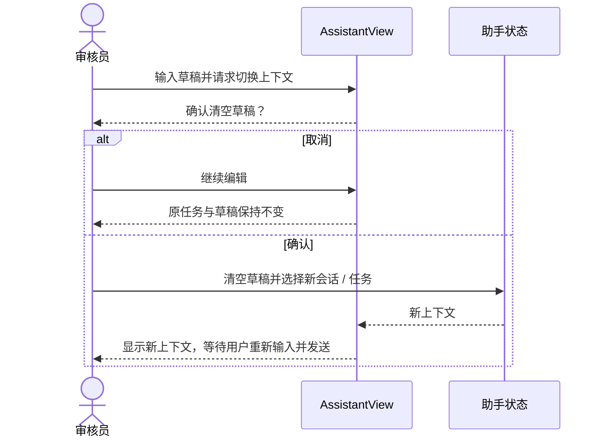

# 慧眼助手核心测试集

本文件按审核员实际操作维护核心验收，不把 mock 服务结果描述成真实模型或 RAG 联通。

## 草稿与上下文隔离

| 场景 | 操作 | 通过条件 | 自动化覆盖 |
|---|---|---|---|
| S15-A 新建会话 | 写问题，点“新建会话”；分别取消和确认 | 取消保留原文；确认清空并新建；两种操作都不自动调用 AI | `asks before clearing a draft when starting a new conversation` |
| S15-B 更换任务 | 在任务 A 输入问题，选择任务 B；分别取消和确认 | 取消保留 A 的草稿且仍停留 A；确认清空后进入 B；没有误发 | `keeps an unsent question in its current task until the user confirms a task switch` |
| S15-C 打开其他任务历史 | 在任务 A 输入问题，打开任务 B 的历史会话；分别取消和确认 | 取消保留 A；确认后恢复 B 的任务和历史，草稿为空且没有模型请求 | `does not carry an unsent question into another historical task session` |
| S15-D 手机端 | 390px 宽打开会话记录并新建会话 | 可完成取消/确认；弹窗不越界、不产生横向滚动 | `draft-flow-acceptance.mjs` |
| S15-E 共享会话切换 | 在会话 A 选“发给成员”，再切换到共享会话 B 并发送 | 新会话恢复“问 AI”；发送进入 B 的 AI run，不误发成员讨论 | `resets member-only mode when switching to another shared conversation` |
| S15-F 删除当前会话 | 当前会话已有未发送草稿和待用 Skill；尝试删除并分别取消、模拟 API 失败、确认成功 | 取消/失败保留草稿与 Skill；删除成功后清空二者并回到新会话，不自动发消息或调用模型 | `preserves the draft and skill when canceling deletion, then clears them after deleting the active session` |
| S15-G 历史操作键盘访问 | 在窄屏历史抽屉中 Tab 到会话操作按钮，按 Enter 打开菜单并进入删除确认 | 操作按钮有可读名称且可聚焦；无需悬停即可键盘触发菜单 | `skill-library-acceptance.mjs` 的 `delete_current_session_clears_context_only_after_success` |

## 技能库与本轮使用

| 场景 | 操作 | 通过条件 | 自动化覆盖 |
|---|---|---|---|
| S16-A 搜索并加入 | 搜项目目录、加入审核技能，再应用于下一问 | 加入仅更新个人库，不直接调用 AI；选择后抽屉关闭并在输入区显示待用技能 | `searches the project catalog, adds a skill, then applies it without sending immediately` |
| S16-B 新建和编辑 | 新建个人指引；再打开详情修改 | 保存内容；编辑前读取当前 revision；更新只提交本人记录并增加 revision | `creates and edits a personal instruction, loading existing text and revision first` |
| S16-C 删除当前技能 | 删除当前已选个人技能并确认 | 二次确认后删除成功，输入区待用技能同步清除；取消时不得删除 | `requires delete confirmation and clears a deleted current skill` |
| S16-D 本人隔离 | 用户 A 创建/编辑技能，用户 B 尝试读取、应用、修改或删除 | B 获得 404/拒绝；A 的技能与版本保持不变；项目发布技能不可修改 | `test_custom_skill_crud_is_owner_scoped_and_uses_optimistic_revision` |
| S16-E 实际随问发送 | 选择技能后发送问题；再单独取消选择发送 | run 请求仅带明确选中的 `skill_id`；后端按本人权限读取文字指引；拒绝运行保留草稿与技能选择 | `opens persisted history and sends a selected skill with task context`；`skill-library-acceptance.mjs` |
| S16-F 编辑草稿保护 | 打开个人技能不修改便关闭；再修改后尝试取消 | 无改动可直接关闭；有改动时取消保留、确认放弃才关闭 | `does not warn on an untouched edit and protects a modified draft until discard is confirmed` |
| S16-G 并发编辑冲突 | 保存旧 revision 收到 409 | 本地草稿留在表单；拉取并展示服务器最新版；合并后用最新 revision 保存成功 | `keeps the draft visible and advances the revision after an edit conflict`；`preserves HTTP status for optimistic skill conflicts` |

个人技能仅是用户自写文字指引，不授予额外材料、工具或审批权限；创建/编辑/选择本身不发模型请求。浏览器验收只拦截模型运行请求，真实模型读取个人指引的端到端链路仍未验收。

## 专家与多人会话

| 场景 | 操作 | 通过条件 | 自动化覆盖 |
|---|---|---|---|
| S17-A 找到并邀请专家 | 搜索姓名/专长，阅读介绍后确认邀请 | 先说明将共享完整历史；过时搜索或会话切换不得执行旧结果 | `assistant-collaboration.test.tsx`；`skill-library-acceptance.mjs` |
| S17-B 讨论和问 AI | 在共享会话分别选择“发给成员”和“问 AI”发送 | 成员消息不调用模型；AI 问题生成共享 run 与相同轨迹 | `assistant-view.test.tsx`；云端双浏览器回归 |
| S17-C 成员权限 | 非创建者尝试管理成员；撤权后继续访问 | 管理操作拒绝；撤权后历史与任务上下文清除，API 拒绝读取 | `assistant-collaboration.test.tsx`；云端双浏览器回归 |
| S17-D 手机协作与资料 | 390×420 查看长姓名专家卡片、邀请确认和 24 人成员列表；320×420 打开本人资料编辑 | 长姓名/介绍不产生横向溢出且邀请可见；专家与成员列表独立滚动、末项可达且成员权限提醒固定可见；无任务时邀请禁用；任务态确认操作可见；资料正文滚动、保存/取消固定且取消不提交 | `skill-library-acceptance.mjs` 的 `mobile_collaboration_drawer_fits_viewport`、`mobile_profile_editor_keeps_save_action_visible` |

邀请不授予任务访问权或审批权；成员与 AI 都只能提供辅助意见，审核结论仍由有权限审核人员确认。

## 答复与依据阅读

| 场景 | 操作 | 通过条件 | 自动化覆盖 |
|---|---|---|---|
| S18-A 答复引用跳转 | 在有 20 条长来源的窄屏答复里点击 `[E20]` | 仅引用清单内编号可点击；自动展开依据区，聊天视口显示面板并滚到对应条目；来源区独立滚动，正文宽表格内部横滚，无页面横向溢出 | `jumps from a verified answer reference into a long evidence list`；`skill-library-acceptance.mjs` 的 `mobile_evidence_navigation_and_long_sources` |
| S18-B 不可信编号与代码 | 检查不在本轮引用清单中的 `[E999]` 及代码片段中的 `[E1]` | 未知编号保持纯文本；代码样例不被改成链接；Markdown 原有净化仍生效 | `links only verified evidence references and leaves code samples untouched` |

这些场景验证前端只对本轮收到的引用编号提供导航；合成来源用于界面测试，不代表模型、RAG 或材料事实已验收。

### 时序



## 回归命令

在 `code/frontend` 执行助手完整回归；低资源环境串行运行以避免组件测试超时：

```bash
npm test -- --maxWorkers=1 --testTimeout=120000
npm run build
```

后端个人技能归属、乐观版本及运行注入：

```bash
python -m unittest tests.test_assistant_api tests.test_assistant_collaboration tests.test_assistant_preflight
python -m unittest tests.test_assistant_contract
python -m scripts.export_assistant_contract
```

技能库测试使用真实 Ant Design 组件覆盖弹窗和表单；助手页面集成测试单独验证草稿、发送与历史状态，技能抽屉的详细交互由前者和浏览器验收负责。模型 API 使用测试替身。云端预览的服务健康状态与 RAG 真实调用状态另行记录，不能作为这组 UI 测试的替代。

## 最近一次页面回归（2026-10-23）

- 助手前端完整回归（第 31 轮）：**7 个测试文件、37/37 项通过**；页面 **13/13**、技能 **3/3**、专家协作 **8/8**，另含状态/API/Markdown 测试。并行首跑有一项超过默认 60 秒上限；单 worker、120 秒上限完整复跑全部通过。
- 第 32 轮改动回归：技能库与协作 API 两个完整测试文件 **10/10**；覆盖新加的未保存保护、409 最新版本读取与 revision 合并，同时原技能 CRUD/协作 API 测试通过。
- 后端助手 API / 协作 / readiness / contract：**64 项通过**，包含第 31 轮单独重跑的 readiness/preflight 13 项。个人技能真实模型注入仍未做汇丰端到端联测；当前环境缺少本机配置及云端预览访问入口，不能以 mock 代替。
- 本地浏览器回归：本轮重跑 `code/assistant-runtime/deploy/preview/draft-flow-acceptance.mjs`，**4/4** 场景通过；新建会话、任务 A→B、切换其他任务历史、390×844 手机确认框。`run_requests=0`、页面异常 **0**，临时会话清理成功；不调用模型、不访问 RAG。
- 本地浏览器合成回归：草稿脚本 **4/4**、技能/协作脚本 **6/6**。包含专家抽屉窄屏适配、选中技能后 run 携带 `skill_id`、被拒问题保留和删除确认；请求在浏览器拦截，模型/RAG 调用均为 **0**，页面异常 **0**，临时数据清理成功。
- 第 33 轮协作 UI 回归：助手页面与专家协作组件 **21/21**；Vite 生产构建通过。更新后的技能/协作浏览器验收 **6/6**，增加 390×420 压缩视口、24 条合成专家独立滚动、无任务邀请禁用、关联合成任务后的邀请确认按钮可见性；确认被取消、邀请 API 未调用、2 个模型运行请求均由 409 夹具拦截，模型/RAG 调用为 **0**，临时技能清理成功。该视口只是键盘占屏的近似模拟，不是实机键盘验收。
- 第 34 轮移动端资料回归：协作组件 **8/8**；Vite 生产构建通过。合成浏览器验收 **7/7**，在 320×420 移动设备模式检查本人资料弹窗、滚动正文、固定保存/取消操作和取消不提交；同时重跑窄屏专家搜索、独立滚动、任务权限门槛与邀请确认。两个模型运行请求被 409 夹具拦截，模型/RAG 调用为 **0**，临时技能清理成功。仍需实机键盘验收。
- 第 35 轮长成员列表回归：协作组件 **8/8**；合成浏览器验收 **7/7** 阶段通过。在 390×420 视口注入 24 条虚构成员，确认滚动区可到达最后一位且权限说明仍可见；没有发起邀请/撤权，模型/RAG 调用 **0**，浏览器异常 **0**，临时数据清理成功。运行时 UI 无需改动；仍需实机键盘和真实设备验收。
- 第 36 轮长文本窄屏回归：完整前端测试 **7 文件/40 项通过**，Vite 生产构建通过。浏览器压力样本先复现 128 字符姓名导致 3,079px 横向溢出，断行修复后助手协作验收 **7/7** 阶段通过；长卡片未越界，滚过长介绍后邀请按钮仍可达。24 人成员列表和资料弹窗场景一并回归，模型/RAG 请求 **0**，页面异常 **0**，临时数据清理成功。TypeScript 项目检查被 `DashboardView.tsx` 缺少 `dayjs` 阻断；主站入口仍提示 1.83 MB 分包过大。
- 第 37–38 轮删除/键盘访问回归：前端完整测试 **7 文件/41 项通过**。真实 Ant Design X 组件测试检查取消、API 失败、删除成功；loopback 手机浏览器通过可聚焦的历史操作按钮以 Enter 打开菜单并进入确认，取消保留草稿和 Skill，确认后清空，随后专家/成员/资料流程回归；浏览器 **8/8 阶段**、模型/RAG 调用 **0**、页面异常 **0**、临时数据清理成功。脚本等待抽屉动画结束再测几何边界。Vite 生产构建通过，助手脚本 **208.13 KB / gzip 70.82 KB**；TypeScript 检查仍被主站缺少 `dayjs` 阻断。
- 第 39 轮证据阅读回归：前端完整测试 **7 文件/43 项通过**（助手页面 15 项、技能库 5 项、协作 8 项、Markdown 2 项及其余状态/API）；Edge loopback 验收 **9/9 阶段**，通过 Tab + Enter 从答复 `[E20]` 定位 20 条合成长依据中的目标，再跳到重复出现的 `[E1]`；验证两次聚焦、依据独立滚动、超宽表格内部横滚和无页面横向溢出。AI/RAG 调用 **0**、浏览器异常 **0**、临时会话/技能清理成功。Vite 生产打包通过，助手脚本 **210.39 KB / gzip 71.63 KB**；主站入口仍有 **1.83 MB** 警告。`tsc -b` 只被既有 `DashboardView.tsx` 缺少 `dayjs` 阻断。
- 真实浏览器回归启动方式（PowerShell，需本机 Edge）：

```powershell
# 终端 1：code/backend
python -m tests.live_assistant_acceptance --browser-fixture --port 8033

# 终端 2：code/frontend
$env:HBCN_API_TARGET = 'http://127.0.0.1:8033'
npm run dev -- --host 127.0.0.1 --port 5178 --strictPort

# 终端 3：code/assistant-runtime/deploy/preview
npm ci
$env:HBCN_DRAFT_TEST_URL = 'http://127.0.0.1:5178'
node .\draft-flow-acceptance.mjs --local-fixture

# 技能库端到端另运行：
$env:HBCN_SKILL_TEST_URL = 'http://127.0.0.1:5178'
node .\skill-library-acceptance.mjs --local-fixture
```

仅 loopback + 临时 SQLite + 合成数据；测试结束按 Ctrl+C 关闭前两个终端。脚本会清理它创建的技能和会话，不发起模型/RAG 请求。
- 构建边界：TypeScript 检查因既有 `src/views/DashboardView.tsx` 缺少 `dayjs` 模块停止；第 32 轮 Vite 生产打包独立通过（3,188 modules，助手 chunk 207.05 KB / gzip 70.54 KB）。主站入口 chunk 1.83 MB 有体积警告。没有添加全站依赖或修改同学页面。

## lfc-assistant 隔离工作树复验（2026-10-23）

在 `C:\Users\28462\.codex\worktrees\team8-lfc-modules\assistant` 的 `lfc-assistant` 分支，对当前工作树完整助手场景重新验收；所有测试均使用组件/API 替身或 loopback 合成 fixture，不代表真实模型/RAG 联通。

- 前端助手套件：**7 个测试文件、44/44 项通过**。包含页面问答/运行轨迹/来源和原件、草稿与任务/历史切换、删除和共享模式状态、专家协作、会话/协作 API、Markdown 净化及证据编号、技能库 5 项。
- Loopback Edge 草稿流程：**4/4 阶段通过**；新建会话、任务切换、历史会话切换及手机确认框；AI run 请求 **0**、页面异常 **0**、临时数据清理成功。
- Loopback Edge 技能/协作流程：**10/10 阶段通过**；技能创建编辑删除、409 运行拦截下随问载荷、专家/资料和协作窄屏、长来源证据跳转与 PDF 原件；模型/RAG 均未调用、页面异常 **0**、临时数据清理成功。
- `vite build` 独立通过，3,188 modules；助手 JS **212.64 KB / gzip 72.45 KB**，主入口 **1,833.80 KB / gzip 576.05 KB**，PDF worker **1,375.84 KB**。产物位于忽略目录 `code/frontend/dist/`，并非提交文件；主站入口仍有大包告警。
- `tsc -b` 未通过：仅报既有主站 `src/views/DashboardView.tsx` 找不到 `dayjs`。本轮没有加全站依赖或修改业务页面。`tsconfig.app.tsbuildinfo` 已是工作树改动，复验生成了新的错误状态元数据；保留原样，不回滚或删除。

复验使用本地 `node_modules/.bin` 可执行文件；当前 PowerShell 未提供 `npm` 命令。测试顺序为助手 API/页面/技能/协作/Markdown 整组串行，测试进程以 **44/44** 正常退出。真实 HSBC 模型、真实 RAG、目标 PostgreSQL/正式站与多实例仍需另行联测。

## 引用键盘与移动端滚动增量验收（2026-10-23）

- 修改仅在助手来源有序列表增加可访问名称；未改 PDF 共用组件、RAG 或业务流程。
- `assistant-view.test.tsx` 上一增量 **16/16**；本轮发送/流式用例定向 **1/1**，在流结束后断言阅读位置仍为 400px，点击“回到最新消息”才移至底部并收起入口。
- 窄屏 `skill-library-acceptance.mjs --local-fixture` 最新 **11/11**，Playwright 按 `list` 角色和“本轮参考依据，共 20 条”名称找到列表、完成键盘引用跳转，并在 320px 长历史溢出模拟下验证回到底部入口完整显示且不压住输入框。
- 引用组件定向 **1/1**；浏览器在来源 E1 聚焦时按 Escape，依据区收起且焦点返回原答复链接；随后重新展开并加载 PDF，等待 loading 结束后确认 canvas 绘出非白内容。
- Vite 生产构建通过，助手 JS **213.20 KB / gzip 72.63 KB**。浏览器异常 **0**、模型/RAG 调用 **0**。本轮没有重跑整组前端测试；最近整组基线为 **44/44**。
- 自动可访问树断言不等同于 NVDA、JAWS 或 VoiceOver 的实际读屏验收。

## 活动会话恢复增量验收（2026-10-23）

- API 请求错误现在保留 HTTP 状态码，供恢复逻辑区分服务暂时失败与权限撤销。
- `assistant-collaboration-state.test.tsx` 与 `assistant-api.test.ts` **10/10**：503 后保留私有活动运行与已有材料，下一轮同步恢复已完成答复；403 后清空消息、技能、运行态并退出该会话；API 错误保留 403 状态和用户可读详情。模型运行 API 未被重试调用。
- `skill-library-acceptance.mjs --local-fixture` 浏览器 loopback **12/12**：真实页面恢复私有活动会话，模拟一次 503 后显示恢复提示并取回最终答复；确认运行请求数没有增加，模型/RAG 调用 **0**、浏览器异常 **0**、临时会话清理完成。
- Vite 生产构建通过，助手 JS **213.60 KB / gzip 72.76 KB**。本轮没有重跑全套前端回归，整组 **44/44** 是改动前基线；真实汇丰环境断网/恢复尚未覆盖。

## 会话撤权后的技能上下文隔离（2026-10-23）

- 当前会话被目录轮询移除后，验证消息、任务、运行和选中 Skill 均清空，避免新会话误带旧会话技能。
- `assistant-collaboration-state.test.tsx` **5/5**；Vite 生产打包通过，助手 JS **213.61 KB / gzip 72.77 KB**。
- `assistant-view.test.tsx` 撤权页面用例 **1/1**：确认错误提示、草稿清空、Skill 标签移除，且没有发送新的模型请求。
- 本轮未重复执行浏览器和全套前端测试；目标环境的权限变更推送仍列入下一轮验收。

## 会话切换状态隔离与全套助手回归（2026-10-23）

- Skill 清理下沉至 `useAssistant`：新建会话、成功恢复历史会话都会清除旧 Skill；加载失败保留原会话状态。状态隔离用例包含新建和历史恢复断言。
- 前端助手 7 个测试文件 **50/50**；后端助手 8 个测试文件 **98/98**，含 RAG v1 请求/版本契约、助手 SSE 与协作权限、证据范围、OpenAPI、原子提交和时间戳。
- Vite production build 通过，助手 JS **213.77 KB / gzip 72.79 KB**；`tsc -b` 仍失败于非助手 `DashboardView.tsx` 对缺少依赖 `dayjs` 的导入。`git diff --check` 通过。
- loopback Playwright **12/12** 是前轮结果；此轮未重复浏览器验收。全套测试使用 API/数据库替身，不代表真实 HSBC 模型、RAG/MCP 网络链路已验收。

## RAG 兼容假设观察（2026-10-23）

- **当前接受范围：**助手调用 `GET /api/v1/ready` 与 `POST /api/v1/retrievals`；两者读取 `X-RAG-Contract-Version`，接受 `>=1.2.0` 的兼容 1.x，拒绝缺失/格式错误/低于 1.2.0/新主版本。不得把 readiness 当真实检索或模型质量证明。
- **RAG 分支摘要：**提交 `eb5280c` 与 `3e32d90` 对应服务版本 **0.5.3**、HTTP 契约 **1.3.3**；检索请求体启用 `extra=forbid`，未知字段返回 422。422 仅提供 `loc` 与 `category`，不回传字段值或详细消息，未知字段名统一为 `<unknown_field>`。助手只发送允许的五个检索字段，不发送 `session_id` 或 `request_id`；会话及关联 ID 由调用方系统管理。此为 RAG 分支摘要，尚不代表合入当前工作树或部署。
- **当前请求假设：**只发送 `query`、`scope=business_rules`、`top_k`（1–8）、`sources=[knowledge_base]`、`purpose=reference`，不发送用户 JWT 或 task code。响应要求 `scope`、`sources`、`evidence_status` 与每条来源的 `content/document_id/document_name`；模型允许忽略额外响应字段，但不放宽必要来源字段或 scope 校验。
- **当前失败语义：**RAG 401/403、HTTP 错误、版本错误、无效响应或错误 scope 不作为知识证据；助手保留独立加载的授权任务材料、发出安全提示并隐藏上游响应正文。readiness 不兼容时 `rag_available=false`，页面应显示服务限制。
- **现有验证：**`test_assistant_knowledge` 覆盖精确请求字段、版本头兼容（含 **1.3.3**）/拒绝、响应字段/scope、超时、HTTP 错误隐藏及脱敏 422；`test_assistant_preflight` 覆盖鉴权 readiness、版本缺失/不兼容及 degraded 状态；`test_assistant_api` 覆盖授权 readiness、RAG 鉴权错误隐藏和不兼容提示；前端页面测试验证模型可用但 RAG 不兼容时显示限制。以上属于 mock/契约测试，不是目标环境联调。
- **待核验：**在授权目标环境验证精确字段请求、readiness/检索版本响应头和真实 422 错误形态。当前分支兼容性测试不等于目标环境已经运行 RAG 1.3.3，也不证明知识检索质量。
