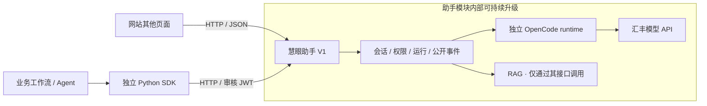
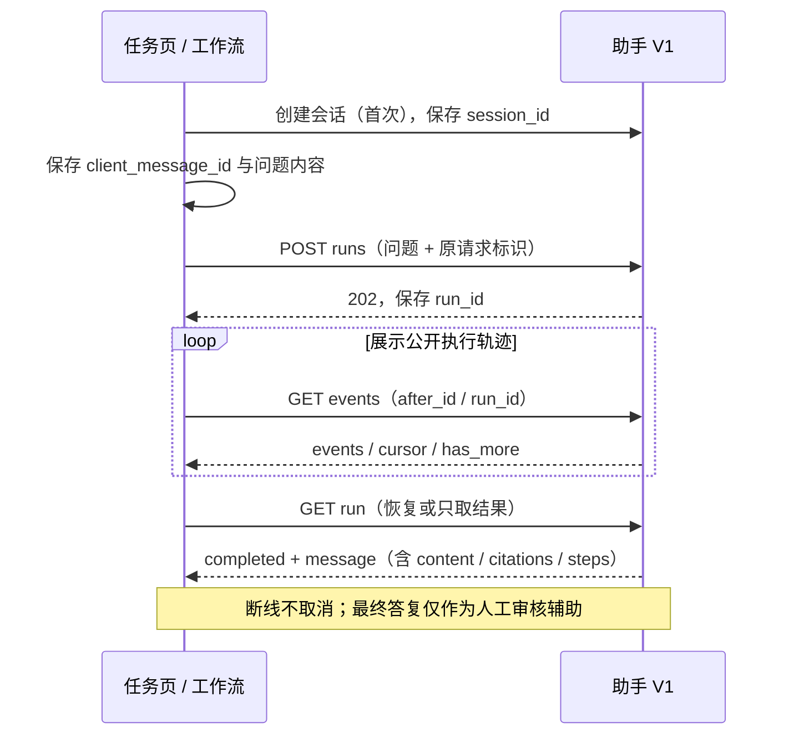

# 慧眼助手 · 模块接入清单

> 给网站页面、工作流与 Agent 的接入同学。**API 契约 1.3.0 / Python SDK 1.1.2**，本机与云端隔离预览已可调用；正式主站须统一发布这一版。详细字段以[对外接口 V1](对外接口V1.md)和 [OpenAPI](contracts/assistant-v1.openapi.json)为准。

当前同机试用：网站根地址 `http://127.0.0.1:5173`（正式前端代理），或后端根地址 `http://127.0.0.1:8003`；既有 8000/8002 是旧 API，不提供 V1。其他电脑的 localhost 指向自己，不能直接沿用这两个地址；部署后由负责人提供实际站点地址。启动与本轮真实模型验证见[部署说明](../../code/assistant-runtime/deploy/README.md#当前本机实例2026-10-22)。

云端隔离预览已验收：当前开发机获准的 SSH 隧道根地址 `http://127.0.0.1:5177`，转发至云端 5174；与本机 5173 是不同数据库/登录态。使用预览的合成审核账号，口令不进文档。邀请、真实汇丰问答、引用、恢复和撤权已过 HTTP 验收；RAG 未配置。详见[预览说明](../../code/assistant-runtime/deploy/preview/README.md)。

## 1. 固定边界



| 固定给调用方 | 助手内部负责 |
|---|---|
| `/api/assistant/v1`、请求/响应、公开事件、错误与恢复语义 | 提示词、模型配置、OpenCode、检索与持久化实现 |
| 当前审核人员 JWT、现有任务权限 | 校验角色、成员和任务权限；服务端管理汇丰密钥 |
| 辅助答复、引用、公开执行轨迹 | 不修改业务审核状态；结论须由有权限人员确认 |

当前是**主后端内的独立业务模块 + 独立 runtime 进程**，共用主站账号和任务库；SDK 可独立安装。不要求同学复制助手页面、导入后端实现或读取助手表，也没有另建一套账号系统。

## 2. 按场景接接口

下表路径均在 `/api/assistant/v1` 下，每次带 `Authorization: Bearer <审核人员JWT>`。

| 调用场景 | 已实现接口 |
|---|---|
| 接入时核对版本、环境就绪 | `GET /contract`、`GET /capabilities` |
| 任务页首次使用、历史恢复 | `POST /sessions`、`GET /sessions`、`GET /sessions/{id}` |
| 提交问题、显示公开进度 | `POST /sessions/{id}/runs`、`GET /sessions/{id}/events` |
| 跨页面/进程取最终结果、主动停止 | `GET /sessions/{id}/runs/{run_id}`、`POST …/cancel` |
| 搜索专家、邀请/撤权、成员讨论 | `GET /experts`、`GET/POST /sessions/{id}/members`、`DELETE …/members/{user_id}`、`POST …/messages` |
| 技能目录、项目技能安装 | `GET /skills`、`GET /skill-library`、`PUT/DELETE /skill-library/{skill_id}` |
| 个人技能增删改查 | `POST /skill-library/custom`、`GET/PUT/DELETE /skill-library/custom/{skill_id}` |

**调用方只需保存四项：** `session_id`、发送前生成并保存的 `client_message_id`、返回的 `run_id`、已消费事件的 `cursor`。会话创建本身不提供幂等保证；创建响应丢失时先查会话列表核对，不自动重建。AI 提问用同会话、同内容、同请求标识安全重试；换标识代表新问题。



## 3. 直接试用

从仓库根目录安装客户端，**不需要安装 FastAPI、OpenCode 或前端依赖**：

```bash
python -m pip install ./code/assistant-sdk
python code/assistant-sdk/examples/workflow.py --help
```

通过本机环境变量 `HBCN_ASSISTANT_SITE`、`HBCN_ASSISTANT_REVIEWER_JWT` 提供站点根地址和业务 JWT，不填模型 key；脚本不打印凭证。

```bash
# 第一次创建任务会话，将返回的 session_id 保存到调用方业务记录
python code/assistant-sdk/examples/workflow.py create --task DEMO-TASK
# 先在调用方持久保存请求标识和内容；超时后重试原命令，不换标识
python code/assistant-sdk/examples/workflow.py ask --session 123 --request-id demo_explain_0001 --content "解释本任务的复核重点"
# 已保存 run_id 时仅恢复读取，不重新提交问题
python code/assistant-sdk/examples/workflow.py resume --session 123 --run 已保存的运行ID
```

`ask` 先输出并刷新 `run_id`，再等最终结果；`resume` 只读。示例 stdout 含授权任务答复，交给当前授权用户查看，不写入公共日志。脚本不创建账号、不自动审批、不自动删除会话。前端也可只跳转 `/assistant?task_code=任务编号` 或 `/assistant?session_id=会话ID`，仍需主站登录。

## 4. 兼容与交付

- V1 内部升级保持既有必填字段、字段含义、鉴权及恢复语义；可新增可选字段/事件，调用方忽略未知项。破坏性变化走 V2，不能原地改坏 V1。
- `202` 仅表示接收；以 `completed` 的最终消息为成功。`error/cancelled` 不当作答案，超时不自动取消；`401` 重新登录，`403/404` 不绕过权限，`409` 先核对原运行。最终答案、引用及依据不足提示应一起展示。
- 当前只支持一个 API 实例/worker；委托审核 JWT 可供业务工作流调用，**独立机器身份、待办通知、自动审批接口尚未提供**。不得拿 runtime token 代替业务身份。
- [部署说明](../../code/assistant-runtime/deploy/README.md)由助手维护；其他模块不依赖其内部文件。隔离云预览已通过真实汇丰 HTTP 验收；正式主站/目标数据库/真实 RAG 联合验收仍未完成。

个人技能 CRUD 仅限当前审核人员本人：以文字指引保存，使用 `expected_revision` 防止覆盖并发编辑；项目目录发布技能只读。新建、编辑或选择技能均不触发模型请求，选择后仅附加到下一条明确发送的 AI 问题。最终审核结论仍须由有权限人员确认。

**本轮验证：** API/契约 28 项、SDK 8 项通过；示例以独立 Python 子进程调用临时本机 TCP API，创建/提问/恢复、同键仅执行一次、权威结果一致、无效 JWT 和缺配置失败均通过。使用隔离合成 SQLite 与 mock 模型，临时服务已关闭；云站与真实知识库状态不由此推断。
