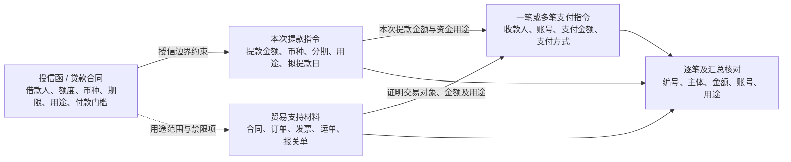
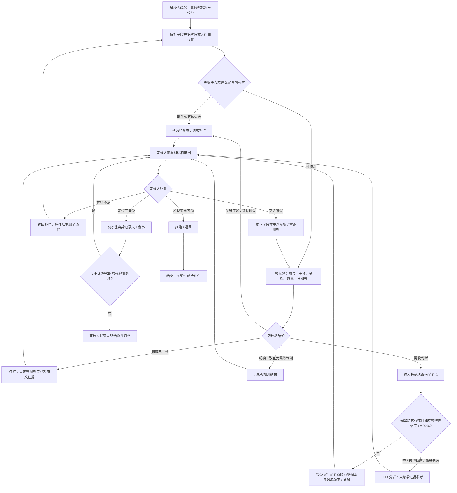
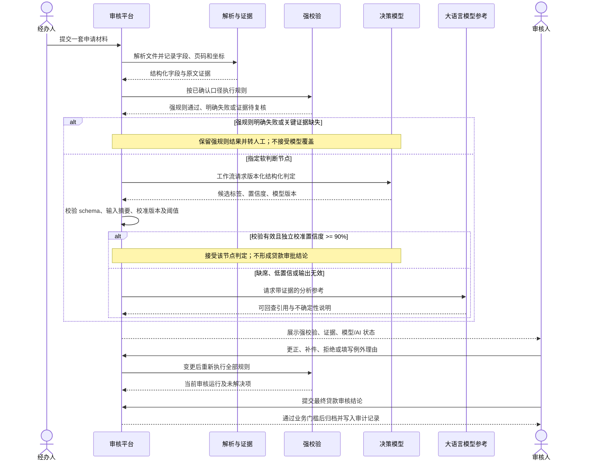

# 贷款文件审核业务架构

本文描述经办人、审核人和审核能力之间的业务关系。目标是把一组提款及贸易支持文件，转成有证据、有责任人、可复核的审核结论。

## 审核范围

首期使用第 8、9、10 套完整材料验证主流程：第 8 套包含客户/供应商名称变更，第 9 套包含合同价格变更，第 10 套包含发票及报关单合同号变更。流贷、固贷、车贷规则暂不纳入本期。

审核对象按一次提款申请归集。授信函/贷款合同说明授信边界；提款指令说明本次用款；支付指令说明收款方和支付金额；商业合同、订单、形式发票、运单、报关单共同说明贸易背景。订单等缺件是否可接受按具体规则处理，不以“文件数量齐全”代替业务判断。

### 资金与贸易材料关系

一笔提款可以对应多笔支付。审核时先核对支付指令金额合计与提款金额；币种不同时需有可核验汇率依据，不能直接按数值比较。支付方式要结合贸易合同条款检查；自由文本提款用途与贸易单据用途之间的语义关系进入专项判断，证据不足时由审核人确认。

## 业务流程

上述路径由应用代码和持久化工作流推进。强规则明确失败、关键字段缺失或来源证据不可回查时，不接受模型或 LLM 覆盖；决策模型只在指定软判断节点返回结构化判定，不拥有贷款审批权。LLM 只在模型置信不足、模型缺席或输出校验失败时补充分析参考；即使两层模型都不可用，也保持待复核并转人工，最终贷款结论由审核人作出。

## 审核角色时序

## 三层判断边界

| 层级 | 适用情形 | 输出 | 对最终结论的权限 |
| --- | --- | --- | --- |
| 强校验 | 已解析且可直接比较的字段，如合同号、币种、金额、数量、明确日期 | 通过、不一致、证据不足 | 明确不一致不能被模型或大语言模型改写；人工更正/例外必须留痕 |
| 决策模型 | 强规则未能直接定论且已定义输入/标签的指定软判断节点 | schema 校验通过的候选标签、校准置信度、模型版本 | 仅独立评测校准 ≥90% 时接受该节点输出；不得覆盖强规则，不拥有贷款审批权 |
| 大语言模型 | 决策模型未配置、输出无效/低于 90% 或仍需解释条款、上下文歧义、商品语义 | 带任务证据引用和不确定性说明的分析参考 | 只辅助审核人，不生成最终贷款结论，不得把失败改成通过或补造材料事实 |

“90%”是模型上线门槛，不是模型自报分数即可通过。需要有独立于训练数据的标注集、按案件隔离的验证集、概率校准、分类型指标和可追溯模型版本。三套造错材料用于回归，不足以校准模型。

## 主审核规则

| 业务检查 | 首期处理 |
| --- | --- |
| 合同号、订单号、提单号及报关协议号 | 对明确编号做精确勾稽；报关协议号允许按字段梳理表与合同号、订单号或发票号关联，具体多合同情形需人工/外部信息 |
| 买方、收货方与借款人 | 文件间名称一致性可比较；与借款人关系按冲突条款进入待复核和 AI 参考 |
| 卖方与支付收款人 | 对文件内明确名称做一致性检查；关联关系、制裁国别交专项审核 |
| 合同、订单、发票及支付金额 | 单一交易链按合同 ≥ 订单 ≥ 发票 ≥ 支付核对；拆单、分货和多合同必须按货品/编号拆分，不能只比较总额 |
| 货物数量和单价 | 有结构化字段且同一货品可映射时做精确比较；浮动价、含税差异、部分货物不作自动失败 |
| 日期与账期 | 硬校验明确日期边界；付款条款、运输、开票顺序等上下文不足时请求 AI 参考和人工确认 |
| 商品范围、禁限品、经营范围、制裁及外部真实性 | 需法规/名单/联网或语义判断；无已验收外部能力时保持待审核，不以演示结果代替验真 |

现有解析字段没有覆盖授信函日期、提款申请日、利率和计息期；这些字段在可稳定定位、规范化之前不得显示为自动通过。已知 V2 规则中关于相关字段的检查列入实施缺口，首期以待复核/补充解析为出口。节假日、跨币种汇率等也依赖经授权且可追溯的外部数据。

## 业务口径冲突台账

V2 工作簿“买方”行的正文写成“所有销售方名称一致且与借款人相符”；字段梳理工作簿“收货方/买方/服务接收方”行则写成“所有收货方名称一致且与借款人相符”。首期将其记录为 BUYER_BORROWER_RULE_CONFLICT：规则引擎可以检查文件间名称是否一致，买方与借款人的冲突只出待复核，不作为自动拒绝或放行依据；AI 可引用两处原文给出参考，最终由审核人处置。未收到业务修订版前不静默改写原文。

讨论群还记录了经办人提交后是否需要一名或两名审核人、以及审核人确认后再向客户反馈的不同表述。首期界面按“经办人提交、审核人处置并提交结论”实现；复核人数、客户反馈责任人及是否需要双人复核仍列业务口径待确认，不推定为已完成的权限制度。

## 人工结论与归档

- 通过强校验不等于贷款审批通过；审核人仍需查看证据并提交最终结论。
- 任何 FAIL、关键字段缺失、无法定位原文或未校准模型输出都不能被 AI 自动清除。
- 更正字段或补件后必须重新核对；旧结论不能继续用于归档。
- 人工接受例外须记录操作者、时间、规则项、原始差异和理由。
- 存在未解决阻断项时，系统不得完成归档。
- 解析置信度低于 80% 的字段及多模态 OCR 候选必须保留来源与复核入口。视觉 OCR 适配器默认关闭；获批启用后，其文本没有可核验坐标或可信置信度，作为候选字段进入人工复核，不能单独支持自动放行。

## 版本一致性与归档

- 每次审核运行绑定任务字段、单据字段、字段来源和 PDF 文件内容 SHA-256。原件在同一路径被替换后，旧运行立即失效；绝对路径和越界路径不读取。
- 变更输入、运行规则、人工处置、保存 AI 参考及最终归档按“任务 → 单据（按 ID）→ 审核运行”的顺序锁定。人工处置、审核快照和审计事件在同一数据库事务提交。
- 归档后禁止重新运行、改字段、退回补件、旧 AI 处置、添加 AI 参考或再次处置业务审核项；原文证据仍可查看和定位。
- 每次重跑保留旧运行，不把旧运行的处置迁移到新版本。数据库重新连接后可继续读取已提交的快照和审计事件；处理中断的请求按当前材料重新运行，不恢复到进程内的模型调用中间态。
- 当前自动化回归使用 SQLite 验证 stale-session 刷新和版本历史。SQLite 不执行行级 `FOR UPDATE`，故生产并发锁的验收仍需在目标 PostgreSQL 环境做双审核人并发测试。
