# 文件解析实施规划

2026-10-23 · AI 实施依据。[人读架构](模块架构.md) · [测试集](核心测试集.md) · [实测记录](验收记录.md)。目标按“架构 → 实施 → 测试集 → 业务验收 → 修正”循环，未达到验收门槛不得把 goal 标为完成。

## 1. 业务与接口约束

1. 首个完整业务样本为第 8 套，不混用第 9 套的价格或第 10 套的编号。第 8 套 7 份、54 页，FOL 45 页，提款申请 4 页，其余五份各 1 页；没有单独订单。
2. 系统字段 key 兼容 `Document.fields` 和现有规则；不把“授信使用申请书”和“提款指令”重复算两份材料。OCR 结果只是事实候选，解析模块不决定审单通过。
3. 日期、金额、币种、账号、编号按语义类型规范化。保留原始值与规范值，金额使用精确十进制字符串；不能用二进制浮点中间结果改金额。前端金额编辑使用 stringMode。
4. 所有可用字段须有原文页码、真实块ID、归一化坐标。`page` 从 1 开始，`bbox=[x0,y0,x1,y1]`，左上原点且各坐标在 0..1。跨页字段保留所有 evidence，兼容旧预览的 source 只指主证据页。
5. 保留原件、哈希、字典版本、模型ID、提示版本、识别候选、错误和人工确认。不得仅覆盖数值而丢失机器原值。原件错应补原件，人工改字段只纠正机器读错。
6. JWT、操作员上传与任务访问控制继续由主站承担；模型凭证只在后端，解析使用独立 `PARSER_` 配置。不得读取个人 CC Switch。

### 下游取证与业务验收边界

解析模块不新建业务规则，复用主站`business_review`的回执投影和审核API：先校验原件SHA及当前字段集合，再发布完整逐行单元格来源；部分行可用不能假冒完整表格ready。规则另负责交易关联和逐项比较。当前第六套两份各30行可完整投影，但合同号未决，T09停在关联处，不能因为表格已识别而绕过该门槛；也不能将英/德语描述仅按行号对齐。

`scripts/accept_trade_goods_parser_result.py`为此提供有限范围验收，不是通用编排或评测框架：真实最终结果及原件输入，独立临时库，禁止金标补值、模型调用和模拟其他缺失材料，验证完整入表/逐格绑定/关联阻断/终审409/清理。第八套完整包继续复用已有`accept_business_review_parser_result.py`，两类输出都只能保留在忽略的uploads中，不能扩大成完整第六套或浏览器验收。

本地浏览器验收启动器可指定`--data-dir`（必须在backend/parser_data内）和`--cache-root`，默认行为保留；冻结缓存缺失即报错，不悄悄访问外部模型。按[业务验收操作单](业务验收操作单.md)完成手动文件选择，再检查核实、入表和审核。当前工具的文件访问/网址校验限制需要用户完成原生选择，不能绕过或将API预置算作原生上传成功。

## 2. 基线选型与资源决策

### 扫描表单的填写横线与低分选项

复用已安装Python标准库`re`及现有Pillow，不引入通用表单识别框架或新模型。参考[Python正则官方文档](https://docs.python.org/3/library/re.html)的整串匹配/捕获及[Pillow Image官方文档](https://pillow.readthedocs.io/en/stable/reference/Image.html)的resize。网络搜索工具本轮不可用，直接读取这两个官方页面均200，原响应保留受控证据目录。许可证为[Python PSF](https://docs.python.org/3/license.html)及[Pillow MIT-CMU](https://pillow.readthedocs.io/en/stable/about.html#license)；本机实际Pillow13.0.0的License-Expression和安装包LICENSE均确认MIT-CMU，不沿用旧版本HPND标签。无新增依赖/模型/授权或部署要求。

- 日期：`normalization.py`只接纳完整4位年及1至2位月/日，组件周围的空格、填写下划线可省略，数字内部缺口不拼接；交给既有datetime校验真实日期。`normalize_source`只从一处明确日期取值，多处返回未决；缺失组件、无效日、日月顺序不明不能由dateutil猜测。本轮同时堵住带横线日期被漏计而错误选择后一日期的情况。原OCR、raw_value及块ID保持原样，不改证据文字。
- 选项：仅已由视觉确认为selected且唯一问题是LOW_OCR_SCORE的候选，可进入既有区域重试页数预算。含选项的页复用`upscale_page`在像素上限内整页放大重OCR，保留整组选项、填表说明及周边条款；再用原页像素和映射后的新块复核。必须实际引用新增OCR且通过既有0.85门槛，才能替代相同旧候选；不同选项保留冲突、低分仍待核实。删改/多选/歧义不能靠此路径猜定。

比较：直接降低OCR门槛会削弱所有字段；孤立裁一个方框会丢失选项组语义；引入通用版面/OMR模型则需要新资源、标注和维护。本轮优先复用已有页面放大与证据校验做业务适配。整页放大增加CPU开销，仍受像素/页数预算限制，不据此承诺并发或实时性；最新实际请求从0.817升至0.836仍不足，保留人工核实路径，而非声称已解决所有扫描勾选。

第三套新增金标在首次推理前冻结，核心7事实、2选项、1遮挡主体保护分开计分；它是扫描质量扩展，不是新的独立表单家族。人工核实可以确认可见3个月，但保留原机器needs_review与null、JWT人员及说明；不补遮挡主体，终审仍被阻止。实测命令/证据和缓存回归见测试集及验收记录。

### 文件类别回退及分类能力边界

现状核对发现：文件名提示覆盖不了`DD notice`或仅“合同”等名称，未知结果没有原件SHA；上传页原文“下一步可调整”也无对应控件。新增`classification.py`只适配经办人明确选择，未以新增关键词冒充内容分类。本轮没有新增/训练自动文档分类模型，没有改变既有文件名路由或原件内容。

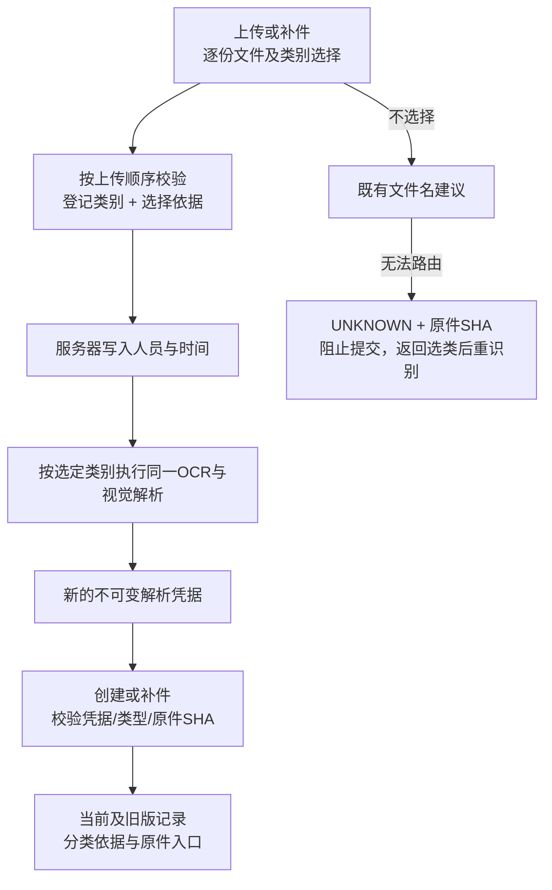

契约和实施：

- `POST /api/parsing/runs`保留原`files` multipart，新增可选`document_types`表单字符串，内容为与files**同顺序、同数量**的JSON数组，每项仅`type_code`（注册枚举或null）与`reason`（选择时trim后2至500字）。同名文件按槽位和实际File对象绑定，不能用文件名当主键。null沿用旧路由。未提供数组的老调用继续可用，不要求先改名。
- 在写文件前校验整个数组，错格式、错数量、未知类别、无依据或伪造`selected_by/selected_at`均400；实际身份来自JWT经办角色，时间来自服务器。仍使用原上传大小/格式/队列/原件权限，队列满清理逻辑不变。
- 服务端将`type_code`和`classification={method:operator_selected,type_code,reason,selected_by,selected_at}`送入现有解析任务。选择只决定字段Schema，不跳过OCR、图像、类型或证据校验。UNKNOWN也返回原件SHA、页数和Schema版本，不能因无字段失去来源身份。
- `jobs.verified_document`沿用凭据归属、doc_code/type_code/path精确绑定与原件SHA验证；分类记录只从服务器凭据复制到`_parsing.classification`，忽略客户端字段中的同名伪造。分类和字段确认是两种不同记录，类别选定不等于字段已确认。
- React `DocumentTypeChoices`复用于创建和补件，选择后依据必填，文件移除/新模板/切换任务均不套用旧类别。表格用File对象绑定而不是同名字符串。补件逐字段修改不应重建类别表，使用React memo/useMemo/useCallback保留稳定输入；没有另建表单库。
- 创建页真实显示未知类别错误和原件入口，“下一步”禁用，可返回上传页重新选类及识别；恢复旧编号没有本地File时需重新选原文件。新解析重新生成字段与确认状态，Collapse按run_id重挂载，不把旧JSON编辑或核实说明带入新结果。
- `ClassificationAudit/DocumentClassificationHistory`在识别页、任务页及旧版补件快照展示类别、依据、人员、时间和原件入口，明确分类不代表审核通过。正式数据库字段复用已有解析审计JSON，不做Schema迁移。

成熟方案比较及来源（2026-10-23官方核对）：[FastAPI文件和表单](https://fastapi.tiangolo.com/tutorial/request-forms-and-files/)支持File与Form共用multipart，不能同时假定JSON Body，因此元数据放Form字段并经已安装Pydantic严格校验；FastAPI与Pydantic均MIT许可，复用既有依赖，无额外服务。类别列表复用[Ant Design Select](https://ant.design/components/select/)（现有5.x，MIT），不升级文档页面显示的6.x，不自建选择控件库；缓存复用[React memo](https://react.dev/reference/react/memo)（MIT）减少字段编辑时无关表格重绘。

自动内容分类的后续子模块仍需实施和验收，人工回退不能替代它：

| 路线 | 正确性与验证 | 资源/授权与运维 |
|---|---|---|
| 现有文件名建议+明确人工选类 | 无新增模型；本轮只验证上传索引、来源绑定与角色留痕；误导文件名仍需人核对 | 已实现，无新增算力/服务，不产生自动分类准确率 |
| 汇丰多模态内容分类适配器 | 在字段抽取前用实际原图/文字和登记类别约束返回候选、标题块及unknown；需独立标题/混合文档金标、冲突和错分成本验收 | 可复用现有模型API，但增加请求与时延；未实装或计作本轮通过 |
| [Azure Document Intelligence自定义分类](https://learn.microsoft.com/en-us/azure/ai-services/document-intelligence/train/custom-classifier?view=doc-intel-4.0.0) | 官方要求至少两类、每类至少5份训练样本，可返回页段；v4默认不拆分，splitMode须显式决定；相近或同字节材料不能冒充独立训练/测试 | 云商业服务条款、业务外发授权、区域、收费和资源申请均需确认；本项目未申请和训练，不因当前CPU资源而否定此路线 |

目标分类适配器应保留独立输入输出：原始页和OCR证据→类别/unknown/候选/证据；不能把OCR方向分类器或版面检测器当作业务类别分类器。内容与文件名冲突、一个PDF混合多种单据、无可验证标题时应进入人工确认/拆分决策，未经标注和资源验收不自行拆分。可先增加汇丰适配器，再以相同冻结金标对比成熟分类服务；本轮提供的人工元数据契约继续作为明确回退，并保留机器建议与人工选择两条来源。

### 多页形式发票：汇总与编号商品行分离

第六套德语发票的原基线把3页30行与汇总字段同时要求输出，文字、视觉两次均触发`SEMANTIC_OUTPUT_TRUNCATED`。本轮新增`invoice_items.py`业务适配，复用已安装Pydantic、现有`extract_records`和逐格`validate_record/merge_records`，不建立新的通用表格或评测框架。后续结构化OCR可提供同契约的表格候选，不改变下游证据关口。

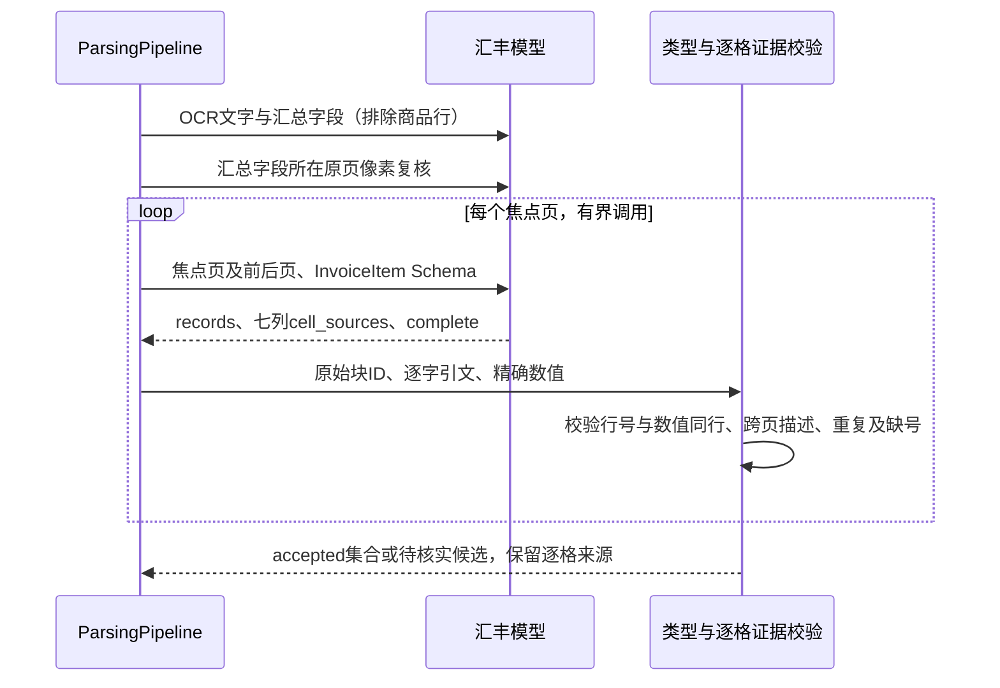

- 路由边界：仅`PROFORMA_INVOICE`且多于一页进入新分支。单页商品表、合同/订单等保留原路径，不能据此宣称全部表格均已通过。原件没有明确行号的新分支返回待核实，不能自行编号。后续应对无编号表格单独标注，再比较结构化OCR路线。
- `InvoiceItem`含原件`line_no`、完整`description`、`quantity/unit/unit_price/amount/currency`。内部类型键为`numbered_invoice_items`，对外仍为`line_items`；不得向所有旧单页商品行施加新行号要求，现有人工核实契约保持兼容。
- 每页最多前后各一页上下文，只输出行号位于焦点页的记录。首尾描述可跨页，单位/币种可引用本表表头；行号、数量、单价、行金额必须有同页且纵向重叠的来源。数字引文不能是更长数字的一部分，例如`1`不能引用`14`，`2,000`不能引用`12,000`。
- 每个非空列有相同英文键的`cell_sources`，禁止把德语表头当作返回键；描述引文须覆盖完整续文。坐标仅由实际OCR块生成，不信任模型坐标。模型仍可能误判行列，因此合法框与同行检查不代表单元格IoU或通用正确率。
- 复用`PARSER_MAX_STRUCTURE_CALLS`预算（默认10次/文件）和每响应200行上限。超预算、截断、`complete=false`、无来源、漏号、冲突均让整集合待核实，保留已有候选供业务查看；不得把部分行统计为可用集合。连续行号及模型complete尚不能独立证明最后一行没有漏掉，仍需更多原件完整性验收。
- 商品表失败单独进入该字段的待核实状态，不让可选表格输出挤掉汇总字段。汇总字段本身缺页/请求失败仍遵守原文档完整性门槛；文档有任一未决仍阻断业务自动通过。
- 汇总总额与印刷数量直接读原件；行加总只供独立诊断，绝不反推、更正字段。第六套打印550000.00/40600与行和558200.00/38400分别保留，下游一致性规则尚未在这份单一发票上独立验收。
- React复用既有`RowEvidenceTable`、`FieldRowsEditor`，有行号证据时展示“原件行号”，描述可按页定位；机器证据不可编辑，载入候选不等于人工确认。前端12项组件回归及生产构建通过，不替代浏览器原生文件上传验收。

日期和标签采用显式业务词表：登记德语发票号、卖方、买方、日期、币种及付款条款标签，只去除行首匹配标签及冒号，不任意截取字符。`Stk/Stück`显式归PCS，不改数值、不把未知ton归公吨。日期复用现有`python-dateutil==2.9.0.post0`的命名月份解析与自定义`parserinfo`，限定完整日、命名月份和四位年，再核对解析日/年；禁止缺省年月日、模糊解析、两位年与数字月日猜测，不改进程全局locale。

选型依据（2026-10-23核对）：[dateutil parser官方文档](https://dateutil.readthedocs.io/en/stable/parser.html)说明其默认宽松补全和parserinfo语言扩展，因此直接宽松parse不适合本业务，采用受限适配；[许可证](https://github.com/dateutil/dateutil/blob/master/LICENSE)为Apache-2.0及BSD条款，无新增依赖、外部服务或部署成本。对比[PP-StructureV3官方模块化表格管线](https://www.paddleocr.ai/latest/en/version3.x/pipeline_usage/PP-StructureV3.html)：其版面/表格结构可替换当前文字块候选层，但需要模型、部署资源与本套逐格质量实测；保持现有OCR作为资源基准，不能凭当前2核机器否定该升级路径。PaddleOCR许可证及资源对照沿用下表记录，本轮未改共享部署。

### 商业合同附件表格：成熟组件定范围，逐格视觉复核

第六套五页合同的正文、付款金额和附件商品行分别处理，不能把两批不同页面的商品集合当作标量冲突。复用现有`InvoiceItem`内部七列Schema、逐格原文验证及相邻页视觉提取，不新建通用表格框架。对外仍为`line_items`，其内部类型名沿用`numbered_invoice_items`，并不把本文件改称发票。

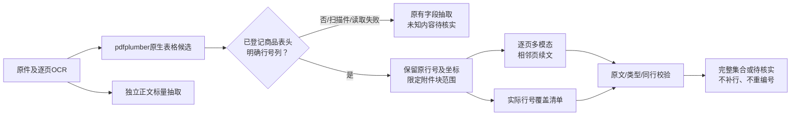

`goods_tables.py`只为多页商业合同/订单提供可选范围：复用已安装`pdfplumber==0.11.9`的`find_tables`与`extract_words`。要求明确的No./Nr.列及商品描述、数量、单价、行金额表头；原件几何及逐字行号仅用于路由和完整性反证，绝不直接生成可接纳金额/数量。没有可确认范围时记录not_detected/unavailable，沿用旧流程，不把页数或“Appendix”一词当作已证明商品表。

原生表格重建可能漏掉跨页末行，不能用`Table.extract()`行数直接决定完整性：在真实编号列及表格边界内核对全部原文字词，保留其页码/框。重复、非连续编号、多张可疑表、超过200行均形成未决。逐页返回的所有行号集合必须与原件清单相同，每个行号证据还须对应原页位置；末行缺失即使模型说complete=true也不得接纳。无编号、多组各自从1开始、只有扫描图或未登记表头仍需后续版式方案和独立验收，不自动造编号。

正文仍读取整份文件，表格调用仅传附件范围内文字块和相邻页原图；原始Page不被裁改，保留全文中的冲突、用途及付款条款。跨页描述必须带完整多页引文，当前示例第22行的款式位于下一页，不得漏掉。表格失败只使该集合待核实；缺页/正文请求错误继续按整文档完整性门槛处理。

原行号齐全不等于描述完整。`native_goods_scope`另保存已确认表格描述列内的原始文字块`description_sources`；所有块都必须由描述单元格引用其实际block_id，且完整文字被引文覆盖，不能以引用同块的较短前缀冒充覆盖。未覆盖块进入`TABLE_DESCRIPTION_COVERAGE_INCOMPLETE`及诊断清单，`line_items.value`保持null。此检查只适用于正向确认的编号合同表范围；它不能证明原OCR本身没有漏字，也不代表任意表格全文召回率。

对下一页首个原行号之前的实际描述块，前一焦点页请求增加`possible_continuation_sources`，要求结合两页原图确认是否属于前页末行；不传金标或预期款式，不在后处理自动附加。真实合同首次虽30行齐全却漏掉下一页款式，新增覆盖门槛后正确阻断；只有模型返回完整跨页引文且全部原文、同行及覆盖条件通过才接纳。原生范围和诊断保存在`line_items.table_scope`，随完整机器证据落表，避免只在临时顶层报告保留。

正文标签适配新增显式`Contract No.`、`Account No/No./Number`；去除标签后保留完整后缀和前导零。文本与视觉的合同号仍冲突时维持未决，不以表内行号、发票号或截断子串代替合同号。

字段候选比较必须区分类型。通用Decimal等值不能用于账号或文本编号；`field_equivalent`对已规范化的account/text按文字比较，用于原文值对应、候选冲突、视觉替换及区域重试淘汰旧候选。账号中登记的空格/横杠格式先按原规则规范化，仍保留前导零；金额/数量继续按精确Decimal比较，123与123.00允许相同。此适配修复“00123与123被当同值”的实际反例，不代表已证明标识符全文召回或所有截断情形均解决，也不能替代OCR/原图证据门槛。

### 账号、编号的完整原文与OCR字段粘连

账号与已登记的`contract_no/invoice_no/order_no/bill_of_lading_no/proforma_invoice_no`不能只凭“引文是原文子串”落表。`identifier_source_check`要求去除登记标签后的实际标识符在单个真实原文块内完整出现，保留空白位置映射，检查相邻拉丁字母、数字及连接符；不能拼接不同文字块或页面制造账号。标签自身可在另一块，完整值仍须在一块中。分组空白、全半角与句末标点沿用明确规范化；未知跨块标识符保持待核实，不自动补前后缀。当前范围为拉丁/数字标识符，不据此承诺全部语言、字体或手写版式。

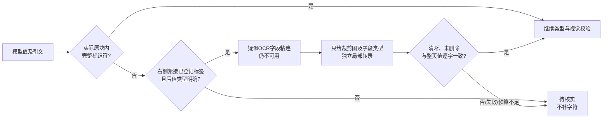

原图中的德语发票号与后续币种分开，但Paddle原块为`…8843Währung: USD`。不能为了恢复此样本直接把标签当成可信分隔符：仅当右侧为已登记的Currency/Währung/币种或Date/Datum/日期标签、紧跟冒号且其余值可按现有类型规范化，才生成服务端`identifier_boundary`疑点；未知标签、未知币种或实际`-CONTRACT`后缀不满足。该信息仅决定是否允许既有局部图像复核，原候选仍带`IDENTIFIER_SOURCE_INCOMPLETE`。模型自带同名metadata在校验前清除，不能自行授权纠错。

复用`correction_crop`、`transcribe_region`及同一单文件预算，不新建模型编排或自动无限重试。只对明确疑似粘连且整页已读清晰的候选发局部请求；无OCR文字、原候选值或金标，只传字段key/label/type及带上下文的原图。`validate_transcription`也按字段类型比较，账号不能借Decimal等值丢零。局部模糊、删改、不同值、请求失败、无唯一锚点或预算用尽均保留未决；普通截短不得靠再次返回同一个短值解禁。原OCR、页面/裁剪哈希、两次读值及同模型标志完整留存，两个视图一致不是独立模型投票或准确率证明。

界面提示“当前候选缺少完整的…原文依据，请对照原件核实”，保留核实说明和候选冲突；已被有效局部复核淘汰的旧候选不重复显示该警告，仍可展开查阅其OCR原文。该组件复用于创建及补件，不显示内部错误码。

成熟能力与取舍（2026-10-23核对）：复用Python标准库Unicode规范化、字符串位置映射及已有图像复核适配；[Python正则官方文档](https://docs.python.org/3/library/re.html#regular-expression-syntax)的`\b`按词字符边界定义，连字符两侧会形成词边界，不能直接证明合同编号完整，因此不使用通用词边界替代业务标识符边界。JSON Schema/Pydantic可以限制格式，却不能证明引文覆盖原件全文；仅提高模型置信度也无法验证。当前无新依赖、许可或独立服务成本，只增加满足条件的限额模型调用；更通用的文档模型/字级OCR结构升级仍须资源、质量及运维比较，不能用这组边界适配替代后续版式验收。

成熟方案比较及来源：已核对[pdfplumber官方表格文档](https://github.com/jsvine/pdfplumber#extracting-tables)及[MIT许可证](https://github.com/jsvine/pdfplumber/blob/stable/LICENSE.txt)。其线段/矩形及文字对齐可解释、无需新服务，适合本原生PDF的范围定位，但不理解商品语义、跨页行或划改，因此不可作为单独质量结论。直接整批JSON商品抽取已在该合同暴露分段集合冲突及缺少逐格证据，停止将其作为此已确认编号表的主路径。Paddle PP-StructureV3可补图像表格/结构模型，资源、许可证及后续质量要求沿用上述比较；当前服务尚未提供结构端点，仍列升级部署决策，不受当前2核配置限制而永久放弃。当前复用成熟组件只做业务Schema、范围和质量适配，外部调用预算仍沿用现有配置。

### 金额从解析到任务的传递契约（decimal-string/1）

`app/money.py`复用Python Decimal及Pydantic约束；`TaskCreate`、`FacilityContextIn`、`TaskOut`的任务金额采用该类型。有效值非负、符合现有NUMERIC(18,2)，输出补齐两位小数字符串，不通过float。该限制仅对应现有任务表头；商品单价等解析字段保留自身小数位，不按两位截断。需要其他货币精度或更大范围时应调整业务Schema及存储并重跑测试，不得自动舍入。

React创建页使用Ant Design InputNumber stringMode，恢复、手工复核、快捷上传及其未决回退均传字符串。`fmt`直接分组十进制文字，额外小数仍完整展示，不能把不合规格的输入先显示成另一合法金额。任务列表、详情、对象链路及助手上下文移除金额Number/float转换。API错误处理将结构化错误及422校验列表转换成文字，以便经办人看到失败原因。

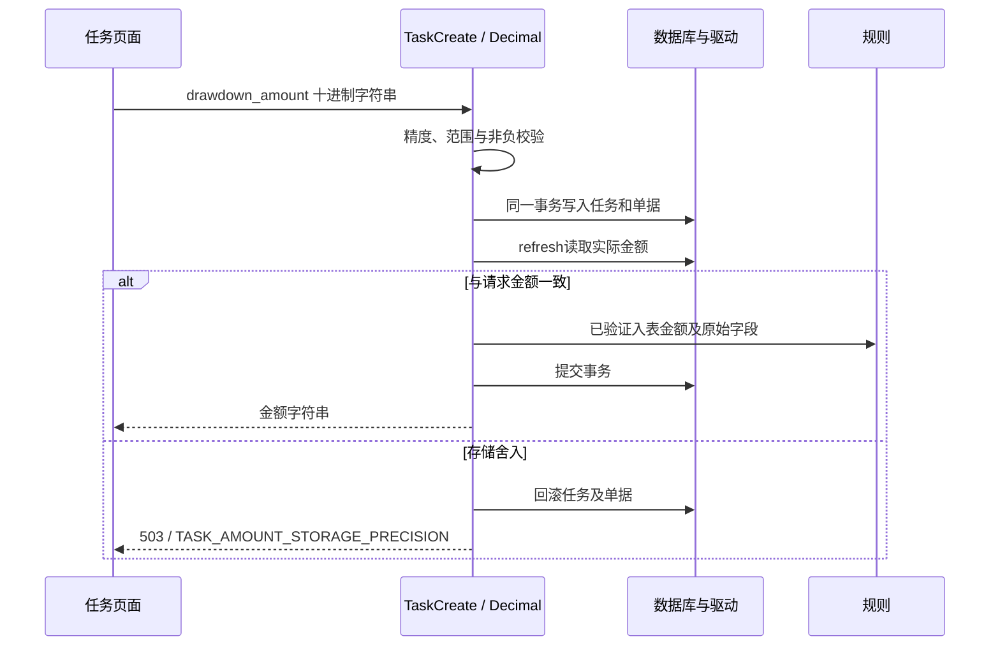

兼容变化必须随前后端一起发布：新响应金额为字符串；前端暂可展示旧数值响应，但无法恢复旧浮点数已经丢失的分位。旧JSON整数和数值形式的整数（例如100、100.0）在安全整数范围内继续接收；带小数的JSON number及超过安全整数范围的数值输入返回422，调用方须改传`"100.01"`。不自动修复历史金额，不改数据库Schema或共享部署。

存储决策：保留已有SQLAlchemy Numeric(18,2)，额外在`routers/tasks.py`创建事务flush后refresh读回；金额不等立即rollback且不执行规则。原生Decimal数据库/驱动（例如PostgreSQL+psycopg2）是完整精度部署候选；SQLite NUMERIC当前路径只允许实际读回相等的请求，不能以POC环境限制目标架构。此轮没有实际PostgreSQL全范围写入验收，仍须在隔离数据库验证最大金额、分位相邻值及回滚；不能用SQLite拒绝样本宣称生产数据库已通过。

成熟组件取舍及来源（2026-10-23核对官方资料）：[Ant Design InputNumber](https://ant.design/components/input-number/)的stringMode自4.13.0起可返回字符串，继续复用已安装Ant Design 5（MIT）；[Pydantic Decimal](https://docs.pydantic.dev/latest/api/standard_library_types/#decimals)提供精度约束和JSON字符串序列化（MIT）；[Python Decimal](https://docs.python.org/3/library/decimal.html)提供十进制运算，标准库无需新服务；[SQLAlchemy Numeric](https://docs.sqlalchemy.org/en/20/core/type_basics.html#sqlalchemy.types.Numeric)明确驱动若返回float，asdecimal也不能恢复精度（MIT）。不引入货币计算框架，不用额外格式化层掩盖驱动舍入；新增成本仅为创建事务一次标量读回，尚未测并发开销。

### OCR与多模态基线

| 方案 | 首版位置 | 优点 | 限制与验证方式 |
|---|---|---|---|
| 已部署 PaddleOCR HTTP | 首版 OCR 基线 | 已可调用，返回块与坐标，服务隔离 | `/extract` 关键词及固定0.9不是校准准确率；扫描表格、手写、选项需真实样本验证 |
| PaddleOCR PP-StructureV3 | 后续可替换版面/表格能力 | 官方支持版面区域、表格、阅读顺序 | 与当前OCR跑同页同字段，比较行列归属、证据、错误与资源；不凭官方榜单直接认定本业务最优 |
| Docling / 其他成熟文档解析 | 对照候选 | 文档结构、表格、可配置OCR | 验证中英文银行单据和坐标映射；评估模型、许可证和部署成本 |
| 文档视觉模型 / 云OCR | 资源申请候选 | 可能改善复杂版面、手写与低清图像 | 核对数据流授权、区域、价格、延迟及批量限制；同测试集验证，不静默换供应商 |
| 汇丰多模态全页直读 | 消融对照，不取代OCR证据 | 能看选项、删改和复杂表格 | 需防幻觉、坐标虚构、遗漏和自评高置信；必须通过同一证据关口 |

现有 ECS 为共享 2vCPU/约7.5GiB，单页 OCR 会占满两个 CPU 核。首轮串行小批量验证；目标架构不以这台机器为上限。需要批量/并发或更强文档模型时，申请独立 OCR worker、更多 CPU 或 GPU；报告实测吞吐、p95、内存峰值后决定。不得把“当前没GPU”写成“不需要更好方案”的结论。

官方能力资料：[PP-StructureV3](https://www.paddleocr.ai/latest/version3.x/algorithm/PP-StructureV3/PP-StructureV3.html)、[表格结构识别](https://github.com/PaddlePaddle/PaddleOCR/blob/main/docs/version3.x/module_usage/table_structure_recognition.en.md)。仅用于选型，不视为银行样本准确率证据。许可证和锁定版本在替换适配器时记录，本轮 HTTP 客户端不复制上游模型或源码。

补充对照来源（2026-10-23检索）：[Docling官方文档](https://docling-project.github.io/docling/)明确提供版面、阅读顺序、表格与OCR；[官方pipeline配置](https://docling-project.github.io/docling/reference/pipeline_options/)允许替换OCR与表格模型。本轮不引入其完整模型栈，原因是先以已有Paddle服务建立同一业务基线；后续对照需锁定版本并核对模型及依赖许可证，再测本项目行列归属与定位质量。

## 3. 文件与子模块

| 子模块 | 文件 | 实施内容 |
|---|---|---|
| 配置 | `app/parsing/config.py`、`.env.parser.example` | 独立前缀、服务端密钥、超时、页/文件/像素预算 |
| 原子契约 | `contracts.py` | Page / Block / OcrProvider / SemanticProvider，provider错误转公开错误码 |
| 预处理 | `preprocess.py` | 逐页判断文本质量，混合页走OCR，渲染并保留页号与尺寸；损坏/加密/超限明确失败 |
| OCR与模型适配 | `providers.py` | Paddle `/analyze` multipart id/file；汇丰兼容API，严格JSON及stop终态，拒绝重定向和公开HTTP传原件 |
| 字段字典 | `registry.py` | 8类定义，首测7类；别名、语义类型、选项枚举、单位配对、必填/视觉要求，版本`loan-fields/1.3` |
| FOL结构明细 | `structured.py`、`records.py` | 章节范围、相邻页焦点抽取、Pydantic行类型、逐格来源、跨页合并及额度冲突 |
| FOL逐授信条款 | `terms.py`、`records.py`、provider专用提示 | 附表/标题/完整正文范围、跨页续文、三列严格行、整条覆盖及格式限额重试 |
| 提款与FOL关联 | `facility.py`、解析/任务路由、`FacilityContextPanel/History.tsx` | 独立关系DTO、原件绑定候选、精确登记别名、人工品种对应说明、提交复验及历史依据 |
| 规范化 | `normalization.py` | Decimal、日期、币种、账号；歧义日期/未知币种不猜；前导零保留 |
| 调度与融合 | `pipeline.py` | OCR → 文本候选 → 原页复核 → 候选冲突与证据校验 → DTO；重试/失败不造值 |
| 图像纠错 | `visual_correction.py` | 选取单一OCR定位锚点、盲转录裁剪原图、核对两次读法、保留原OCR与图像哈希 |
| 主站接入 | `parse_agent.py`、任务路由、解析运行路由 | 保留旧结果字段，兼容扩展质量信息；异步运行、轮询、身份归属和原件落盘 |
| 入表与审核关口 | schemas / tasks / rule runner | 保存服务器识别凭据与人工确认；待核实必填项阻断自动规则结论，不能用None当0放行 |
| React复核 | CreateTaskView / types / api | 进度、质量状态、原文、候选、人工说明；列表与表格编辑可用，错误不能显示识别成功 |
| 实测工具 | `scripts/evaluate_parser.py`、`parser_tunnel.py` | SSH指纹固定的加密隧道，逐份实测，缓存可重放但区分live/replay |
| 回归 | `tests/test_parsing*.py`、`evaluation/parser/` | 确定性边界、HTTP契约、第8套金标、业务操作脚本及指标报告 |

## 4. 逐页预处理

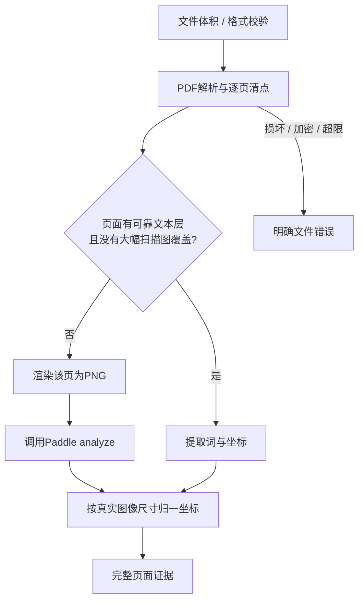

当前服务器源码以整份PDF文字总长度判定是否OCR，混合PDF可能漏页。客户端必须逐页选路，不把整份混合PDF直接发去依赖此判定；向OCR发送单页PNG也消除了PDF点坐标与扫描图像素坐标不一致的歧义。原始OCR倾斜poly后续扩展保留，不能用虚构bbox代替。

## 5. 字段语义与证据

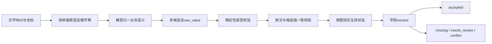

规范字段对象至少含 `key,label,data_type,kind,value,raw_value,status,required,source,candidates,issues,method`。候选含 `normalized_value,block_ids,evidence,visual_state,reason,method`。模型不提供受信坐标，坐标由服务端从已登记块计算。拒绝未知ID、空证据、非法坐标、截断输出、原文与金额不一致。

文本OCR分数不等于字段正确率；首版 `confidence` 仅兼容旧表单，以 `status` 为准，不声称90%准确率。`value` 只放已接纳值，未决值保存在候选，避免规则误用。OCR错字被视觉纠正但无法与文字块核实时，进入限额局部重OCR；仍不一致时仅允许经过下述独立局部图像转录门槛的数值/单位纠错，其他情形人工核实，不悄悄覆盖。

金额与币种分开，规范值与raw_value并存。`quantity/unit_price` 为精确数字字符串，分别配对 `quantity_unit/price_unit`；单位不明确时不能自动接纳对应计量值。已登记的千克、公斤、MT、公吨、卷等可规范化；`ton`可能指短吨或长吨，不能默认公吨。运单另有 `net_weight/gross_weight/weight_unit/package_count/package_unit`，避免把12卷当89.860吨。单价分母可根据同一商品行的数量单位及单价表头关系确定，须引用本表证据，不能通过金额算术或其他文件反推。多行不同单价时不平均，含税口径保存在 `line_items`。列表和结构化行也须逐项有证据；跨页归并尚未完整验收。

FOL应保留借款人清单、授信结构、借款人分配限额、用途和特别条款。第8套有多个借款人与多种授信品种；未由提款指令确定主体/授信对应前，不能把美元总额度直接当该借款人的可用人民币额度。三类结构明细及下述关联DTO/规则关口已实现；完整用途/期限/特别条款及余额依据仍需实施和验收，不能靠固定mock额度制造通过路径。

### FOL跨页结构子模块（已实施）

复用既有Pydantic 2的严格模型、`BeforeValidator`及禁止额外属性机制，只实现银行业务列和证据适配，不自建文档框架。官方依据见[Pydantic配置](https://pydantic.dev/docs/validation/latest/api/pydantic/config/)、[前置校验](https://pydantic.dev/docs/validation/latest/api/pydantic/functional_validators)。本机既有版本2.10.3，已核对安装包LICENSE为MIT；不新增模型服务。[Docling文档结构](https://docling-project.github.io/docling/reference/docling_document/)保留页码、bbox、字符范围及表格行列跨度，其[分层分块](https://docling-project.github.io/docling/concepts/chunking/)保留文档层级和上下文，作为完整表格解析器对照方向。本轮不安装完整Docling或声称使用了它的表格模型；当前章节适配成本低，但依赖可读英文标题，未知/重复边界必须报缺口。

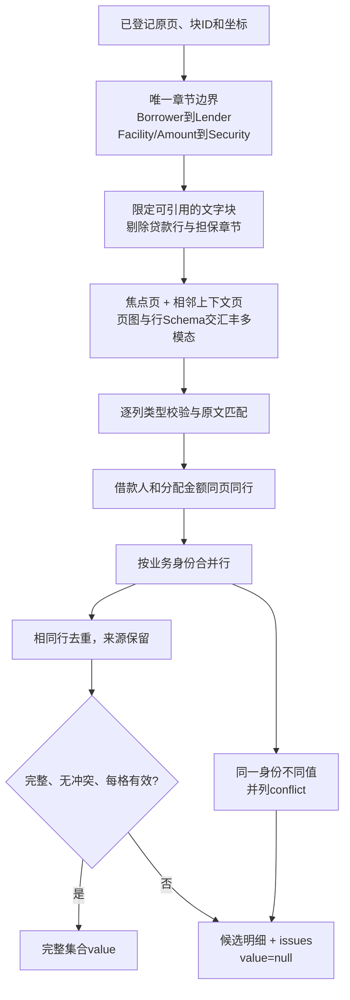

| 字段 | 严格业务列 | 语义边界 |
|---|---|---|
| `borrowers` | `name`；可选`short_name,name_local` | 名单中的英文法定名称、原文简称、中文名；不是本次提款选定主体 |
| `facility_limits` | `facility_name,amount,currency` | 总额度、各品种额度、共享组额度；禁止加总 |
| `borrower_allocations` | `facility_name,borrower_name,amount,currency` | 同一物理表格行中的主体分配额；品种标题可在前页 |

每列必须有`cell_sources[column]={raw_value,block_ids}`。服务端回填`row_results[].cells[column].sources`的页码、bbox、文字、方法与OCR分数；模型坐标和未知ID不受信。金额精确十进制字符串，金额中明确印出的币种还须与币种列一致。分配的主体与金额须同页且纵向框重叠；不能把同一页任意两个块拼成一行。原文错误金额会保留可读的部分单元格和位置，整行`value=null`；前端载入时保留该行并把非法数值留空，不能悄悄漏行。

焦点页记录按行追加，不将每一块不同的行数组当作竞争标量。相同行合并并保留重复证据，同一业务身份不同值全部标冲突，后续重复不能消除已有冲突。数字/字母标题编号、外层括号标签及末尾冒号可确定性归一，原始引文不变；不改公司名称、模糊字符或别名。名单简称与分配表简称不同不能自动认同一主体。上下文页的纯重复记录不作为焦点页新记录。

每文件最多`PARSER_MAX_STRUCTURE_CALLS=10`次相邻页调用，每次最多200行，0关闭并显式报预算缺口。原本OCR/标量调用不重复计入新调用；没有结构provider、超限、失败、页不完整都使集合待核实。首版以唯一英文业务章节为边界，不宣称支持任意合同版式或所有跨页表格。`tranches`旧接口仍保留，尚未由三类明细自动映射本次适用授信，旧冲突不被隐藏。

前端以业务列编辑，机器候选为只读证据表，可按页定位单元格；同页多个来源框取并集，避免重复原文按钮。超过10行的编辑表和候选表分别分页；编辑/删除使用全表行号，不能把第2页的操作应用到第1页。载入候选不是确认，保留不完整行提示；人工提交须填写说明，后端再次校验严格行类型并留存机器原值。逐格验证成功的行数与完整集合可用数分别统计。

### 本次提款与授信关联（已实施，业务适用仍待验收）

选型沿用Pydantic严格输入和Ant Design选择/表单组件，仅实现本项目关联检查，不新建知识图谱、通用实体消歧或Agent框架。2026-10-23补查[Pydantic模型及跨字段校验](https://pydantic.dev/docs/validation/latest/concepts/validators)和[Ant Design Select官方API](https://ant.design/components/select/)。既有Pydantic/Ant Design均沿用项目依赖和MIT许可；精确登记名匹配可复现且无额外推理成本，无法解释中英文语义差异，因此由明确人工关系留痕承接。模糊名称相似度或让模型直接选择额度难以证明法定主体一致，本轮不采用。

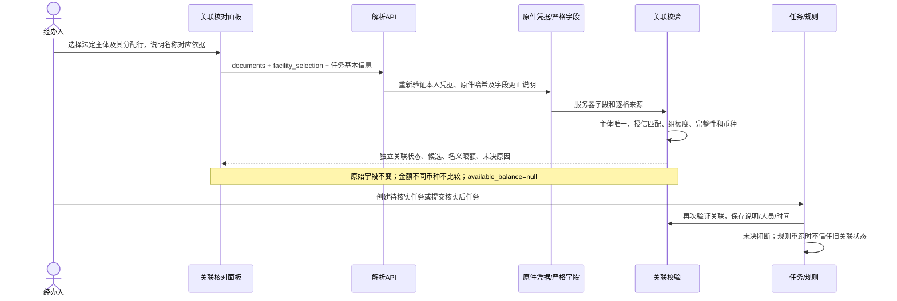

`facility-context/1.0`与`loan-fields/1.3`分开版本。解析响应的`facility_context`含`request`（提款borrower/facility/currency/amount及原件位置）、`borrowers`、`allocations`、`selected_*_id`、`association_method`、`nominal_limit`、`comparison`、`available_balance`、`issues`。候选ID为doc_code、原件哈希、字段、行号、业务值及逐格来源的SHA256；不能仅传行序号或客户端金额。原件或字段改变后旧ID失效。人工更正的行没有完全相同机器值时，不沿用机器单元格位置。

- `POST /api/parsing/facility-context`：经办JWT；输入`DocumentIn[]`和可选`facility_selection={borrower_id,allocation_id,reason}`，说明1..4000字且非全空白、ID固定64位，禁止额外属性。逐份`verified_document`校验原件和字段，返回即时核对结果，不写业务任务。不调用OCR/模型，缓存和凭据重放不能作为推理性能。
- `POST /api/tasks`：接受同一selection，完成所有原件校验后重新分析，不信任前端计算的关系或状态。保存到FOL的`_parsing.facility_context`，包括`confirmed_by/confirmed_at`、原始候选和来源、任务基本信息、说明及全部未决项。允许保存待核实任务，不代表认可真实借款主体。
- 精确匹配仅做NFKC、空白及大小写归一；法定名、原文中文名、原文简称来自已核实借款人行。分配简称须唯一对应同一FOL主体；不得自动删掉名称字符、翻译、修正ABCJilin/ABCD Jilin或由任务客户填补原件借款人。多份FOL和多份提款不默认取第一份。
- 中英文授信名称不同可以人工确认关系；该说明不能覆盖提款借款主体差异、原文异常金额、组额度冲突、名单/分配表不完整、未知允许币种或不完整页面。选择某一清晰分配行不等于整份合同已核实。
- 名义限额只在提款金额、计价币种、允许提款币种及关联均核实后供规则比较。不同币种没有批准汇率/额度折算依据时`comparison=null`。同币种名义限额以内仍须核实用信、冻结和共享占用，`available_balance`保持null；超名义限额才可直接判定该项超限。删除旧“额度减提款=剩余可用”结论。
- React面板提供主体/分配行、逐格原文和说明；选候选不会清除未决。字段变更清空旧人工关联，任务信息变更标记待重新核对；请求返回前又有修改时，不采纳迟到结果。任务页显示提交时历史关系、说明、人员/时间和分配金额原文，明确不能替代当前规则结果。
- 规则在原件识别关口后重算关联，检查当前字段与保存的final_value；旧确认失效返回`FACILITY_APPLICABILITY`提示。投影名义限额只存在于该次规则bundle，不写回原文`facility_amount`。用途、利率、期限等逐授信条款尚未完成，不能宣称关联ready即业务可提款。

## 6. 视觉复核与人工处置

### 逐授信附表条款（本轮实施边界）

采用“附表 → 授信标题 → 完整条款 → 原文块”的层级，而不是把全文的用途、利率或期限合并为一个标量。成熟方案参考 [DoclingDocument 层级与 provenance](https://docling-project.github.io/docling/concepts/docling_document/) 和 [HierarchicalChunker 保留章节标题](https://docling-project.github.io/docling/concepts/chunking/)。Docling 能提供通用层级/版面能力，但引入完整模型栈仍需独立比较扫描件质量、模型许可证和部署成本；本轮不新增该依赖。继续复用现有 Paddle、汇丰模型、Pydantic 严格行契约及 Ant Design 控件，只实现 FOL 附表业务适配，不自建通用版面/分块框架。

新增 `terms.py` 和 `facility_terms` 行类型：`facility_name / clause_heading / clause_text`。条款逐字保留条件、子项及跨页续文，不概括、不翻译、不把罚息当普通利率；未提供的固定利率、贴现期限或已签总协议不能补造。系统仍保留原有标量未决状态，条款转录通过不等于本次提款适用性或可提款结论通过。

范围由唯一 `SCHEDULE OF FACILITIES`、其授信标题和下一附表/一般条款标题界定。已注册条款标题按原文划分，跨页续文同属一行；未知或缺失边界显式待核实。每次模型请求只包含同一附表的完整条款与标题来源，最多配置允许的页数。`PARSER_MAX_TERMS_CALLS=8` 独立于借款人/额度抽取预算；超限不得假装完整。模型返回 `complete=false`、缺行、标题串用、引用其他授信、漏掉任一正文块或限制条件均不自动接纳。

逐格引用必须经过现有校验；额外校验授信名仅引用本附表标题、条款名仅引用对应标题、正文引用有序完整正文，防止“同页有来源但漏条件”。已知页脚 INTERNAL 和页码按位置排除；底部其他不明标记保留位置并使集合待核实，不静默当正文或丢弃。前端按业务列展示完整条款、多页来源和未决原因，长文本使用多行编辑；人工更正沿用原件哈希凭据、说明、人员与时间。

第8套工程金标由原图先核对：四份附表、17项完整条款，包含循环贷款罚息跨页、进口融资利息跨页、承兑业务承诺跨页，以及贴现条款引用另签总协议。评测必须区分条款逐字保留、自动接纳和整份集合完整，不能用模型回答生成金标，也不能将文字相同视为业务条款已解释正确。

实施采用专用`TERMS_PROMPT`，与名单/额度的`RECORDS_PROMPT`分开，避免通用“去编号”约束影响条款原文。只有回答完整但列形状错误时允许一次格式重试，计入同一8次上限；`complete=false`和证据差异不靠重试覆盖。缓存key包含实际系统提示、模型、业务spec、原图哈希、块和焦点页。评测分别记录live_attempts、live有效响应与failed_attempts，坏格式产生的实际外部请求也须计数；缓存重放与新请求分开。

强制查看扫描页、选项字段、表格、低质量块以及业务候选所在页；即便文字层清晰，也要防止文字上覆盖了删除线。复核输入含整页或保留选项上下文的区域，不仅是孤立勾选框。

视觉状态分 `clear/selected/unselected/deleted/ambiguous/not_checked`。未选/删除不生效，歧义不生成最终值。多个实际候选值不同进入conflict，不允许“模型最后说的算”。文字转录差异和业务数值冲突分别留痕；OCR原文不得被改写为视觉转录。没有OCR/模型服务时返回显式缺口，绝不回退固定业务值。

人工确认应记录旧值、新值、证据、说明、人员和时间。原件本身有错进入补件，不把“改字段”当作“更正原件”。新文件哈希变化应重新解析并失效关联规则结果；旧确认不得自动沿用。

### 补件、重新解析与旧版本追溯（已补齐的工程链路）

复用既有`business_review.supplements.apply_supplement`及其材料摘要/状态比较更新，不另建通用版本或工作流框架。SQLAlchemy[Session事务与提交回滚](https://docs.sqlalchemy.org/en/20/orm/session_basics.html)提供持久化基础；React[状态与key的关系](https://react.dev/learn/preserving-and-resetting-state)用于新回执清空编辑组件状态。两者均为MIT许可（[SQLAlchemy许可证](https://github.com/sqlalchemy/sqlalchemy/blob/main/LICENSE)、[React许可证](https://github.com/facebook/react/blob/main/LICENSE)），现有项目已有安装，无额外服务或依赖。比较过独立版本框架与现有审计：当前沿用已校验的补件事务和历史快照，接入/运维成本较低；版本数量增大时需分页历史API并建立原件历史关联索引，不能将当前JSON检索视为大规模归档方案。

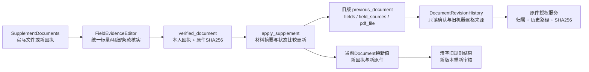

- `SupplementDocuments.tsx`：所有字段复用`FieldEvidenceEditor`，包括借款人名单、授信分配、完整条款及商品行；逐格来源明确绑定本次补充文件路径。`Collapse`以`parse_run_id`为key，新解析不携带旧编辑/确认/替换选择。载入候选仍不自动填写核实说明。旧任务/旧文件迟到响应不得覆盖新选择。
- `jobs.verified_document`：新回执重新生成每字段machine/final/status/说明/人员/时间；原件字节与旧回执哈希不同即拒绝，不能手动修改回执哈希来跳过解析。字段核实说明只能证明该回执下的人工更正，不能作为修改原件文字的证明。
- `supplements.py`：整批验证完再更新；替换保留原单据id与doc_code，通过`source_doc_code`指向新回执中的单据。新字段不合并旧`_parsing`。新增`changes[].previous_document`深拷贝旧完整字段、机器证据、人工确认、授信关联与来源；仅有业务`previous_snapshot`不足以保留解析阶段人工确认。本轮不回填历史缺失确认，也不伪造旧快照。
- `DocumentRevisionHistory.tsx`：审核员按需读取既有审计API，展示补件说明、旧版未决、旧人工确认及只读机器行证据；`RowEvidenceTable`不传`onAdopt`即无载入入口。源位置使用旧文件路径，不按doc_code切换到当前文件。旧档缺少完整字段快照时明确提示，仅提供受权原件入口。
- `routers/files.py`：当前原件要求任务提交人与服务端批次归属匹配，防止客户端登记别人的文件来授予审核员访问。旧原件只接受服务端supplement审计中`previous_snapshot.documents[].sources[].file`精确路径及`file_sha256`与当前字节匹配；审计归属任务也须由原上传人提交。SQL文本包含仅用于筛选候选，真正授权依赖结构化路径和哈希；理由中出现文件路径、错主体、哈希变动及未提交文件都不授权。沿用JWT与private/no-store，无公网静态文件入口。
- 当前与旧回执、原件、审计都应按业务保留策略留存，不能只清理uploads而保留失去依据的历史记录。旧版本完整快照增加存储与审计接口体积，正式归档需测量版本数量、分页和索引；当前测试仅SQLite，正式数据库还需部署联调。

第八套验收复用原件真实响应，分别重复提交提款指令和FOL，验证新回执、旧确认留痕、旧关联清理、授权与未决阻断；没有收到实际补正材料，不能将同字节重新上传称为补正内容识别。另以合成字节变更和未决金额回执验证旧回执拒绝、新回执不沿用确认，仍不能替代真实补正样本新推理验收。

## 7. 运行、接口与隔离

### 条款到规则事实的业务适配（本轮）

复用已安装 Pydantic 严格类型及显式类型标签，参考[官方严格模式](https://docs.pydantic.dev/latest/concepts/strict_mode/)、[可辨识联合类型](https://docs.pydantic.dev/latest/concepts/unions/)；Pydantic为[MIT许可](https://github.com/pydantic/pydantic/blob/main/LICENSE)，本轮不加依赖或自建语义推理框架。比较过继续增加一次模型解释请求和确定性业务适配：模型可覆盖更多表达，但仍需可验证条件/数值/范围；本轮优先将已视觉核对的完整条款通过登记业务模板映射，未匹配表达留待核实，后续扩充同一事实契约而非另建一套规则输入。

`term_facts.py`只从服务器凭据的`facility_terms`重建`facility-term-facts/1.0`：每项保留完整条款、所属附表、真实来源、映射方法及限制条件。数字从完整匹配条款捕获，不能把样本中的1/3/6/12/180写成固定输出，也不能只找一个数字或币种子串而漏掉后续例外。许可币种与额度计价币种分开；贷款标准期限、协商的其他期限、含展期的绝对上限分开。进口融资的CIL和Reimbursement只有在完整条款明确列名时才能向其子品种投影，不靠名称包含或模糊匹配继承。

只读派生事实不作为客户端可编辑/可提交的新凭据。字段、原件或人工确认改变时重新派生，不信任客户端提供的旧派生结果；正文变更没有相同机器证据时不沿用其逐格坐标。整集合未决、所选条款未决、证据不完整、未知模板、同名条款重复、复合授信组或多附表匹配均显式阻断自动使用。允许把清晰的候选事实展示给人，但不能据此清除其他识别/主体/币种折算未决。

React关联面板和提交时记录显示所选授信的许可币种、贷款期限及原文入口。规则端只消费同一次服务器复验的适用范围；未知范围不得回退全函币种。利息期不是贷款期限，期限天数不是利率百分比；月份不换算成固定30天。日期相减使用Python[date/timedelta](https://docs.python.org/3/library/datetime.html)，只报告实际日期差，不凭此补出起讫日计入、展期起点、月末或营业日顺延的业务口径。缺乏这些依据保持待核实。

实施接口与规则：

- `derive_term_facts(row_results, collection_status, document_errors)`输出只读候选；`applicable_terms`精确匹配授信名或条款明确列名的子品种。`pipeline`保存投影供查看，`facility`每次从凭据内原始行重建，不信任缓存/客户端投影。
- `CurrencyScope`和`TenorPolicy`使用现有Pydantic严格Schema；期限单位只允许days/months，未声明的条件为null，不能伪装成false。完整正文追加例外、缺掉限制、无证据人工改写、同名重复等均不能匹配为确定事实。
- 币种规则使用所选条款的许可币种和同一条款原件位置；关联或条款范围未决时返回WARN。授信段规则优先使用服务器唯一主体分配关联，不改写原件品种。
- `DRAWDOWN_VS_FACILITY_LETTER__TENOR`展示期限条件和提款/到期日期来源，当前缺少契约日历、展期起点及同意依据时返回WARN；没有以利息期或日期差制造PASS。第八套因更早的识别关口未过，实际任务只显示`PARSING_READY`，单项期限规则通过合成边界测试验证，不能宣称真实业务期限已通过。
- `FacilityTermFacts`在创建页和提交时历史记录复用，只读展示并逐页定位；历史结果不替代修改后重新核实。普通利息和罚息保留不同完整原文，不推导固定普通利率；用途及支付条件尚未自动解释为批准条件。

适配覆盖当前登记的三类完整Utilization表达，不能称为通用合同理解。新OCR或模型可以通过相同事实契约接入；新增措辞必须补独立原图标注和反例后才扩充模板。资源申请、其他OCR比较及业务签字仍按验收缺口管理。

目标运行状态：`queued → running → completed/failed/interrupted`。上传返回202与run_id，前端查询进度，API事件循环不执行OCR。首版以单进程、单解析worker为部署边界；进程重启后未完成运行应标interrupted，明确重试，不能永久显示运行中或误称持久队列可恢复。正式多worker部署改用持久队列、任务租约和隔离存储。

文件名不作为唯一落盘名，避免同名覆盖；总大小、每份大小、页数、像素及待处理任务数均有限额。`routers/files.py`取代主站公开`/uploads`静态挂载：上传人凭服务器写入的批次归属可查看原件，审核员仅能查看已关联提交任务的原件，匿名401、其他经办人404，响应private/no-store。PDF.js、图片预览与下载均携带JWT。失败上传和队列满清理本次随机批次。旧上传没有归属清单时，经办人不能自动获得访问权，部署前须按可信历史凭据回填；不得凭客户端声明回填。共享服务器尚未部署此改造；上线还需确认Nginx没有绕过授权的文件alias。

### 局部重识别子模块

`regional.py`只裁剪未决字段已有来源区域，四周增加20像素上下文，最多放大2倍并遵守像素限额；大于整页75%的区域跳过。配置`PARSER_REGIONAL_RETRY_PAGES`默认每文件2页，可设0关闭。局部OCR的框映射回原件坐标，使用独立块ID保留两次识别证据，再由同一汇丰模型看原页核对。候选须引用新OCR证据才能记为本轮OCR复核；不同值继续冲突，不采用“最后一次覆盖”。可选重试失败保留诊断，不能把其他已核实字段全部作废。局部OCR本身尚未解决本套付款末位及NT/MT问题。

### 独立局部图像转录子模块

`visual_correction.py`只处理money/decimal/unit：已有整页vision候选、视觉状态clear、有规范值，失败原因仅为OCR引文/值不一致或OCR低分。已有数值冲突、选项、日期、账号、删除/模糊候选不进入此分支。须有单一可定位OCR原始锚点，区域不超过整页10%；金额优先锚定数字所在文字块，不把大写金额当作数字依据。

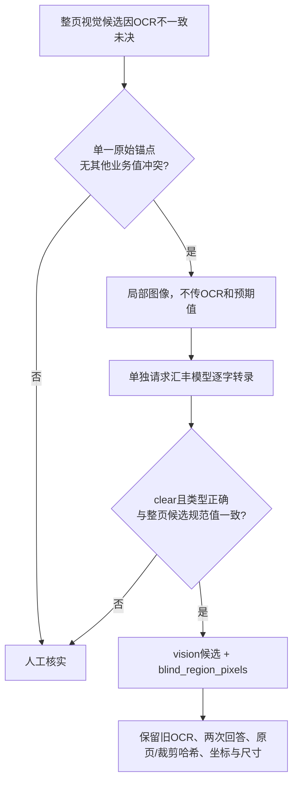

`PARSER_VISUAL_CORRECTION_FIELDS`默认6次/文件，可设0关闭。新调用只含字段key/label/data_type和裁剪图，无OCR文字、模型候选、金标或其他文件。严格JSON raw_text/visual_state，经确定性规范化比较；不一致保留冲突，模糊/删除/未知单位保持未决。原始OCR块及分数不变，候选显式标记`verification=blind_region_pixels`，记录same_model=true，不能称为独立统计验证。区域转录失败只是可选救援失败。当前已解决付款金额；运单净毛重数值虽获两次一致读法，但重量单位仍未决，因此最终净毛重仍留空。

### 业务核实控件

创建任务和补件页面分别保存本次解析的不可变机器结果及可编辑副本，仍复用现有React和Ant Design控件，不增加表单框架。依据[React不可变状态更新](https://react.dev/learn/updating-objects-in-state)及[Ant Design Input受控值/校验状态](https://ant.design/components/input/)实现；已读取本地React、Ant Design的MIT许可证。比较继续只在提交后显示服务端400与页面即时提示：服务端复验仍为权威，即时提示用于避免经办人更正后仍看到绿色“已识别”，无需新增依赖或运维服务。

`fieldReview.ts`仅派生显示和提交准备状态，不修改机器status。当前值与原值不同且没有有效值/非空说明时提示更正未完成，创建页不能进入确认，补件通过既有`onBusy`接口阻止提交。已有未决字段保持原值时仍可保存待核实，不能将“待核实”一律等同禁止落表。填写说明只显示“核实说明已填写”，最终格式、枚举、证据与人工状态由服务器凭据校验决定。逐行值按结构比较，金额不转Number，行顺序保留意义，对象键顺序不算更正。

“恢复识别值”从本次机器快照恢复完整原值并清除未提交说明和JSON输入错误，不通过数值框重新格式化；数值控件可能去掉尾零，手动重输同一数值不等于恢复原始字符串。新解析/恢复结果重新建立快照，不跨解析编号沿用人工确认。原值快照和UI状态不进入API请求，创建与补件仍只提交字段值、核实说明和原解析凭据；不得据此绕过服务端更正审计。

选项使用注册枚举下拉，文本标签来自OCR，选中/删除状态由原图核实；服务端同时校验人工填写的枚举。`FieldRowsEditor.tsx`以货物、授信段业务列逐行编辑，金额保持字符串；证据块与机器原始值不作为可编辑业务列。已知行类型不要求业务人员编辑JSON，其他尚未定义行结构仍使用受校验的后备输入。所有更正均由服务器凭据记录原值、最终值、核实说明、人员与时间。

前端创建页显示本次解析编号，支持本人按编号恢复服务器原始结果；恢复不保存未提交的人工编辑，页面明确提示。查询仍走JWT和服务器owner校验。原件弹窗打开/回命中页时滚动到字段框，避免页中下部证据不可见。有未决项时确认页显示数量和“创建待核实任务”，不再称“确认无误”。

生产在服务器回环调用`http://127.0.0.1:7888/analyze`；本地实测使用SSH隧道并固定已有主机指纹。公网`http://101.201.232.81/ocr`只用于公开契约探测/合成样本，不通过它发送真实单据。`/cloud`第三方外发不自动启用。不修改共享OCR、Nginx、PM2、助手或RAG服务。

### 隐私安全质量指标与失败分类

每次质量运行绑定代码提交、字段Schema版本、提示版本、金标版本、运行模式（live/replay）和样本家族；指标文件只输出聚合计数，不输出文件名、原文、字段值、OCR块文本、账号/编号、原始响应或可逆文本哈希。受控原始响应仅留在授权隔离环境，不能进入Git或普通评审附件。

| 层 | 可重复指标 | 解释边界 |
|---|---|---|
| PDF渲染 | 输入页数、成功/失败页数、页图宽高区间、OCR路由页数/native-text页数 | 渲染失败与OCR/字段缺失分开计数 |
| OCR | 请求成功/失败/空文本页数、块数、非空字符数、框合法率、低/中/高分数桶 | 不保存正文；字符数不是字符召回率，框合法不是框准确率 |
| 字段映射 | 金标适用槽位、非空候选槽位、未注册模型字段键、无候选槽位；每个注册字段另记录类型、状态、值是否存在、候选/活跃候选数、候选方法/失败码及区域重试次数/状态 | 缺字段只在已有逐字段金标中计覆盖，不直接归因为OCR |
| 规范化与证据 | 类型错误、原文未锚定、block ID无效、归一化值与原文不符、错误接纳数 | 逐项保持错误接纳为零优先于提高覆盖率 |
| 定位 | 字段证据页码命中率、合法框率、跨页标量证据率；有人工框金标时另计IoU阈值命中率 | 第八套当前只有页码标注，因此不得报告框IoU或全文定位召回；越界框与压成单框的跨页标量转待核实 |
| 业务可用 | 正确且自动接纳并有位置的槽位数/已标注槽位数；正确接纳精度=正确接纳/全部接纳 | 未标注字段、失败样本和未决事实不得混入分母或计作正确 |

稳定失败码分类顺序：`pdf_render`（文件/页渲染和像素限制）、`ocr_transport`（超时/HTTP）、`ocr_response`（协议格式或OCR坐标非法）、`ocr_no_text`、`ocr_low_confidence`、`field_mapping`（模型键无注册或响应结构错误）、`evidence_reference`（块ID/引用不存在）、`evidence_grounding`（引文不能在OCR块中找到）、`normalization`（类型/规范值冲突）、`localization`（字段框越界、来源跨页但接口只支持单页框）、`semantic_unresolved`（无候选但前置层成功）及`unknown`。每个字段/页只记录类别与计数；无法凭现有观测确定原因时必须归`unknown`，不得倒推归因。`field_diagnostics`仅输出注册字段key、状态、候选/问题计数、区域重试次数/状态及位置有效布尔值；不输出值、原文、块ID、具体坐标、文件名或业务材料标识。OCR块数/字符数/框质量由`page_diagnostics`提供。

## 8. 实施顺序与完成标准

| 轮次 | 实施 | 必须提供的证据 |
|---|---|---|
| 0 基线 | 核对原件、字段口径、OCR契约，建立架构与规划 | 7份54页哈希、原图观察、服务契约 |
| 1 接线 | 可替换provider、逐页OCR、语义/视觉、规范化与证据关口 | 真实样本调用、原始结果、失败与冲突回归 |
| 2 主站 | 异步运行、结果表、原文预览、确认记录、入表与规则门槛 | JWT/归属测试、字段精度、未决项不放行 |
| 3 金标 | 第8套双渠道核对，补合成选项/表格/错误样本 | 字段金标、状态金标、页码/框、实际指标 |
| 4 验收 | 以经办人/审核员完成上传→核实→落表→规则 | 可复现操作报告、问题修正、通过/待确认项分明 |
| 5 替换评估 | 当前OCR vs 更强方案；OCR-only vs multimodal-only vs hybrid | 同一金标指标、实际延迟成本、资源申请理由 |

第8套仅为首批开发/回归材料，不能同时充当独立泛化测试。金标未经业务负责人复核时标`engineering_verified`，不能写`business_signed_off`。第9/10套清点后确认与第8套相近模板，提款指令还完全重复，改列相关业务变体；后续独立留出须按原件来源/版式家族划分，而不是按目录号划分。金标与实现指纹先冻结再推理，重复页与精确请求缓存只报告重放，不增加独立样本数。合成变体不替代原始真实样本。goal完成须核心场景全部通过、关键错误无自动接纳，并从实际业务操作角度完成端到端验收。业务签字是独立的上线治理事项，不把它凭空设为本任务继续实施的许可条件；本任务仍应自主完成工程与业务角色模拟验收。

每轮：固定代码/字典/提示版本 → 跑确定性回归 → 跑受影响真实样本 → 统计错误自动接纳率和覆盖率 → 修复 → 重跑受影响项 → 更新验收记录。缓存重放不算新的live调用，不能用缓存时间声称模型或OCR提速。
