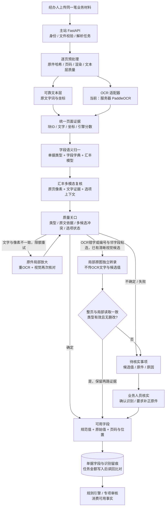
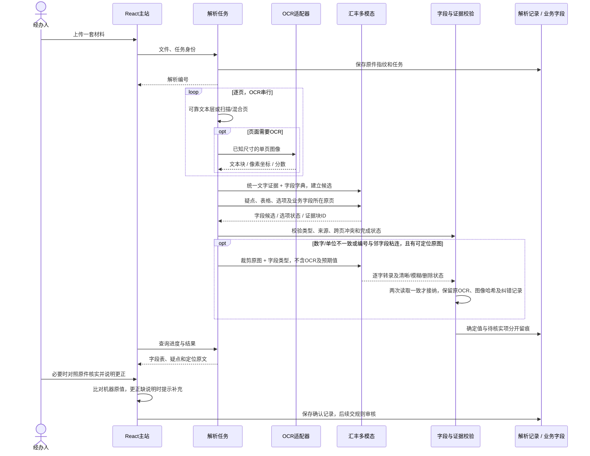
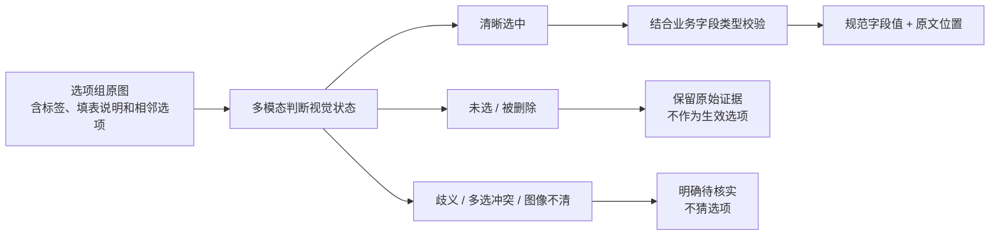
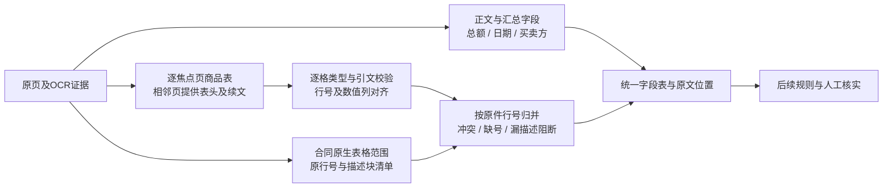
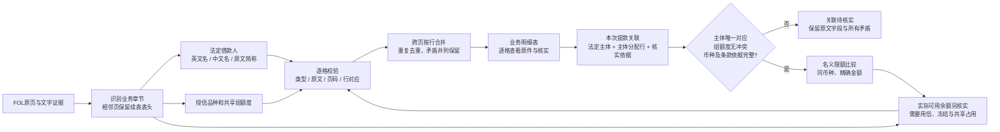
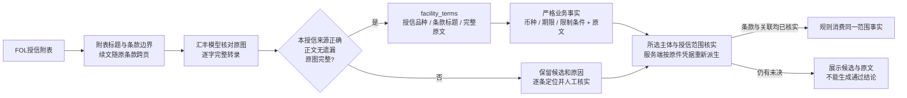
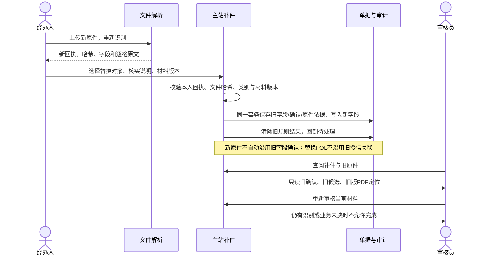

# 文件解析模块架构

2026-10-23 · 给业务与开发同事的入口。[实现细节](实施规划.md) · [验收状态](验收记录.md)。图中描述目标链路，哪些已实现以验收记录为准。

## 1. 文件进来，交付什么

“合同金额”“总价”“Amount”等表达按文件类别、标签、表头和上下文映射到字段 `amount`；单价归 `unit_price`，提款日归 `drawdown_date`，不是见到数字或日期就直接填入某个槽位。数量与单价分别配套 `quantity_unit`、`price_unit`；运单净重、毛重、包装件数分别落表。多商品保留行明细；多借款人、多授信段保留关联，未选定时不能跨段拼金额和币种。

每份原件分别保留事实，跨单据差异交规则审核；不能为了让合同与发票金额一致而改写识别值。更换OCR也沿用同一冻结金标和证据关口，相关模板变体、重复原件与独立版式样本分开评价。

商品行进入审核时，逐格来源随当前原件及解析回执绑定；先明确同一笔交易，再逐项比较。最新隔离API已验证第六套两组30行完整投影，但合同号仍未关联，数量规则保持待核实，没有绕过关联去比较汇总。当前本地经办/审核操作见[业务验收操作单](业务验收操作单.md)。

金额从解析结果、页面编辑、任务接口到详情及助手上下文使用十进制字符串，后端比较用Decimal。任务提交在事务内读回实际存储值，发生舍入即回滚，规则不消费改变后的金额。任务表沿用现有NUMERIC(18,2)；本地SQLite不能据此承诺全范围分位精确，部署数据库及驱动须单独验收。

## 2. 一次解析的时序

文件名目前提供类别建议；名称不明确或建议不符时，经办人可在上传/补件时按原件选类并填写依据。类别、操作人与时间随服务器解析凭据留存，审核员可追溯原件。未识别类型不能直接创建任务，需重新选择类别后重新识别，旧凭据保持不变。这不是自动内容分类或混合文件拆分。

核实页同时保留机器原值与当前编辑值。更正后显示待填写说明，可原样恢复识别值；填写说明不直接变成机器“已识别”，保存时仍由服务器复验并记录人员和时间。未修改的未决项允许保存待核实，后续规则继续阻断自动通过。

## 3. 勾选、叉号、横线如何处理

叉号不固定等于“否”，横线也不固定等于“未选”。OCR 高分只表示文字较清晰，不能证明选项有效。先看整组选项，再结合原件规则；多模态也不能确定时交人工。

视觉已确认选中但选项文字OCR低分时，在原有预算内整页放大再OCR，保留全部选项和说明，新来源及分数必须再次过关。第三套真实扫描件的3个月放大后仍低分，所以保持待核实；业务人员确认时另记人工依据，不覆盖机器结果或遮挡主体。完整已填日期周围的表单横线可归一，日期缺位与日月歧义仍不猜。

## 4. 可替换的原子模块

多页发票将汇总字段与商品表分开读取，避免几十行明细挤占同一响应造成截断。商业合同/订单另用成熟原生表格组件确认已登记的编号商品表范围；它只提供范围和完整性检查，业务值仍经过OCR、多模态及原文验证。当前不能据此承诺扫描表、无行号表或任意表头。

印刷合计与逐行金额分别保留。两者不一致是后续业务检查的输入，解析器不能自行把其中一个改成另一个。

跨页续文不能只靠模型声称完整：已确认合同表内的原行号、位置及描述块均须覆盖。下一页首行号之前的描述只作为可能续文传给模型，需对照原图确认；漏掉款式等描述时整集合待核实，不自动拼接或补写。

| 模块 | 当前基线 | 替换后保持不变的契约 |
|---|---|---|
| OCR | 已部署 PaddleOCR 3.7.0，调用 `/analyze` | 单页图像 → 文字块、坐标、分数 |
| 字段语义 | 汇丰提供模型 API，字典约束输出 | 证据 + 字段定义 → 候选值和证据ID |
| 视觉复核 | 汇丰同一多模态能力 | 原图 + 候选 → 视觉状态、候选、依据 |
| 局部图像转录 | 汇丰多模态，独立请求 | 裁剪原图 + 字段类型 → 原文及视觉状态；不接收OCR/候选值 |
| 质量与落表 | 本项目确定性校验 | 不依赖模型品牌，未决事实不能记为通过 |

服务器的 `/extract` 只是关键词提取，不能覆盖七类材料的全部业务语义；首版使用 `/analyze` 取得底层文字与坐标，由本模块统一映射字段。今后换本地文档模型或云 OCR，只替换 OCR 适配器，并跑同一测试集比较质量、延迟、成本和运维要求。

局部读取和整页读取使用同一模型，是一致性校验，不是独立模型投票或准确率证明。原OCR文字不被覆盖；无法定位、两次读法不同、存在删改或单位不明时保留待核实。

账号与合同号等编号须有完整标识符原文，不能只截取子串或拼接不同块。OCR把后续日期/币种标签粘进编号时，只形成待核实疑点，经限额局部原图复核一致才可用；实际缺前后缀的候选不靠重复短值解除。页面显示完整性提示，候选与核实记录继续保留。

## 5. 多借款人和跨页表格

当前已实现三类明细、逐格来源及独立关联核对。原件中的法定名、中文名、简称可精确对应；中英文授信名称不同由经办人填写对应依据，不覆盖原文字段。候选与原件哈希绑定，保存时重新校验，审核员可查看提交时记录。第八套的部分简称、异常金额、组额度冲突以及未决借款主体仍使关联待核实；多份提款或授信函不能默认取第一份。名义限额不等于实际可用余额，不从额度简单相减推导余额。

## 6. 不同授信的条款分别保留

用途、利息、罚息、费用、期限及支付条件按所属附表保留，不能拼成全合同通用值。正文可展开阅读，每页都有原文入口；漏续文、模型格式错误或不明标记不会被当作已核实。

已增加完整条款模板的业务适配：允许提款币种与额度计价币种分开；标准贷款期限、其他期限须同意和含展期的绝对上限分别保存；明确列名的进口子品种分别关联。未知表述或证据不足保持待核实。界面和历史记录可查看这些候选并定位原件，规则只使用服务器复验的范围。日期差只是观察值，利息期不等于贷款期限；未取得起讫日、展期及批准依据时期限仍不能判通过。

## 主站集成契约

- `main.py` 同时注册 `tasks`、`parsing` 与 `files` 路由。交互前端使用异步 `/api/parsing/runs`；兼容调用仍可使用经办人 JWT 保护的同步 `/api/tasks/parse`，响应保留 `suggested_*`、`documents/fields/source` 等旧字段并追加 `parse_run_id` 和质量状态。两入口都保存上传原件并绑定解析回执。
- `tasks.py` 创建任务时通过 `verified_document` 重新核对 run 所属用户、原件路径与 SHA256、类型和字段确认；客户端传来的 `_parsing` 不作为权威审计元数据。服务端重建 `_parsing` 机器候选/人工核实凭据，规则引擎先检查未决必填、冲突、页面错误和字段被改写；存在任一项即返回 `PARSING_READY` 警告，不让业务规则把未知值视作零。`build_bundle` 把字段字典传给既有规则；`_parsing` 只用于前置完整性关口和受控授信投影，不是贷款字段。
- `TaskMoney` 使用 Decimal；任务 API 接收十进制字符串（兼容安全范围内整数），拒绝可能已丢失分位的浮点小数。Pydantic JSON 模式将 Decimal 输出为字符串，数据库回读后还会比较写入前后数值；SQLite 精度不够时整体回滚并返回503。助手任务摘要也必须序列化为两位小数字符串，禁止 `float(Decimal)`。
- `PdfSourceViewer` 的上传原件路径经 `/uploads/{batch}/{filename}`，读取时带当前JWT；图片通过带JWT的fetch加载，PDF通过PDF.js请求头加载。仓库样本仍经 `/pdf/` 静态路由。`files.py` 对历史补件文件延迟查询 `app.business_review.storage.BusinessReviewAudit`，以历史快照路径、任务归属和 SHA256 授权；如果业务审核模块尚未集成，历史补件 PDF 的审核员访问失败关闭，上传经办人的当前原件和已提交任务中的当前原件规则不变。

契约回归命令见实施规划/验收记录：`tests.test_main_lfc_integration` 覆盖同步兼容响应及主站路由；`tests.test_task_money` 覆盖 Decimal API/JSON/数据库/助手边界；`tests.test_parsing_receipts` 与 `tests.test_parsing_facility` 覆盖回执、`_parsing` 及规则关口；`tests/parsing-original.test.ts` 覆盖上传 URL/JWT 与静态样本分流。

## 7. 原件补充与替换

补件复用同一字段编辑、表格和证据定位组件，不能把授信函表格当作货品表。旧版只供追溯，没有载入候选或更正入口。审核员读取旧原件需满足上传归属与历史任务对应、审计中确有该文件路径及原件哈希匹配；文件名或自由文本不能授予访问权限。
