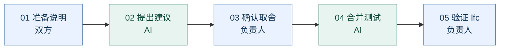

# AI 协作合并：简单版

**双方讲清楚要保留什么，AI 提建议，人定取舍，AI 合并测试，在 lfc 交付验证。当前禁止写入 main，见根目录 AGENTS.md。**

## 怎么做

1. **双方准备说明**：直接用现有架构图和模块文档，说明做了什么、接口怎么用、哪些功能必须保留。
2. **AI 先列问题**：对比最新 main 和待合分支的代码与文档，列出“哪里冲突、双方想做什么、建议怎么合、会影响什么”。没有文字冲突但接口不兼容的，也要指出。
3. **负责人定取舍**：双方确认关键问题，不需要逐行审代码；AI 不确定的地方交给人决定。
4. **AI 合并并测试**：在独立集成分支操作，保留双方功能，检查接口、构建和主要业务流程。
5. **交付 lfc 让同事验证**：看最终效果和测试结果；期间 main 有更新，就重新检查新增影响并验证。暂不合回 main。

## 流程图

测试通过后再确认合入。未通过就修复重测；涉及新的取舍，再由负责人确认。

**记住一点：架构图没被破坏只是第一步，还要确认接口能接上、原有功能没丢。**

本项目实际分支名是 `lfc`。合并前先确认 main 之前回退 RAG 的原因，以及这次要恢复哪些内容；不要让 AI 直接整包选某一边。

参考：[GitHub 官方 AI 处理合并冲突流程](https://docs.github.com/copilot/how-tos/use-copilot-agents/coding-agent/make-changes-to-an-existing-pr)。实际结果见 [合并验证记录](main合入lfc验证记录.md)。
