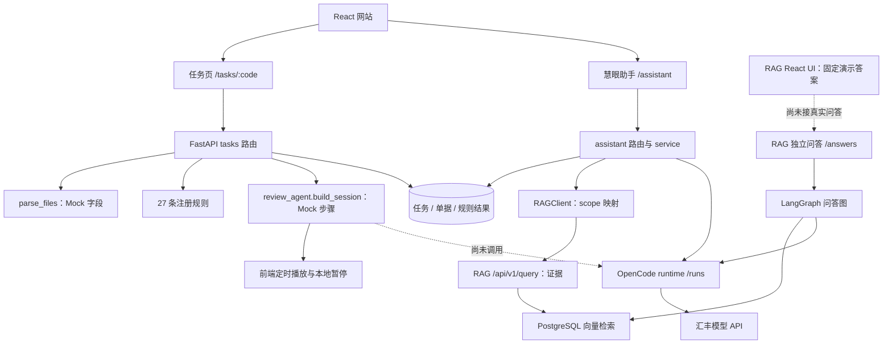
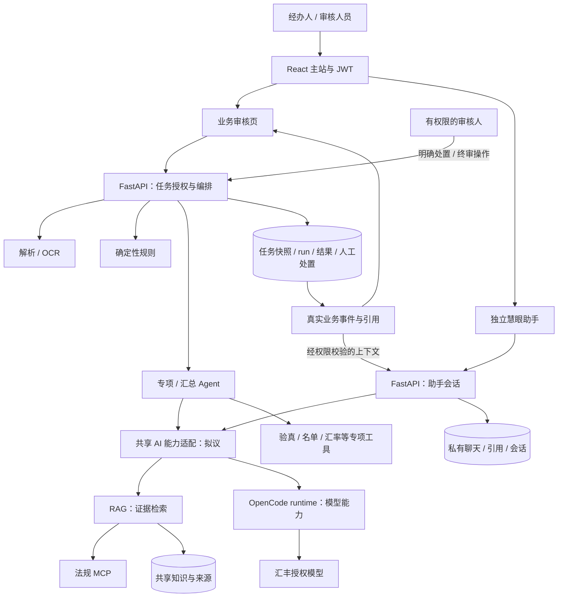

# 全组接线总览：业务审核、慧眼助手、RAG 与 SDK

版本：接线草案 v0.1 · 2026-10-22。源码基线 `f722291` 加研究开始时工作区；这是源码审查与实施设计，不是新一轮线上验收。目标接口均明确标为“拟议”，未在本研究中实现。原有模块分工沿用 [TEAM_MASTER](../../TEAM_MASTER.md)。

**收尾增量说明：** 研究期间其他会话正在实现助手成员/专家/运行/事件，以及 RAG 查询规划、融合和 `/retrievals`。下文“当前实际接线”保留已核查的稳定基线；新增源码和挂接情况已补记在[详细接口第1节](接口与时序.md)，不将并行开发描述为不存在，也不把尚未联合验收的内容宣布上线。实施优先复用这些成果，不另起重复的助手run或检索图。

**共同目标：同一笔任务，规则结果、专项证据、助手解释能相互定位；经办人能补件，审核人能复核，过程可追溯。** 不以“每人完成自己的页面”为完成标准，以跨模块闭环为标准。

全组先看本文；开发看[详细接口与时序](接口与时序.md)；领任务看[分工与验收](分工与验收.md)；界面讨论打开[目标界面原型](../../mockup/mockup_integration_workbench.html)。原型只有脱敏示例，无联网、真实聊天或审批功能。

不支持 Mermaid 的阅读器可直接打开[五张架构与时序图图览](图览.html)；图览使用仓库内已渲染的 SVG，无需联网。修改 `.mmd` 后应同步重新渲染 SVG。

## 1. 一分钟讲清楚

| 部分 | 做什么 | 不拥有的职责 | 负责人 |
|---|---|---|---|
| 网站与业务 workflow | 创建任务、授权、调用解析/规则/专项、汇总、补件和人工终审；保存唯一业务状态 | 不把页面动画当实际执行，不把模型文字当审批指令 | 罗检 |
| 解析与 OCR | 将原件变成字段、全文及位置证据；提供识别质量信息 | OCR 文本不等于字段提取已完成；不直接决定通过 | 陈子业＋肖瑶 |
| 规则引擎 | 金额、币种、日期等确定性核对；明确哪些项须专项处理 | 不靠 LLM 改写数值计算 | 罗检 |
| 专项与汇总 Agent | 针对移交项调用外部核验/知识证据，产生结构化建议与未决项，汇总风险 | 不接管用户登录、任务状态和最终审批 | 诸葛＋吴杨 |
| RAG | 管理共享知识、检索证据、定位原文；接法规 MCP | 不负责贷款任务状态，不默认收全体任务单据 | 刘范聪 |
| 共享 AI 能力＋SDK | 在已授权的证据和工具范围内，提供解释/研判/生成能力 | 不让浏览器或外部 Agent 直接取得模型密钥、runtime 会话或数据库 | 刘范聪 |
| 独立慧眼助手 | 审核人员主动提问、选择任务、看引用与建议 | 聊天记录不是审核决定，不自动改规则和任务 | 刘范聪；主站入口与权限由罗检协作 |
| 部署与集成验收 | 各服务环境、反向代理、密钥、版本、回滚与上线检查 | 不覆盖同学现有运行进程；资源不足需单独决策 | 陈子业＋肖瑶；各模块提供运行说明 |

**审核 workflow 和独立助手是两个业务入口，共用 RAG、模型 runtime 和证据规范，不共用一份聊天状态，更不共用审批权限。** “SDK 服务给主流程用”的交付物是受控 AI 能力调用契约，而不是一个聊天页面或把 session ID 发给其他 Agent。

## 2. 当前实际接线

图源：[integration-current.mmd](../diagrams/integration-current.mmd)。实线代表源码中存在调用；不代表 ECS 上版本、配置和网络已经验收。

核查得到的几个关键事实：

1. `TaskObjectView` 的“智能审核”和 `AssistantView` 的“慧眼助手”是两个实现。前者 `/ai/start` 返回整包 `thoughts`，前端 `sleep` 播放，当前没有实时专项模型核验。并行新增的助手聊天run不能直接当作这条业务审核run。
2. 慧眼助手经主后端 `_rag_search → RAGClient → /api/v1/query` 获取证据，再调用 `/runs` 生成答复。`agentic=True` 在现适配层被丢弃；**助手当前没有调用 RAG 的 LangGraph 问答图**。
3. RAG 独立 `/answers`、`/answers/stream` 才会走 LangGraph 和 SDK；RAG React UI 的 `ask` 仍使用固定答案。后端验收不能替代 UI 接线验收。
4. 主站适配器的 `knowledge_base` 映射为 `business_rules + project_design`。`law`、`task_documents` 未开放。北大法宝本机直调实测成功不等于 RAG、主站或 ECS 已接入。
5. OpenCode runtime 只开放本轮 `read_authorized_evidence` 工具，工具读的是调用方预先传入的证据，不会自主去 RAG 查库。正文目前完整生成后由主后端切片显示，不是模型 token 实时流。
6. 原文访问、任务 ACL、补件版本、人工处置与并发控制还需一起补齐；不要直接把当前 `/uploads` 静态挂载与本机 RAG UI 会话签发暴露为公网多用户入口。

## 3. 目标接线：两条入口，一个业务状态权威

图源：[integration-target.mmd](../diagrams/integration-target.mmd)。这是目标，不是已部署图。独立 RAG 工作台仍可维护语料和调试问答，生产主站通过自己的授权网关使用它。

### 两条业务链分别如何跑

**业务审核链**：上传原件 → 解析＋人工复核字段 → 保存任务快照 → 规则核对 → 移交专项项 → 专项工具与 RAG 取证 → SDK 结构化研判 → 汇总建议 → 审核人处置／退回补件／确认完成。任务状态由主后端维护；Agent 只返回结果，不执行 `/complete`。

**独立助手链**：登录 → 新建私有会话并可关联任务 → 服务端验证权限并加载当前快照 → 选择授权知识范围 → RAG 取证 → SDK 生成解释 → 保存消息与引用。助手的“建议去补件”是文字；只有审核人到任务页确认才走业务命令。后续“生成补件草稿”也须是草稿能力，不能悄悄提交。

**审核页内求助**：对某条异常点击“解释并查依据”，导航至带 `task_code` 的助手；拟议增补 `rule_id`、`review_run_id` 上下文，后端重新核验。首版只传已有 `task_code` 即可，附带问题由用户确认发送，不把 URL 参数当已授权证据。

### RAG 与 SDK 谁生成最终回答

接线 v0.1 采用“RAG 返回证据，调用入口的编排层生成最终内容”：助手生成对话答复，专项 Agent 生成结构化专项建议，汇总 Agent 整理已有结果。它们共享 runtime。RAG 独立 `/answers` 保留给知识工作台，不让助手把其最终答案再当原文证据生成一遍。

未来 Agentic 检索优化在 RAG 内完成问题扩展、混合召回、重排与证据覆盖判断；拟议新增“只返回证据的增强检索”契约，与现 `/query`、`/answers` 区分。RAG 可以为检索判断使用 SDK，但 SDK 不反向再调用这条 RAG 编排链，避免递归。具体优化仍遵循 [Agentic RAG 优化规划](../Agentic-RAG优化规划.md)，不把当前机器配置当目标上限。

## 4. 页面怎么体现

| 页面 | 展示内容 | 触发接口 / 动作 | 不能混淆 |
|---|---|---|---|
| 发起审核 | 原件、识别字段、低置信度项、原文框 | `/tasks/parse` → 人工复核 → 创建任务 | OCR 结果与人工修订分开留痕 |
| 任务审核 | 规则结果、专项结果、待处置项、真实执行状态 | 当前 `/run`；目标 review-run API | `完成运行` 不等于 `任务审批完成` |
| 异常详情 | 本案事实、规则依据、外部核验、未决项 | 看原件、解释并查依据、审核人处置 | 没有核验就不能显示“外部核验通过” |
| 慧眼助手 | 当前任务／版本、私有历史、问答、证据、缺失来源提示 | `/api/assistant/*` | 聊天不修改审批状态 |
| 知识工作台 | 上传与真实入库阶段、语料版本、来源、检索/问答调试 | RAG ingestion/status/query/answers | 管理入口须有主站授权，不能把服务 Token 发浏览器 |
| 管理诊断 | 服务配置、数据库就绪、MCP/tool 状态、trace ID | 主后端受控诊断聚合（拟议） | 业务人员界面不显示 Token、内部 prompt 或模型思维链 |

本轮[界面原型](../../mockup/mockup_integration_workbench.html)表达上述交互位置与模块归属，不替换现有 React 页面；实施时沿用 React、Ant Design 5/X 与现有 hooks/API 层。

## 5. 全组先完成哪一条闭环

**首个联合演示场景**：脱敏支付指令金额异常 → 确定性规则给出差异 → 审核人从异常项进入慧眼助手查操作依据 → 打开真实知识原文 → 保留异常并退回补件 → 经办人更正 → 新版本重新核对 → 审核人终审。金额差异由代码计算，AI 解释不得改数。

专项能力另外用“法规依据核查”证明真实取证、结构化建议与人工确认；提单验真、名单等接口未接入时明确“未核验/待人工”，不能用同一个 LLM 假扮外部核验。

实施分两步：先用现有 API 接通任务→助手→RAG 证据，补齐告警与引用；再实现持久化 review-run、快照与专项结构化调用。多人聊天、历史经验库和完整 RAG 质量升级按各自规划推进，不作为首条闭环的前置阻塞。

## 6. 决策与待确认

本轮给出推荐草案，可据此开工文档/契约/测试样例；不代表成员已接受新增排期。分工沿用主档，具体负责人内部拆分为建议。

| 决策 | 推荐 | 需要确认的人 |
|---|---|---|
| workflow 指什么 | 当前是 tasks 路由＋规则＋专项＋人工状态机；仓库没看到独立外部 workflow 引擎接入，不假定另有一套平台 | 罗检＋诸葛／吴杨 |
| 业务状态权威 | 主后端；规则原判、AI 建议和人工处置分开留存 | 罗检 |
| SDK 对业务交付 | 私网 runtime＋主后端 AI 能力适配，供专项模块内部调用；不开放聊天写库绕行 | 刘范聪＋诸葛／吴杨 |
| 专项组内拆分 | 吴杨建议主导专项工具/适配，诸葛建议主导汇总/证据解释/答辩；仍由两人确认 | 诸葛＋吴杨 |
| OCR/部署组内拆分 | 肖瑶建议主导解析证据契约，陈子业建议主导服务部署；仍由两人确认 | 陈子业＋肖瑶 |
| 联调身份 | 用户 JWT 与服务凭证分离；主后端根据持久任务授权生成上下文 | 罗检＋各服务负责人 |
| 资源与质量 | 先用金标题与业务验收定义目标，新增 reranker/算力/授权形成独立资源决策 | 刘范聪＋部署组＋业务评审 |

审查记录与任务逐项定义见[分工与验收](分工与验收.md)。本轮没有启动新的模型请求、修改线上服务、提交或推送代码。
