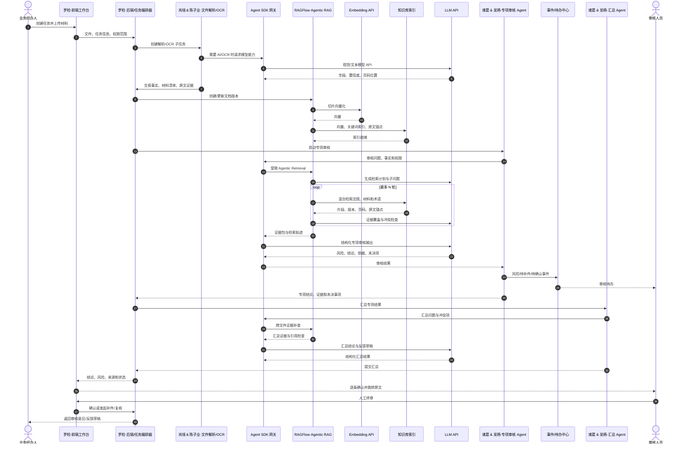
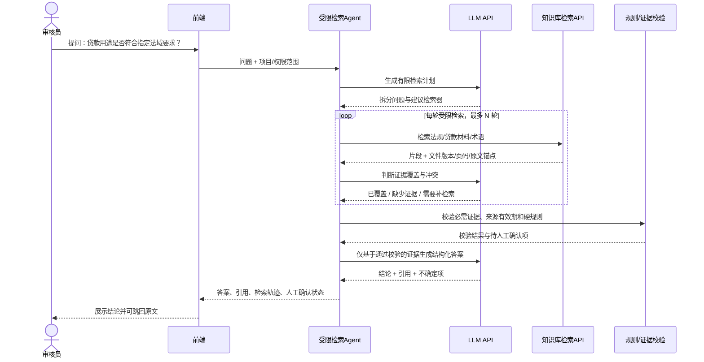
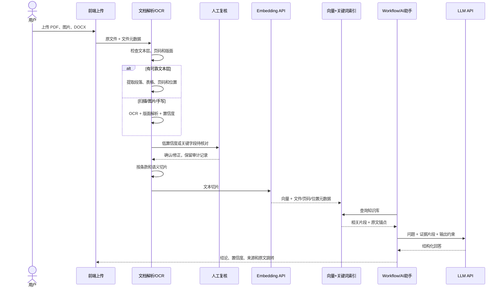
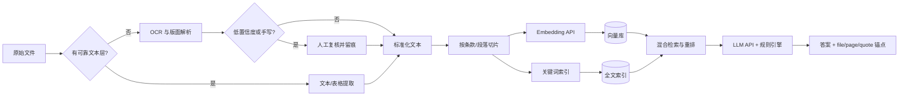

# RAG 模块技术方案

> 项目：智汇跨境贷途·慧眼识险无忧  
> 用途：竞赛 Demo 的法律、贷款和跨境业务资料检索  
> 状态：选型结论与 MVP 边界

## 1. 结论先行

### 1.1 当前电脑能不能用

可以用于开发和小规模 Demo，前提是 embedding、LLM 和重型 OCR 通过 API 或云端服务调用。

本机已核实：

| 项目 | 当前配置 | 判断 |
| --- | --- | --- |
| CPU | Intel i5-8250U，4 核 8 线程 | 可运行前端、轻量后端和小批量解析 |
| 内存 | 16 GB | 可做单人开发；同时运行多个 Docker 服务会紧张 |
| GPU | NVIDIA MX110，2 GB | 不适合本地运行大型 LLM 或大型 embedding |
| 模型 | embedding / LLM 使用 API | 可行，推理主要在服务端完成 |

本机仍需承担文件上传、任务队列、解析/OCR 客户端、向量数据库和前端服务。建议先用少量脱敏材料验证；正式演示时可将 OCR、向量库或整套 RAG 服务部署到已有 ECS/云资源。

### 1.2 直接拉取成熟项目是否能跑

能跑通基础链路，但不是“只填两个 API Key 就完成”。还需要配置：

- Docker/数据库/对象存储或本地文件存储；
- embedding 的协议、模型名、向量维度和批量限制；
- LLM 的协议、上下文长度和结构化输出格式；
- OCR/版面解析服务及失败重试；
- 前端上传、索引状态、搜索结果引用和 workflow 调用接口；
- API Key、敏感材料和数据出境边界。

要区分“平台已经提供并验证过的通用功能”和“针对你们环境验证通过”。Dify、RAGFlow 等带有默认数据库、索引和流程模板；它们不会预先知道你们的 embedding API 协议、向量维度、API 限额、ECS 配置、扫描件质量或材料出境规则。更准确的预期是：**部署成熟平台 + 配置受支持的模型和存储 + 用本项目样例验收**，而不是把某个仓库拉下来就保证适配。

若你们的 embedding API 兼容平台支持的协议，且维度/批处理参数一致，通常可通过模型配置接入；若协议不兼容，就需要一个 API 适配层。无论如何，换 embedding 模型通常意味着重建对应向量索引。项目定型前还要检查候选产品的许可证、镜像来源、版本固定和安全更新策略。

## 2. 推荐选型

| 候选 | 定位 | 适合本项目的部分 | 结论 |
| --- | --- | --- | --- |
| [RAGFlow](https://github.com/infiniflow/ragflow) | 可部署的文档解析、RAG 和 Agentic Retrieval 平台 | 扫描 PDF、版面、复杂文档、多步检索 | **MVP 首选** |
| [Dify](https://github.com/langgenius/dify) | 可部署的 AI 应用、知识库和 Workflow 平台 | Agent/Workflow/API、模型配置 | **备选；强调前端集成时优先评估** |
| [FastGPT](https://github.com/labring/FastGPT) | 知识库和 Workflow 应用 | 中文界面和快速 Demo | 可做对照验证，先核对许可证 |
| [Microsoft GraphRAG](https://github.com/microsoft/graphrag) | GraphRAG 索引与查询库 | 实体、关系和全局总结 | 不是开箱即用的产品，不作为第一版底座 |
| [LlamaIndex](https://github.com/run-llama/llama_index) / [LangGraph](https://github.com/langchain-ai/langgraph) | Python 组件/Agent 编排框架 | 后续自定义检索和 Agent 流程 | 需要自己做较多集成，不作为最快 Demo 路线 |

截至 2026-10-18，上述仓库均有近期提交；GitHub 热度只能证明社区规模，不能替代对真实样例的解析和检索验收。

### 2.1 Agentic RAG 直接部署候选评分

评分是针对本项目的工程评估，不是官方 benchmark。权重重点放在扫描/复杂文档、Agentic 检索、外部模型 API、部署负担和现有工作台集成。

| 排名 | 项目 | 总分 | 适配判断 | 部署复杂度 |
| ---: | --- | ---: | --- | --- |
| 1 | [RAGFlow](https://github.com/infiniflow/ragflow) | **92/100** | 文档解析、Agentic Retrieval、混合检索和引用最贴近本项目 | 中等；Docker，建议 ECS |
| 2 | [Dify](https://github.com/langgenius/dify) | **88/100** | Agent/Workflow/API 最成熟，适合快速接入现有前端 | 中等；组件较多 |
| 3 | [FastGPT](https://github.com/labring/FastGPT) | **84/100** | 中文 Workflow 和知识库体验好，适合竞赛 Demo | 中等；先核对版本与许可证 |
| 4 | [AnythingLLM](https://github.com/Mintplex-Labs/anything-llm) | **78/100** | 安装简单、Agent 和 API 齐全，但复杂文档解析能力不是首要强项 | 较低到中等 |

**推荐定案：先用 RAGFlow。**原因是它的官方仓库直接声明了 Agentic Retrieval、多步检索、证据验证、可配置 LLM/embedding、文档理解和 HTTP API；Docker 推荐起步配置正好是 4 CPU、16 GB RAM、50 GB 磁盘，与当前电脑的 CPU/内存规格相符。当前电脑可以做小规模验证，但 Windows Docker、OCR 并发和磁盘会带来压力，正式演示更适合放到已有 ECS。

**Dify 是第二选择。**如果首要目标变成“最快做出可调用的 Agent Workflow 和前端 API”，或者 RAGFlow 对你们的模型 API 适配不顺，就改用 Dify。Dify 官方仓库明确支持 Agentic workflows、RAG、Docker Compose 和 OpenAI API 兼容模型；它的通用文档解析质量仍需用汇丰扫描样例实测。

GraphRAG 和 LangGraph 不排入“直接部署候选”：前者是图索引/查询系统，后者是 Agent 编排框架，均需要额外应用、权限、API 和评测集成；采用它们会重新引入本项目明确要避免的手搓工作。

### 2.2 评分依据

| 维度 | 权重 | RAGFlow | Dify | FastGPT | AnythingLLM |
| --- | ---: | ---: | ---: | ---: | ---: |
| 扫描/复杂文档与版面解析 | 25 | 25 | 17 | 18 | 14 |
| Agentic 检索/Workflow | 25 | 23 | 24 | 22 | 20 |
| 外部 embedding/LLM API | 20 | 18 | 19 | 17 | 18 |
| API 与现有前端集成 | 15 | 13 | 15 | 13 | 12 |
| 本机/ECS 部署负担 | 10 | 8 | 8 | 8 | 9 |
| 许可证与可审计性 | 5 | 5 | 5 | 4 | 3 |
| **总分** | **100** | **92** | **88** | **84** | **78** |

分数不代表无需验收。特别是手写识别、中文/英文混排、表格还原和法律条款页码定位，必须用项目样例验证。

### 2.3 RAGFlow 部署工作量

按官方 Docker 路线，部署顺序是：固定一个 release tag，准备 Docker/Docker Compose，配置模型与 embedding，启动依赖服务，导入文档，创建 dataset，等待解析和索引完成，再通过 HTTP API 接入现有工作台。RAGFlow 的默认文档解析可在 CPU 上运行，但扫描件和表格解析会消耗 CPU；本机适合低并发测试，ECS 适合稳定演示。

你们不需要自己实现切块、向量库、Agent 循环或检索 API；需要做的是配置和验收，以及把现有前端的上传/搜索按钮接到 RAGFlow API。若模型 API 不是平台支持的协议，增加一个很薄的 OpenAI-compatible 适配服务即可，不重写 RAG 引擎。

### 2.4 需要由项目方提供的信息

以下信息由项目方提供，不能凭空推断：

1. **Embedding API**：`base_url`、模型名、维度、鉴权方式、单次批量上限、是否兼容 OpenAI Embeddings API。
2. **LLM API**：`base_url`、模型名、鉴权方式、上下文长度、是否支持 tool calling/结构化输出、是否支持视觉输入。
3. **OCR 方案边界**：先使用 RAGFlow CPU 文档解析，还是提供独立 OCR API；手写材料是否允许发送到外部服务。
4. **部署位置**：本机验证还是已有 ECS；若用 ECS，需要可用磁盘、CPU/内存、操作系统、开放端口和 HTTPS/域名方式。
5. **测试材料**：脱敏文本 PDF、扫描 PDF、图片、表格和至少一份手写样例，以及 10 个左右带期望来源页码的问题。
6. **合规边界**：哪些材料可以上传到外部 embedding/LLM/OCR API，哪些只能留在境内或私有环境。

API Key 和密码只通过环境变量或部署平台密钥管理注入，不写入 Markdown、Git 或聊天记录。

### 2.5 可以由部署 Agent 完成的工作

在项目方提供上述参数并授权部署后，部署 Agent 可以完成：固定版本、检查 Docker、写本地 `.env` 模板、启动 RAGFlow、配置模型、创建知识库、导入测试材料、接通 API、跑检索验收和记录结果。涉及真实客户材料、外部数据上传、付费资源或受保护凭据时，仍需项目方明确授权。

## 3. RAG 版本选择

## 3.1 与汇丰现有业务工作流的集成

本图以现有业务基线为准：[loan-review-sequence.mmd](../汇丰竞赛8组共享文件夹/01_汇丰业务文件/业务时序图/loan-review-sequence.mmd)。原图中的“审核任务编排器、文件解析 Agent、专项审核 Agent、事件/待办中心、汇总 Agent”保留不变；RAG 作为这些 Agent 共用的证据检索层，Agent SDK 作为底层模型和工具调用的统一封装边界。

### 当前方案分工映射

以下是本次讨论确定的模块分工，按 Master 中的正式姓名记录。它覆盖并细化 Master 中的原始岗位，不等同于 Master 的初始岗位分工。

| 系统角色 | 负责同学 | 与 RAG 的交互 |
| --- | --- | --- |
| 前端工作台、后端/任务编排器 | 罗检 | 上传材料、显示索引状态、调用 RAG/Agent API、提交人工确认 |
| 文件解析/OCR | 肖瑶、陈子业 | 识别文本层和扫描件，保留页码/坐标，将标准化内容交给 RAGFlow 入库 |
| 专项审核 Agent | 诸葛、吴杨 | 通过 Agent SDK 调用 Agentic Retrieval，完成法规、用途、主体和风险核查 |
| 汇总 Agent | 诸葛、吴杨 | 汇总专项结果，调用 RAG 做跨文件证据补查和引用完整性检查 |
| 审核人员 | 业务审核岗 | 处理待办，逐条采纳/驳回/存疑，完成最终确认 |

完整集成版时序图源码：[RAG-汇丰业务集成时序图.mmd](RAG-汇丰业务集成时序图.mmd)。在 VS Code 安装 Mermaid 预览扩展后可直接打开；本文件中的图也可在 GitHub Markdown 中渲染。



图中的关键边界：文件解析负责把材料变成带原文位置的证据；RAGFlow 负责索引和 Agentic Retrieval；Agent SDK 负责模型/工具调用封装；审核 Agent 负责业务判断；事件中心负责把不确定项交给人；审核人员拥有最终确认权。

### MVP：混合检索 RAG

第一版采用：

1. 文本检索 + 向量检索（Hybrid Search）；
2. 可选 reranker；
3. 返回文件名、版本、页码、段落和原文位置；
4. LLM 只能基于检索片段回答，证据不足时输出“证据不足”；
5. 法规和贷款硬规则由规则引擎兜底。

这条路线已经能体现竞赛需要的“可追溯、可解释、可复核”，实现风险最低。

### Agentic RAG：推荐作为受控的 P1 能力

Agentic RAG 可以让系统拆解问题、选择检索器、改写查询、检查证据并再次检索。它适合“跨多个法域、多个文件反复核对”的问题，但会增加延迟、调用次数和不可预测性。

建议采用“混合检索为底座 + 受限 Agent 编排复杂问题”，而不是只做纯 Agentic RAG。日常简单查询直接检索，只有需要跨材料核对的问题才进入 Agent 多步流程。限定工具集合、最大检索轮数、超时和预算，并保留每一步检索日志。不要让 Agent 直接修改审核结论。



图中 Agent 不直接读写数据库，也不自行决定贷款结论；它调用知识库检索 API，并把证据交给规则校验和人工审核。

### GraphRAG：暂不作为默认主链路

GraphRAG 适合回答“哪些主体、法规、担保、交易和国家之间有什么关系”以及跨文档全局总结。它需要实体/关系抽取、图构建、图存储和额外评测；法律条款的精确页码引用仍要回到原文检索。

适合的演示方式是：在基础 RAG 之上，抽取少量实体和关系，做一个“主体—贷款用途—法规—风险”的关系视图。不要为了追求新名词，把整套系统一开始就改成 GraphRAG。

## 4. 文件入库流程

扫描 PDF、图片和手写材料不能直接当作普通文本切片。应先判断是否有可靠文本层：有则提取，无则对页面做 OCR/版面解析。手写和关键金额、日期、比例、条款必须保留原图并进入人工复核队列。





## 5. 证据数据结构

每个切片至少保存以下元数据，不能只保存一段无来源的字符串：

```json
{
  "document_id": "doc_001",
  "document_version": "2026-10-18T12:00:00Z",
  "source_file": "facility_letter.pdf",
  "page": 4,
  "section": "贷款用途",
  "text": "...",
  "bbox": [72, 180, 520, 260],
  "ocr_confidence": 0.96,
  "review_status": "verified"
}
```

原文件、OCR 结果和切片应分层保存。更新文件时生成新版本，不覆盖旧版本；法规回答必须显示来源版本和生效日期。

## 6. 竞赛实施顺序

1. **MVP**：先部署 RAGFlow，配置自有 embedding/LLM API，完成上传、解析、混合检索、Agentic Retrieval、引用和 API。若优先级转为快速编排业务 Workflow/嵌入现有前端，或 RAGFlow 模型适配不顺，再评估 Dify。
2. **质量关**：用 10–20 份脱敏样例评测文本层 PDF、扫描 PDF、中英混排、表格和少量手写材料；记录 OCR 错误、Top-k 命中和引用准确性。
3. **加分项**：加入受限 Agentic RAG，展示查询拆分、证据检查和检索日志。
4. **图谱演示**：只对核心实体和法规关系建小图，用于关系视图；底层答案仍由带原文锚点的检索提供。

## 7. 风险边界

- 未经确认的真实客户资料、API Key、数据库密码不得进入 GitHub 或公开 Markdown。
- 外部 OCR、embedding、LLM API 是否允许接收跨境贷款材料，必须先确认数据出境和隐私要求。
- OCR 结果不是法律事实；低置信度、手写、金额、日期和否定词必须可复核。
- RAG/Agent 输出是审核辅助，不是授信、放款或法律意见。

## 8. 参考资料

- [Dify](https://github.com/langgenius/dify)
- [Dify 自托管部署](https://docs.dify.ai/getting-started/install-self-hosted)
- [RAGFlow](https://github.com/infiniflow/ragflow)
- [RAGFlow Docker 部署指南](https://ragflow.io/docs/dev/deploy_local)
- [RAGFlow HTTP API 参考](https://ragflow.io/docs/dev/http_api_reference)
- [FastGPT](https://github.com/labring/FastGPT)
- [FastGPT Docker 部署](https://doc.fastgpt.io/docs/self-host/deploy/docker)
- [AnythingLLM Docker 部署](https://github.com/Mintplex-Labs/anything-llm/blob/master/docker/HOW_TO_USE_DOCKER.md)
- [Microsoft GraphRAG](https://github.com/microsoft/graphrag)
- [PaddleOCR 文档](https://www.paddleocr.ai/main/en/index.html)
- [MinerU](https://github.com/opendatalab/MinerU)
- [LlamaIndex](https://github.com/run-llama/llama_index)
- [LangGraph](https://github.com/langchain-ai/langgraph)
