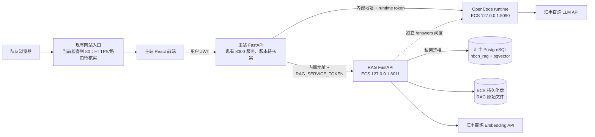

# 本机 RAG 与慧眼助手迁移到汇丰 ECS 实施方案

> **状态：部署规划，尚未执行。** 目的：把目前在个人电脑运行的 RAG 后端和 OpenCode runtime 搬到团队 Linux ECS，让队友通过现有业务网站访问；不覆盖同学已经运行的主站服务，不开放数据库或内部服务公网端口。
>
> 模块现状分别见 [RAG 总览](../code/rag-service/README.md)、[RAG 验收报告](RAG后端验收与运行.md) 和 [慧眼助手总规划](ai-assistant/README.md)。

## 一页现状

| 项目 | 已知情况 | 迁移影响 |
|---|---|---|
| 当前 RAG | 本机 `127.0.0.1:8011`；真实 PostgreSQL/pgvector 入库和带引用问答已验收 | ECS 上要新建独立服务，当前 RAG 不能被其他电脑直接访问 |
| OpenCode runtime | 当前本机 `8090`，RAG 和助手会调用 | 需与 RAG 一起迁到 ECS，或另行提供稳定、受控的服务地址 |
| ECS | 2026-10-21 的只读核验显示为 Linux，约 2 vCPU / 8 GiB、Python 3 可用、未发现 Docker | 可承载轻量 FastAPI 服务；不按重型 RAGFlow Docker 方案部署 |
| ECS 已有主站 | 上次只读检查看到 `/home/frontend` 与 `/home/backend` 有运行进程，分别涉及公网 `80` 和 `8000`；此状态部署前必须重新核实 | 先盘点启动方式、版本、端口、负责人和回滚方法；不直接覆盖或停止 |
| 数据库 | 汇丰 PostgreSQL/pgvector 在私网；当前笔记本通过 SSH 到 ECS 再访问数据库 | 在 ECS 上优先验证同 VPC 私网直连；不开放 RDS 公网访问 |
| 缺口 | ECS 上尚无本次 RAG 版本和 runtime；原始文件仍在本机；RAG 工作台为静态演示 | 需要部署服务、迁移原件并做跨电脑端到端验收 |

## 目标架构



所有模型调用由服务端发起。浏览器只访问主站入口，不持有 RAG service token、runtime token 或模型密钥。`8000 / 8011 / 8090 / 5432` 不应直接暴露公网；RAG 和 runtime 只监听回环或私网地址。现有网站入口的实际代理方式尚未核实，不能在确认前把已运行的 `80` 端口改交给另一套服务。

## 推荐部署顺序

1. **先盘点并备份 ECS。** 用阿里云 Workbench 或 SSH 查看系统版本、现有进程与启动方式、监听端口、磁盘余量、主站代码版本和日志。让现有部署负责人确认维护窗口；备份主站配置、RAG PostgreSQL schema 和本机原始文件。当前已有网站进程不得直接杀掉或原地覆盖。
2. **先确定网络与密钥。** 在 ECS 上验证 PostgreSQL 私网地址和账号权限；确认是否可从 ECS 直连 RDS。不要把笔记本到 ECS 的 SSH 隧道照搬成 ECS 自己连自己的隧道。RDS 不开放公网；当前报告指出 RDS 不支持数据库 TLS，正式运行前要让资源管理员确认安全策略。按 Team Master 的 P0 行动先轮换历史上暴露过的凭证，再把新凭证放入受限权限的服务端环境文件，不写入 Git 或文档。
3. **以独立发布目录安装 RAG。** 建议放在 `/opt/hbcn/releases/<版本>/rag-service`，原件放在独立持久目录（如 `/var/lib/hbcn/rag/originals`），并保留一份旧版本用于回滚。安装项目依赖，使用单 worker 的 Uvicorn 服务绑定 `127.0.0.1:8011`，由专用非 root 用户和 `systemd` 管理；不要复用 Windows PowerShell 启动脚本作为 Linux 服务管理方式。
4. **迁移原始文件并核验。** 数据库记录和向量仍在汇丰 RDS；把本机 `data/originals/{UUID}/original` 安全复制到 ECS 持久目录，保留 UUID 目录结构。生成文件清单并逐个核对 SHA-256，再测试引用链接、全文片段和原件下载。不要把 `.env`、SSH 私钥或资源文件一起复制进代码目录。
5. **部署 OpenCode runtime。** 在独立版本目录按锁文件安装 Bun 依赖，作为另一项 `systemd` 服务运行并只绑定 `127.0.0.1:8090`。配置汇丰模型地址和授权、runtime token；RAG 与主后端分别通过内部地址和各自 token 调用。不要把模型凭证放进 React 构建产物。
6. **再接主站。** 经主站负责人确认后，在后端运行环境设置 `RAG_BASE_URL=http://127.0.0.1:8011`、`ASSISTANT_RUNTIME_URL=http://127.0.0.1:8090` 及对应服务 token。重启前先确认当前主站如何部署与回滚；前端只调用主站 API，由后端代理 RAG 和 runtime。
7. **最后处理网页入口。** 主站前端目前已占用现有网站入口。先确认是否有 Nginx、Caddy 或其他反向代理，再决定如何挂载助手和 RAG 页面。当前 RAG UI 仍是演示版，接通真实上传、进度、问答和原件阅读后才适合作为业务入口；不要为了打开端口把服务 token 暴露给浏览器。

## ECS 落地操作模板

下面是经过负责人复核后的实施模板，不表示已在 ECS 执行。先只读盘点，确认目录、服务名、端口和回滚人；如果目标路径或服务名已存在，先停下来核对归属，不能覆盖同学的主站。

### 1. 只读盘点

在阿里云 Workbench 或 SSH 中检查系统、磁盘、内存、进程和监听端口：

```bash
cat /etc/os-release
id
df -h
free -h
nproc
sudo ss -lntp
sudo systemctl --type=service --state=running
ps -ef --forest
```

核对现有 `80/8000` 入口对应的服务单元、启动目录、日志和负责人，并确认 `/opt`、`/var/lib` 空间够用。若已有 `hbcn-rag` 或 `hbcn-runtime` 同名服务，先检查配置与进程，不要直接重建。

### 2. 发布代码和准备数据目录

从团队批准的仓库来源部署一个固定 commit 到独立版本目录，例如 `/opt/hbcn/releases/<commit>/`，不要在 `/home/backend` 或当前网站目录原地 `git pull`。每个版本至少包含 `code/rag-service`、`code/assistant-runtime` 和 runtime 的 `.opencode/skills`。验证后再把 `/opt/hbcn/current` 指向该版本，旧版本保留用于回退。

建立专用非 root 用户及独立持久化目录（若用户或目录已经存在，先确认现有属主和用途）：

```bash
sudo useradd --system --home-dir /var/lib/hbcn --shell /usr/sbin/nologin hbcn
sudo install -d -o hbcn -g hbcn -m 0750 /var/lib/hbcn/rag
```

RAG 数据库里的 `documents` 和 `chunks_v1` 已在汇丰 PostgreSQL；如果 ECS 连接到同一数据库，不需要重建向量表。需要从本机搬的是原件 `code/rag-service/data/originals/`，目标为 `/var/lib/hbcn/rag/originals/`。经批准使用 SCP 或 Workbench 文件传输，保留 UUID 目录结构；传输前后生成 SHA-256 清单，确认每份原件一致。不要复制本机 `.env`、SSH 资源文件或本机 SSH 私钥。

### 3. 配置服务端环境

在 `/etc/hbcn/` 放置受限权限的服务配置，密钥通过团队批准的安全渠道写入，不能进 Git。RAG 配置至少包括：

```dotenv
RAG_ENGINE=postgres
SERVICE_TOKEN=<独立的RAG服务令牌>
RAG_DATABASE_RESOURCE_FILE=/etc/hbcn/rag-db.resource
RAG_DATABASE_SCHEMA=hbcn_rag
RAG_VECTOR_TABLE=chunks_v1
RAG_DATA_DIR=/var/lib/hbcn/rag
ASSISTANT_RUNTIME_URL=http://127.0.0.1:8090
ASSISTANT_RUNTIME_TOKEN=<与runtime一致的令牌>
BAILIAN_BASE_URL=<团队批准的模型API地址>
BAILIAN_API_KEY=<服务端模型凭证>
```

`rag-db.resource` 使用受限数据库连接文件，包含 `PGHOST`、`PGPORT`、`PGDATABASE`、`PGUSER`、`PGPASSWORD`。ECS 应直接连 RDS 私网地址，**不要配置本机到 ECS 的 SSH 跳板隧道，也不要开放 RDS 公网**。如 RDS 当前不支持 TLS，`RAG_POSTGRES_SSLMODE=disable` 只有在资源管理员明确确认网络与运行策略后才能设置。`ASSISTANT_RUNTIME_HOST` 必须设为 `127.0.0.1`，因为 runtime 代码默认监听 `0.0.0.0`；主后端和 RAG 仍可在本机回环调用。

RAG 和 runtime 使用独立令牌；主后端环境中的 `RAG_SERVICE_TOKEN` 必须与 RAG 的 `SERVICE_TOKEN` 一致，`ASSISTANT_RUNTIME_TOKEN` 必须与 runtime 一致。环境文件仅授予服务管理者读取，数据库资源文件只授予运行用户所需的最小读取权限；先轮换历史上曾暴露的凭证再部署。

### 4. 安装依赖并以 systemd 管理

在对应 release 目录安装锁定依赖，先验证 Python/Bun 版本和依赖安装结果：

```bash
cd /opt/hbcn/current/code/rag-service
python3 -m venv .venv
.venv/bin/python -m pip install -r requirements.txt
.venv/bin/python -m pip check

cd /opt/hbcn/current/code/assistant-runtime
bun install --frozen-lockfile
bun run typecheck
bun test
```

为两个服务分别建立 `systemd` unit，由 `hbcn` 用户运行。RAG 的启动命令应等价于：

```ini
WorkingDirectory=/opt/hbcn/current/code/rag-service
EnvironmentFile=/etc/hbcn/rag.env
ExecStart=/opt/hbcn/current/code/rag-service/.venv/bin/uvicorn app.main:app --host 127.0.0.1 --port 8011 --workers 1
```

Runtime 的启动命令应等价于：

```ini
WorkingDirectory=/opt/hbcn/current/code/assistant-runtime
EnvironmentFile=/etc/hbcn/runtime.env
Environment=ASSISTANT_RUNTIME_HOST=127.0.0.1
Environment=ASSISTANT_RUNTIME_PORT=8090
ExecStart=<command -v bun 查到的绝对路径> run src/index.ts
```

Unit 中设置 `User=hbcn`、失败自动重启和合理的日志策略；RAG 是单 worker，不能在多个实例间共享启动恢复任务。先启新服务，不重启或改写主站：`systemctl daemon-reload` 后启动 `hbcn-runtime` 和 `hbcn-rag`，分别检查 `systemctl status`、`journalctl`、RAG `/health`、带授权的 `/api/v1/ready` 与 runtime `/healthz`。ready 必须确认数据库、pgvector 和 runtime 实际可连。

### 5. 接入主站并跨机器验收

只有主站负责人确认当前服务管理方式、维护窗口和回滚配置后，才把主后端的 `RAG_BASE_URL` 设为 `http://127.0.0.1:8011`、`ASSISTANT_RUNTIME_URL` 设为 `http://127.0.0.1:8090`，并设置匹配令牌。先核实 ECS 上主后端 commit 已包含 `/api/assistant` 路由和 `RAGClient`、前端构建产物已包含 `/assistant` 页面；若版本落后，按主站正常发布流程更新前后端。由负责人用当前主站对应的方式重启后端；不要猜测 unit 名称，也不要为了助手改动 80/8000 端口。

从另一台电脑走现有 HTTPS/网站入口登录主站，验证助手答复、RAG 引用、任务授权、原文定位、未授权返回 401、重启后原件和向量仍存在。现阶段 React RAG 工作台还未接真实 API；即使后端已迁到 ECS，也只能先通过现有慧眼助手接入已开放的知识范围，不能把静态 RAG UI 宣称为已上线。

## 上线验收与回滚

| 验收项 | 通过标准 |
|---|---|
| 服务存活 | RAG `/health`、`/api/v1/ready` 与 runtime health 均可从 ECS 本机检查；`ready` 实际验证 PostgreSQL/pgvector 和 runtime |
| 访问控制 | 缺少服务 token 返回 401；外网不能直接访问 8000、8011、8090 或 RDS 5432 |
| RAG 数据 | 上传获批的脱敏样例，处理状态到 `ready`；真实查询返回引用；能读取对应原件和原文片段 |
| 助手整链路 | 从另一台电脑打开主站，使用 JWT 登录并通过 `/assistant` 提问；确认助手可调用 RAG 证据和 runtime，引用与任务权限正确 |
| 重启与持久化 | 重启服务后文档、向量、原件和引用仍可读；确认日志轮转与备份恢复方式 |
| 资源 | 连续验收期间记录 CPU、内存、磁盘和接口时延；达到预设并发后再决定是否需要扩容 |

部署失败时，先切回旧版本或恢复旧主站配置，停止新增的 RAG/runtime 服务；保留 PostgreSQL schema 和原始文件，不以删库作为回滚。上线前保存可执行的配置备份、服务定义和恢复步骤。

## 当前阻塞与决策人

- **主站负责人**：确认 ECS 上现有 80/8000 服务的版本、启动管理方式、部署目录及维护窗口。
- **资源管理员**：确认 ECS 到 RDS 的私网连通、TLS/凭证轮换策略和长期访问授权；不得开放 RDS 公网。
- **项目组**：确认域名/HTTPS/反向代理、RAG 原件备份位置、日志保留、演示账号及跨电脑验收样例。
- **RAG/助手负责人**：完成 Linux 服务单元、环境变量、真实 UI 接线和主站到 RAG/runtime 的端到端验收。

在以上确认完成前，这份文档是迁移方案，不代表已经对 ECS 做了变更。轻量 RAG 和 runtime 使用外部模型 API，可先试运行在现有 2C8G ECS 上；并发、OCR 负载、磁盘增长和持续运行稳定性仍需实测。目标优先于现有硬件限制，资源不足时应明确申请或调整部署资源。
